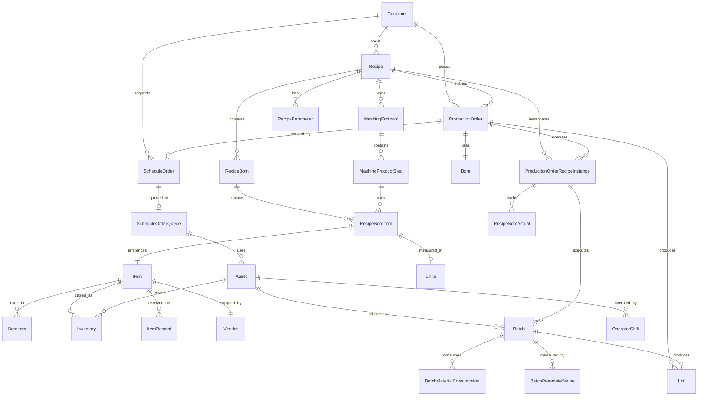

# MES Phase 1 Data Model Documentation

## Overview

The MES Phase 1 data model represents a comprehensive manufacturing execution system designed specifically for whiskey production. The model encompasses 50+ interconnected entities that manage everything from raw material receipt through finished goods production, providing complete traceability and operational control.

## Core Entity Categories

### Production Management
- **ProductionOrder**: Individual production units
- **ScheduleOrder**: Production grouping and scheduling
- **ScheduleOrderQueue**: Queue-based production scheduling
- **Batch**: Production batch tracking
- **Lot**: Material lot management

### Recipe Management  
- **Recipe**: Master recipe definitions
- **RecipeBom**: Recipe bill of materials
- **RecipeBomItem**: Individual BOM components
- **MashingProtocol**: Mashing process definitions
- **MashingProtocolStep**: Individual process steps
- **RecipeParameter**: Recipe-specific parameters

### Inventory & Materials
- **Item**: Master item catalog
- **Inventory**: Current inventory positions
- **InventoryLog**: Inventory transaction history
- **InventoryTransfer**: Material movements
- **ItemReceipt**: Incoming material receipts

### Quality & Testing
- **TestParameter**: Quality test definitions
- **PhaseParameter**: Process parameter definitions
- **EnzymeConfiguration**: Enzyme dosing configuration
- **SystemConfiguration**: System-wide configuration

### Operations & Equipment
- **Asset**: Equipment and location hierarchy
- **Operation**: Production operations
- **EquipmentPhase**: Equipment phase definitions
- **UnitProcedure**: Unit procedure definitions
- **Procedure**: Master procedure definitions

### Master Data
- **Customer**: Customer master data
- **Vendor**: Supplier information
- **Units**: Unit of measure definitions
- **UnitLookup**: Unit conversion tables

### Integration & Messaging
- **MqttMessage**: Equipment integration messages
- **MqttTagMapping**: Tag mapping definitions
- **MessageQueue**: System message queue
- **UnsConfiguration**: UNS configuration

## Entity Relationship Diagram



## Core Production Entities

### ProductionOrder
```prisma
model ProductionOrder {
  id                      String                           @id @default(cuid())
  globalId                String?                          @default(cuid())
  name                    String?                          @unique
  
  // Core specifications
  quantity                Int?
  finalProof              Float?
  containerType           EnumProductionOrderContainerType? @default(LargeBarrel)
  
  // Planning and estimation
  plannedCooks            Int?
  plannedFermenters       Int?
  totalCooks              Int?
  totalFermenters         Int?
  estimatedBarrelsPerFermenter Float?
  estimatedPGsPerBbl      Float?
  estimatedPGsPerBushel   Float?
  totalGrainWeight        Float?
  
  // Execution tracking
  executedCooks           Int?
  executedFermenters      Int?
  completedCooks          Int?
  completedFermenters     Int?
  completedQuantity       Decimal?
  
  // Control limits
  upperControlLimit       Int?
  lowerControlLimit       Int?
  
  // Status management
  status                  EnumProductionOrderStatus?        @default(Initiated)
  complete                Boolean?                          @default(false)
  inProcess               Boolean?                          @default(false)
  scheduled               Boolean?                          @default(false)
  
  // Dates
  startDate               DateTime?                         @default(now())
  endDate                 DateTime?
  
  // Relationships
  customer                Customer                          @relation(fields: [customerId], references: [id])
  customerId              String
  customerCode            String?
  recipe                  Recipe?                           @relation(fields: [recipeId], references: [id])
  recipeId                String?
  bom                     Bom                               @relation(fields: [bomId], references: [id])
  bomId                   String
  item                    Item                              @relation(name: "ItemOnProductionOrders", fields: [fgItemId], references: [id])
  fgItemId                String
  scheduleOrder           ScheduleOrder?                    @relation(fields: [scheduleOrderId], references: [id])
  scheduleOrderId         String?
  units                   Units?                            @relation(fields: [unitsId], references: [id])
  unitsId                 String?
  millingBinConfiguration MillingBinConfiguration?          @relation(fields: [millingBinConfigurationId], references: [id])
  millingBinConfigurationId String?
  
  // Production outputs
  lots                    Lot[]
  containerItem           Item[]                            @relation(name: "containerItem")
  productionOrderRecipeInstances ProductionOrderRecipeInstance[]
  SalesOrder              SalesOrder[]
  
  // Audit
  createdAt               DateTime                          @default(now())
  createdBy               String
  updatedAt               DateTime                          @updatedAt
  updatedBy               String?
  schemaVersion           String?                           @default("0001-alpha")
}
```

### ScheduleOrder
```prisma
model ScheduleOrder {
  id                             String                   @id @default(cuid())
  globalId                       String?                  @unique @default(cuid())
  name                           String?                  @unique
  recipeName                     String
  
  // Timeline management
  estimatedStart                 DateTime?
  estimatedEnd                   DateTime?
  actualStart                    DateTime?
  actualEnd                      DateTime?
  duration                       Float?
  durationUnits                  String?                  @default("Hours")
  
  // Phase timing
  estimatedMashingStartTime      DateTime?
  estimatedMashingDuration       Float?
  estimatedFermentationStartTime DateTime?
  estimatedFermentationDuration  Float?
  estimatedDistillationStartTime DateTime?
  estimatedDistillationDuration  Float?
  estimatedBarrelingStartTime    DateTime?
  estimatedProcessingStartTime   DateTime?
  estimatedTotalProductionDuration Float?
  
  // Production planning
  productionOrderAllocation      Json
  totalBarrels                   Int?
  totalProofGallons              Float?
  
  // Status
  status                         EnumScheduleOrderStatus? @default(Created)
  
  // Relationships
  recipeGroup                    RecipeGroup              @relation(fields: [recipeGroupId], references: [id])
  recipeGroupId                  String
  scheduleOrderRecipe            Recipe?                  @relation(fields: [scheduleOrderRecipeId], references: [id])
  scheduleOrderRecipeId          String?
  customers                      Customer[]
  productionOrders               ProductionOrder[]
  scheduleOrderQueues            ScheduleOrderQueue?      @relation(fields: [scheduleOrderQueueId], references: [id])
  scheduleOrderQueueId           String?                  @unique
  
  // Audit
  createdAt                      DateTime                 @default(now())
  createdBy                      String?
  updatedAt                      DateTime                 @updatedAt
  updatedBy                      String?
  schemaVersion                  String?
}
```

### Recipe
```prisma
model Recipe {
  id                             String                          @id @default(cuid())
  globalId                       String?                         @unique @default(cuid())
  Recipe                         String                          @unique
  whiskeyType                    EnumRecipeWhiskeyType?          @default(RyeBourbon)
  
  // Recipe specifications
  cooksPerFerm                   Int?                            @default(3)
  totalCooks                     Int?
  totalFermenters                Int?
  
  // Status and versioning
  active                         Boolean?                        @default(true)
  isClassDefinition              Boolean?                        @default(true)
  revision                       Int?                            @default(0)
  schemaVersion                  String?                         @default("0001-b")
  
  // Customer relationship
  customer                       Customer                        @relation(fields: [customerId], references: [id])
  customerId                     String
  customerCode                   String?
  
  // Recipe components
  recipeGroup                    RecipeGroup?                    @relation(fields: [recipeGroupId], references: [id])
  recipeGroupId                  String?
  mashingProtocol                MashingProtocol?                @relation(fields: [mashingProtocolId], references: [id])
  mashingProtocolId              String?
  recipeBoms                     RecipeBom[]
  parameters                     RecipeParameter[]
  unitProcedures                 UnitProcedure[]
  
  // Production relationships
  productionOrders               ProductionOrder[]
  scheduleOrders                 ScheduleOrder[]
  productionOrderRecipeInstances ProductionOrderRecipeInstance[]
  lots                           Lot[]
  
  // Inheritance
  classId                        Recipe?                         @relation(name: "RecipeClassIdRecipeInstances", fields: [classIdId], references: [id])
  classIdId                      String?
  instances                      Recipe[]                        @relation(name: "RecipeClassIdRecipeInstances")
  
  // Audit and comments
  createdAt                      DateTime                        @default(now())
  createdBy                      String
  updatedAt                      DateTime                        @updatedAt
  updatedBy                      String?
  comments                       Comment[]
}
```

## Inventory and Material Management

### Item
```prisma
model Item {
  id                        String                     @id @default(cuid())
  globalId                  String?                    @unique @default(cuid())
  itemNumber                String                     @unique
  itemName                  String
  itemDescription           String?
  erpId                     String                     @unique
  
  // Classification
  itemType                  String
  itemClass                 String?
  itemGroup                 String?
  itemRevision              Int?                       @default(0)
  baseBomItem               Boolean?                   @default(false)
  
  // Status
  active                    Boolean?                   @default(true)
  schemaVersion             String?
  
  // Units and vendor
  unit                      Unit?                      @relation(fields: [unitId], references: [id])
  unitId                    String?
  units                     Units?                     @relation(fields: [unitsId], references: [id])
  unitsId                   String?
  vendor                    Vendor?                    @relation(fields: [vendorId], references: [id])
  vendorId                  String?
  
  // Relationships
  inventories               Inventory[]
  inventoryLogs             InventoryLog[]
  inventoryTransfers        InventoryTransfer[]
  itemReceipts              ItemReceipt[]
  bomItems                  BomItem[]
  bomsWipItem               Bom[]
  recipeBoms                RecipeBomItem[]
  lots                      Lot[]                      @relation(name: "ItemOnLots")
  lotContinerItem           Lot?                       @relation(name: "continerItem")
  productionOrders          ProductionOrder[]          @relation(name: "ItemOnProductionOrders")
  productionOrderContainerItems ProductionOrder[]      @relation(name: "containerItem")
  purchaseOrders            PurchaseOrder[]
  salesOrders               SalesOrder[]
  testParameters            TestParameter[]
  additiveActuals           AdditiveActual[]
  batchMaterialConsumptions BatchMaterialConsumption[]
  EnzymeConfiguration       EnzymeConfiguration?
  
  // Audit
  createdAt                 DateTime                   @default(now())
  createdBy                 String
  updatedAt                 DateTime                   @updatedAt
  updatedBy                 String?
}
```

### Inventory
```prisma
model Inventory {
  id               String      @id @default(cuid())
  globalId         String?     @unique @default(cuid())
  
  // Quantities
  currentQuantity  Int?
  originalQuantity Int?
  fifoIndex        Int?        @default(0)
  units            String?     @default("lbs")
  proof            Float?
  
  // Location and item
  asset            Asset       @relation(fields: [assetId], references: [id])
  assetId          String
  item             Item        @relation(fields: [itemId], references: [id])
  itemId           String
  itemReceipt      ItemReceipt? @relation(fields: [itemReceiptId], references: [id])
  itemReceiptId    String?
  
  // Lot tracking
  lotNumber        String?
  customers        Json?
  
  // Status and corrections
  active           Boolean?    @default(true)
  correctedBy      String?
  correctionNote   String?
  
  // Notes and revision
  notes            String?
  revision         Int?        @default(0)
  schemaVersion    String?
  
  // Audit
  createdAt        DateTime    @default(now())
  createdBy        String
  updatedAt        DateTime    @updatedAt
  updatedBy        String?
  
  @@unique([assetId, fifoIndex])
}
```

## Quality and Testing

### TestParameter
```prisma
model TestParameter {
  id                       String                            @id @default(cuid())
  globalId                 String?                           @default(cuid())
  name                     String
  description              String?
  
  // Test configuration
  testSetpointType         EnumTestParameterTestSetpointType?
  testSetpointValue        Float?
  testSetpointUpperLimit   Float?
  testSetpointLowerLimit   Float?
  testSetpointBooleanValue Boolean?
  testParamUnits           String
  testParamRevision        String?
  
  // Test execution
  testResult               Float?
  testPass                 Boolean?                          @default(false)
  testedAt                 DateTime?
  testedBy                 String?
  testDetails              String?
  
  // Status and configuration
  active                   Boolean                           @default(true)
  required                 Boolean?                          @default(true)
  isClassDef               Boolean?                          @default(false)
  tooltip                  String?
  schemaVersion            String?
  
  // Relationships
  classId                  TestParameter?                    @relation(name: "TestParameterClassIdTestParameterInstances", fields: [classIdId], references: [id])
  classIdId                String?
  instances                TestParameter[]                   @relation(name: "TestParameterClassIdTestParameterInstances")
  equipmentPhases          EquipmentPhase[]
  item                     Item[]
  itemGroup                String?
  itemReceipt              ItemReceipt?                      @relation(fields: [itemReceiptId], references: [id])
  itemReceiptId            String?
  purchaseOrder            PurchaseOrder[]
  
  // Audit
  createdAt                DateTime                          @default(now())
  createdBy                String
  updatedAt                DateTime?                         @updatedAt
  updatedBy                String?
}
```

### EnzymeConfiguration
```prisma
model EnzymeConfiguration {
  id               String             @id @default(cuid())
  globalId         String?            @unique @default(cuid())
  
  // Configuration
  category         EnumEnzymeCategory
  dosePerMetricTon Float
  instructions     String
  active           Boolean            @default(true)
  schemaVersion    String?            @default("0001-a")
  
  // Item relationship
  item             Item               @relation(fields: [itemId], references: [id])
  itemId           String             @unique
  
  // Calculation rules
  calculationRules EnzymeCalculationRule[]
  
  // Audit
  createdAt        DateTime           @default(now())
  createdBy        String
  updatedAt        DateTime           @updatedAt
  updatedBy        String?
  
  @@index([category, active])
  @@index([active, createdAt])
  @@map("enzyme_configurations")
}
```

## Equipment and Operations

### Asset
```prisma
model Asset {
  id                       String                    @id @default(cuid())
  globalId                 String?                   @unique @default(cuid())
  name                     String
  description              String
  assetPath                String                    @unique
  assetType                EnumAssetAssetType
  
  // Hierarchy
  parent                   Asset?                    @relation(name: "AssetChildrenAssetParent", fields: [parentId], references: [id])
  parentId                 String?
  children                 Asset[]                   @relation(name: "AssetChildrenAssetParent")
  index                    Int?                      @default(0)
  
  // Status and specifications
  status                   EnumAssetStatus?          @default(InService)
  proofInitial             Float?
  revision                 Int?                      @default(0)
  schemaVersion            String                    @default("0001-alpha")
  
  // Relationships
  inventories              Inventory[]
  inventoryLogs            InventoryLog[]
  inventoryTransfersFrom   InventoryTransfer[]       @relation(name: "fromLocation")
  inventoryTransfersTo     InventoryTransfer[]       @relation(name: "inventoryTransfersTo")
  itemReceipts             ItemReceipt[]
  batches                  Batch[]
  lots                     Lot[]                     @relation(name: "fromAsset")
  lotsFilledFrom           Lot[]                     @relation(name: "filledFrom")
  lotProofingTank          Lot[]                     @relation(name: "lotProofingTank")
  lotTankofOrigin          Lot[]                     @relation(name: "lotTankofOrigin")
  purchaseOrders           PurchaseOrder[]
  operatorShifts           OperatorShift[]
  scheduleOrderQueues      ScheduleOrderQueue[]
  millingBinConfigurations MillingBinConfiguration[]
  
  // Audit
  createdAt                DateTime                  @default(now())
  createdBy                String
  updatedAt                DateTime                  @updatedAt
  updatedBy                String?
  
  @@unique([name, revision])
}
```

### Operation
```prisma
model Operation {
  id                     String            @id @default(cuid())
  globalId               String?           @default(cuid())
  name                   EnumOperationName
  abbreviation           String
  description            String
  
  // Hierarchy and sequencing
  procedureSequenceIndex Int               @default(0)
  path                   String?
  auxiliaryPhases        Json?
  
  // Status and versioning
  active                 Boolean?          @default(true)
  isClassDefinition      Boolean?          @default(false)
  revision               Int?              @default(0)
  schemaVersion          String?           @default("0001-b")
  
  // Relationships
  classId                Operation?        @relation(name: "OperationClassIdOperationInstances", fields: [classIdId], references: [id])
  classIdId              String?
  instances              Operation[]       @relation(name: "OperationClassIdOperationInstances")
  unitProcedure          UnitProcedure?    @relation(fields: [unitProcedureId], references: [id])
  unitProcedureId        String?
  equipmentPhases        EquipmentPhase[]
  RecipeParameter        RecipeParameter[]
  
  // Special lot tracking
  lotId                  String?           @unique
  
  // Audit
  createdAt              DateTime?         @default(now())
  createdBy              String
  updatedAt              DateTime?         @updatedAt
  editedBy               String?
}
```

## Batch and Lot Tracking

### Batch
```prisma
model Batch {
  id                              String                         @id @default(cuid())
  batchId                         String                         @unique
  
  // Hierarchy
  parent                          Batch?                         @relation(name: "BatchChildrenBatchParent", fields: [parentId], references: [id])
  parentId                        String?
  children                        Batch[]                        @relation(name: "BatchChildrenBatchParent")
  
  // Production data
  quantity                        Int?
  batchData                       Json?
  durationSplits                  Json?
  totalDuration                   Int?
  revision                        Int?                           @default(0)
  schemaVersion                   String?
  
  // Relationships
  asset                           Asset?                         @relation(fields: [assetId], references: [id])
  assetId                         String?
  customer                        Customer?                      @relation(fields: [customerId], references: [id])
  customerId                      String?
  lot                             Lot?                           @relation(fields: [lotId], references: [id])
  lotId                           String?
  productionOrderRecipeInstance   ProductionOrderRecipeInstance? @relation(fields: [productionOrderRecipeInstanceId], references: [id])
  productionOrderRecipeInstanceId String?
  
  // Tracking data
  batchMaterialConsumptions       BatchMaterialConsumption[]
  batchParameterValues            BatchParameterValue[]
  batchTimeSeriesDataItems        BatchTimeSeriesData[]
  
  // Audit
  createdAt                       DateTime                       @default(now())
  updatedAt                       DateTime                       @updatedAt
}
```

### Lot
```prisma
model Lot {
  id                          String                     @id @default(cuid())
  globalId                    String?                    @unique @default(cuid())
  lotNumber                   String                     @unique
  externalId                  String?                    @unique
  
  // Production specifications
  whiskeyType                 EnumLotWhiskeyType?
  status                      EnumLotStatus?             @default(Started)
  confirmed                   Boolean?                   @default(false)
  isRawMaterial               Boolean?                   @default(false)
  
  // Volume and weight tracking
  initialVolume               Float?
  finalVolume                 Float?
  initialWeight               Float?
  finalWeight                 Float?
  totalWeight                 Float?
  totalVolumeWg               Float?
  totalWGs                    Float?
  totalPGs                    Float?
  totalPGsByRecipe            Float?
  
  // Barrel and proof data
  bblTotal                    Int?
  bblType                     String?
  bblOem                      String?
  bblEntryProof               Float?
  proofInitial                Float?
  densityFinal                Float?
  
  // Yield and performance metrics
  standardYield               Float?
  pgLosses                    Float?
  avgBblFillByPg              Float?
  avgBblFillByWg              Float?
  avgPGsFerm                  Float?
  grainLbsFerm                Float?
  grainLbsPg                  Float?
  totalFermenters             Float?
  warehouseEntryNumber        Int?
  
  // Relationships
  continerItem                Item?                      @relation(name: "continerItem", fields: [continerItemId], references: [id])
  continerItemId              String?                    @unique
  item                        Item[]                     @relation(name: "ItemOnLots")
  productionOrder             ProductionOrder?           @relation(fields: [productionOrderId], references: [id])
  productionOrderId           String?
  recipe                      Recipe?                    @relation(fields: [recipeId], references: [id])
  recipeId                    String?
  furnishingCustomer          Customer?                  @relation(fields: [furnishingCustomerId], references: [id])
  furnishingCustomerId        String?
  purchaseOrderAcceptedLots   PurchaseOrder?             @relation(fields: [purchaseOrderAcceptedLotsId], references: [id])
  purchaseOrderAcceptedLotsId String?
  
  // Asset relationships
  fromAsset                   Asset?                     @relation(name: "fromAsset", fields: [fromAssetId], references: [id])
  fromAssetId                 String?
  filledFrom                  Asset?                     @relation(name: "filledFrom", fields: [filledFromId], references: [id])
  filledFromId                String?
  filledFromString            String?
  tankOfOrigin                Asset?                     @relation(name: "lotTankofOrigin", fields: [tankOfOriginId], references: [id])
  tankOfOriginId              String?
  proofingTank                Asset?                     @relation(name: "lotProofingTank", fields: [proofingTankId], references: [id])
  proofingTankId              String?
  
  // Tracking data
  batches                     Batch[]
  batchMaterialConsumptions   BatchMaterialConsumption[]
  inventoryTransfers          InventoryTransfer[]
  bomItems                    BomItem[]
  comments                    Comment[]
  
  // Audit
  createdAt                   DateTime                   @default(now())
  createdBy                   String?
  lotCreatedAt                DateTime?                  @default(now())
  updatedAt                   DateTime                   @updatedAt
  notes                       String?
  lotAlphaChar                String?
  schemaVersion               String?                    @default("0001-b")
}
```

## Integration and Messaging

### MqttMessage
```prisma
model MqttMessage {
  id                    String                  @id @default(cuid())
  messageId             String?                 @unique
  topic                 String
  payload               Json
  qos                   Int?                    @default(0)
  retain                Boolean?                @default(false)
  
  // Processing status
  processed             Boolean?                @default(false)
  processingError       String?
  expiresAt             DateTime?
  
  // Mapped data
  entityType            String?
  entityId              String?
  tagName               String?
  numericValue          Float?
  stringValue           String?
  booleanValue          Boolean?
  
  // Broker relationship
  brokerConfiguration   UnsBrokerConfiguration? @relation(fields: [brokerConfigurationId], references: [id])
  brokerConfigurationId String?
  
  // Audit
  createdAt             DateTime                @default(now())
  updatedAt             DateTime                @updatedAt
  
  @@index([topic])
  @@index([expiresAt])
  @@index([entityType, entityId])
  @@index([tagName])
}
```

### MessageQueue
```prisma
model MessageQueue {
  id             String                 @id @default(cuid())
  messageId      String?                @unique
  entityId       String
  entityType     String
  topic          String
  payload        Json
  
  // Status and retry logic
  status         EnumMessageQueueStatus @default(PENDING)
  attempts       Int                    @default(0)
  maxAttempts    Int                    @default(3)
  lastAttemptAt  DateTime?
  errorMessage   String?
  acknowledgedAt DateTime?
  
  // Audit
  createdAt      DateTime               @default(now())
  createdBy      String
  updatedAt      DateTime               @updatedAt
  schemaVersion  String?
}
```

## Audit and System Configuration

### AuditLog
```prisma
model AuditLog {
  id         String      @id @default(cuid())
  globalId   String      @unique @default(cuid())
  entityType String
  entityId   String
  action     AuditAction
  oldValues  Json?
  newValues  Json?
  userId     String
  user       User        @relation(fields: [userId], references: [id])
  ipAddress  String?
  userAgent  String?
  createdAt  DateTime    @default(now())
  updatedAt  DateTime    @updatedAt
  
  @@index([entityType, entityId])
  @@index([userId])
  @@index([createdAt])
  @@index([action])
}

enum AuditAction {
  CREATE
  UPDATE
  DELETE
}
```

### SystemConfiguration
```prisma
model SystemConfiguration {
  id            String   @id @default(cuid())
  globalId      String?  @unique @default(cuid())
  configKey     String   @unique
  configValue   String
  description   String?
  dataType      String   @default("string")
  active        Boolean  @default(true)
  schemaVersion String?  @default("0001-a")
  
  createdAt     DateTime @default(now())
  createdBy     String
  updatedAt     DateTime @updatedAt
  updatedBy     String?
  
  @@index([active, dataType])
  @@map("system_configurations")
}
```

## Key Enumerations

### Production Order Enums
```prisma
enum EnumProductionOrderStatus {
  Planned
  Committed
  Initiated
  InProgress
  Complete
}

enum EnumProductionOrderContainerType {
  LargeBarrel
  SmallBarrel
  BulkLoadout
  PlasticDrum
  IbcTote275
  SsTote275
}
```

### Schedule Order Enums
```prisma
enum EnumScheduleOrderStatus {
  Created
  Scheduled
  InProgress
  Complete
}
```

### Recipe Enums
```prisma
enum EnumRecipeWhiskeyType {
  RyeBourbon
  WheatedBourbon
  FourGrainBourbon
  RyeWhiskey
  WheatWhiskey
  MaltWhiskey
  FourGrainWhiskey
}

enum EnumRecipeBomItemOperation {
  Mashing01
  Fermentation01
  Distillation01
  Processing01
}
```

### Asset and Equipment Enums
```prisma
enum EnumAssetAssetType {
  ENT
  SITE
  AREA
  LINE
  CELL
  EQUIPMOD
  EQUIPPHASE
  CONTROLMOD
  UNIT
  DEVICE
}

enum EnumAssetStatus {
  OOS
  InService
}
```

## Data Model Relationships Summary

### Core Production Flow
1. **Customer** places **ProductionOrder**
2. **ProductionOrder** uses **Recipe** and **Bom**
3. **ProductionOrder** grouped into **ScheduleOrder**
4. **ScheduleOrder** queued in **ScheduleOrderQueue**
5. **ProductionOrder** creates **ProductionOrderRecipeInstance**
6. **Batch** executes production using **Asset**
7. **Batch** produces **Lot** with material tracking

### Recipe Management Flow
1. **Recipe** contains **RecipeBom** and **MashingProtocol**
2. **RecipeBom** contains **RecipeBomItem** referencing **Item**
3. **MashingProtocol** contains **MashingProtocolStep**
4. **ProductionOrderRecipeInstance** instantiates **Recipe** for production
5. **RecipeBomActual** tracks actual usage vs. planned

### Inventory Flow
1. **Item** received via **ItemReceipt**
2. **Inventory** tracks current positions at **Asset**
3. **InventoryTransfer** moves materials between **Asset**
4. **BatchMaterialConsumption** tracks usage in **Batch**
5. **InventoryLog** maintains transaction history

### Quality and Testing Flow
1. **TestParameter** defines quality tests
2. **TestParameter** executed on **ItemReceipt** and **Batch**
3. **PhaseParameter** controls process parameters
4. **EnzymeConfiguration** manages dosing calculations
5. **BatchParameterValue** tracks actual measurements

## Performance Considerations

### Indexing Strategy
- **Primary Keys**: All entities have unique primary keys
- **Foreign Keys**: All relationships properly indexed
- **Search Fields**: Text search fields indexed
- **Temporal Data**: Created/updated timestamps indexed
- **Business Keys**: Unique business identifiers indexed

### Relationship Optimization
- **Selective Includes**: Load only required relationships
- **Pagination**: Cursor-based pagination for large datasets
- **Aggregations**: Database-level aggregations for summaries
- **Caching**: Strategic caching of frequently accessed data

### Data Volume Considerations
- **Archival Strategy**: Historical data archival procedures
- **Partitioning**: Time-based partitioning for large tables
- **Cleanup**: Automated cleanup of temporary data
- **Monitoring**: Database performance monitoring

---

*This data model documentation provides comprehensive coverage of the MES Phase 1 database structure. For specific implementation details and usage patterns, refer to the individual feature documentation sections.*