# S88 MES Architecture: Living Design Document

> **Status**: Design — Not Yet Implemented
> **Last Updated**: 2026-02-17
> **Scope**: Generalizing the mashing execution engine to all production stages, adding equipment state management, and cross-area batch orchestration

---

## Table of Contents

1. [Context and Motivation](#1-context-and-motivation)
2. [Terminology — S88 Alignment](#2-terminology--s88-alignment)
3. [ISA-88 Mapping to WhiskeyHouse](#3-isa-88-mapping-to-whiskeyhouse)
4. [Procedural Model — Generic UnitProcedure](#4-procedural-model--generic-unitprocedure)
5. [Physical / Asset Model](#5-physical--asset-model)
6. [Material Model](#6-material-model)
7. [Cross-Area Batch Governance](#7-cross-area-batch-governance)
8. [Ignition Integration](#8-ignition-integration)
9. [Schema Change Summary](#9-schema-change-summary)
10. [Module Structure](#10-module-structure)
11. [Migration Strategy](#11-migration-strategy)
12. [Implementation Roadmap](#12-implementation-roadmap)
13. [Verification Strategy](#13-verification-strategy)
14. [Key File Reference](#14-key-file-reference)
15. [Decision Log](#15-decision-log)

---

## 1. Context and Motivation

### What Exists Today

The MES has a working mashing execution engine built around three layers:

| Layer | Models | Service |
|-------|--------|---------|
| Protocol definition | `MashingProtocol` → `MashingProtocolStep` | — |
| Execution tracking | `Batch` → `StepExecution` (S88 state machine) | `StepExecutionService` |
| Actuals recording | `MashingProtocolStepActual` → `MashingStepParameterActual` | `MashingExecutionService`, `MashingStepParameterService` |

`StepExecution` is already stage-agnostic — it carries an `EnumProductionPhase` field and its state machine (`Idle → Running → Complete`, with `Paused / Held / Aborting / Aborted / Restarting` branches) is fully generic. The `phaseProtocolStepId` field exists as a placeholder for this work.

The deprecated `Procedure → UnitProcedure → Operation → EquipmentPhase` hierarchy is unused in execution. It remains in the schema for legacy reference but is not part of the target architecture.

### What Needs to Change

1. **Protocol generalization**: The protocol layer (`MashingProtocol`, `MashingProtocolStep`, `MashingProtocolStepActual`) is mashing-specific. A fermenter YeastPitch phase or a distillation HeartsCut phase cannot be represented without new tables today.

2. **Equipment state**: The current `Asset.status` is binary (`OOS` / `InService`). Real operations need `Allocated`, `InUse`, `InCIP`, `InMaintenance`, `Changeover` states with audit trails and reservation semantics.

3. **Cross-area orchestration**: There is no mechanism for governing the batch lifecycle across production areas. Today, the operator manually manages transitions between mashing, fermentation, distillation, processing, and barreling.

4. **Separation integration**: The `SeparationEventService` exists but is not wired to an orchestration layer that advances the batch from combined SO execution to per-PO execution.

### Design Principles

- **Build on what works.** The execution engine and `BatchService` are proven. Extend, don't replace.
- **Generic where possible, stage-specific through configuration.** `PhaseParameterDefinition` rows define phase behavior, not code branches.
- **JSON `configuration` for phase-specific setpoints.** No new columns per phase — structured JSON validated by Zod schemas.
- **MES owns batch state; Ignition is the execution layer.** MES is the system of record for recipes, batch status, and traceability. Ignition executes the physical process and reports actuals via MQTT/GraphQL callbacks.
- **Seed data, not schema migrations.** Adding a new phase type or parameter should be a seed script, not a Prisma migration.

---

## 2. Terminology — S88 Alignment

Our naming follows ISA-88 (S88) terminology so that PLC programmers, Ignition developers, and MES engineers share one vocabulary. This section is the authoritative reference.

### Glossary

| Term | S88 Level | Our Model / Enum | Meaning |
|------|-----------|------------------|---------|
| **Production Stage** | ~ Unit Procedure scope | `EnumProductionStage` | A major area of production: Mashing, Fermentation, Distillation, Processing, Barreling, Cleaning |
| **Unit Procedure** | Unit Procedure | `UnitProcedure` | The ordered set of phases that execute on one unit for one production stage. One per stage per recipe. |
| **Phase** | Phase (equipment phase) | `RecipePhase` | The atomic procedural element. What the PLC actually executes: Heat, GrainAdd, YeastPitch, HeartsCut, etc. |
| **Phase Execution** | Phase instance | `PhaseExecution` | Runtime record of a phase executing: state machine, timestamps, actuals. (Currently `StepExecution` in code — renamed.) |
| **Phase Actual** | — | `PhaseActual` | Recorded actuals (temperature, duration, configuration) for a completed phase. (Currently `MashingProtocolStepActual` — generalized.) |
| **Batch** | Batch | `Batch` | One batch per production stage. Contains the phase executions for that stage. |
| **Batch Orchestration** | Procedure | `BatchOrchestrationService` | Governs the full batch lifecycle across all stages. |

### Why "Stage" Instead of "Phase" for Production Areas

ISA-88 defines **Phase** as the lowest-level procedural element — the thing the equipment runs. Our previous naming (`EnumProductionPhase`, `currentPhase`) used "phase" to mean production area, forcing everyone to mentally remap:

```
OLD (confusing):                         NEW (S88-aligned):
─────────────────                        ──────────────────
"Phase" = production area (Mashing)      "Stage" = production area (Mashing)
"PhaseProtocolStep" = S88 Phase          "RecipePhase" = S88 Phase
"StepExecution" = Phase execution        "PhaseExecution" = Phase execution
```

Now "Phase" means one thing everywhere — in this document, in the code, in the PLC, and in ISA-88.

### Procedural Hierarchy

```
ISA-88 Procedural Hierarchy          MES Model
─────────────────────────────        ──────────────────────
Procedure                            BatchOrchestrationService (implicit)
  └─ Unit Procedure                  UnitProcedure (one per stage)
       └─ Operation                  (skipped — flat phase list)
            └─ Phase                 RecipePhase → PhaseExecution
```

We skip the Operation level. Each `UnitProcedure` contains a flat ordered list of `RecipePhase` entries. This is sufficient for distillery operations and avoids unnecessary nesting. If we later need to group phases (e.g., "Grain Loading" operation containing three GrainAdd phases), we can add `phaseGrouping` metadata without a schema change.

---

## 3. ISA-88 Mapping to WhiskeyHouse

ISA-88 (ANSI/ISA-88.01) defines three models that together describe batch manufacturing. This section maps each to our system.

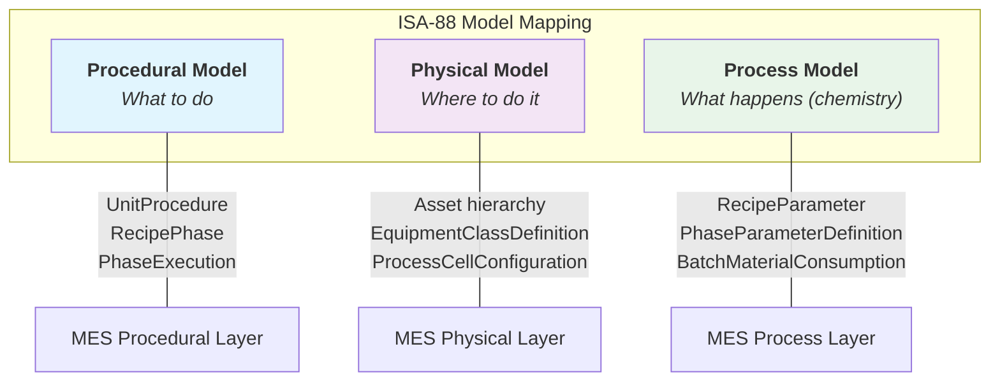

| ISA-88 Concept | MES Implementation | Current Status |
|---|---|---|
| **Recipe** (master) | `Recipe` + `RecipeBom` + `UnitProcedure[]` | Exists (mashing only as `MashingProtocol`) |
| **Control Recipe** (active instance) | `ScheduleOrderRecipeInstance` → copies of unit procedures, BOMs, parameters | Exists (mashing only) |
| **Procedure** (batch-level) | `BatchOrchestrationService` (stage sequence on SORI) | **New** |
| **Unit Procedure** | `UnitProcedure` — one per production stage | **New** (replaces `MashingProtocol`) |
| **Operation** | (skipped — flat phase list within unit procedure) | — |
| **Phase** (equipment phase) | `RecipePhase` — the atomic executable element | **New** (replaces `MashingProtocolStep`) |
| **Phase instance** (runtime) | `PhaseExecution` — S88 state machine | Exists as `StepExecution`, renamed |
| **Process Cell** | `Asset` with `assetType=CELL` + `ProcessCellConfiguration` | **Enhanced** |
| **Unit** | `Asset` with `equipmentClass` (Cooker, Fermenter, etc.) | **Enhanced** |
| **Batch** | `Batch` — one per production stage, linked to SORI | Exists |

---

## 4. Procedural Model — Generic UnitProcedure

### 4.1 Entity Relationships

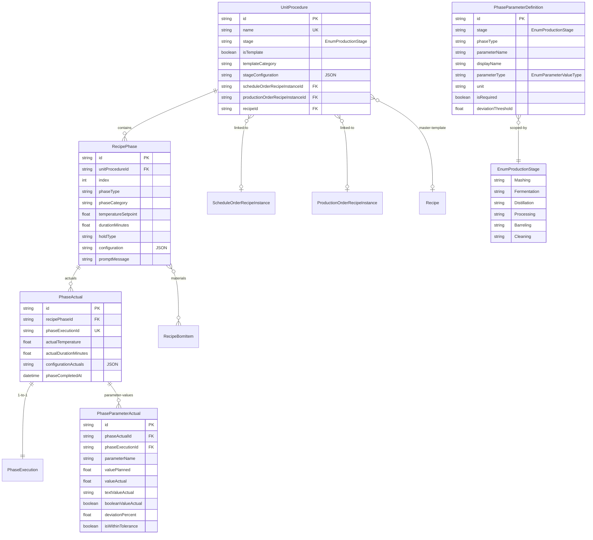

### 4.2 Key Design Decisions

#### `phaseType` is a string, not an enum

Each production stage has completely different phase types. A single Prisma enum would be unmanageable and require a migration for every new phase type.

Valid phase types are defined by `PhaseParameterDefinition` rows (seeded data) and enforced at the service layer. The UI calls `getPhaseParameterDefinitions(stage, phaseType)` and dynamically renders the input form.

#### JSON `configuration` replaces phase-specific columns

The current `MashingProtocolStep` has dedicated columns: `heatEnabled`, `coolEnabled`, `agitatorSpdSp`, etc. This approach does not scale to distillation (`startProof`, `endProof`, `collectTank`) or CIP (`chemicalConcentration`, `flowRate`).

Instead, `RecipePhase.configuration` is a JSON field validated by Zod schemas keyed on `stage::phaseType`:

```json
// Mashing Hold phase
{
  "heatEnabled": true,
  "heatTempSp": 152.0,
  "coolEnabled": false,
  "agitatorEnabled": true,
  "agitatorSpdSp": 45.0
}

// Distillation HeartsCut phase
{
  "startProof": 140,
  "endProof": 110,
  "collectTank": "hearts-tank-01",
  "targetFlowRate": 3.5
}

// CIP CausticWash phase
{
  "chemicalConcentration": 2.5,
  "chemicalUnit": "%",
  "flowRate": 50,
  "flowRateUnit": "gpm"
}
```

#### `temperatureSetpoint` and `durationMinutes` remain first-class columns

These appear across nearly every production stage and are the most commonly queried fields for reporting and scheduling. Everything else lives in `configuration`.

#### Zod schemas in `apps/shared/` validate configuration

Per `stage::phaseType` key, a Zod schema defines the expected shape. This gives type safety without schema rigidity:

```typescript
// apps/shared/src/phaseConfiguration/mashing.ts
export const MashingHoldConfigSchema = z.object({
  heatEnabled: z.boolean().default(false),
  heatTempSp: z.number().optional(),
  coolEnabled: z.boolean().default(false),
  coolTempSp: z.number().optional(),
  agitatorEnabled: z.boolean().default(false),
  agitatorSpdSp: z.number().optional(),
});
```

### 4.3 Phase Types by Production Stage

| Stage | phaseType | phaseCategory | Description |
|-------|-----------|---------------|-------------|
| **Mashing** | `GrainAdd` | MaterialAddition | Grain addition (type from BOM) |
| | `LiquidAdd` | MaterialAddition | Water, backset |
| | `AdditiveAdd` | MaterialAddition | Enzymes, chemicals |
| | `Hold` | TemperatureControl | Temperature hold |
| | `Prompt` | OperatorAction | Operator confirmation |
| **Fermentation** | `FermenterPrep` | Setup | Clean, inspect, pre-condition |
| | `WortTransfer` | MaterialAddition | Mash transfer to fermenter |
| | `YeastPitch` | MaterialAddition | Yeast addition |
| | `TemperatureHold` | TemperatureControl | Hold fermentation temp |
| | `GravityCheck` | QualityCheck | Specific gravity reading |
| | `pHCheck` | QualityCheck | pH measurement |
| | `DropReady` | OperatorAction | Confirm fermentation complete |
| **Distillation** | `ColumnStartup` | Setup | Column heating, stabilization |
| | `BeerWellTransfer` | MaterialAddition | Pump beer into still |
| | `HeadsCollection` | Collection | Foreshots/heads cut |
| | `HeartsCut` | Collection | Hearts (desired spirit) |
| | `TailsCut` | Collection | Tails collection |
| | `ProofReading` | QualityCheck | Proof measurement |
| | `ColumnShutdown` | Shutdown | Cool down, drain |
| **Processing** | `CisternFill` | MaterialAddition | Fill cistern tank |
| | `ProofAdjustment` | ProcessControl | Water proofing down |
| | `Blending` | MaterialAddition | Blend from multiple sources |
| | `ProofVerification` | QualityCheck | Final proof check |
| **Barreling** | `BarrelFill` | MaterialAddition | Fill barrel |
| | `ProofVerification` | QualityCheck | Fill proof verification |
| | `LotAssignment` | OperatorAction | Assign to lot/warehouse |
| **Cleaning** | `PreRinse` | CIP | Initial water rinse |
| | `CausticWash` | CIP | Caustic circulation |
| | `AcidWash` | CIP | Acid rinse |
| | `FinalRinse` | CIP | Final water rinse |
| | `Sanitize` | CIP | Sanitizer application |

> **Extensibility**: Adding a new phase type is a seed script that inserts `PhaseParameterDefinition` rows + an optional Zod schema. No schema migration needed.

### 4.4 How Parameter Definitions Drive Phase Behavior

`PhaseParameterDefinition` (keyed by `stage` + `phaseType`) defines what parameters exist, their types, validation, and deviation thresholds. This is the primary extensibility mechanism.

Example — Fermentation YeastPitch:

| parameterName | parameterType | unit | isRequired | validationMin | validationMax | deviationThreshold |
|---|---|---|---|---|---|---|
| `yeastStrain` | Text | — | true | — | — | — |
| `pitchRate` | Float | cells/mL | true | — | — | 10% |
| `pitchTemperature` | Float | degF | true | 60 | 90 | 5% |
| `wortGravity` | Float | SG | true | — | — | — |
| `wortpH` | Float | pH | false | 3 | 7 | — |

The frontend calls `getPhaseParameterDefinitions(stage, phaseType)` and dynamically renders the input form. One component handles all stages.

### 4.5 Relationship to Existing Mashing Models

The current mashing-specific models map 1:1 to the new generic models:

| Current (Mashing-Only) | New (S88-Aligned) | Notes |
|---|---|---|
| `MashingProtocol` | `UnitProcedure` | + `stage` field, `stageConfiguration` JSON |
| `MashingProtocolStep` | `RecipePhase` | `heatEnabled` etc. → `configuration` JSON; `stepType` → `phaseType` |
| `MashingProtocolStepActual` | `PhaseActual` | `actualValue` → `actualTemperature` + `configurationActuals` |
| `MashingStepParameterDefinition` | `PhaseParameterDefinition` | `stepType` enum → string `phaseType`; + `stage` field |
| `MashingStepParameterActual` | `PhaseParameterActual` | Same fields, S88-aligned naming |
| `StepExecution` | `PhaseExecution` | Rename only — same state machine, same fields |
| `EnumMashingProtocolStepStepType` | String `phaseType` | Values become seed data |
| `EnumMashingProtocolStepHoldType` | `holdType` string field | Moved into `configuration` for non-mashing stages |
| `EnumProductionPhase` | `EnumProductionStage` | Rename + add Processing, Cleaning |

---

## 5. Physical / Asset Model

### 5.1 ISA-88 Physical Hierarchy Applied to Distillery

```mermaid
graph TD
    ENT["<b>Enterprise</b><br/>WhiskeyHouse"]
    SITE["<b>Site</b><br/>Main Distillery"]

    ENT --> SITE

    SITE --> GRN["<b>Area</b>: Grain Handling"]
    SITE --> MSH["<b>Area</b>: Mashing"]
    SITE --> FRM["<b>Area</b>: Fermentation"]
    SITE --> DST["<b>Area</b>: Distillation"]
    SITE --> PRC["<b>Area</b>: Processing"]
    SITE --> WSE["<b>Area</b>: Warehousing"]
    SITE --> CIP["<b>Area</b>: CIP"]

    GRN --> RCV["Process Cell:<br/>Grain Receiving"]
    RCV --> CS1["Corn Silo 1"]
    RCV --> CS2["Corn Silo 2"]
    RCV --> RS1["Rye Silo 1"]

    GRN --> MIL["Process Cell: <br/>Milling"]
    MIL --> HM01["Hammer Mill 01"]

    GRN --> GDN['Process Cell: Grain Distribution<br/>Grain Receiver + Milling Bins']
    GDN --> MB1["Milling Bin 1"]
    GDN --> MB2["Milling Bin 2"]

    MSH --> ML1["Process Cell:<br/>Mash Line 1"]
    ML1 --> CK1["Cooker 01"]
    ML1 --> MC1["Mash Cooler 01"]
    ML1 --> MC2["Mash Cooler 02"]

    FRM --> FBA["Process Cell:<br/>Ferm Bank A"]
    FBA --> F01["Fermenter 01"]
    FBA --> F02["Fermenter 02"]
    FBA --> Fdot["...Fermenter 03-14"]

    DST --> SL1["Process Cell:<br/>Still Line 1"]
    SL1 --> ST1["Column Still 01"]
    SL1 --> DB1["Doubler 01"]
    SL1 --> LW1["Low Wine Tank"]
    SL1 --> HW1["High Wine Tank"]

    PRC --> PL1["Process Cell:<br/>Processing Line 1"]
    PL1 --> CT1["Cistern Tank 01"]
    PL1 --> CT2["Cistern Tank 02"]
    PL1 --> BT1["Blend Tank 01"]
    PL1 --> PT1["Proofing Tank 01"]
    PL1 --> BRL["Barreling"]

    BRL --> BL1["Process Cell:<br/>Barrel Line 1"]
    BL1 --> FS1["Fill Station 01"]
    BL1 --> GS1["Gauge Station 01"]

    WSE --> WS1["Warehouse 01"]
    WSE --> WS2["Warehouse 02"]
    WSE --> WS3["Warehouse 03+"]

    style ENT fill:#e1f5fe
    style SITE fill:#e1f5fe
    style GRN fill:#fff3e0
    style MSH fill:#fff3e0
    style FRM fill:#fff3e0
    style DST fill:#fff3e0
    style PRC fill:#fff3e0
    style BRL fill:#fff3e0
    style WSE fill:#fff3e0
    style CIP fill:#fff3e0
```

This maps directly to our existing `Asset` tree (parent/child via `parentId`). The `assetType` enum (`ENT`, `SITE`, `AREA`, `CELL`, `UNIT`, etc.) already provides the hierarchy levels. What's missing is **what kind of equipment** a given unit is, and **what it can do**.

### 5.2 Equipment Classification

New `EnumEquipmentClass` on the `Asset` model answers "what kind of equipment is this?" — distinct from `EnumAssetAssetType` which answers "what hierarchy level?"

| Equipment Class | Allowed Stages | Typical Capacity |
|---|---|---|
| `GrainSilo` | — | 100,000–200,000 lbs |
| `MillingBin` | — | 5,000 lbs |
| `Cooker` | Mashing | 6,000–10,000 gal |
| `MashCooler` | Mashing | 6,000–10,000 gal |
| `Fermenter` | Fermentation | 10,000–50,000 gal |
| `ColumnStill` | Distillation | throughput: 500 gal/hr |
| `Doubler` | Distillation | — |
| `CisternTank` | Processing | 5,000–10,000 gal |
| `BlendTank` | Processing | 5,000 gal |
| `ProofingTank` | Processing | 5,000 gal |
| `BarrelFillStation` | Barreling | 30 barrels/hr |
| `Rickhouse` | — | 20,000 barrels |
| `CipSkid` | Cleaning | — |

**`EquipmentClassDefinition` model** stores the default configuration per class: default capacity, allowed stages, CIP requirements, batch exclusivity rules, and MQTT tag patterns.

**`AssetCapability` join table** links a specific asset to its class definition with per-asset overrides (e.g., a large fermenter that can also serve as a blend tank).

### 5.3 Changes to the Asset Model

Current `Asset` model fields remain unchanged. New fields are added:

```
Asset (existing)
├── name, description, assetPath, assetType, parentId, status, ...
│
├── NEW: equipmentClass         EnumEquipmentClass?     // What kind of equipment
├── NEW: operationalState       EnumEquipmentOperationalState?  @default(Available)
├── NEW: capacityMin            Float?                  // Minimum operating volume
├── NEW: capacityMax            Float?                  // Maximum capacity
├── NEW: capacityUnit           String?                 // "gal", "lbs", "barrels"
├── NEW: lastCipCompletedAt     DateTime?               // When last cleaned
├── NEW: lastMaintenanceAt      DateTime?               // When last maintained
├── NEW: mqttBaseTopic          String?                 // MQTT topic prefix for this equipment
│
├── NEW: capabilities           AssetCapability[]       // What this asset can do
├── NEW: stateTransitions       EquipmentStateTransition[]  // Audit log
├── NEW: reservations           EquipmentReservation[]  // Soft-lock reservations
└── NEW: processCellConfig      ProcessCellConfiguration?   // If this asset is a process cell
```

### 5.4 Equipment Operational State Machine

Replaces binary `EnumAssetStatus` (`OOS` / `InService`) with full operational state management:

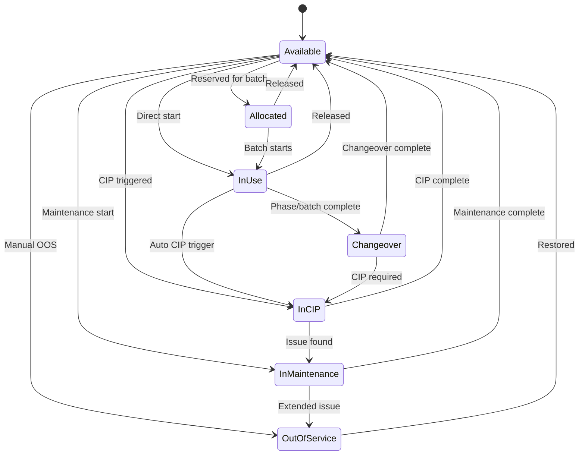

**`EquipmentStateTransition`** audit table records every state change:

| Field | Type | Description |
|---|---|---|
| `assetId` | FK → Asset | Which equipment |
| `fromState` | EnumEquipmentOperationalState | Previous state |
| `toState` | EnumEquipmentOperationalState | New state |
| `triggerType` | EnumStateTransitionTrigger | Manual, Automatic, Scheduled, Fault |
| `triggeredBy` | String | User or system ID |
| `batchId` | FK → Batch? | Optional batch context |
| `phaseExecutionId` | FK → PhaseExecution? | Optional phase context |
| `notes` | String? | Reason/context |
| `transitionedAt` | DateTime | When it happened |

**`EquipmentReservation`** provides soft-lock reservations:

| Field | Type | Description |
|---|---|---|
| `assetId` | FK → Asset | Which equipment |
| `scheduleOrderId` | FK → ScheduleOrder? | Which SO |
| `batchId` | FK → Batch? | Which batch |
| `stage` | EnumProductionStage | Which production stage |
| `reservationType` | EnumReservationType | Exclusive, Shared, Preferred |
| `status` | EnumReservationStatus | Pending, Active, Fulfilled, Released, Expired |
| `reservedFrom` | DateTime | Start of reservation window |
| `reservedUntil` | DateTime? | End of reservation window |

The system warns about conflicts; operators decide. Reservations are advisory, not hard locks.

### 5.5 Process Cell Configuration

**`ProcessCellConfiguration`** defines what a process cell can do. Links to `Asset` records where `assetType = CELL`:

| Field | Type | Description |
|---|---|---|
| `assetId` | FK → Asset | Which process cell |
| `supportedStages` | EnumProductionStage[] | Which stages this cell handles |
| `maxConcurrentBatches` | Int | How many batches at once |
| `maxCooksPerDay` | Int? | Mashing throughput |
| `maxFermentersInUse` | Int? | Fermentation capacity |
| `changeoverDuration` | Int | Minutes between batches |
| `cipRequired` | Boolean | Whether CIP is mandatory between uses |
| `cipDuration` | Int? | Standard CIP duration in minutes |

This connects to `ScheduleOrderQueue.areas` — queue entries target specific process cells, and the orchestrator uses process cell configuration to determine equipment availability.

---

## 6. Material Model

### 6.1 Material Flow Through Production

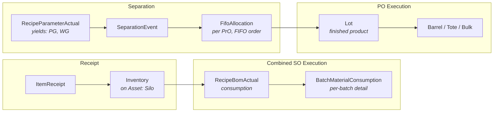

### 6.2 Existing Material Models — No Changes Needed

The material model is complete for the current scope:

| Model | Purpose | Status |
|-------|---------|--------|
| `Item` | Raw material / finished good definition | Complete |
| `RecipeBom` / `RecipeBomItem` | Bill of materials template | Complete |
| `RecipeBomActual` | Material consumption tracking (SO + PO levels) | Complete |
| `BatchMaterialConsumption` | Per-batch granular consumption | Complete |
| `Inventory` | Asset-based material tracking with FIFO indexing | Complete |
| `InventoryTransfer` | Movement between assets | Complete |
| `ItemReceipt` | Raw material receiving with QA | Complete |
| `Lot` | Finished product traceability (proof, barrels, volumes) | Complete |
| `SeparationEvent` | SO → PO distillate split | Complete |
| `FifoAllocation` | FIFO barrel assignment per PrO | Complete |
| `RecipeParameterActual` | Yield tracking (PG, WG) | Complete |

### 6.3 Material-to-Asset Connection Enhancement

With `equipmentClass` on `Asset`:
- `Inventory.assetId` → raw materials live on equipment (silos, tanks) — the `equipmentClass` gives semantic meaning to what "stored on" means
- `Asset.capacityMax` enables validation: can't overfill a vessel
- `InventoryTransfer` between assets can trigger equipment state transitions
- `Lot` fields (`tankOfOriginId`, `filledFromId`, `proofingTankId`) gain semantic meaning through `equipmentClass`

### 6.4 Traceability Chain

Complete traceability from barrel back to grain lot:

```
Barrel → Lot → sourceScheduleOrderId → SORI → RecipeBomActual[]
  → lotNumber → BatchMaterialConsumption → grain lots → ItemReceipt → supplier
```

Proof gallons remain the currency of the system. All yield calculations, barrel allocations, and separation logic pivot on PG.

### 6.5 RecipeBomActual Link Change

`RecipeBomActual` currently links to `MashingProtocolStepActual`. A new optional FK `phaseActualId` is added to support the generic model. Both FKs coexist during migration.

---

## 7. Cross-Area Batch Governance

### 7.1 The Problem

A batch of bourbon flows through 4–5 production areas over days or weeks:

```
Mashing (8 hrs) → Fermentation (72 hrs) → Distillation (12 hrs) → Processing (variable) → Barreling (variable)
```

Each area has its own equipment, unit procedures, and operators. We need to govern:

| Concern | Question |
|---|---|
| **Sequencing** | What order do stages execute in? |
| **Transitions** | When and how does a batch move between stages? |
| **Equipment handoff** | How does equipment get allocated/released as the batch moves? |
| **Batch continuity** | How do we maintain the batch record across stages? |
| **Separation** | When does combined SO-level execution split into per-PO? |

### 7.2 Stage Sequence — SORI as the Backbone

Rather than a heavyweight `ProcedureRunPlan` model, the stage sequence is governed by the `ScheduleOrderRecipeInstance` and its `UnitProcedure[]` linkages:

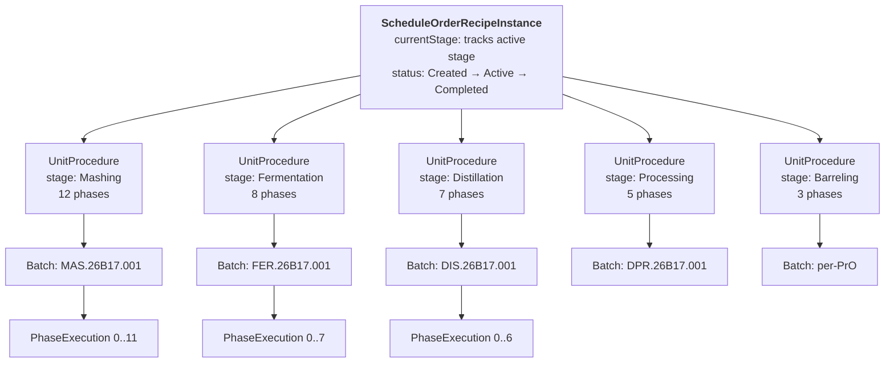

The SORI already has:
- `currentStage: EnumProductionStage` — tracks which stage is active (renamed from `currentPhase`)
- `status: EnumRecipeInstanceStatus` — Created / Active / InSeparation / Completed
- `batches: Batch[]` — one batch per stage (linked via `ScheduleOrderBatches` relation)

The new `unitProcedures: UnitProcedure[]` relation replaces `mashingProtocols: MashingProtocol[]`.

### 7.3 Stage Transition Model

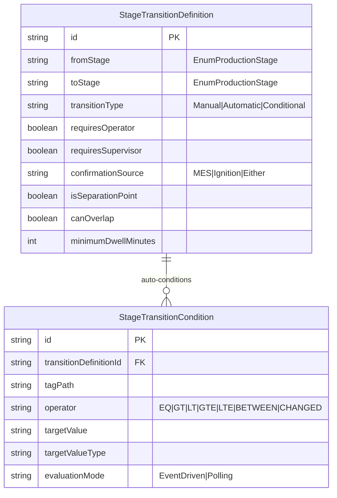

**`EnumTransitionType`**:
- **Manual** — Operator confirms in MES or Ignition that the batch is ready to move
- **Automatic** — Tag-based condition(s) on Ignition are met (e.g., `fermenter/ferm_complete == true`)
- **Conditional** — Tag condition + operator confirmation required

**Key fields on `StageTransitionDefinition`**:

| Field | Type | Purpose |
|---|---|---|
| `fromStage` / `toStage` | EnumProductionStage | Transition edge |
| `transitionType` | EnumTransitionType | Manual, Automatic, or Conditional |
| `requiresOperator` | Boolean | Needs operator sign-off |
| `requiresSupervisor` | Boolean | Needs supervisor sign-off |
| `confirmationSource` | "MES" / "Ignition" / "Either" | Where manual confirmation comes from |
| `isSeparationPoint` | Boolean | If true, triggers SO → PO split |
| `canOverlap` | Boolean | Next stage can start before previous finishes cleanup |
| `minimumDwellMinutes` | Int? | Minimum time in current stage before transition |

**`StageTransitionCondition`** for automatic transitions:

| Field | Type | Purpose |
|---|---|---|
| `tagPath` | String | MQTT topic path (e.g., `whk01/.../ferm_complete`) |
| `operator` | EnumConditionOperator | EQ, GT, LT, GTE, LTE, BETWEEN, CHANGED |
| `targetValue` / `targetValueType` | String | What triggers the transition |
| `evaluationMode` | EnumEvaluationMode | EventDriven (MQTT subscription) or Polling |

### 7.4 Standard Bourbon Transition Configuration (Seed Data)

| From | To | Type | Separation? | Overlap? |
|---|---|---|---|---|
| Mashing | Fermentation | Manual | No | Yes (cooker CIP while ferm starts) |
| Fermentation | Distillation | Conditional | No | No |
| Distillation | Processing | Manual | **Yes** | No |
| Processing | Barreling | Manual | No | No |

### 7.5 Batch Orchestration Service

`BatchOrchestrationService` manages the batch lifecycle across stages. It is lightweight — it reads configuration, not hard-coded logic.

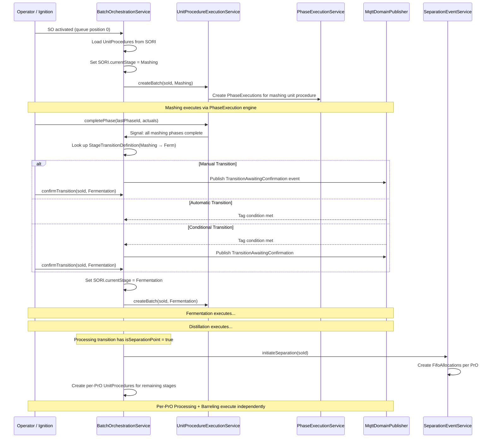

**What the orchestrator does:**

1. Reads the SORI's `unitProcedures[]` to know what stages exist and their sequence
2. Reads `StageTransitionDefinition` to know how transitions work
3. Creates a `Batch` for each stage as it becomes active (using `BatchService.GetBatchId()` with existing operation mappings)
4. Delegates all phase-level execution to `UnitProcedureExecutionService`
5. Listens for "stage complete" signals (all phases in unit procedure done)
6. Evaluates transition conditions (manual, automatic, or conditional)
7. Advances `SORI.currentStage` on successful transition
8. At separation points, delegates to existing `SeparationEventService`
9. Manages equipment reservation/release as stages transition

**What the orchestrator does NOT do:**

- No phase-level logic (that's `UnitProcedureExecutionService` + `PhaseExecutionService`)
- No deviation detection (that's `BatchDeviationService`)
- No material tracking (that's `RecipeBomActual` recording in unit procedure services)
- No BOM calculation (that's `BomCalculationService`)

### 7.6 Equipment Handoff During Transitions

```mermaid
gantt
    title Equipment State During SO-2026-042
    dateFormat X
    axisFormat %s

    section Cooker 01
    InUse-Cook 1    :a1, 0, 8
    Changeover      :a2, 8, 9
    InUse-Cook 2    :a3, 9, 17
    Changeover      :a4, 17, 18
    InUse-Cook 3    :a5, 18, 26
    InCIP           :a6, 26, 30
    Available       :a7, 30, 100

    section Fermenter 03
    Allocated       :b1, 0, 8
    InUse           :b2, 8, 80
    Changeover      :b3, 80, 82
    InCIP           :b4, 82, 86
    Available       :b5, 86, 100

    section Still 01
    Available       :c1, 0, 80
    InUse           :c2, 80, 92
    Available       :c3, 92, 100

    section Cistern 01
    Available       :d1, 0, 92
    InUse           :d2, 92, 100
```

When the orchestrator transitions between stages:

1. **Release** equipment from the completed stage (state → `Changeover` or `InCIP`)
2. **Allocate** equipment for the next stage (check availability, create `EquipmentReservation`)
3. **Record** `EquipmentStateTransition` entries with batch/phase context
4. **Publish** MQTT domain events (EquipmentReserved, CIPStarted, etc.)
5. Equipment in the completed stage may continue CIP independently while the next stage starts (`canOverlap = true`)

### 7.7 SO → PO Separation at Processing

When the orchestrator reaches a transition where `isSeparationPoint = true`:

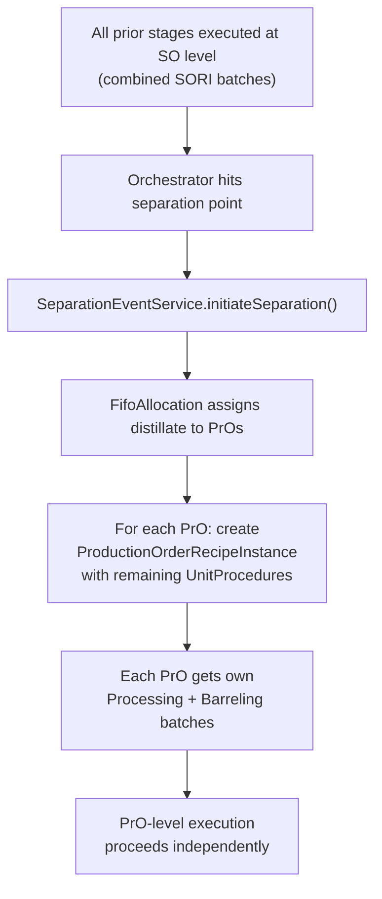

This integrates with existing services:
- `SeparationEventService.initiateSeparation()` — already implemented
- `FifoAllocation` — already implemented (FIFO by PO creation order)
- `ProductionOrderRecipeInstance` creation — needs enhancement to clone remaining `UnitProcedure` entries

---

## 8. Ignition Integration

### 8.1 Communication Pattern

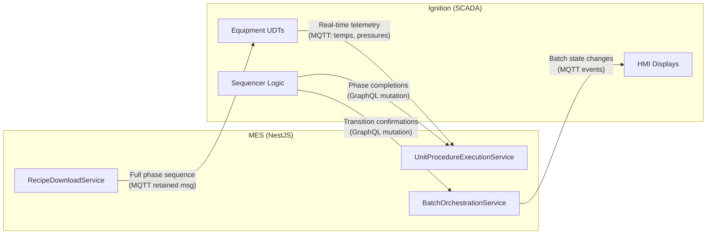

**Recipe flow**: MES → Ignition (MQTT retained messages)
**Actuals flow**: Ignition → MES (GraphQL mutations)
**Telemetry flow**: Ignition → MES (MQTT subscriptions)

### 8.2 Recipe Download

The `RecipeDownloadService` builds the complete phase sequence for a unit procedure and publishes to the equipment's MQTT topic as a retained message. Ignition reads this on startup or when a new batch is assigned.

Payload structure (published to `{mqttBaseTopic}/recipe`):

```json
{
  "scheduleOrderId": "clxyz...",
  "batchId": "MAS.26B17.001",
  "stage": "Mashing",
  "unitProcedureName": "WHK-RB-001 Mashing v3",
  "totalPhases": 12,
  "phases": [
    {
      "index": 0,
      "phaseType": "LiquidAdd",
      "phaseCategory": "MaterialAddition",
      "temperatureSetpoint": 180.0,
      "durationMinutes": 15,
      "configuration": { },
      "bomItems": [{ "itemName": "City Water", "quantity": 2400, "unit": "gal" }]
    },
    {
      "index": 1,
      "phaseType": "GrainAdd",
      "phaseCategory": "MaterialAddition",
      "temperatureSetpoint": 180.0,
      "durationMinutes": 20,
      "configuration": { "addRate": 150 },
      "bomItems": [{ "itemName": "Corn #2", "quantity": 8500, "unit": "lbs" }]
    }
  ],
  "downloadedAt": "2026-02-17T10:30:00Z"
}
```

### 8.3 Ignition UDT Structure per Equipment

```
MES_Equipment (UDT)
├── Status/
│   ├── Connected          Bool
│   ├── Mode               String     (Auto/Manual/Maintenance)
│   ├── CurrentBatchId     String
│   ├── CurrentPhaseIndex  Int
│   └── FaultActive        Bool
├── Recipe/
│   ├── RecipeLoaded       Bool
│   ├── RecipeSOId         String
│   ├── RecipeUpdatedAt    String
│   ├── TotalPhases        Int
│   └── Phases[]           (nested UDT per phase)
├── Execution/
│   ├── CurrentPhase       Int
│   ├── PhaseComplete      Bool       (Ignition sets → MES reads)
│   ├── StageComplete      Bool       (Ignition sets → MES reads)
│   ├── AbortRequested     Bool       (MES or operator sets)
│   └── HoldRequested      Bool       (MES or operator sets)
└── ProcessValues/
    ├── Temperature_PV     Float
    ├── Pressure_PV        Float
    ├── Level_PV           Float
    └── Flow_PV            Float
```

### 8.4 GraphQL Callback Mutations

These mutations are called by Ignition's sequencer logic to report execution progress:

```graphql
# Stage lifecycle (called by orchestration layer or Ignition)
mutation RecordStageStarted(
  scheduleOrderId: String!
  stage: EnumProductionStage!
  assetId: String!
  startedBy: String!
): Batch!

mutation RecordStageCompleted(
  scheduleOrderId: String!
  stage: EnumProductionStage!
  completedBy: String!
  actuals: JSON
): Batch!

# Phase lifecycle (called by Ignition sequencer)
mutation RecordPhaseStarted(
  batchId: String!
  phaseIndex: Int!
  startedBy: String!
): PhaseExecution!

mutation RecordPhaseCompleted(
  batchId: String!
  phaseIndex: Int!
  completedBy: String!
  actuals: JSON!
): PhaseExecution!

# Stage transition confirmation (called by operator in MES or Ignition)
mutation ConfirmStageTransition(
  scheduleOrderId: String!
  toStage: EnumProductionStage!
  confirmedBy: String!
  notes: String
): ScheduleOrderRecipeInstance!

# Equipment events (called by Ignition on fault)
mutation RecordEquipmentFault(
  assetId: String!
  faultCode: String!
  faultDescription: String
  batchId: String
  reportedBy: String!
): EquipmentStateTransition!

# Existing mutations (unchanged)
# recordCookComplete, recordRecipeLoadedToPLC, advanceScheduleOrderQueue
```

---

## 9. Schema Change Summary

### 9.1 New Prisma Models

| Model | Purpose | Key Relations |
|-------|---------|---------------|
| `UnitProcedure` | Unit procedure definition (replaces `MashingProtocol`) | → SORI, PORI, Recipe, RecipePhase[] |
| `RecipePhase` | Phase with JSON config (replaces `MashingProtocolStep`) | → UnitProcedure, RecipeBomItem[], PhaseActual[] |
| `PhaseActual` | Phase execution actuals, 1:1 with PhaseExecution | → PhaseExecution, PhaseParameterActual[] |
| `PhaseParameterDefinition` | Stage+phaseType scoped parameter templates | Standalone (seed data) |
| `PhaseParameterActual` | Recorded parameter values with deviation | → PhaseActual, PhaseExecution |
| `StageTransitionDefinition` | Cross-area transition governance | → StageTransitionCondition[] |
| `StageTransitionCondition` | Tag-based conditions for auto transitions | → StageTransitionDefinition |
| `EquipmentClassDefinition` | Equipment class capabilities and defaults | → AssetCapability[] |
| `AssetCapability` | Per-asset capability overrides | → Asset, EquipmentClassDefinition |
| `EquipmentStateTransition` | Equipment state change audit log | → Asset, Batch?, PhaseExecution? |
| `EquipmentReservation` | Soft-lock equipment reservations | → Asset, ScheduleOrder?, Batch? |
| `ProcessCellConfiguration` | Process cell throughput and stage support | → Asset |

### 9.2 New Enums

| Enum | Values |
|------|--------|
| `EnumEquipmentClass` | GrainSilo, MillingBin, Cooker, MashCooler, Fermenter, ColumnStill, Doubler, CisternTank, BlendTank, ProofingTank, BarrelFillStation, Rickhouse, CipSkid |
| `EnumEquipmentOperationalState` | Available, Allocated, InUse, Changeover, InCIP, InMaintenance, OutOfService |
| `EnumParameterValueType` | Float, Int, Boolean, Text, Enum |
| `EnumTransitionType` | Manual, Automatic, Conditional |
| `EnumConfirmationSource` | MES, Ignition, Either |
| `EnumConditionOperator` | EQ, GT, LT, GTE, LTE, BETWEEN, CHANGED |
| `EnumEvaluationMode` | EventDriven, Polling |
| `EnumReservationType` | Exclusive, Shared, Preferred |
| `EnumReservationStatus` | Pending, Active, Fulfilled, Released, Expired |
| `EnumStateTransitionTrigger` | Manual, Automatic, Scheduled, Fault, SystemAction |

### 9.3 Renamed / Extended Existing Enums

| Enum | Change |
|------|--------|
| `EnumProductionPhase` → **`EnumProductionStage`** | Renamed + add `Processing`, `Cleaning` |
| `EnumProductionEventType` | + `TransitionAwaitingConfirmation`, `TransitionConfirmed`, `CIPStarted`, `CIPCompleted`, `RecipeDownloaded`, `EquipmentReserved`, `EquipmentReleased` |

### 9.4 Renamed Existing Models

| Current Name | New Name | Reason |
|---|---|---|
| `StepExecution` | `PhaseExecution` | It executes an S88 Phase, not a "step" |

The existing `StepExecution` table is renamed (Prisma `@@map("step_executions")` can preserve the DB table name during transition). All fields remain the same; key field renames:

| Current Field | New Field |
|---|---|
| `stepIndex` | `phaseIndex` |
| `stepName` | `phaseName` |
| `phaseProtocolStepId` (placeholder) | `recipePhaseId` |
| `phase: EnumProductionPhase` | `stage: EnumProductionStage` |
| `mashingProtocolStepId` | deprecated, keep for migration |

### 9.5 Modified Existing Models

| Model | Changes |
|-------|---------|
| `Asset` | + `equipmentClass`, `operationalState`, `capacityMin`, `capacityMax`, `capacityUnit`, `lastCipCompletedAt`, `lastMaintenanceAt`, `mqttBaseTopic`, new relations |
| `ScheduleOrderRecipeInstance` | `currentPhase` → `currentStage`; + `unitProcedures: UnitProcedure[]` relation (alongside existing `mashingProtocols` during migration) |
| `ProductionOrderRecipeInstance` | + `unitProcedures: UnitProcedure[]` relation |
| `Recipe` | + `unitProcedures: UnitProcedure[]` relation (alongside existing `mashingProtocol` during migration) |
| `RecipeBomActual` | + `phaseActualId` FK (alongside existing `mashingProtocolStepActualId` during migration) |

---

## 10. Module Structure

```
src/
  unitProcedureExecution/                # Generic execution (replaces mashingExecution)
    unitProcedureExecution.module.ts
    unitProcedureExecution.service.ts    # Parameterized by stage
    unitProcedureExecution.resolver.ts
    stage-execution.registry.ts          # Registry: stage → handler config
    dto/
    __tests__/

  batchOrchestration/                    # Cross-area batch lifecycle
    batchOrchestration.module.ts
    batchOrchestration.service.ts        # Lightweight conductor
    batchOrchestration.resolver.ts
    dto/
    __tests__/

  phaseParameter/                        # Generic parameter service
    phaseParameter.module.ts
    phaseParameter.service.ts            # Replaces mashingStepParameter
    phaseParameter.resolver.ts
    __tests__/

  stageTransition/                       # Transition configuration CRUD
    stageTransition.module.ts
    stageTransition.service.ts
    stageTransition.resolver.ts
    __tests__/

  recipeDownload/                        # Ignition recipe download
    recipeDownload.module.ts
    recipeDownload.service.ts
    recipeDownload.resolver.ts

  equipmentState/                        # Equipment state management
    equipmentState.module.ts
    equipmentState.service.ts            # State machine + audit
    equipmentAllocation.service.ts       # Reservation + allocation
    __tests__/

  # Existing modules — renamed or modified:
  phaseExecution/                        # Renamed from stepExecution/
    phaseExecution.module.ts             # S88 Phase state machine (Idle→Running→Complete...)
    phaseExecution.service.ts            # Renamed from StepExecutionService
    __tests__/

  # Existing modules — become thin wrappers during migration:
  mashingExecution/                      # Wrapper → unitProcedureExecution(Mashing)
  mashingStepParameter/                  # Wrapper → phaseParameter

  # Existing modules — updated:
  scheduleOrderRecipeInstance/           # SORI creation adds UnitProcedure copies
  batch/                                 # No changes (operationsMapping already has all prefixes)
  separationEvent/                       # No changes (orchestrator calls existing methods)
```

### Module Dependency Graph

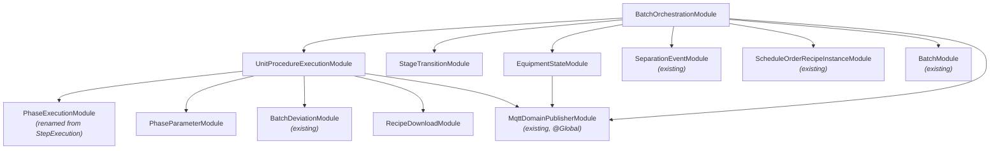

---

## 11. Migration Strategy

Migration from mashing-specific to S88-aligned generic models follows a five-step approach. Each step is non-breaking — the system works at every intermediate state.

### Step 1: Create New Tables (Non-Breaking)

Add all new Prisma models alongside existing ones. No existing code is affected.

- `UnitProcedure`, `RecipePhase`, `PhaseActual`
- `PhaseParameterDefinition`, `PhaseParameterActual`
- `StageTransitionDefinition`, `StageTransitionCondition`
- Equipment models
- New enums, `EnumProductionStage`

### Step 2: Data Migration Script

Script copies existing data into generic models:

| From | To | Transformation |
|---|---|---|
| `MashingProtocol` | `UnitProcedure` | + `stage=Mashing` |
| `MashingProtocolStep` | `RecipePhase` | `heatEnabled`, `coolEnabled`, etc. → `configuration` JSON; `stepType` → `phaseType` |
| `MashingProtocolStepActual` | `PhaseActual` | `actualValue` → `actualTemperature` |
| `MashingStepParameterDefinition` | `PhaseParameterDefinition` | `stepType` enum → string, + `stage=Mashing` |
| `MashingStepParameterActual` | `PhaseParameterActual` | Same fields, S88-aligned naming |
| `StepExecution` | `PhaseExecution` | `@@map` preserves table; field aliases during transition |
| `EnumProductionPhase` | `EnumProductionStage` | Rename + add Processing, Cleaning |

### Step 3: Service Wrapper Pattern

`MashingExecutionService` becomes a thin wrapper that delegates to `UnitProcedureExecutionService` with `stage=Mashing`. All existing callers continue to work unchanged.

```typescript
// mashingExecution.service.ts (wrapper)
@Injectable()
export class MashingExecutionService {
  constructor(private upExecution: UnitProcedureExecutionService) {}

  async startMashingStep(soId: string, phaseId: string) {
    return this.upExecution.startPhase(soId, phaseId, EnumProductionStage.Mashing);
  }
  // ... delegate all methods
}
```

### Step 4: Frontend Migration

Frontend migrates from `mashingState` queries to `unitProcedureState(stage: Mashing)`. The generic phase execution UI component handles all stages with the same code.

### Step 5: Deprecation

After validation period:
- Mark old mashing-specific models as deprecated in schema comments
- Old models remain in schema but are no longer written to
- Drop in a future migration after full validation

---

## 12. Implementation Roadmap

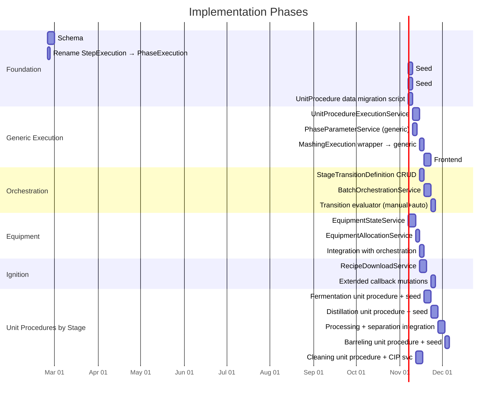

### Critical Path

```
Schema → Data Migration → UnitProcedureExecutionService → MashingWrapper → Orchestration → Stage Unit Procedures
```

The equipment track and Ignition track run in parallel and converge at the orchestration layer.

---

## 13. Verification Strategy

| Test Type | What It Validates |
|---|---|
| **Regression** | Existing mashing tests pass after wrapper migration |
| **Unit: UnitProcedureExecutionService** | `stage=Mashing` produces identical behavior to `MashingExecutionService` |
| **Unit: BatchOrchestrationService** | Stage advancement, transition evaluation, separation triggering |
| **Unit: EquipmentStateService** | Valid state transitions, conflict detection, reservation logic |
| **Unit: PhaseParameterService** | Parameter definition lookup, deviation calculation, caching |
| **Integration** | Create SO → generate unit procedures for 3 stages → execute mashing → transition → start fermentation |
| **MQTT** | Recipe download payload structure validation |
| **Seed data** | Full equipment hierarchy with capabilities and process cell configs |

---

## 14. Key File Reference

| File | Role |
|------|------|
| `prisma/schema.prisma` | All schema changes |
| `src/mashingExecution/mashingExecution.service.ts` | Reference pattern → generalize into `UnitProcedureExecutionService` |
| `src/stepExecution/stepExecution.service.ts` | Rename to `PhaseExecutionService`; already generic state machine |
| `src/mashingStepParameter/mashingStepParameter.service.ts` | Reference → `PhaseParameterService` |
| `src/scheduleOrderRecipeInstance/scheduleOrderRecipeInstance.service.ts` | SORI creation → multi-stage unit procedures |
| `src/separationEvent/separationEvent.service.ts` | Existing separation → called by `BatchOrchestrationService` |
| `src/batch/batch.service.ts` | BatchId generation (operationsMapping already has MAS, FER, DIS, DPR, GRN) |
| `src/app.module.ts` | Register new modules |
| `scripts/seed/` | Equipment hierarchy, parameter definitions, transition configs |

---

## 15. Decision Log

| # | Date | Decision | Rationale | Alternatives Considered |
|---|------|----------|-----------|------------------------|
| D-001 | 2026-02-17 | `phaseType` is a string, not an enum | Each stage has unique phase types; a single enum would require migrations for every new type | Per-stage enum, single mega-enum |
| D-002 | 2026-02-17 | JSON `configuration` for phase-specific setpoints | Avoids new columns per stage; validated by Zod schemas | Dedicated columns per stage, EAV pattern |
| D-003 | 2026-02-17 | `temperatureSetpoint` and `durationMinutes` stay as first-class columns | Used across all stages, most common query/sort fields | All setpoints in JSON |
| D-004 | 2026-02-17 | Wrapper migration pattern for `MashingExecutionService` | Non-breaking; existing callers unaffected; validates generic service with known behavior | Big-bang rewrite, feature flag |
| D-005 | 2026-02-17 | SORI is the backbone for stage sequencing | Already tracks `currentStage` and has batch/unit procedure relations; avoids new ProcedureRunPlan model | Dedicated run plan table, state machine service |
| D-006 | 2026-02-17 | Equipment reservations are advisory (soft locks) | Operators need flexibility; hard locks cause deadlock issues in real operations | Hard locks with timeout, no reservations |
| D-007 | 2026-02-17 | Separation point configured on `StageTransitionDefinition` | Single source of truth for transition behavior; orchestrator doesn't need hard-coded knowledge of which stage separates | Hard-coded in orchestrator, configurable per recipe |
| D-008 | 2026-02-17 | Both old (`mashingProtocolStepActualId`) and new (`phaseActualId`) FKs coexist during migration | Non-breaking; gradual rollover | Drop old FK immediately, use views |
| D-009 | 2026-02-17 | **S88-aligned naming**: "Stage" for production areas, "Phase" for equipment phases, "UnitProcedure" for stage protocols | ISA-88 standard terminology. PLC programmers, Ignition devs, and MES engineers share one vocabulary. Eliminates the double-inversion where "Phase" meant production area and "Step" meant S88 Phase. | Keep original naming (confusing), operator-friendly plain English (no S88 alignment) |
| D-010 | 2026-02-17 | Rename `StepExecution` → `PhaseExecution` | It executes an S88 Phase; calling it "Step" was misleading. Use `@@map` to preserve DB table name during transition. | Keep old name with alias comments, rename only in new code |
| D-011 | 2026-02-17 | Skip Operation level in S88 hierarchy | Flat phase list within UnitProcedure is sufficient for distillery ops. Can add `phaseGrouping` metadata later without schema change. | Full Operation model, nested grouping |

---

*This is a living document. Update it as implementation decisions are made and validated.*
