# Admission: how a hub decides that a module may attach, and how it knows what was approved — design record

**Status: approved by reh3376 on 2026-11-23 as D-18** (the owner: "docs/decisions/approved-spec-register.md reviewed and approved"), as its third draft. Nothing in it is built yet; §9 is the order. Written 2026-11-23 at gate 1 (`+design`) for BACKLOG FB-256, with FB-249 and FB-140. The first draft was attacked by three adversaries, who proved twenty-two findings against it by running the code or quoting the signed records; §4 lists what they changed. The third draft follows the owner's direction of 2026-11-23: "You should be able to sharpen your thought process and find the best path forward on your own. Just keep me informed", and "always consider dynamic design first". So §10 no longer puts design questions to the owner: it states the choice made for each and why, and lists separately the acts that stay the owner's.

Marks: **[OWNER]** the owner's words or decision · **[FACT]** verified, with the path · **[PROPOSED]** Claude's proposal, approved with the record on 2026-11-23 · **[OPEN]** left open.

## 1. The problem

**[OWNER]** confirmed 2026-11-23 ("looks correct to me, approved"): a hub accepts a module only if the module carries a spec that was approved, and a refusal is visible with its cause. The unanswered question underneath is how a hub knows what was approved.

**The attack widened it.** Register is one of five doors, and the other four have no check at all (§3). So the problem is: **there is no one place where a hub decides that a module may attach**, and nothing it could decide from.

## 2. What is already decided

| Decision | Where |
|---|---|
| The hub refuses at Register a module whose spec is missing or not approved, with the cause shown. | D-12 Q-7, step 6 (`forge-module-requirements.md:87, :100, :120`) |
| The approved hash reaches the hub with the manifest: "a contract field to add once, deliberately". Step 6 names the module spec's hash. | D-12 (`:100, :120`) |
| The proto only gains optional additions; both sides ignore unknown fields; both declare what they support at Register, and the hub answers with the limits in force. | D-15 Q-2, Q-3 (`transport-contract.md:36-37`) |
| "Spec not approved" is a cause whose required reaction is that the module stops and waits for an operator. Every cause appears under one name on the module's health and the hub's status. | D-15 Q-13 (`:47`) |
| "Development mode must never be reachable by configuration drift." | D-15 (`:42`) |
| A hub runs only promoted versions: an approver promotes an exact hash; rollback is promoting the previous one; all audited. Approval is per hub. | D-13 B-6, B-9, Q-2, Q-8 (`integration-module-builder.md:40-62`) |
| Forge's own approved things are files; a site's are in its hub's database. | D-16 Q-12, DS-5 (`forge-display.md:189, :261`) |
| One source of truth per datum; "the same data is not stored long-term in two places"; below it a derived copy, never edited locally, with its age visible. Offline verification against the issuer's key. | D-1 R-16, R-18, R-8 |
| Promoted flows and specs travel as the data class `config`: latest wins, "only the newest matters". | `forge-core/contract/lists/data-classes.list.json:129-139` (approved) |
| "Nobody but the owner approves a spec hash", always. | `hard-limits.list.json:51-61` (approved) |
| forge-core is where administrative changes are made and distributed; a hub that is cut off runs on what it last received. | D-17 §11 (`repository-structure.md:333-340`) |

**[OWNER]** 2026-11-23, correcting the first reading of these two rows as a conflict: they are "2 rules with different use cases". "Nobody but the owner approves a spec hash" is a development rule: it governs Forge's own specs, schemas and lists, in this repository. A hub's approver approving what is built on that hub is a production rule: a hub has the autonomy to make decisions like that. So they do not disagree. What is left is that the list's entry, as data, does not say which use it covers (AD-13, §10.2, FB-261).

## 3. What exists

**The doors.** A module becomes known to a hub, or its data enters, in five ways:

| Door | Check today | Proof |
|---|---|---|
| gRPC Register | compares the manifest with the spec file if one is found; a missing spec is a warning; approval is never read | `link/hub_ingest.py:120-166`, `ingest/facts_check.py` |
| REST register and ingest | none: an id with no spec anywhere registers and ingests, with authentication off by default | `api/main.py:418-421, :453-461`; run by an adversary: `200 registered`, `200 accepted` |
| Hub pull: backfill and collect | none | `api/main.py:580, :613` |
| The hosted forge-ot | none: it is put in the registry directly and writes to the pipeline; it never passes the servicer | `api/main.py:256-258` (FB-204) |
| The conformance kit's reference hub | the same servicer as door 1 | `forge_hub/conformance.py:111-116` |

**The check itself, at door 1.** **[FACT]**
- Only the id, the capabilities the spec names, and the schema reference can refuse. Version, type, protocol, tier, record format and context fields differing are warnings. A capability the spec does not mention is not checked. A spec that says `"write": "false"` (a string) admits a manifest that writes. A spec with no hash at all is a warning.
- The module spec is not looked at (FB-140).
- A refusal is one message to the module and one log line. The hub keeps nothing: not on status, health or the API. The module cannot be given a cause: `RegisterResponse` has no field for one. The interim MES bridge retries a refused registration until it succeeds.

**What an approval is.** **[FACT]**
- Two fields in the spec's own JSON, `hash_state` and `approved_by`. The command records whatever name `--by` is given.
- The hash is taken over the spec **without** its `integrity` block. On a real approved spec an adversary changed the approver's name, the approval date and the recorded schema version and hash; it still verified as unmodified (`fxts/shared/runner.py:196-198`).
- A first hash sets the state to "approved" with no approver (`runner.py:366-368`).
- The hash method is a label: `sha256-jcs` and `sha256-c14n-v1` run the same code. Two texts with a duplicated key, or a non-number, hash without complaint.
- Only adapter specs and module specs name a module. A spec that names none, presented under another module's id, passes.

**Where things are.** **[FACT]** The hub finds specs as files under its own root (FB-249). The hub in the shipped image has no database: its registry is in memory (`deploy/docker/Dockerfile.forge:72`, `api/main.py:730`). The schema registry's tables already keep documents by hash (`storage/migrations/versions/009`). Sessions are never removed or expired (`link/hub_server.py:121`).

## 3a. An experiment on the real modules

Every real module's manifest was compared with its own approved spec by the check as it is (2026-11-23, read-only). All nine are accepted today. Under "each field matches or refuses" (AD-3), **four of the nine would be refused**: forge-cmms, forge-wms, forge-nms and forge-integ-erp-netsuite each state context fields in the manifest that differ from the spec's (FB-263). The cause is that the same facts are written in two places. That is why AD-11 makes the spec the declaration, and why step 1 fixes these four before it refuses anything.

## 4. What the attack changed

| First draft | Proven against it | Now |
|---|---|---|
| The design was about Register. | Four other doors have no check; data enters with no registration. | One admission decision that every door goes through (AD-1, AD-2). |
| "Approved" meant "may run". | D-13: a hub runs only promoted versions. | Two facts: approved (by whom) and promoted (here). Only promoted is admitted (AD-4). |
| Import Forge's files into a register in the hub's database. | That stores one document in two places (R-16), and the shipped hub has no database. | One question, "what is promoted here", answered from two sources that each stay the only copy: the files a hub carries, and what was approved on it (AD-5). |
| "Approvals are read as they are today" as step 1. | Today's approval is outside the hash and can be rewritten undetected. | The approval is its own signed record, covering what the hash leaves out (AD-6). No step trusts an unsigned field as an approval. |
| An approval "bound to that module's id". | Most kinds of spec name no module. | The binding is written into the approval record, not inferred from the spec (AD-6). |
| An ordinary withdrawal lets the module run on. | D-15 Q-13: the module stops and waits for an operator. Sessions never end, so "until the next registration" has no bound. | A module whose promoted spec is taken away is refused on each request, with the cause, like a clock refusal (AD-8). |
| A hub's approver may approve; Forge's own stay the owner's. | The approved hard limit says only the owner, always, with no such distinction. | The owner: a development rule and a production rule, two use cases. Two entries in one table of authorities (AD-13). |
| One register for every kind of approved thing. | D-16 already says where screens live. | Dropped. This record covers what a module presents to attach. |
| Changes travel "since a sequence number". | The approved data class says latest wins. | Dropped; travel is not this record's (§11). |
| Silent: a wire change in three copies, four cause names in an approved transport spec, a new governed schema, how a hub knows it is production. | Each is the owner's. | Listed in §10. |

## 5. The proposal

| # | Rule | Mark |
|---|---|---|
| AD-1 | **Admission is one decision in one place:** given a manifest and what the module presents, the hub answers admitted, or refused with a named cause. Nothing else decides it. | [PROPOSED] |
| AD-2 | **Every door goes through it.** gRPC Register, the hosted module's mount, the conformance kit's hub, and for as long as they exist the REST register, REST ingest and hub pull. A module can be put in the registry, and its data can enter, only with an admission in hand. | [PROPOSED]; "a module" is "everything that registers with a hub" (D-12 Q-1) |
| AD-3 | **The manifest is held to the spec, not merely compared with it.** Identity, version, type, protocol, tier, capabilities, schema reference, record format and context fields each either match or refuse. A value is coerced to its type once (`"false"` is not true). A capability the spec does not state is not granted. | D-12 M-2; the value rule of `CLAUDE.md` |
| AD-4 | **A hub admits a module only on a spec that is promoted on that hub.** Approved says someone with the authority accepted an exact content. Promoted says this hub runs it. | D-13 Q-8 |
| AD-5 | **"What is promoted here" is one question with two sources, and each source is the only copy of what it holds:** the files a hub carries for Forge's own modules, and the hub's own store for what was built and approved on it. The hub reads them into one answer when it starts; it does not copy one into the other. | D-16 DS-5; R-16 |
| AD-6 | **An approval is a signed record beside the spec, not a field inside it.** It names the framework, the spec's id and hash, the module it binds, the schema version and hash it was approved against, who approved, with what authority and for which hub, and when. The signature covers all of it. | [PROPOSED]; closes what the hash leaves out |
| AD-7 | **A spec is read strictly before it is hashed:** a duplicated key, a non-number, or an unknown hash method is refused. The method named is the method run. | [PROPOSED] |
| AD-8 | **A refusal is kept, shown and told.** The hub counts it and shows it on status, health and the API under the cause's name. The module is told the cause in the answer. A module refused for its spec stops and waits for an operator; it does not retry in a loop. A module whose spec stops being promoted while it runs is refused on each request from then on. | D-15 Q-13; "no silent failure" |
| AD-9 | **Nothing is admitted until the hub knows what is promoted.** Admission is closed from start until that answer is loaded, and says so. | [PROPOSED]; fail closed |
| AD-11 | **The spec is the declaration; the manifest refers to it.** What a module is and may do (type, tier, capabilities, schema, record format, context fields) is read from its promoted spec. Where the manifest still restates one of these it must match (AD-3); nothing new is added to the manifest that a spec already says. | Experiment, §3a: restating is what drifted |
| AD-12 | **What admission requires is data, not code.** Which kinds of spec a party must present, which fields are held, the causes and the reaction each requires, and the limits in force (for example "a hash is required from contract version N") are read from governed files. Adding a requirement, a cause or a kind of spec is a release of data, not a change to the decision. | A-13, A-19; D-15 Q-3 "the limits in force" |
| AD-13 | **Who may approve what, and where, is data: a table of authorities.** Each entry names an authority, its key, the origin of what it may approve (Forge's own artifacts, or what was built on a named hub) and where its approvals hold. The owner's development rule and a hub's production rule are two entries of this one table, not two code paths. Deciding while cut off (D-17 §11.5), when it is signed, is a third kind of entry. | The owner, 2026-11-23: "2 rules with different use cases" |
| AD-14 | **What is promoted on a hub is one document, the hub's promoted set:** for each spec id, the hashes this hub runs, each with who promoted it, when, and optionally until when. It travels as the data class `config` already says such things travel: whole, newest wins. A hub's first one comes with its deployment. | `data-classes.list.json:129-139`; D-13 Q-8 |
| AD-15 | **Admission is for whatever attaches, by kind.** A module over gRPC, a module the hub hosts, a hub below this one (a hub is a module to its parent, D-15 Q-10). The kinds are a governed list; each kind says what it must present. | D-15 Q-10; A-19 |
| AD-16 | **Each act names its permission and takes a check point:** `governance:spec:approve`, `governance:spec:promote`, `governance:spec:withdraw`. Which roles hold them is decided later (FB-189); a check point not wired to anything is shown as such. | The owner, 2026-11-23, role security built in |
| AD-10 | **There is no switch that turns admission off.** A development hub, the test suite and the conformance kit use the same decision with a promotion that is marked as not for production, which a production hub refuses to load. | D-15 `:42`; the front-loading rule |

## 6. How one admission is decided

```mermaid
stateDiagram-v2
  [*] --> Arrives: a module registers, a hosted module is mounted,\nor data arrives for a module
  Arrives --> Closed: the hub has not yet loaded\nwhat is promoted here
  Closed --> Refused: cause "hub not ready"
  Arrives --> Identified: the manifest is read strictly
  Identified --> Refused: no spec is promoted here for this module\n(cause: no spec, or spec not known here)
  Identified --> Presented: the module presented a hash?
  Presented --> Refused: the hash presented is not the promoted one\n(cause: spec not approved)
  Presented --> RecordChecked: the approval record's signature verifies,\nfor this hub, by an authority it trusts
  RecordChecked --> Refused: it does not (cause: spec not approved)
  RecordChecked --> Held: the manifest is held to the spec
  Held --> Refused: any field differs (cause: manifest does not match)
  Held --> TimeChecked: the clock gate (already built)
  TimeChecked --> Refused: clock out of tolerance
  TimeChecked --> Admitted
  Admitted --> Refused: the spec stops being promoted here\nwhile the module runs
  Refused --> Recorded: counted, with its cause,\non status, health and the API;\nthe module is told and waits
  Admitted --> Recorded
```

## 7. Cases

| # | Case | What happens |
|---|---|---|
| 1 | Scale: thousands of specs at a site | One promoted version per spec id per hub; lookup by id and hash. |
| 2 | A rolling upgrade: old and new instances of one module run together for some minutes | The promoted set may hold more than one hash for a spec id, each optionally with an end time (AD-14), so both run until the old one's time ends; status shows it while it lasts. |
| 3 | A promotion is taken back while the module runs a line | Its requests are refused with the cause, and it waits (AD-8). Its records are not lost once store and forward exists (D-15, FB-164): it holds them and replays when promoted again. Until FB-164 is built they are lost, which is a reason to build that first for any module that feeds a line. |
| 4 | A hub is cut off | It decides from what it holds. A module it has admitted before comes back after a restart. A module whose spec it has never received is refused: "spec not known here". |
| 5 | Nobody is there: a module restarts at night | The answer is local; it comes back. |
| 6 | The hub restarts | Admission is closed until the promoted set is loaded (AD-9). A module that arrives first is refused with "hub not ready" and tries again; that one cause is retried, the spec causes are not. |
| 7 | The hub has no database | Forge's own modules are admitted from the files it carries. Nothing can be approved on that hub, and it says so. |
| 8 | A module built before the hash field existed | It presents nothing. It is admitted by its id, held to the promoted spec, until the hub's limits in force require a hash (AD-12). |
| 9 | The interim MES bridge | Its module spec is not approved (FB-155), and it retries a refusal forever. Under this design it is refused and must stop, until its module spec is approved. That approval is the owner's (§10.2). |
| 10 | The conformance kit | A generated module is a draft; a hub that refuses unapproved specs could never test it. The kit's hub promotes the spec under test as "under conformance test", which no production hub loads (AD-10). |
| 11 | The hosted forge-ot | It is admitted at mount by the same decision (AD-2). If it is refused the hub starts without it and shows why. |
| 12 | A rename: a spec's id, a module's id, the hash method | A new id is a new spec with its own approval. The approval record names its method (AD-7), so a later method does not undo earlier approvals. |
| 13 | The 69 specs approved today | Their approval is a plain field. To be admitted under AD-6 each needs a signed record: one signing by the owner when step 3 is built (§10.2). |
| 14 | Before all of this exists | §9: each step closes doors and never adds a bypass. |

## 8. Laws

Each gets an exhaustive check on the real code and a `verify-*` skill when it is built.

1. **No module is in the registry, and no record of a module is accepted, without an admission.**
2. **An admission is given only on a spec that is promoted on this hub, whose approval record verifies, and to which the manifest is held.**
3. **A refusal is always recorded on the hub with its cause.**
4. **Nothing is admitted before the hub has loaded what is promoted.**

## 9. Order of building

1. **The admission decision and the doors.** First the four manifests that differ from their specs are brought into line (FB-263). Then one function; gRPC Register, the hosted mount and the kit go through it; the REST and pull doors go through it. The manifest is held to the spec (AD-3). Refusals are kept and shown. `require_facts` is removed. This step uses the files a hub carries and refuses a spec that is not marked approved; it does not yet have signed records, and says so on status.
2. **The cause on the wire and the hash on the manifest** (two additions to the contract, in Python, Go and the bridge; the causes join the transport spec's catalogue). The module spec is checked beside the adapter spec. Closes FB-140.
3. **Signed approval records,** strict reading before hashing, the one-time signing of what exists.
4. **Promotion on a hub** of what was built on it (with the designer, FB-154, FB-184).
5. **Travel down the chain** (with forge-core's manager, FB-232).

## 10. Choices made, and what stays the owner's

### 10.1 Choices made in this design (Claude, under the owner's direction of 2026-11-23; each is open to the owner's correction)

| # | Choice | Why |
|---|---|---|
| C-1 | The hub decides from what it holds; the module presents a hash. Approvals are signed records. | §4. |
| C-2 | The owner's rule and a hub's approver's rule are two entries in one table of authorities (AD-13). A hub's approver approves what is built on that hub at all times, as D-13 B-6 is signed; deciding while cut off is separate and waits for D-17 §11.5. | The owner's correction; one path with data. |
| C-3 | Promotion is a deliberate act, held as the hub's promoted set (AD-14). Being in an image promotes nothing. | A deployment should not by itself change what a line's hub admits. |
| C-4 | More than one version may be promoted at once, each with an end time. | Rolling upgrades; it is the same data shape as one version. |
| C-5 | A module that presents no hash is admitted by id until the limits in force require one. | D-15 Q-2: additions are optional within a major version. |
| C-6 | A module whose spec is no longer promoted is refused on each request and waits. There is no "runs on regardless" kind of withdrawal. | D-15 Q-13. Its records wait in store and forward (FB-164). |
| C-7 | A cut-off hub refuses a module whose spec it has never received. | A hub does not admit what it cannot check. |
| C-8 | The REST and pull doors go through admission until FB-123 retires them. | Closing them now breaks what uses them before the replacement exists. |
| C-9 | This record covers what attaches to a hub. Where screens, flows, lists and packages are kept stays as D-16 and D-13 say; they use the same approval record and table of authorities. | One form of approval, without moving anyone's store. |

### 10.2 What stays the owner's, each when its step comes

| Act | Step |
|---|---|
| The `owner-approval` entry of the hard-limits list stating what it covers (FB-261): a governed-list release. | 3 |
| Two additions to the contract: the cause in the Register answer, the spec hashes on the manifest. | 2 |
| The spec causes joining the transport spec's catalogue, and the new governed files (kinds of party, the admission requirements, the form of an approval record and of a promoted set): each a spec or schema with a hash to approve. | 1 to 3 |
| Where the owner's signing key is kept, and the one signing of the 69 approvals. | 3 |
| Approving forge-mes's module spec, or accepting that the interim MES bridge is refused until FB-155. | 1 |

## 11. What this does not decide

How approvals and promotions travel between hubs (FB-232; the data class says latest wins), what a cut-off hub may approve in the meantime (D-17 §11.5, not signed), and the role that may approve on a hub (FB-189). Where the hub's own specs, screens, lists and packages are kept is already decided elsewhere (D-16, D-13) and is not changed here.
