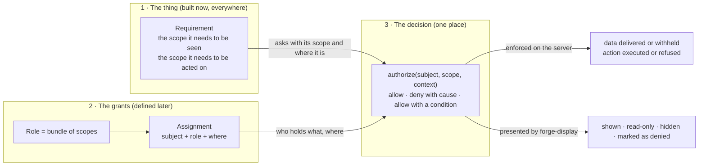
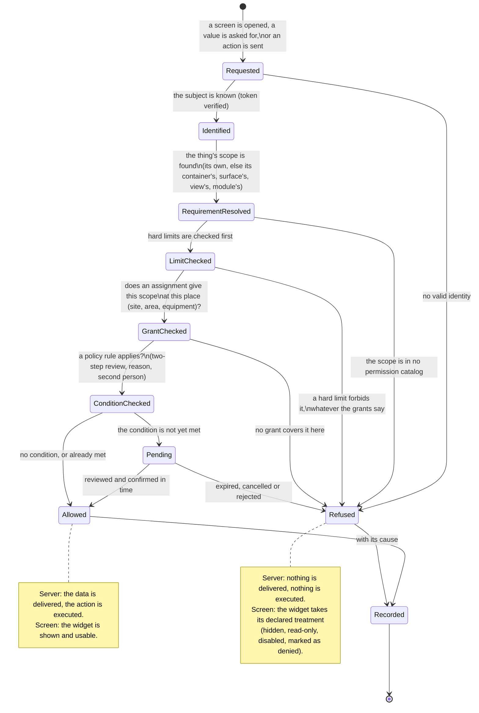
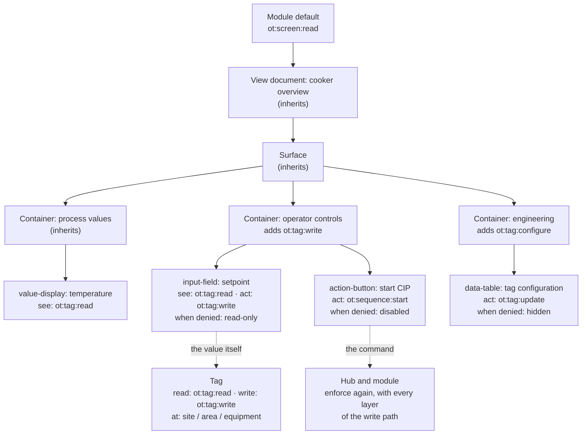

# The base permissions framework: a permission on every object and widget — design proposal

**Status: approved by reh3376 on 2026-11-25 as D-22** (the owner answered Q-1 to Q-10 one at a time, Q-2 revised for D-21, then, asked whether the record is signed: "Sign it"). It is the authorization chapter of the security framework (`security-framework.md`, D-21), whose rules win where the two differ. Nothing is built yet. Written 2026-11-23 on the owner's request. It builds on the signed role record (`roles.md`, D-1) and changes none of it.

Marks: **[OWNER]** the owner's words or decision · **[FACT]** verified in the repository · **[PROPOSED]** Claude's proposal · **[OPEN]** a question for the owner.

## 1. Why now

**[OWNER]** 2026-11-23: "We do not need to have all roles defined, we just need to account for the fact that security at role level will be needed, so we build it in to everything as we go." And: "the best way to implement a base permissions framework for hub and module level role models (user permission) … These security requirements will be a part of every object and widget in the forge UIs."

So the question is not which roles exist. It is: **what must every protected thing carry, and where is the one place that decides, so that roles can be added later without touching the things?**

## 2. What exists

- **[FACT]** The signed role record already fixes the model (`roles.md` §3): a **scope** is the atomic permission, `domain:resource:action`; a **role** is a named bundle of scopes; an **assignment** is subject + role + where it applies; a **policy rule** adds a condition (two people, a reason, an approval). One decision engine, many presets.
- **[FACT]** It also names the enforcement points (§5): every hub route names a scope; the OT write engine's roles become scopes; FVTS actions carry `required_scope`; a module asks through one SDK helper and never implements its own check; reads are scopes too, applied to queries (§10).
- **[FACT]** In the code: hub routes name a scope through `require_scope` (`forge_hub/gateway/rbac.py`), and forge-ot's control routes take that check from the hub when mounted (`forge_ot/host.py`). The hub's three roles expand to flat scopes with no "where".
- **[FACT]** What is missing for "every object and widget": an FVTS action names a `required_role` (a role name, not a scope); a surface, a point and an object name nothing; a widget instance in a view document (FUTS) names nothing; a tag names nothing; nothing lists the scopes a module defines; and no decision carries where it applies.

## 3. What a commercial SCADA designer does at this grain

Researched on the owner's suggestion (the product is not named here; the repository names no existing company). Its documented model, in general terms:

| What it has | How it works |
|---|---|
| Security levels as a tree | A level can have children; holding a child implies its parents. Levels are granted by rules over the identity provider's attributes. |
| Permissions at four grains | The project (who may open it), a view (who may load it), a component's events and actions, and a tag (who may read, who may write). |
| Inheritance on a screen | A component inherits its container's permissions unless that is switched off for it. |
| A treatment when denied | Per component, one of: an "access denied" overlay, disabled, events disabled, hidden. Overlay and disabled show the user that something is there; hidden does not. |
| A binding for the rest | A component's enabled or visible property can be bound to "is the user authorized for X". |
| Where the request comes from | Zones: the same user may be allowed less from outside the control room. |
| Two known weaknesses | The designer has more privilege than a client and cannot show a screen as a given user sees it. And hiding or disabling is presentation: what protects the data and the write is the server-side check on the tag and the action. |

What Forge should take from it: the four grains, inheritance, and the treatments. What it should do better: one decision point for all grains, no role names inside screens, and a designer that can show a screen as any set of permissions sees it.

## 4. The proposal in one picture

Three things are kept apart. Only the first has to exist in everything from the start.

## 5. The rules

| # | Rule | Mark |
|---|---|---|
| PF-1 | **Every protected thing names a scope, never a role.** A route, a hub function, a module command, a tag operation, a surface, a point, an object, an action, a widget instance. A role name inside a spec or a screen is a defect, because it fixes who may do it at design time. | [PROPOSED]; D-1 §5 says this for routes and actions |
| PF-2 | **Two requirements per thing where both apply: to see it and to act on it. Each is a set of scopes, all of which are needed.** A value display has only the first; a setpoint field has both. There is no "or" in a requirement: "engineers or supervisors" is two roles that hold the same scope. A set is what makes PF-7 checkable (case 1). | [PROPOSED]; D-1 R-11 makes reads scopes |
| PF-3 | **A module declares its scopes in a permission catalog**, a governed file: each scope's name, what it protects, whether it is a read or an action, and whether it can reach a process controller. A requirement may only name a scope that is in a catalog. This is the first spec kind of the security framework (FSTS, today planned). | [PROPOSED] |
| PF-4 | **One decision point.** `authorize(subject, scope, context)` answers allow, deny with its cause, or allow with a condition (two-step review, a reason, a second person: D-1's policy rules). The hub evaluates; a module asks through the SDK and never checks for itself. | D-1 §5 and R-6; the form of the answer is [PROPOSED] |
| PF-5 | **Every decision carries where.** The context is the resource's place: site, area, equipment, module, tag path, and the kind of screen it came from. Without it a role could not later be limited to one area. Built in from the start even while every grant is "everywhere". | [PROPOSED]; D-1 R-7 |
| PF-6 | **The server enforces; the screen only presents.** Data a subject may not read is not sent to the client at all. An action a subject may not take is refused by the hub or the module whatever the screen showed. Hiding a widget is never the protection. | D-1 §10 and A-7; stated here for widgets |
| PF-7 | **On a screen, a requirement is inherited downward and can only be narrowed.** A widget instance takes its requirement from its container, the container from the surface, the surface from the view, the view from the module's default. Most things set nothing and simply inherit. A child may add a requirement, down to a single widget, which is the fine control; it can never remove one an ancestor set. | [OWNER] 2026-11-23, Q-1: narrow only; differs from §3, where a child can loosen |
| PF-8 | **What a denied widget looks like is declared, from a governed list:** hidden, read-only, disabled, or marked as denied. The widget's spec says which of them it supports and its default; the view document may choose among those. | [PROPOSED] |
| PF-9 | **Hard limits are checked before any grant** (`forge-core/contract/lists/hard-limits.list.json`): no role and no assignment can allow what a hard limit forbids. | signed in D-17 §11.5 as a list; its place in the decision is [PROPOSED] |
| PF-10 | **There is one path through the decision, and no mode that skips it.** Without grants every check is refused and status says why. Development and the test suite run the same decision with a grant as data (a subject that holds every scope everywhere), which status shows and a production deployment refuses to load. A bypass switch would be a second path that the real one is never tested against (case 15). | [PROPOSED]; replaces the first draft's "development mode" |
| PF-11 | **Every decision is recorded:** subject, scope, context, outcome, the condition applied, and what justified it. A decision is made where access is given: once for an action, and once per subscription for a stream of values, not once per value (cases 4 and 12). Every refusal is recorded. | D-1 §5; what counts as one decision is [PROPOSED] |
| PF-12 | **The designer can show a screen as a set of scopes sees it**, and building is itself permissioned (`display:view:edit`, `ot:tag:create`). | [PROPOSED]; answers a weakness of §3 |
| PF-13 | **A screen never grants anything.** It can only ask for more than the data and the action already require. Whoever builds a screen cannot give a user access the user's grants do not give, because the server decides on the data's and the action's own requirement (PF-6). So the designer needs no rule about what its user may bind (case 8). | [PROPOSED]; follows from PF-6 and PF-7 |
| PF-14 | **A scope's name is permanent.** Specs, screens built on site and roles all name it. It is never renamed or reused; one that is replaced stays in the catalog as retired, with what replaces it. A catalog is released in versions, like a schema (case 13). | [PROPOSED] |
| PF-15 | **A decision holds until what it rested on changes.** The hub tells an open session when a grant it used is changed or withdrawn; the stream stops and the widget takes its treatment. An action is always decided at the moment it is executed, never from an earlier answer (cases 4 and 5). | [PROPOSED]; how fast is Q-8 |

## 6. How one decision is made

`Pending` is the state the OT write review gate already implements for one case (a staged write awaiting its token). The framework makes it the general form.

## 7. How fine the grain goes on one screen

An operator without `ot:tag:configure` never receives the engineering table's data and does not see the table. An operator in another area sees the setpoint as read-only, because the grant does not reach this equipment. Neither is decided by the screen.

## 8. Worked through: cases the design has to survive

The first draft went from rules to questions. These are the cases a permissions design usually fails on later, each taken through the rules above, with what it changed.

| # | Case | What happens | Effect on the rules |
|---|---|---|---|
| 1 | **What is a requirement, exactly?** If a child "adds" to its parent, the two must combine. | A requirement is a set of scopes, all needed. A child's set is its parent's plus its own. "Tighten only" is then a fact that can be checked on any view document: every child's set contains its parent's. | PF-2 revised. PF-7 is a law and gets an exhaustive check (case 16). |
| 2 | **A widget bound to protected data.** The screen says one thing, the tag another. | The widget needs both: its own set and the data's. The data's requirement holds on the server whatever the screen says. | PF-13 added. |
| 3 | **A table whose rows come from several areas.** | The requirement is on the kind of object; the place is each row's. The hub leaves out the rows the subject may not read, in the query. A row is absent, not "marked as denied". | Follows D-1 §10. A total over rows the subject cannot see is a leak: Q-9. |
| 4 | **Hundreds of widgets, values every second.** | Deciding per value is not possible. The decision is made when a stream is opened, per subject, scope and place; the stream then carries only what was allowed. | PF-11 and PF-15. |
| 5 | **A grant changes while a screen is open** (a shift ends, a role is withdrawn). | The hub tells the session; the stream stops; the widget takes its treatment. A write is decided again at execution, so a withdrawn permission cannot be used from an open screen. | PF-15. The delay for reads is Q-8. |
| 6 | **A hub cut off from the level above.** | It decides from the copy of the grants it holds (D-1 R-18), and the record of each decision says how old that copy was. Grants made while cut off are interim (D-17 §11.5). | No change; the record carries the copy's age. |
| 7 | **No person is acting:** a script, an expression tag, a sequence, a controller from forge-ml. | The subject is the service's own identity with its own scopes, declared in its module's catalog. Where a person started it, the person is carried along and both are checked (D-1 §5, `on_behalf_of`). A script does not run with its author's permissions: writing a script must not be a way to gain them. | Which scopes a script holds, and who approves that, is Q-10. |
| 8 | **The designer.** May a builder bind a widget to something the builder cannot do? | It does not matter for safety: a screen grants nothing (PF-13). Publishing a screen is approved separately (D-16). | PF-13 added. |
| 9 | **One screen, several modules.** | Each binding carries its own module's scope; the widget needs all of them. | None. |
| 10 | **A denied widget can still tell something:** a disabled button says the action exists; a label says a measurement exists. | When seeing is denied the default is hidden, and nothing about the data reaches the client. When only acting is denied the default is read-only. "Marked as denied" is a choice a site makes knowingly. | PF-8 gains defaults; the list is Q-5. |
| 11 | **Hiding a widget moves the layout.** | A treatment says whether the widget's space is kept. | Detail for the FUTS schema. |
| 12 | **The volume of records.** | One record per decision, as PF-11 now defines a decision; every refusal; not one per value. | PF-11 revised; this narrows how D-1 §5's "every decision" is read. |
| 13 | **A scope is renamed** after sites have built screens on it. | It cannot be. | PF-14 added. |
| 14 | **Access in an emergency,** or with the identity provider down. | Local accounts are in the first set of identity methods (D-1 R-10). The plant's own HMI can always take a loop back without Forge (D-11). Whether Forge needs a recorded emergency override is not decided here. | Out of scope; named so it is not forgotten. |
| 15 | **Before grants exist.** | The first draft proposed a development mode that allows everything. That is a second path through the code: everything developed under it has never met the real decision. Instead the real decision always runs, and development loads one grant as data. | PF-10 rewritten; Q-2 changed. |
| 16 | **How these are known to hold.** | Three statements are laws: a child never requires less than its parent; data a subject may not read is never delivered; an action is never executed on an earlier answer. Each gets an exhaustive check on the real code and a `verify-*` skill, as the rule in `CLAUDE.md` requires. | Added to §10's order of building. |

## 9. Questions for the owner, one at a time

| # | Question | Claude's recommendation |
|---|---|---|
| Q-1 | PF-7: may a widget only narrow what its container requires, or may it also loosen it? | **Answered 2026-11-23: tighten only.** The owner: "The vast majority of objects, widgets, and such will simply inherit their parents security settings. But we do want to give users the ability to control access at a fine level if needed"; then, to the two options put to them, "yes, option 1 is correct". Inherit by default; any widget, container, surface or view can add a requirement of its own; none can be open to someone its container is closed to. A container holds any widget. A value that more people must see than may enter a container sits outside it, or the container stays open and the stricter requirement goes on the other widgets in it. |
| Q-2 | PF-10: until grants exist, what does a hub do with a permission check? | Refuse it, and say why on status. No mode skips the decision: development and tests load one grant as data (a subject holding every scope), which status shows and a production deployment refuses. One path through the code, so nothing is built against a bypass. **Answered 2026-11-24, as revised for D-21: refuse with the cause on status; development holds real grants made through the framework (the developer's ceremony), tests fixture grants under a production-staged test anchor; no all-scopes subject anywhere.** *Noted 2026-11-25 (D-23 Q-2, D-21 SF-2 as amended): tests run under an anchor staged `test`, which has production's rules plus a test attestation root and which every hub release refuses.* |
| Q-3 | PF-3: is the permission catalog one governed file per module, approved by the owner like a spec? | Yes, as the first FSTS spec kind. It also closes M-10 (a module declares its scopes) without waiting for roles. **Answered 2026-11-24: "Accept".** |
| Q-4 | PF-1: FVTS actions name `required_role` today. Replace it with `required_scope` in the next schema version? | Yes. It is a breaking change to the view schema (a new major version), and D-1 §5 already calls for it. **Answered 2026-11-24: "Accept".** |
| Q-5 | PF-8: the treatments. Are hidden, read-only, disabled and marked-as-denied the right closed list? | Yes as a first list, as a governed list so a site cannot invent a fifth. **Answered 2026-11-24: "Accept".** |
| Q-6 | PF-5: which places can a grant be limited to from the start? | Site, area, equipment and module, plus the tag path for forge-ot. More can be added as attributes later without changing a requirement. **Answered 2026-11-24: "Accept".** |
| Q-8 | PF-15: how long may a withdrawn permission keep showing data on an open screen? (An action is never affected: it is decided at execution.) | Seconds, by the hub telling the session, with the token's lifetime (D-1 R-15, one hour by default) only as the backstop when a session cannot be reached. **Answered 2026-11-24: "Accept".** |
| Q-9 | Case 3: may a subject see a total or a count that includes rows they may not read? | No by default: totals are computed over what the subject may read. A total over everything is its own scope. **Answered 2026-11-24: "Accept".** |
| Q-10 | Case 7: which permissions does a script or a sequence run with, and who approves them? | Its own, declared when it is written and approved when it is published, never its author's and never the viewer's. **Answered 2026-11-24: "Accept".** |
| Q-7 | Where does the decision run for a module's own function: in the hub on every call, or in the module from a signed copy of the grants? | In the hub for anything a person triggers through forge-display; in the module, from the token's scopes, only for the fast path that cannot wait (a controller write keeps every layer either way). This follows D-1 R-8 (tokens verified offline). **Answered 2026-11-24: "Accept"; a module trusts only its own hub's tokens (D-21 SF-12).** |

## 10. What would be built, in order

1. **In forge-core (the contract):** the scope grammar, the `Requirement` and `Decision` types, the `authorize` interface, the context of "where", and the governed list of treatments. No roles.
2. **The permission catalog** as a governed file per module, with its checker: every route, action, tag operation and widget requirement names a scope that is in a catalog.
3. **The hub's decision point** behind the existing `require_scope`, taking the context, checking hard limits first, and recording each decision. Grants are a stub at first: the development mode or closed (Q-2).
4. **The view schemas:** requirements on surfaces, points, objects and actions (FVTS), and on widget instances with their treatment (FUTS). The hub's own four screens are the first to carry them.
5. **forge-ot:** tag operations ask for their scopes (FB-251), and the write engine's roles become scopes.
6. **The three laws of case 16**, each with its exhaustive check and its `verify-*` skill, as the parts they cover are built.
7. **Later, without touching 1 to 5:** roles, assignments, sign-in, and the administrator's screens (FB-189 to FB-195).

## 11. What this does not decide

Which roles exist, who holds them, how people sign in, and how grants travel between hubs. Those are the role model's (D-1, and the authority model of D-17 §11.5), and nothing above constrains them beyond what D-1 already signed.
