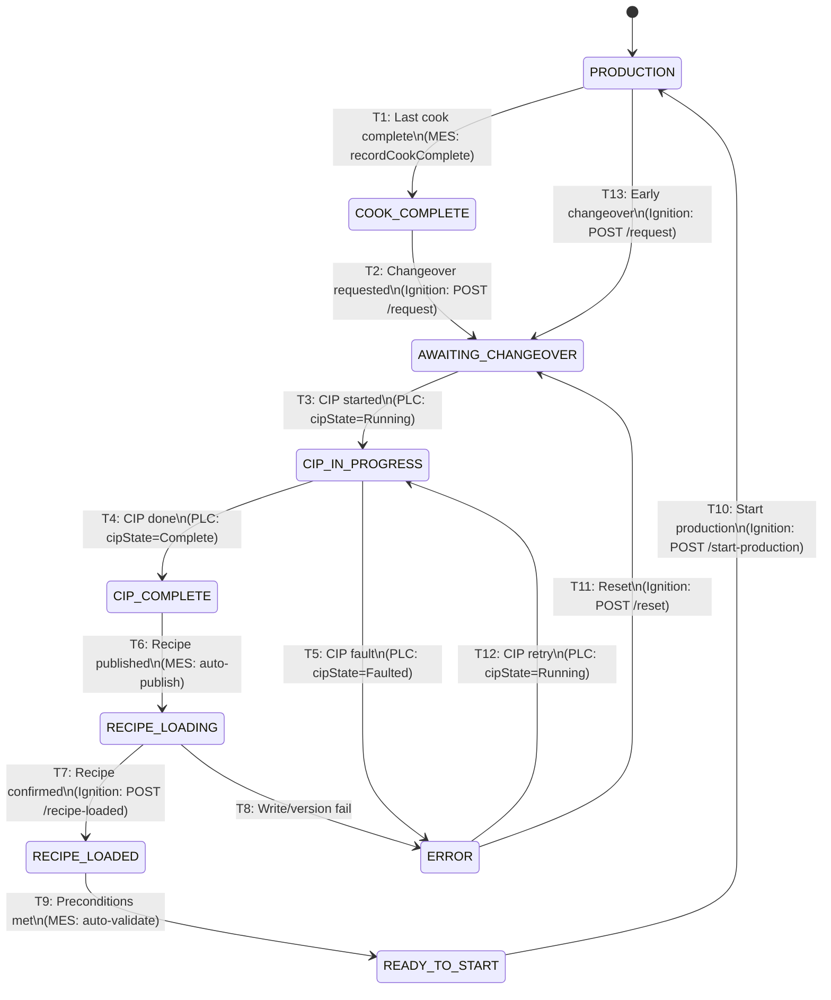
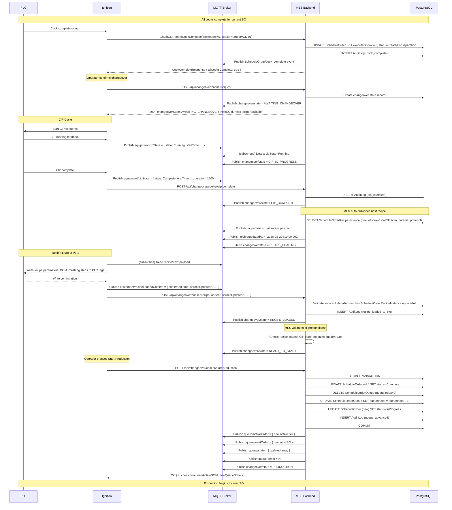
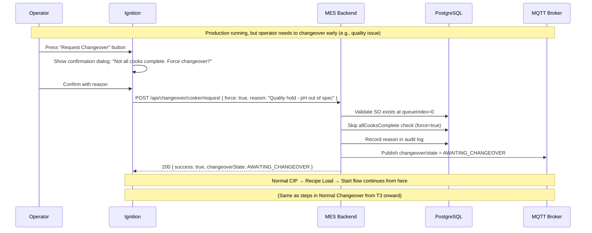
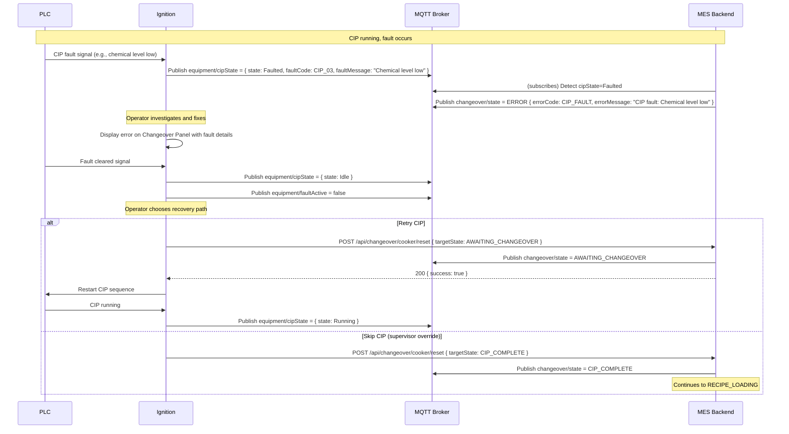
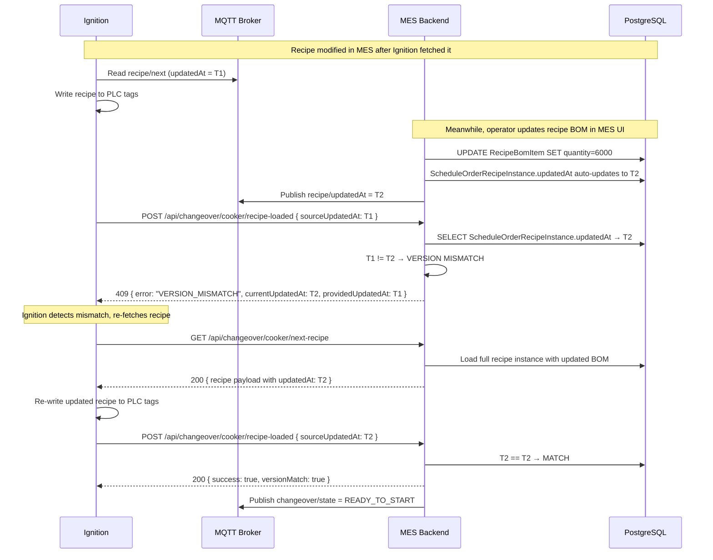

# Ignition Changeover Specification

> **Version**: 1.0
> **Last Updated**: 2026-02-20
> **Audience**: Ignition Developer, MES Team
> **Status**: Draft

---

## Table of Contents

1. [Overview & Glossary](#1-overview--glossary)
2. [Changeover State Machine](#2-changeover-state-machine)
3. [UNS Tag Structure](#3-uns-tag-structure)
4. [REST API Endpoints](#4-rest-api-endpoints)
5. [Ignition UI Screens](#5-ignition-ui-screens)
6. [Tag-to-MES Data Mapping](#6-tag-to-mes-data-mapping)
7. [Sequence Diagrams](#7-sequence-diagrams)
8. [Implementation Notes](#8-implementation-notes)

---

## 1. Overview & Glossary

### What Is Changeover?

Changeover is the process of transitioning production equipment between Schedule Orders. When the current production run finishes (all cooks complete), the equipment must be cleaned (CIP), the next recipe loaded to PLCs, and the next order started. This specification defines the contracts between the MES backend and Ignition so that Ignition can drive the operator-facing changeover workflow.

### Key Terms

| Term | Definition |
|------|-----------|
| **Schedule Order (SO)** | A production run grouping one or more Production Orders with the same mash bill. The unit of work on the production floor. |
| **Queue Index** | Integer position in the schedule order queue. `0` = currently active, `1` = on-deck (next), `2+` = future. Negative values = completed/historical. |
| **CIP** | Clean-In-Place. Automated cleaning cycle for equipment between production runs. |
| **Recipe Instance** | A `ScheduleOrderRecipeInstance` — a frozen copy of the master recipe created when an SO becomes active. Contains BOM, mashing protocols, and parameters. |
| **S88 States** | ISA-88 standard states for batch control: Idle, Running, Complete, Held, Aborted, Stopped. |
| **Production Phase** | A stage of production: Mashing, Fermentation, Distillation, Barreling. |
| **UNS** | Unified Namespace — the ISA-95 MQTT topic hierarchy used for all MES/PLC data exchange. |
| **Area** | An independent production zone. Each area has its own changeover cycle. Current areas: **Cooker**, **Fermentation**, **Barreling**. |
| **PLC** | Programmable Logic Controller — the equipment controller that Ignition interfaces with directly. |

### Area Scope

Each area operates an **independent changeover cycle**. The Cooker area may be in `CIP_IN_PROGRESS` while Fermentation is still in `PRODUCTION`. The state machine described below runs **per area**.

```
Areas:
  cooker        — Grain milling, cooking, mashing
  fermentation  — Yeast pitch, fermentation hold, beer well
  barreling     — Distillation, proofing, barrel fill
```

---

## 2. Changeover State Machine

### States

| State | Description | Owner |
|-------|-------------|-------|
| `PRODUCTION` | Normal production in progress. Current SO at queueIndex 0. | MES + Ignition |
| `COOK_COMPLETE` | All cooks for the current SO are done. Awaiting changeover initiation. | MES sets via `recordCookComplete()` |
| `AWAITING_CHANGEOVER` | Changeover requested. Waiting for CIP to begin. | MES sets on changeover request |
| `CIP_IN_PROGRESS` | CIP cycle actively running on equipment. | Ignition/PLC drives |
| `CIP_COMPLETE` | CIP finished successfully. Equipment clean. | Ignition/PLC reports |
| `RECIPE_LOADING` | MES has published the next recipe; Ignition is writing to PLC tags. | Ignition drives |
| `RECIPE_LOADED` | Recipe written to PLC and confirmed. Version validated. | Ignition confirms via REST |
| `READY_TO_START` | All preconditions met. Operator can start the next order. | MES sets after validation |
| `ERROR` | Something failed during changeover. Requires recovery action. | Either side can set |

### State Transition Table

| # | From State | To State | Trigger | Owner | MES Method / Endpoint |
|---|-----------|----------|---------|-------|-----------------------|
| T1 | `PRODUCTION` | `COOK_COMPLETE` | Last cook signals complete from PLC | MES | `recordCookComplete()` — sets `allCooksComplete=true` |
| T2 | `COOK_COMPLETE` | `AWAITING_CHANGEOVER` | Ignition calls changeover request | Ignition | `POST /api/changeover/{area}/request` (new) |
| T3 | `AWAITING_CHANGEOVER` | `CIP_IN_PROGRESS` | PLC starts CIP sequence | Ignition/PLC | Ignition publishes `equipment/cipState = "Running"` |
| T4 | `CIP_IN_PROGRESS` | `CIP_COMPLETE` | PLC reports CIP done | Ignition/PLC | Ignition publishes `equipment/cipState = "Complete"` |
| T5 | `CIP_IN_PROGRESS` | `ERROR` | CIP fault occurs | PLC | Ignition publishes `equipment/cipState = "Faulted"` + `faultCode` |
| T6 | `CIP_COMPLETE` | `RECIPE_LOADING` | MES publishes next recipe to UNS; Ignition begins PLC write | MES → Ignition | MES auto-publishes `recipe/next` on CIP_COMPLETE detection |
| T7 | `RECIPE_LOADING` | `RECIPE_LOADED` | Ignition confirms recipe written to PLC | Ignition | `POST /api/changeover/{area}/recipe-loaded` (new) |
| T8 | `RECIPE_LOADING` | `ERROR` | Recipe write failed or version mismatch | Ignition | Ignition publishes error; calls `POST /api/changeover/{area}/reset` |
| T9 | `RECIPE_LOADED` | `READY_TO_START` | MES validates all preconditions | MES | Automatic after recipe-loaded confirmation |
| T10 | `READY_TO_START` | `PRODUCTION` | Operator starts next order | Ignition | `POST /api/changeover/{area}/start-production` (new) |
| T11 | `ERROR` | `AWAITING_CHANGEOVER` | Operator resets; MES clears error | Ignition | `POST /api/changeover/{area}/reset` (new) |
| T12 | `ERROR` | `CIP_IN_PROGRESS` | CIP retry after fault clear | Ignition/PLC | PLC re-initiates CIP after fault clear |
| T13 | `PRODUCTION` | `AWAITING_CHANGEOVER` | Operator initiates early changeover | Ignition | `POST /api/changeover/{area}/request` with `force=true` |

### State Diagram



---

## 3. UNS Tag Structure

All tags follow the ISA-95 namespace convention:

```
whk/whk01/{area}/{category}/{detail}
```

Where `{area}` is one of: `cooker`, `fermentation`, `barreling`.

### 3.1 MES-Published Tags (Ignition Reads)

#### `whk/whk01/{area}/changeover/state`

Current changeover state for this area. Retained message.

```jsonc
{
  "state": "CIP_COMPLETE",           // enum: see state machine
  "previousState": "CIP_IN_PROGRESS",
  "transitionTimestamp": "2026-02-20T14:30:00.000Z",
  "currentSOId": "clx1abc...",        // Schedule Order currently active
  "currentSOName": "SHO260510101",
  "nextSOId": "clx2def...",           // Next Schedule Order in queue
  "nextSOName": "SHO260510102",
  "errorMessage": null,               // populated when state=ERROR
  "errorCode": null,                  // populated when state=ERROR
  "area": "cooker"
}
```

| Field | Type | Description |
|-------|------|-------------|
| `state` | `string` | Current changeover state enum value |
| `previousState` | `string` | State before the current transition |
| `transitionTimestamp` | `string` (ISO-8601) | When the last transition occurred |
| `currentSOId` | `string` | Active Schedule Order ID (queueIndex=0) |
| `currentSOName` | `string \| null` | Human-readable SO name |
| `nextSOId` | `string \| null` | Next SO ID (queueIndex=1) |
| `nextSOName` | `string \| null` | Human-readable next SO name |
| `errorMessage` | `string \| null` | Error description when `state=ERROR` |
| `errorCode` | `string \| null` | Machine-readable error code |
| `area` | `string` | Area identifier |

#### `whk/whk01/{area}/queue/activeOrder`

Details of the currently active Schedule Order. Retained.

```jsonc
{
  "scheduleOrderId": "clx1abc...",
  "name": "SHO260510101",
  "status": "InProgress",
  "recipeName": "Bourbon Mash #4",
  "recipeGroupId": "clxrg...",
  "totalCooks": 6,
  "executedCooks": 6,
  "completedCooks": 6,
  "totalFermenters": 2,
  "executedFermenters": 0,
  "totalBarrels": 150,
  "totalProofGallons": 7960.5,
  "totalGrainWeight": 12000.0,
  "estimatedStart": "2026-02-18T06:00:00.000Z",
  "estimatedEnd": "2026-02-22T18:00:00.000Z",
  "actualStart": "2026-02-18T06:15:00.000Z",
  "queueIndex": 0
}
```

| Field | Type | Description |
|-------|------|-------------|
| `scheduleOrderId` | `string` | Prisma ID |
| `name` | `string` | SO name (e.g., `SHO260510101`) |
| `status` | `string` | `EnumScheduleOrderStatus` value |
| `recipeName` | `string` | Recipe name from the SO |
| `recipeGroupId` | `string` | Recipe group ID |
| `totalCooks` | `int` | Total planned cooks |
| `executedCooks` | `int` | Cooks completed so far |
| `completedCooks` | `int` | Confirmed completed cooks |
| `totalFermenters` | `int` | Planned fermenter count |
| `executedFermenters` | `int` | Fermenters filled so far |
| `totalBarrels` | `int` | Planned barrel count |
| `totalProofGallons` | `float` | Planned proof gallons |
| `totalGrainWeight` | `float` | Total grain weight (lbs) |
| `estimatedStart` | `string` (ISO-8601) | Planned start datetime |
| `estimatedEnd` | `string` (ISO-8601) | Planned end datetime |
| `actualStart` | `string \| null` (ISO-8601) | Actual start datetime |
| `queueIndex` | `int` | Always `0` for active order |

#### `whk/whk01/{area}/queue/nextOrder`

Details of the next Schedule Order (queueIndex=1). Same schema as `activeOrder`. Retained. Payload is `null` if no next order exists.

#### `whk/whk01/{area}/queue/state`

Full queue as an ordered array. Retained.

```jsonc
[
  {
    "queueIndex": 0,
    "scheduleOrderId": "clx1abc...",
    "scheduleOrderName": "SHO260510101",
    "status": "InProgress",
    "recipeName": "Bourbon Mash #4"
  },
  {
    "queueIndex": 1,
    "scheduleOrderId": "clx2def...",
    "scheduleOrderName": "SHO260510102",
    "status": "Scheduled",
    "recipeName": "Rye Mash #2"
  }
]
```

| Field | Type | Description |
|-------|------|-------------|
| `queueIndex` | `int` | Position in queue |
| `scheduleOrderId` | `string` | SO ID |
| `scheduleOrderName` | `string \| null` | SO display name |
| `status` | `string` | SO status enum value |
| `recipeName` | `string` | Recipe name |

#### `whk/whk01/{area}/queue/depth`

Integer count of items in the queue. Retained.

```jsonc
3
```

#### `whk/whk01/{area}/recipe/next`

Full recipe payload for the next order. Published when the next SO reaches queueIndex=1 and its `ScheduleOrderRecipeInstance` is created. Retained.

```jsonc
{
  "scheduleOrderId": "clx2def...",
  "scheduleOrderRecipeInstanceId": "clxsri...",
  "recipeName": "Rye Mash #2",
  "recipeId": "clxr...",
  "recipeRevision": 3,
  "status": "Created",
  "bom": [
    {
      "bomId": "clxbom1...",
      "items": [
        {
          "itemId": "clxi1...",
          "itemName": "Rye Grain",
          "itemNumber": "GRN-RYE-001",
          "quantity": 5000.0,
          "unit": "lbs",
          "unitAbbreviation": "lbs"
        },
        {
          "itemId": "clxi2...",
          "itemName": "Malted Barley",
          "itemNumber": "GRN-MALT-001",
          "quantity": 1500.0,
          "unit": "lbs",
          "unitAbbreviation": "lbs"
        }
      ]
    }
  ],
  "parameters": [
    {
      "parameterId": "clxp1...",
      "name": "Mash Temperature",
      "category": "Mashing",
      "setpointType": "Numerical",
      "numericalSetpoint": 152.0,
      "upperLimit": 155.0,
      "lowerLimit": 148.0,
      "unit": "Fahrenheit",
      "unitAbbreviation": "°F"
    }
  ],
  "mashingProtocols": [
    {
      "protocolId": "clxmp1...",
      "name": "Standard Rye Mash",
      "steps": [
        {
          "stepId": "clxs1...",
          "index": 0,
          "stepType": "HeatAndHold",
          "holdType": "Time",
          "stepTime": 30,
          "temperatureSetpoint": 152.0,
          "heatEnabled": true,
          "heatTempSp": 155.0,
          "coolEnabled": false,
          "coolTempSp": null,
          "agitatorEnabled": true,
          "agitatorSpdSp": 60,
          "promptMessage": null,
          "ingredients": [
            {
              "itemName": "Rye Grain",
              "quantity": 2500.0,
              "unit": "lbs"
            }
          ]
        }
      ]
    }
  ],
  "updatedAt": "2026-02-20T10:00:00.000Z"
}
```

#### `whk/whk01/{area}/recipe/updatedAt`

Change-detection timestamp for the recipe payload. Ignition compares this against its last-loaded value to detect recipe changes. Retained.

```jsonc
"2026-02-20T10:00:00.000Z"
```

### 3.2 Ignition-Published Tags (MES Reads)

#### `whk/whk01/{area}/equipment/cipState`

CIP lifecycle state. Retained.

```jsonc
{
  "state": "Running",
  "startTime": "2026-02-20T14:00:00.000Z",
  "endTime": null,
  "duration": null,
  "faultCode": null,
  "faultMessage": null
}
```

| Field | Type | Values | Description |
|-------|------|--------|-------------|
| `state` | `string` | `Idle`, `Running`, `Complete`, `Faulted` | CIP lifecycle state |
| `startTime` | `string \| null` (ISO-8601) | — | When CIP started |
| `endTime` | `string \| null` (ISO-8601) | — | When CIP ended |
| `duration` | `int \| null` | Seconds | CIP duration |
| `faultCode` | `string \| null` | — | PLC fault code if `Faulted` |
| `faultMessage` | `string \| null` | — | Human-readable fault description |

#### `whk/whk01/{area}/equipment/recipeLoadedConfirm`

Boolean. Ignition sets `true` after successfully writing the recipe payload to PLC tags. Retained.

```jsonc
{
  "confirmed": true,
  "scheduleOrderRecipeInstanceId": "clxsri...",
  "loadedAt": "2026-02-20T14:35:00.000Z",
  "sourceUpdatedAt": "2026-02-20T10:00:00.000Z"
}
```

| Field | Type | Description |
|-------|------|-------------|
| `confirmed` | `boolean` | `true` when recipe is in PLC |
| `scheduleOrderRecipeInstanceId` | `string` | Which recipe instance was loaded |
| `loadedAt` | `string` (ISO-8601) | When the load completed |
| `sourceUpdatedAt` | `string` (ISO-8601) | The `recipe/updatedAt` value that was loaded — used for version validation |

#### `whk/whk01/{area}/equipment/readyForProduction`

Boolean. Ignition sets `true` when all preconditions for production start are met from the equipment side. Retained.

```jsonc
true
```

#### `whk/whk01/{area}/equipment/mode`

Current equipment operating mode. Retained.

```jsonc
"Auto"
```

| Value | Description |
|-------|-------------|
| `Auto` | Normal automatic operation |
| `Manual` | Operator has taken manual control |
| `Maintenance` | Equipment in maintenance mode — changeover blocked |

#### `whk/whk01/{area}/equipment/faultActive`

Boolean. `true` when any equipment fault is active. Retained.

```jsonc
false
```

---

## 4. REST API Endpoints

All changeover endpoints are under the prefix:

```
/api/changeover/{area}
```

Where `{area}` is one of: `cooker`, `fermentation`, `barreling`.

**Authentication**: Bearer JWT token in `Authorization` header (same as all MES endpoints).

**Note**: These are **new endpoints** that need to be implemented. The existing MES has GraphQL mutations for `recordCookComplete`, `recordRecipeLoadedToPLC`, and `advanceScheduleOrderQueue`. The REST endpoints below provide an HTTP-native interface for Ignition, which is simpler for Ignition's scripting environment than GraphQL.

### 4.1 `POST /api/changeover/{area}/request`

**Purpose**: Ignition requests that the MES initiate a changeover for the specified area.

**When to call**: After all cooks complete (operator confirmation), or for early/forced changeover.

**Request**:

```jsonc
{
  "scheduleOrderId": "clx1abc...",    // Current SO being completed
  "requestedBy": "operator@whk.com",  // User or system identity
  "reason": "All cooks complete",     // Human-readable reason
  "force": false                       // true = skip cook-complete validation
}
```

| Field | Type | Required | Description |
|-------|------|----------|-------------|
| `scheduleOrderId` | `string` | Yes | The SO currently at queueIndex=0 |
| `requestedBy` | `string` | Yes | Identity of who/what initiated |
| `reason` | `string` | No | Free-text reason |
| `force` | `boolean` | No | Skip `allCooksComplete` check (for early changeover) |

**Response `200 OK`**:

```jsonc
{
  "success": true,
  "changeoverState": "AWAITING_CHANGEOVER",
  "currentSOId": "clx1abc...",
  "currentSOName": "SHO260510101",
  "nextSOId": "clx2def...",
  "nextSOName": "SHO260510102",
  "nextRecipeAvailable": true,
  "auditLogId": "clxaudit..."
}
```

**Error responses**:

| Status | Condition |
|--------|-----------|
| `400` | `scheduleOrderId` is not at queueIndex=0 |
| `400` | All cooks not complete and `force=false` |
| `404` | Schedule Order not found |
| `409` | Changeover already in progress for this area |
| `422` | No next SO in queue (queue depth < 2) |

### 4.2 `POST /api/changeover/{area}/cip-complete`

**Purpose**: Ignition reports that CIP has completed successfully.

**When to call**: After PLC reports CIP cycle finished without faults. (This is the REST complement to the MQTT `cipState=Complete` tag — use either mechanism, not both.)

**Request**:

```jsonc
{
  "scheduleOrderId": "clx1abc...",
  "cipStartTime": "2026-02-20T14:00:00.000Z",
  "cipEndTime": "2026-02-20T14:25:00.000Z",
  "cipDurationSeconds": 1500,
  "reportedBy": "ignition-gateway"
}
```

| Field | Type | Required | Description |
|-------|------|----------|-------------|
| `scheduleOrderId` | `string` | Yes | SO that triggered the changeover |
| `cipStartTime` | `string` (ISO-8601) | Yes | When CIP started |
| `cipEndTime` | `string` (ISO-8601) | Yes | When CIP completed |
| `cipDurationSeconds` | `int` | No | Duration in seconds |
| `reportedBy` | `string` | No | Reporting identity |

**Response `200 OK`**:

```jsonc
{
  "success": true,
  "changeoverState": "CIP_COMPLETE",
  "nextRecipePublished": true,
  "nextSOId": "clx2def...",
  "auditLogId": "clxaudit..."
}
```

**Error responses**:

| Status | Condition |
|--------|-----------|
| `400` | Area is not in `CIP_IN_PROGRESS` state |
| `404` | Schedule Order not found |

### 4.3 `POST /api/changeover/{area}/recipe-loaded`

**Purpose**: Ignition confirms that the next recipe has been successfully written to PLC tags.

**When to call**: After Ignition reads `recipe/next` from UNS, writes all values to PLC tags, and verifies the write.

**Request**:

```jsonc
{
  "scheduleOrderId": "clx2def...",
  "scheduleOrderRecipeInstanceId": "clxsri...",
  "sourceUpdatedAt": "2026-02-20T10:00:00.000Z",
  "cookerNumber": "CK-01",
  "loadedBy": "ignition-gateway",
  "loadedAt": "2026-02-20T14:35:00.000Z"
}
```

| Field | Type | Required | Description |
|-------|------|----------|-------------|
| `scheduleOrderId` | `string` | Yes | The **next** SO whose recipe was loaded |
| `scheduleOrderRecipeInstanceId` | `string` | Yes | Recipe instance ID from the recipe payload |
| `sourceUpdatedAt` | `string` (ISO-8601) | Yes | The `updatedAt` from the recipe payload. MES validates this matches the current recipe instance `updatedAt` to detect stale loads. |
| `cookerNumber` | `string` | Yes | Equipment identifier |
| `loadedBy` | `string` | No | Identity |
| `loadedAt` | `string` (ISO-8601) | No | When the load completed |

**Response `200 OK`**:

```jsonc
{
  "success": true,
  "changeoverState": "READY_TO_START",
  "scheduleOrderId": "clx2def...",
  "scheduleOrderRecipeInstanceId": "clxsri...",
  "versionMatch": true,
  "loadedUpdatedAt": "2026-02-20T10:00:00.000Z",
  "auditLogId": "clxaudit..."
}
```

**Error responses**:

| Status | Condition |
|--------|-----------|
| `400` | Area is not in `RECIPE_LOADING` or `CIP_COMPLETE` state |
| `404` | Schedule Order or Recipe Instance not found |
| `409` | **Version mismatch** — `sourceUpdatedAt` does not match the current recipe instance `updatedAt`. Recipe was modified after Ignition fetched it. Ignition must re-fetch and re-load. |

### 4.4 `POST /api/changeover/{area}/start-production`

**Purpose**: Start the next Schedule Order. Advances the queue and begins production.

**When to call**: Operator presses "Start Production" after all changeover steps are complete.

**Request**:

```jsonc
{
  "scheduleOrderId": "clx2def...",
  "startedBy": "operator@whk.com",
  "notes": "All checks passed, starting production"
}
```

| Field | Type | Required | Description |
|-------|------|----------|-------------|
| `scheduleOrderId` | `string` | Yes | The SO to start (must be at queueIndex=1) |
| `startedBy` | `string` | Yes | Operator identity |
| `notes` | `string` | No | Free-text notes |

**Response `200 OK`**:

```jsonc
{
  "success": true,
  "changeoverState": "PRODUCTION",
  "previousSOId": "clx1abc...",
  "previousSOName": "SHO260510101",
  "newActiveSOId": "clx2def...",
  "newActiveSOName": "SHO260510102",
  "newQueueState": [
    { "queueIndex": 0, "scheduleOrderId": "clx2def...", "scheduleOrderName": "SHO260510102" },
    { "queueIndex": 1, "scheduleOrderId": "clx3ghi...", "scheduleOrderName": "SHO260510103" }
  ],
  "auditLogId": "clxaudit..."
}
```

**Error responses**:

| Status | Condition |
|--------|-----------|
| `400` | Area is not in `READY_TO_START` state |
| `400` | SO is not at queueIndex=1 |
| `404` | Schedule Order not found |
| `409` | Equipment not in `Auto` mode |
| `409` | Equipment fault active |

**MES backend flow**: This endpoint orchestrates the existing `startOrder()` and `advanceScheduleOrderQueue()` methods inside a transaction:
1. Calls `ScheduleOrderService.advanceScheduleOrderQueue()` — marks current SO complete, shifts queue
2. Calls `ScheduleOrderQueueService.startOrder()` — moves next SO to position 0, sets InProgress
3. Publishes updated queue state and changeover state to UNS
4. Creates audit log

### 4.5 `GET /api/changeover/{area}/next-recipe`

**Purpose**: Fetch (or re-fetch) the full recipe payload for the next SO. Useful when Ignition needs to reload after a version mismatch or on screen refresh.

**When to call**: Anytime, but typically during `RECIPE_LOADING` state or to verify recipe content.

**Request**: No body. Query parameters:

| Param | Type | Required | Description |
|-------|------|----------|-------------|
| `scheduleOrderId` | `string` | No | Specific SO to get recipe for. Defaults to queueIndex=1. |

**Response `200 OK`**:

Same schema as the `recipe/next` UNS tag payload (see Section 3.1).

**Error responses**:

| Status | Condition |
|--------|-----------|
| `404` | No next SO in queue, or SO has no recipe instance |

### 4.6 `POST /api/changeover/{area}/reset`

**Purpose**: Reset the changeover state machine after an error. Clears error state and returns to `AWAITING_CHANGEOVER` so the operator can retry.

**When to call**: After an error has been investigated and the operator wants to retry the changeover.

**Request**:

```jsonc
{
  "resetBy": "operator@whk.com",
  "reason": "CIP fault cleared, retrying",
  "targetState": "AWAITING_CHANGEOVER"
}
```

| Field | Type | Required | Description |
|-------|------|----------|-------------|
| `resetBy` | `string` | Yes | Identity of who reset |
| `reason` | `string` | No | Why the reset is needed |
| `targetState` | `string` | No | State to reset to. Default `AWAITING_CHANGEOVER`. Allowed: `AWAITING_CHANGEOVER`, `CIP_COMPLETE` |

**Response `200 OK`**:

```jsonc
{
  "success": true,
  "changeoverState": "AWAITING_CHANGEOVER",
  "previousErrorCode": "CIP_FAULT_03",
  "previousErrorMessage": "CIP rinse cycle timeout",
  "auditLogId": "clxaudit..."
}
```

**Error responses**:

| Status | Condition |
|--------|-----------|
| `400` | Area is not in `ERROR` state |
| `400` | Invalid `targetState` value |

---

## 5. Ignition UI Screens

### 5.1 Per-Area Changeover Panel

The primary operator screen during changeover. Shows the step-by-step workflow for a single area.

```
+============================================================================+
|  COOKER CHANGEOVER                                    [Auto] [No Faults]   |
+============================================================================+
|                                                                            |
|  +-CURRENT ORDER---------+    +-NEXT ORDER-----------+                     |
|  | SHO260510101          |    | SHO260510102          |                    |
|  | Bourbon Mash #4       |    | Rye Mash #2           |                    |
|  | Status: Complete       |    | Status: Scheduled      |                   |
|  | Cooks: 6/6 [########] |    | Cooks: 0/4             |                   |
|  | Grain: 12,000 lbs      |    | Grain: 8,500 lbs       |                  |
|  | Barrels: 150           |    | Barrels: 100            |                  |
|  +------------------------+    +--------------------------+                 |
|                                                                            |
|  +-CHANGEOVER PROGRESS---------------------------------------------------+ |
|  |                                                                       | |
|  |  [1. Request]  [2. CIP]  [3. Recipe]  [4. Verify]  [5. Start]       | |
|  |     [DONE]      [=====>]   [ --- ]      [ --- ]      [ --- ]        | |
|  |                                                                       | |
|  |  CIP Status: Running                                                  | |
|  |  Started: 14:00:00    Elapsed: 12m 30s    Est. Remaining: 12m 30s    | |
|  |  [|||||||||||||||||||>                                   ] 50%         | |
|  |                                                                       | |
|  +-----------------------------------------------------------------------+ |
|                                                                            |
|  +-ACTIONS---------------------------------------------------------------+ |
|  |                                                                       | |
|  |  [ Request Changeover ]  [ Skip CIP ]  [ Load Recipe ]               | |
|  |  [ Start Production   ]  [ Reset     ]  [ Refresh Recipe ]           | |
|  |                                                                       | |
|  +-----------------------------------------------------------------------+ |
|                                                                            |
|  +-AUDIT LOG-------------------------------------------------------------+ |
|  | 14:30:00  CIP started by ignition-gateway                             | |
|  | 14:00:12  Changeover requested by operator@whk.com                    | |
|  | 13:58:45  Cook 6/6 complete on CK-01                                  | |
|  +-----------------------------------------------------------------------+ |
+============================================================================+
```

**Data Sources**:

| UI Element | Data Source | Update Mechanism |
|------------|-----------|------------------|
| Current Order card | `queue/activeOrder` tag | MQTT subscription |
| Next Order card | `queue/nextOrder` tag | MQTT subscription |
| Changeover state | `changeover/state` tag | MQTT subscription |
| CIP progress | `equipment/cipState` tag | MQTT subscription |
| Equipment mode | `equipment/mode` tag | MQTT subscription |
| Fault indicator | `equipment/faultActive` tag | MQTT subscription |

**Button Actions**:

| Button | REST Call | Enabled When |
|--------|-----------|-------------|
| Request Changeover | `POST /api/changeover/{area}/request` | State = `PRODUCTION` or `COOK_COMPLETE` |
| Skip CIP | (Direct state override — privileged) | State = `AWAITING_CHANGEOVER`, requires supervisor |
| Load Recipe | (Automatic — Ignition reads `recipe/next` and writes to PLC) | State = `CIP_COMPLETE` or `RECIPE_LOADING` |
| Start Production | `POST /api/changeover/{area}/start-production` | State = `READY_TO_START` |
| Reset | `POST /api/changeover/{area}/reset` | State = `ERROR` |
| Refresh Recipe | `GET /api/changeover/{area}/next-recipe` | Any state (re-fetches from MES) |

### 5.2 Queue Management View

Shows the full schedule order queue with reorder controls and changeover timing estimates.

```
+============================================================================+
|  SCHEDULE ORDER QUEUE                              Depth: 5                |
+============================================================================+
|                                                                            |
|  +--+-------+------------------+----------------+--------+--------+------+ |
|  |Ix| SO#   | Recipe           | Barrels | Cooks | Status | Est.   | Ops  | |
|  +--+-------+------------------+---------+-------+--------+--------+------+ |
|  | 0| SHO101| Bourbon Mash #4  |    150  |  6/6  | InProg | --:--  |      | |
|  | 1| SHO102| Rye Mash #2      |    100  |  0/4  | Sched  | 02:30  | [^v] | |
|  | 2| SHO103| Bourbon Mash #4  |    200  |  0/8  | Sched  | 05:15  | [^v] | |
|  | 3| SHO104| Corn Whiskey #1  |     75  |  0/3  | Sched  | 08:00  | [^v] | |
|  | 4| SHO105| Bourbon Mash #4  |    150  |  0/6  | Sched  | 11:30  | [^v] | |
|  +--+-------+------------------+---------+-------+--------+--------+------+ |
|                                                                            |
|  +-TIMELINE BAR----------------------------------------------------------+ |
|  |  [SHO101|##########][CO][SHO102|######][CO][SHO103|############]...   | |
|  |  06:00   10:00   14:00   16:30   20:00   22:30   04:00   08:00       | |
|  +-----------------------------------------------------------------------+ |
|                                                                            |
|  +-ACTIONS---------------------------------------------------------------+ |
|  |  [ Add to Queue ]  [ Remove Selected ]  [ Resequence ]               | |
|  +-----------------------------------------------------------------------+ |
+============================================================================+
```

**Column Mappings**:

| Column | Source |
|--------|--------|
| Ix | `ScheduleOrderQueue.queueIndex` |
| SO# | `ScheduleOrder.name` |
| Recipe | `ScheduleOrder.recipeName` |
| Barrels | `ScheduleOrder.totalBarrels` |
| Cooks | `ScheduleOrder.executedCooks / totalCooks` |
| Status | `ScheduleOrder.status` |
| Est. | Calculated from `estimatedMashingDuration` + changeover allowance |
| Ops | `PATCH /scheduleOrderQueues/update-schedule-order-queue-index/:id` |

**`[CO]` blocks** in the timeline represent estimated changeover duration (configurable, default 30min for CIP + recipe load).

**Button Actions**:

| Button | REST Call |
|--------|-----------|
| Move Up/Down (`[^v]`) | `PATCH /scheduleOrderQueues/update-schedule-order-queue-index/:id` with `{ newIndex }` |
| Remove Selected | `DELETE /scheduleOrderQueues/deschedule-schedule-order/:id` with `{ userId }` |
| Add to Queue | `POST /scheduleOrderQueues/create-and-queue-schedule-order` |

### 5.3 Dashboard Overview

All areas at a glance. Designed for wall-mounted displays or supervisor stations.

```
+============================================================================+
|  PRODUCTION OVERVIEW                           2026-02-20 14:32:00        |
+============================================================================+
|                                                                            |
|  +-COOKER--------------------+  +-FERMENTATION-----------+                 |
|  | State: CIP_IN_PROGRESS    |  | State: PRODUCTION       |                |
|  | [=====>              ] 50%|  |                          |                |
|  |                           |  | Active: SHO260510099     |                |
|  | Active: SHO260510101      |  | Rye Mash #2              |                |
|  | Next:   SHO260510102      |  | Fermenters: 1/2          |                |
|  | Queue:  5 orders          |  | Queue: 3 orders          |                |
|  |                           |  |                          |                |
|  | Mode: [Auto]              |  | Mode: [Auto]             |                |
|  | Faults: [None]            |  | Faults: [None]           |                |
|  +---------------------------+  +--------------------------+                |
|                                                                            |
|  +-BARRELING-----------------+  +-ALERTS-----------------+                 |
|  | State: PRODUCTION         |  | ! CIP running on Cooker |                 |
|  |                           |  | i Queue depth < 3 on    |                 |
|  | Active: SHO260510098      |  |   Barreling             |                 |
|  | Bourbon Mash #4           |  |                          |                |
|  | Barrels: 45/150           |  |                          |                |
|  | Queue: 2 orders           |  |                          |                |
|  |                           |  |                          |                |
|  | Mode: [Auto]              |  |                          |                |
|  | Faults: [None]            |  |                          |                |
|  +---------------------------+  +--------------------------+                |
+============================================================================+
```

**Data Sources per Area Card**:

| Element | Tag |
|---------|-----|
| State indicator | `changeover/state` → `state` field |
| CIP progress bar | `equipment/cipState` → `duration` / estimated |
| Active SO | `queue/activeOrder` → `name` |
| Next SO | `queue/nextOrder` → `name` |
| Queue depth | `queue/depth` |
| Mode | `equipment/mode` |
| Faults | `equipment/faultActive` |

**Alert Conditions**:

| Alert | Condition | Severity |
|-------|-----------|----------|
| CIP running | `changeover/state` = `CIP_IN_PROGRESS` | Info |
| CIP fault | `equipment/cipState.state` = `Faulted` | Critical |
| Queue low | `queue/depth` < 3 | Warning |
| Queue empty | `queue/depth` < 2 | Critical |
| Equipment fault | `equipment/faultActive` = `true` | Critical |
| Recipe version mismatch | `changeover/state` = `ERROR` with version error | Warning |
| Maintenance mode | `equipment/mode` = `Maintenance` | Warning |

---

## 6. Tag-to-MES Data Mapping

This table maps every UNS tag field back to its Prisma model, field(s), and the MES service method that populates it.

### MES-Published Tags

| Tag Path | Field | Prisma Model | Prisma Field(s) | Service Method |
|----------|-------|-------------|-----------------|----------------|
| `changeover/state` | `state` | *(new: ChangeoverState)* | — | *(new: ChangeoverService)* |
| `changeover/state` | `currentSOId` | `ScheduleOrderQueue` | `scheduleOrder.id` where `queueIndex=0` | `ScheduleOrderQueueService` |
| `changeover/state` | `nextSOId` | `ScheduleOrderQueue` | `scheduleOrder.id` where `queueIndex=1` | `ScheduleOrderQueueService` |
| `queue/activeOrder` | `scheduleOrderId` | `ScheduleOrder` | `id` | `ScheduleOrderService` |
| `queue/activeOrder` | `name` | `ScheduleOrder` | `name` | `ScheduleOrderService` |
| `queue/activeOrder` | `status` | `ScheduleOrder` | `status` (`EnumScheduleOrderStatus`) | `ScheduleOrderService` |
| `queue/activeOrder` | `recipeName` | `ScheduleOrder` | `recipeName` | `ScheduleOrderService` |
| `queue/activeOrder` | `totalCooks` | `ScheduleOrder` | `totalCooks` | `ScheduleOrderService` |
| `queue/activeOrder` | `executedCooks` | `ScheduleOrder` | `executedCooks` | `recordCookComplete()` |
| `queue/activeOrder` | `totalBarrels` | `ScheduleOrder` | `totalBarrels` | Set during SO creation |
| `queue/activeOrder` | `totalProofGallons` | `ScheduleOrder` | `totalProofGallons` | Set during SO creation |
| `queue/activeOrder` | `totalGrainWeight` | `ScheduleOrder` | `totalGrainWeight` | `updateLoads()` |
| `queue/activeOrder` | `estimatedStart` | `ScheduleOrder` | `estimatedStart` | Set during scheduling |
| `queue/activeOrder` | `actualStart` | `ScheduleOrder` | `actualStart` | `updateProductionExecution()` |
| `queue/state` | (array) | `ScheduleOrderQueue` + `ScheduleOrder` | `queueIndex`, `scheduleOrder.id/name/status/recipeName` | `advanceScheduleOrderQueue()` |
| `queue/depth` | (integer) | `ScheduleOrderQueue` | `count(*)` where `queueIndex >= 0` | Computed on any queue change |
| `recipe/next` | `scheduleOrderRecipeInstanceId` | `ScheduleOrderRecipeInstance` | `id` | `ScheduleOrderRecipeInstanceService.createFromScheduleOrder()` |
| `recipe/next` | `bom[].items[]` | `RecipeBom` → `RecipeBomItem` → `Item` | `quantity`, `item.itemName`, `item.itemNumber` | Loaded via recipe instance relations |
| `recipe/next` | `parameters[]` | `RecipeParameter` | `recipeParamName`, `recipeNumericalSetpoint`, limits | Loaded via recipe instance relations |
| `recipe/next` | `mashingProtocols[].steps[]` | `MashingProtocol` → `MashingProtocolStep` | `index`, `stepType`, `temperatureSetpoint`, etc. | Loaded via recipe instance relations |
| `recipe/updatedAt` | (timestamp) | `ScheduleOrderRecipeInstance` | `updatedAt` | Auto-set by Prisma `@updatedAt` |

### Ignition-Published Tags

| Tag Path | Field | MES Consumer | MES Action |
|----------|-------|-------------|------------|
| `equipment/cipState` | `state` | `ChangeoverService` (new) | Transitions changeover state: `Running`→`CIP_IN_PROGRESS`, `Complete`→`CIP_COMPLETE`, `Faulted`→`ERROR` |
| `equipment/cipState` | `faultCode` | `ChangeoverService` (new) | Stored in changeover error context |
| `equipment/recipeLoadedConfirm` | `confirmed` | `ChangeoverService` (new) | Alternative to REST `/recipe-loaded`. MES validates `sourceUpdatedAt` matches. |
| `equipment/recipeLoadedConfirm` | `sourceUpdatedAt` | `ScheduleOrderService` | Compared against `ScheduleOrderRecipeInstance.updatedAt` for version validation |
| `equipment/readyForProduction` | (boolean) | `ChangeoverService` (new) | Combined with MES readiness for `READY_TO_START` transition |
| `equipment/mode` | (string) | `ChangeoverService` (new) | Blocks `start-production` when not `Auto` |
| `equipment/faultActive` | (boolean) | `ChangeoverService` (new) | Blocks changeover progression when `true` |

---

## 7. Sequence Diagrams

### 7.1 Normal Changeover Flow



### 7.2 Operator-Initiated Early Changeover



### 7.3 Error Recovery Scenarios

#### CIP Failure



#### Recipe Load Failure / Version Mismatch



---

## 8. Implementation Notes

### 8.1 Authentication

| Interface | Auth Method |
|-----------|------------|
| REST API (`/api/changeover/*`) | JWT Bearer token in `Authorization` header. Same token format as all MES endpoints. Ignition gateway should store a service account JWT. |
| MQTT (publish/subscribe) | Broker-level username/password auth configured in `UnsBrokerConfiguration`. Ignition connects with its own MQTT client credentials. |
| GraphQL (existing mutations) | JWT Bearer token. Used by MES UI; Ignition should prefer the REST endpoints for simplicity. |

### 8.2 Existing MES Endpoints (Already Live)

These endpoints and mutations exist today and are called by the MES frontend. The changeover REST API **wraps and orchestrates** these:

| Type | Endpoint/Mutation | Service Method | File |
|------|------------------|----------------|------|
| GraphQL | `recordCookComplete` | `ScheduleOrderService.recordCookComplete()` | `scheduleOrder.service.ts:796` |
| GraphQL | `recordRecipeLoadedToPLC` | `ScheduleOrderService.recordRecipeLoadedToPLC()` | `scheduleOrder.service.ts:913` |
| GraphQL | `advanceScheduleOrderQueue` | `ScheduleOrderService.advanceScheduleOrderQueue()` | `scheduleOrder.service.ts:1018` |
| REST | `POST /scheduleOrderQueues/start-order/:id` | `ScheduleOrderQueueService.startOrder()` | `scheduleOrderQueue.controller.ts:629` |
| REST | `PATCH /scheduleOrderQueues/activate-next-schedule-order-queue/:id` | `ScheduleOrderQueueService.setActiveScheduleOrderQueue()` | `scheduleOrderQueue.controller.ts:165` |
| REST | `PATCH /scheduleOrderQueues/complete-schedule-order-queue/:id` | `ScheduleOrderQueueService.completeScheduleOrderQueue()` | `scheduleOrderQueue.controller.ts:234` |
| REST | `PATCH /scheduleOrderQueues/update-schedule-order-queue-index/:id` | `ScheduleOrderQueueService.updateScheduleOrderQueueIndex()` | `scheduleOrderQueue.controller.ts:368` |
| REST | `DELETE /scheduleOrderQueues/deschedule-schedule-order/:id` | `ScheduleOrderService.descheduleScheduleOrder()` | `scheduleOrderQueue.controller.ts:574` |
| REST | `POST /scheduleOrderQueues/create-and-queue-schedule-order` | `ScheduleOrderQueueService.createAndQueueScheduleOrder()` | `scheduleOrderQueue.controller.ts:466` |
| REST | `POST /scheduleOrderQueues/handle-position-1-queue-items` | `ScheduleOrderQueueService.handlePosition1QueueItems()` | `scheduleOrderQueue.controller.ts:509` |

### 8.3 New Endpoints Needed

The six REST endpoints under `/api/changeover/{area}/*` are **new** and require:

1. **A new `ChangeoverController`** at `src/changeover/changeover.controller.ts`
2. **A new `ChangeoverService`** at `src/changeover/changeover.service.ts` that:
   - Manages per-area changeover state (in-memory + optional DB persistence)
   - Subscribes to Ignition MQTT tags (`equipment/cipState`, etc.) for state transitions
   - Orchestrates calls to existing services (`ScheduleOrderService`, `ScheduleOrderQueueService`)
   - Publishes changeover state to UNS after each transition
3. **A new `ChangeoverModule`** registered in `app.module.ts`

### 8.4 Queue Index Conventions

| Index | Meaning |
|-------|---------|
| `0` | Currently active (in production). Only one SO at index 0 at a time. |
| `1` | On-deck (next). Recipe instance auto-created when SO reaches position 1 (`handlePosition1QueueItems()`). |
| `2+` | Future orders in sequence. |
| `< 0` | Historical/completed. Decremented by `startOrder()` to make room. |
| `null` | Temporarily unset during reorder operations (see `updateScheduleOrderQueueIndex()`). |

### 8.5 Changeover State Persistence

**Recommendation**: Store changeover state in-memory with Redis backup.

- **Primary**: In-memory `Map<area, ChangeoverState>` for low-latency reads
- **Backup**: Redis key `changeover:{area}:state` with TTL (e.g., 24h) for crash recovery
- **Audit**: All transitions logged to the `AuditLog` table via `AuditService.logChange()`
- **UNS**: Every state change published to `whk/whk01/{area}/changeover/state` as retained MQTT message

Future option: A `ChangeoverState` Prisma model if full DB persistence is needed.

### 8.6 Critical MES Source Files

| File | Path | Relevance |
|------|------|-----------|
| Schedule Order Service | `src/scheduleOrder/scheduleOrder.service.ts` | `recordCookComplete()`, `recordRecipeLoadedToPLC()`, `advanceScheduleOrderQueue()`, `updateProductionExecution()` |
| Schedule Order Resolver | `src/scheduleOrder/scheduleOrder.resolver.ts` | GraphQL mutations for cook complete, recipe loaded, queue advance |
| Schedule Order DTOs | `src/scheduleOrder/dto/cook-complete.input.ts` | Input/response types for existing mutations |
| Queue Service | `src/scheduleOrderQueue/scheduleOrderQueue.service.ts` | `startOrder()`, `handlePosition1QueueItems()`, `updateScheduleOrderQueueIndex()`, `createAndQueueScheduleOrder()` |
| Queue Controller | `src/scheduleOrderQueue/scheduleOrderQueue.controller.ts` | Existing REST endpoints for queue operations |
| MQTT Domain Publisher | `src/mqttDomainPublisher/mqttDomainPublisher.service.ts` | Fire-and-forget MQTT event publishing |
| Topic Template Resolver | `src/mqttDomainPublisher/topic-template.resolver.ts` | `{variable}` placeholder resolution for topic paths |
| MQTT Service | `src/providers/mqtt/mqtt.service.ts` | Core `publish()`, `isBrokerConnected()` methods |
| SO Recipe Instance Service | `src/scheduleOrderRecipeInstance/scheduleOrderRecipeInstance.service.ts` | `createFromScheduleOrder()` — creates frozen recipe copy |
| Prisma Schema | `prisma/schema.prisma` | `ScheduleOrder` (~line 418), `ScheduleOrderQueue` (~line 315), `ScheduleOrderRecipeInstance` (~line 1154), `MqttEventPublishRule` (~line 2666) |
| Audit Service | `src/audit/audit.service.ts` | `logChange()` for all changeover transition audit records |

### 8.7 MQTT Topic Template Configuration

To enable changeover state publishing via the existing `MqttDomainPublisherService`, create `MqttEventPublishRule` records for the new event types:

| Entity Type | Event Type | Topic Template | Retain |
|-------------|-----------|----------------|--------|
| `Changeover` | `state_change` | `whk/whk01/{area}/changeover/state` | `true` |
| `ScheduleOrder` | `queue_advanced` | `whk/whk01/{area}/queue/state` | `true` |
| `ScheduleOrder` | `cook_complete` | `whk/whk01/{area}/queue/activeOrder` | `true` |

Alternatively, the `ChangeoverService` can publish directly via `MqttService.publish()` for more control over the exact payload structure and timing.

### 8.8 EnumScheduleOrderStatus Reference

The SO status enum values used throughout:

```
Created → Scheduled → InProgress → ReadyForSeparation → Separating → Separated → Complete
```

Changeover primarily involves: `InProgress` (current production) → `Complete` (after queue advance) for the outgoing SO, and `Scheduled` → `InProgress` for the incoming SO.
