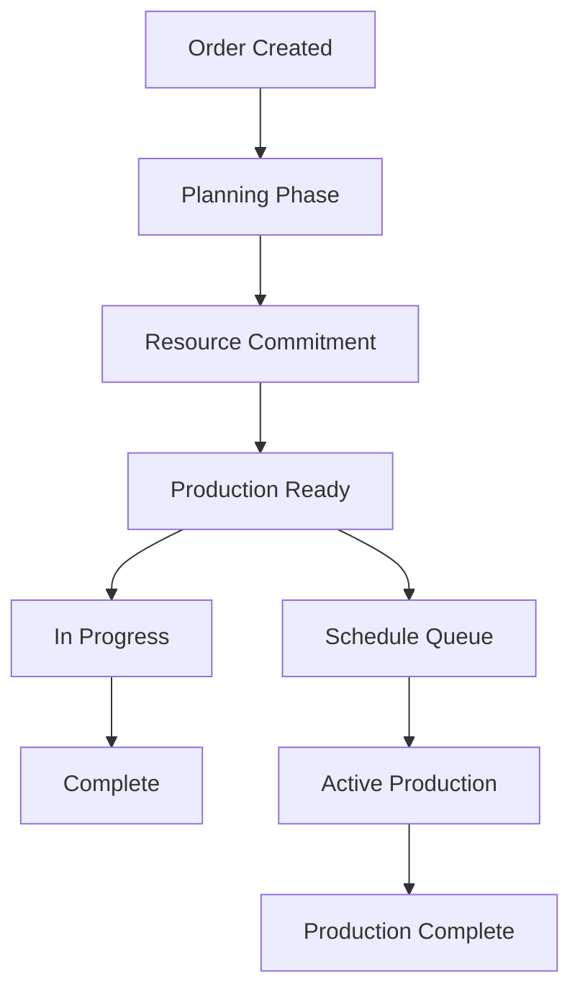

# Order Management System

## Documentation Index

| Document | Description | Audience |
|---|---|---|
| **[Architecture](./architecture.md)** | Technical deep-dive: PrO vs SchO design, validation, transactions, event architecture | Developers |
| **[Order Relationships](./order-relationships.md)** | Parent-child relationships, recipe instance hierarchy, BOM propagation, separation | Developers, Planners |
| **[Production Order User Guide](./user-guide-production-orders.md)** | Step-by-step PrO creation, constraints, status lifecycle, validation errors | Planners, Operators |
| **[Schedule Order User Guide](./user-guide-schedule-orders.md)** | SchO creation, grouping, timeline, planning modes, queue management, execution tracking | Planners, Operators |
| **[Quick Reference](./quick-reference.md)** | Checklists, status diagrams, error fix table, field descriptions, GraphQL queries | All users |
| **[Troubleshooting](./troubleshooting.md)** | Validation errors, relationship issues, queue problems, ERP sync, escalation procedures | All users |
| **[Standard Operating Procedures](./standard-operating-procedures.md)** | SOPs for order creation, scheduling, planning, queue management, shift handover | Operators, Planners |
| **[Change Management](./change-management.md)** | Legacy vs MES differences, migration, training schedule, rollback, success metrics | Management, All users |

---

## Overview

The Order Management system is a core component of the MES Phase 1 initiative, providing comprehensive management of production orders and schedule orders. This system handles the entire lifecycle from order creation through production completion, with tight integration to recipe management and ERP systems.

## Order Types

### Production Orders (PrOs)

Production Orders represent the fundamental production unit in the MES system. Each Production Order is highly specific and constrained to ensure precise manufacturing control.

#### Core Characteristics
- **One Customer**: Each PrO is tied to a single customer
- **One Mash Bill**: Specific grain recipe formulation
- **One Barrel/Container Type**: Specific final container designation
- **One Proof**: Single target proof specification
- **One BOM**: Specific Bill of Materials
- **One Final Item FG Code**: Unique finished goods identifier

#### Item Number Generation
Production Orders automatically generate item numbers using the structured format:
```
CUS-%%-%%-%%-%%-53-04-4-4-0-120-R01
│   │  │  │  │  │     │ │ │ │   │
│   │  │  │  │  │     │ │ │ │   └─ Item revision (R01)
│   │  │  │  │  │     │ │ │ └─── Final proof (120)
│   │  │  │  │  │     │ │ └───── Container spec (4)
│   │  │  │  │  │     │ └─────── Size spec (4)
│   │  │  │  │  │     └───────── Barrel info (53-04)
│   └──┴──┴──┴──┴─────────────── Mash bill (%%-%%-%%-%%%)
└───────────────────────────────── Customer code (CUS)
```

#### Database Schema
```prisma
model ProductionOrder {
  id                      String                           @id @default(cuid())
  globalId                String?                          @default(cuid())
  name                    String?                          @unique
  
  // Core specifications
  quantity                Int?
  finalProof              Float?
  containerType           EnumProductionOrderContainerType? @default(LargeBarrel)
  
  // Planning data
  plannedCooks            Int?
  plannedFermenters       Int?
  estimatedBarrelsPerFermenter Float?
  estimatedPGsPerBbl      Float?
  estimatedPGsPerBushel   Float?
  
  // Execution tracking
  executedCooks           Int?
  executedFermenters      Int?
  completedCooks          Int?
  completedFermenters     Int?
  completedQuantity       Decimal?
  
  // Status and control
  status                  EnumProductionOrderStatus?        @default(Initiated)
  complete                Boolean?                          @default(false)
  inProcess               Boolean?                          @default(false)
  scheduled               Boolean?                          @default(false)
  
  // Relationships
  customer                Customer                          @relation(fields: [customerId], references: [id])
  customerId              String
  recipe                  Recipe?                           @relation(fields: [recipeId], references: [id])
  recipeId                String?
  bom                     Bom                               @relation(fields: [bomId], references: [id])
  bomId                   String
  item                    Item                              @relation(name: "ItemOnProductionOrders", fields: [fgItemId], references: [id])
  fgItemId                String
  scheduleOrder           ScheduleOrder?                    @relation(fields: [scheduleOrderId], references: [id])
  scheduleOrderId         String?
  
  // Timestamps
  createdAt               DateTime                          @default(now())
  updatedAt               DateTime                          @updatedAt
  startDate               DateTime?                         @default(now())
  endDate                 DateTime?
}
```

### Schedule Orders (SchOs)

Schedule Orders provide a higher-level grouping mechanism that allows operations to separate final proof, barrel, and disposition details either within a customer's order or between different customer orders.

#### Core Characteristics
- **One Mash Bill**: Consistent grain recipe across grouped orders
- **One Recipe BOM**: Including mashing additives and yeast specifications
- **Multiple Production Orders**: Can group several PrOs with different specifications
- **Master Recipe Link**: Connected to master recipe definitions

#### Key Features
- **Production Order Allocation**: Manages distribution across multiple PrOs
- **Timeline Management**: Coordinates timing across grouped orders
- **Resource Planning**: Aggregated resource requirements
- **Master Recipe Integration**: Links to comprehensive recipe specifications

#### Database Schema
```prisma
model ScheduleOrder {
  id                             String                   @id @default(cuid())
  globalId                       String?                  @unique @default(cuid())
  name                           String?                  @unique
  
  // Recipe and customer links
  recipeName                     String
  recipeGroup                    RecipeGroup              @relation(fields: [recipeGroupId], references: [id])
  recipeGroupId                  String
  scheduleOrderRecipe            Recipe?                  @relation(fields: [scheduleOrderRecipeId], references: [id])
  scheduleOrderRecipeId          String?
  customers                      Customer[]
  
  // Production planning
  productionOrderAllocation      Json
  totalBarrels                   Int?
  totalProofGallons              Float?
  
  // Timeline management
  estimatedStart                 DateTime?
  estimatedEnd                   DateTime?
  estimatedMashingStartTime      DateTime?
  estimatedMashingDuration       Float?
  estimatedFermentationStartTime DateTime?
  estimatedFermentationDuration  Float?
  estimatedDistillationStartTime DateTime?
  estimatedDistillationDuration  Float?
  estimatedBarrelingStartTime    DateTime?
  estimatedTotalProductionDuration Float?
  
  // Actual tracking
  actualStart                    DateTime?
  actualEnd                      DateTime?
  
  // Duration specifications
  duration                       Float?
  durationUnits                  String?                  @default("Hours")
  
  // Status
  status                         EnumScheduleOrderStatus? @default(Created)
  
  // Relationships
  productionOrders               ProductionOrder[]
  scheduleOrderQueues            ScheduleOrderQueue?      @relation(fields: [scheduleOrderQueueId], references: [id])
  scheduleOrderQueueId           String?                  @unique
  
  // Timestamps
  createdAt                      DateTime                 @default(now())
  updatedAt                      DateTime                 @updatedAt
}
```

## Production Order Wizard

The Production Order Wizard provides a comprehensive interface for creating production orders with complex configurations through a single API endpoint.

### Endpoint
```
POST /productionOrders/createFromWizard
```

### Key Features

#### 1. Item Number Generation
- Automatic generation using customer code and recipe information
- Mash bill derivation from recipe BOM
- Barrel specification integration for container types
- Revision management

#### 2. BOM Creation
- Creates BOM records from wizard BOM items array
- Links to existing items or creates new items as needed
- Validates item groups and categories
- Quantity and unit conversion management

#### 3. Schedule Integration
- Creates corresponding schedule orders
- Adds orders to the production queue
- Timeline calculation and estimation
- Resource allocation planning

#### 4. Bin Configuration Management
- Links milling bin configurations to production orders
- Supports multiple bin configurations (SIL110, SIL115, SIL120)
- Validates bin availability and capacity

### Request Payload Structure

```typescript
interface CreateProductionOrderWizardDto {
  productionOrder: {
    orderName: string;
    quantity: number;
    units: string;
    priority?: string;
    startDate: string;
    endDate?: string;
    customerCode: string;
    notes?: string;
    finalProof: number;
    containerType: EnumProductionOrderContainerType;
    fermenters: number;
    cooks: number;
    totalGrainLoad: number;
    estBblsPerFerm: number;
    estPGsPerBshl: number;
    estPGsPerBbl: number;
    upperControlLimit?: number;
    lowerControlLimit?: number;
  };
  
  recipe: {
    id: string;
    Recipe: string;
    whiskeyType: string;
  };
  
  bomItems: Array<{
    id: string;
    itemCode: string;
    name: string;
    quantity: number;
    unit: string;
    category: string;
    itemGroup: string;
  }>;
  
  binConfigurations: {
    sil110ConfigId?: string;
    sil115ConfigId?: string;
    sil120ConfigId?: string;
    totalCooks: number;
    totalFermenters: number;
    cooksPerFermenter: number;
    entryProof: number;
    proofGallonsPerBarrel: number;
    barrelsPerFermenter: number;
  };
  
  scheduleOrder: {
    estimatedStart: string;
    estimatedEnd: string;
    totalBarrels: number;
    totalProofGallons: number;
    duration: number;
    durationUnits: string;
  };
  
  metadata: {
    createdBy: string;
    source: string;
    version: string;
  };
}
```

### Service Implementation

#### Key Service Methods

1. **`createProductionOrderFromWizard()`**
   - Main orchestration method
   - Coordinates all sub-operations
   - Handles transaction management
   - Error handling and rollback

2. **`generateItemNumber()`**
   - Creates formatted item numbers
   - Derives mash bill from recipe BOM
   - Incorporates customer and container specifications
   - Manages revision numbering

3. **`getMashBillFromRecipe()`**
   - Extracts grain composition from recipe BOM
   - Calculates percentages
   - Formats for item number generation

4. **`createOrFindItem()`**
   - Item number uniqueness validation
   - Creates new items when needed
   - Links to existing items when available
   - Updates item specifications

5. **`createBomFromWizardItems()`**
   - Converts wizard BOM data to database BOM
   - Creates BOM and BomItem records
   - Validates item references
   - Manages quantities and units

6. **`createScheduleOrderFromWizard()`**
   - Creates schedule order from wizard data
   - Links to recipe groups
   - Sets up timeline estimates
   - Manages customer relationships

## Order Lifecycle Management

### Status Progression

#### Production Order Statuses
```typescript
enum EnumProductionOrderStatus {
  Initiated   // Order created and ready (default)
  Planned     // Initial planning phase
  Committed   // Resources committed, on the schedule
  InProgress  // Production in progress
  Complete    // Production completed
  Cancelled   // Order cancelled (only from Planned/Initiated)
}
```

#### Schedule Order Statuses
```typescript
enum EnumScheduleOrderStatus {
  Created              // Schedule order created
  Scheduled            // Added to production queue
  InProgress           // Production started
  ReadyForSeparation   // All cooks complete
  Separating           // Separation in progress
  Separated            // PO-level tracking active
  Complete             // All production orders completed
}
```

### State Transitions



## Integration Points

### ERP Integration (NetSuite)
- **Item Synchronization**: FG items pushed to NetSuite
- **Customer Data**: Customer information sync
- **Inventory Updates**: Production completion updates
- **Work Order Integration**: Production order to work order mapping

### Recipe Management
- **Master Recipe Link**: Production orders link to master recipes
- **Recipe Instance Creation**: Active recipe instantiation for production
- **BOM Resolution**: Recipe BOM to production BOM conversion
- **Parameter Propagation**: Recipe parameters to production parameters

### Scheduling System
- **Queue Management**: Integration with schedule order queue
- **Timeline Calculation**: Automated duration and timing estimates
- **Resource Planning**: Capacity and resource allocation
- **Progress Tracking**: Real-time production progress updates

### Messaging Integration
- **RabbitMQ**: Order creation and update events
- **Event Publishing**: Status change notifications
- **Audit Trail**: Complete change tracking
- **Error Handling**: Failed operation recovery

## API Endpoints

### Production Orders

#### Create Production Order
```http
POST /api/productionOrders
Content-Type: application/json

{
  "customerId": "customer-id",
  "recipeId": "recipe-id",
  "bomId": "bom-id",
  "quantity": 500,
  "finalProof": 120.0,
  "containerType": "LargeBarrel"
}
```

#### Create from Wizard
```http
POST /api/productionOrders/createFromWizard
Content-Type: application/json

{
  "productionOrder": { /* production order data */ },
  "recipe": { /* recipe data */ },
  "bomItems": [ /* BOM items array */ ],
  "binConfigurations": { /* bin config data */ },
  "scheduleOrder": { /* schedule data */ },
  "metadata": { /* metadata */ }
}
```

#### Update Production Order
```http
PUT /api/productionOrders/{id}
Content-Type: application/json

{
  "status": "InProgress",
  "completedCooks": 5,
  "completedFermenters": 2
}
```

#### Get Production Order
```http
GET /api/productionOrders/{id}
```

#### List Production Orders
```http
GET /api/productionOrders?status=InProgress&customerId=customer-id
```

### Schedule Orders

#### Create Schedule Order
```http
POST /api/scheduleOrders
Content-Type: application/json

{
  "recipeName": "Premium Bourbon",
  "recipeGroupId": "recipe-group-id",
  "estimatedStart": "2025-01-15T08:00:00Z",
  "estimatedEnd": "2025-01-20T17:00:00Z"
}
```

#### Update Schedule Order
```http
PUT /api/scheduleOrders/{id}
Content-Type: application/json

{
  "status": "InProgress",
  "actualStart": "2025-01-15T08:15:00Z"
}
```

#### Add Production Order to Schedule
```http
POST /api/scheduleOrders/{id}/productionOrders
Content-Type: application/json

{
  "productionOrderId": "production-order-id"
}
```

## GraphQL Schema

### Production Order Type
```graphql
type ProductionOrder {
  id: String!
  globalId: String
  name: String
  quantity: Int
  finalProof: Float
  containerType: ProductionOrderContainerType
  status: ProductionOrderStatus
  customer: Customer!
  recipe: Recipe
  bom: Bom!
  item: Item!
  scheduleOrder: ScheduleOrder
  createdAt: DateTime!
  updatedAt: DateTime!
}

input CreateProductionOrderInput {
  customerId: String!
  recipeId: String
  bomId: String!
  quantity: Int
  finalProof: Float
  containerType: ProductionOrderContainerType
}

type Mutation {
  createProductionOrder(data: CreateProductionOrderInput!): ProductionOrder!
  updateProductionOrder(where: ProductionOrderWhereUniqueInput!, data: UpdateProductionOrderInput!): ProductionOrder!
  createProductionOrderFromWizard(data: CreateProductionOrderWizardInput!): ProductionOrderWizardResponse!
}
```

### Schedule Order Type
```graphql
type ScheduleOrder {
  id: String!
  name: String
  recipeName: String!
  recipeGroup: RecipeGroup!
  status: ScheduleOrderStatus
  estimatedStart: DateTime
  estimatedEnd: DateTime
  totalBarrels: Int
  totalProofGallons: Float
  productionOrders: [ProductionOrder!]!
  createdAt: DateTime!
  updatedAt: DateTime!
}

input CreateScheduleOrderInput {
  recipeName: String!
  recipeGroupId: String!
  estimatedStart: DateTime
  estimatedEnd: DateTime
}

type Mutation {
  createScheduleOrder(data: CreateScheduleOrderInput!): ScheduleOrder!
  updateScheduleOrder(where: ScheduleOrderWhereUniqueInput!, data: UpdateScheduleOrderInput!): ScheduleOrder!
}
```

## Error Handling

### Validation Errors
- **Required Field Validation**: Ensures all mandatory fields are provided
- **Reference Validation**: Verifies all referenced entities exist
- **Business Rule Validation**: Enforces business logic constraints
- **Data Format Validation**: Ensures proper data types and formats

### Common Error Scenarios
1. **Invalid Recipe Reference**: Recipe ID not found
2. **Customer Not Found**: Invalid customer ID
3. **BOM Validation Failure**: Invalid BOM structure or items
4. **Container Type Mismatch**: Container requirements not met
5. **Resource Conflicts**: Scheduling conflicts or resource unavailability

### Error Response Format
```json
{
  "error": {
    "code": "VALIDATION_ERROR",
    "message": "Recipe with ID 'invalid-id' not found",
    "details": {
      "field": "recipeId",
      "value": "invalid-id",
      "constraint": "exists"
    }
  }
}
```

## Performance Considerations

### Database Optimization
- **Indexes**: Key fields indexed for query performance
- **Relationships**: Optimized join strategies
- **Pagination**: Large result set pagination
- **Caching**: Frequently accessed data cached

### API Performance
- **Query Optimization**: Efficient database queries
- **Response Caching**: Cacheable endpoint responses
- **Bulk Operations**: Batch processing for multiple operations
- **Async Processing**: Non-blocking operations for heavy tasks

## Security Considerations

### Authentication
- **JWT Tokens**: Secure API access
- **Role-Based Access**: Permission-based operation access
- **Audit Logging**: Complete operation tracking

### Data Protection
- **Input Validation**: SQL injection and XSS prevention
- **Data Encryption**: Sensitive data encryption
- **Access Control**: Resource-level access restrictions

## Monitoring and Logging

### Application Metrics
- **Order Creation Rate**: Orders created per time period
- **Processing Time**: Order processing duration
- **Error Rate**: Failed operations percentage
- **System Load**: Resource utilization tracking

### Business Metrics
- **Production Throughput**: Orders completed per period
- **Resource Utilization**: Equipment and capacity usage
- **Quality Metrics**: Production quality indicators
- **Customer Satisfaction**: Order fulfillment metrics

---

*This documentation covers the core Order Management functionality within the MES Phase 1 initiative. For additional details on specific features or integration points, refer to the related documentation sections.*