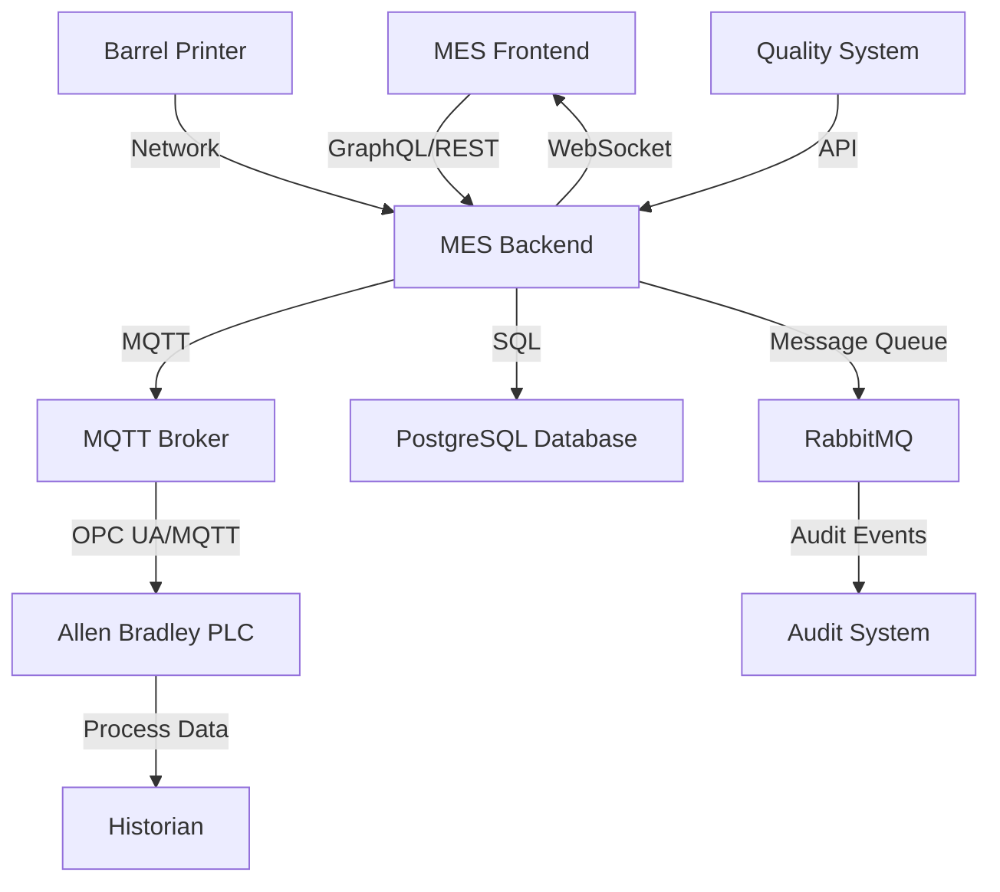

# Schedule Order & Production Order Tracking System Requirements

**Project**: Allen Bradley PLC Integration for Schedule & Production Order Tracking  
**Version**: 1.0  
**Date**: January 2025  
**Status**: Draft  

## 1. Executive Summary

### 1.1 Business Need
The Whiskey House of Kentucky requires enhanced tracking capabilities for schedule orders and their associated production orders throughout the production line. Building upon the existing recipe tracking system in PLCs, this enhancement will provide comprehensive visibility and control of production execution through Allen Bradley PLC integration using UDT (User Defined Type) structures.

### 1.2 Scope
This system will extend the current MES (Manufacturing Execution System) to include:
- Real-time tracking of schedule orders and production orders through PLC integration
- Cistern Tank and Blend Tank production order selection interface
- Automated PLC S88 sequence population for High Wine and Blending Automation
- Barrel printing integration
- Comprehensive lot and batch record tracking for distillation and barreling operations

## 2. Current System Architecture Analysis

### 2.1 Existing Data Model
Based on the current Prisma schema, the following key entities support this enhancement:

#### Core Production Entities
- **ScheduleOrder**: Master scheduling entity with timing estimates and phase information
- **ProductionOrder**: Individual manufacturing orders linked to schedule orders
- **ScheduleOrderQueue**: Queue management system for production scheduling
- **Recipe**: Master recipes linked to production orders
- **RecipeGroup**: Recipe categorization system

#### Production Tracking Entities
- **Batch**: Production batch information
- **BatchMaterialConsumption**: Material usage tracking
- **BatchParameterValue**: Process parameter tracking
- **BatchTimeSeriesData**: Real-time production data
- **Lot**: Lot tracking for traceability
- **AdditiveActual**: Actual additive usage (including enzyme dosing)

#### Equipment and Process Entities
- **Asset**: Physical equipment including tanks, stills, and processing equipment
- **UnitProcedure**: Process definitions (Mashing01, Fermentation01, Distillation01, Processing01, Granary01)
- **Operation**: Manufacturing operations (Cook, FermenterSet, Fermenter, Clean, StillRun, BlendingTank, CisternTank, Barreling)
- **EquipmentPhase**: Equipment phase definitions
- **PhaseParameter**: Process parameters

### 2.2 Current Integration Points
- **MQTT Integration**: Real-time messaging infrastructure for PLC communication
- **RabbitMQ**: Message queue system for reliable data exchange
- **Audit System**: Comprehensive change tracking for all production entities
- **WebSocket Gateway**: Real-time UI updates for production monitoring

## 3. Functional Requirements

### 3.1 Schedule Order & Production Order Tracking

#### 3.1.1 PLC UDT Structure Definition
**Requirement ID**: REQ-001  
**Priority**: High  

**Description**: Define and implement User Defined Type (UDT) structures for Allen Bradley PLCs to track schedule orders and production orders throughout the production line.

**Specifications**:
- **ScheduleOrderTracking UDT**:
  ```
  ScheduleOrderTracking:
    - ScheduleOrderId: STRING[50]        // Unique schedule order identifier
    - ScheduleOrderName: STRING[100]     // Human-readable schedule order name
    - Status: DINT                       // Order status (Created=1, Scheduled=2, InProgress=3, Complete=4)
    - RecipeName: STRING[50]             // Associated recipe name
    - RecipeGroupId: STRING[50]          // Recipe group identifier
    - TotalBarrels: REAL                 // Total barrels to produce
    - TotalProofGallons: REAL           // Total proof gallons
    - EstimatedStart: DATE_AND_TIME      // Planned start time
    - EstimatedEnd: DATE_AND_TIME        // Planned end time
    - ActualStart: DATE_AND_TIME         // Actual start time
    - ActualEnd: DATE_AND_TIME           // Actual end time
    - ProductionOrderCount: DINT         // Number of associated production orders
    - ProductionOrderIds: ARRAY[1..10] OF STRING[50]  // Associated production order IDs
    - CurrentPhase: DINT                 // Current production phase (Mashing=1, Fermentation=2, Distillation=3, Barreling=4)
    - LastUpdated: DATE_AND_TIME         // Last update timestamp
  ```

- **ProductionOrderTracking UDT**:
  ```
  ProductionOrderTracking:
    - ProductionOrderId: STRING[50]      // Unique production order identifier
    - ProductionOrderName: STRING[100]   // Human-readable production order name
    - ParentScheduleOrderId: STRING[50]  // Parent schedule order reference
    - Status: DINT                       // Order status (Planned=1, Committed=2, Initiated=3, InProgress=4, Complete=5)
    - ItemNumber: STRING[50]             // Finished goods item number
    - CustomerCode: STRING[10]           // Customer identifier
    - Quantity: REAL                     // Production quantity
    - CompletedQuantity: REAL            // Actual completed quantity
    - EstimatedBarrelsPerFermenter: REAL // Estimated barrels per fermenter
    - EstimatedPGsPerBbl: REAL          // Estimated proof gallons per barrel
    - EstimatedPGsPerBushel: REAL       // Estimated proof gallons per bushel
    - FinalProof: REAL                   // Target final proof
    - ContainerType: DINT                // Container type (LargeBarrel=1, SmallBarrel=2, etc.)
    - TotalCooks: DINT                   // Total planned cooks
    - TotalFermenters: DINT              // Total planned fermenters
    - ExecutedCooks: DINT                // Completed cooks
    - ExecutedFermenters: DINT           // Completed fermenters
    - CurrentOperation: DINT             // Current operation (Cook=1, Fermenter=2, StillRun=3, etc.)
    - StartDate: DATE_AND_TIME           // Production start date
    - EndDate: DATE_AND_TIME             // Production end date
    - LastUpdated: DATE_AND_TIME         // Last update timestamp
  ```

**Acceptance Criteria**:
- UDT structures are defined in Allen Bradley Studio 5000
- UDTs support all current ProductionOrder and ScheduleOrder data fields
- Data types are compatible with existing PLC programs
- UDTs include versioning for future modifications

#### 3.1.2 MES to PLC Data Synchronization
**Requirement ID**: REQ-002  
**Priority**: High  

**Description**: Implement bidirectional data synchronization between the MES system and Allen Bradley PLCs using MQTT messaging.

**Specifications**:
- **Outbound Data Flow** (MES → PLC):
  - Schedule order creation/updates trigger PLC UDT population
  - Production order status changes propagate to PLC
  - Recipe parameters and setpoints sent to PLC
  - Material allocation updates transmitted to PLC

- **Inbound Data Flow** (PLC → MES):
  - Real-time production progress updates from PLC
  - Equipment status and alarm information
  - Actual parameter values and process data
  - Operation completion confirmations

- **MQTT Topic Structure**:
  ```
  wh/whk01/distillery01/scheduleorder/{scheduleOrderId}/status
  wh/whk01/distillery01/scheduleorder/{scheduleOrderId}/data
  wh/whk01/distillery01/productionorder/{productionOrderId}/status
  wh/whk01/distillery01/productionorder/{productionOrderId}/data
  wh/whk01/distillery01/equipment/{assetId}/status
  wh/whk01/distillery01/operation/{operationId}/actual
  ```

**Acceptance Criteria**:
- All schedule order changes are reflected in PLC within 5 seconds
- Production order status updates appear in MES within 10 seconds
- Message delivery is guaranteed (QoS 1 minimum)
- Failed message delivery triggers automatic retry with exponential backoff
- All MQTT messages are logged for audit purposes

### 3.2 Cistern Tank & Blend Tank Production Order Selection

#### 3.2.1 Tank Production Order Selection Interface
**Requirement ID**: REQ-003  
**Priority**: High  

**Description**: Develop operator interface for selecting production orders from parent schedule orders for Cistern Tank and Blend Tank operations.

**Specifications**:
- **Tank Selection Interface**:
  - Display available Cistern Tanks and Blend Tanks
  - Show current tank status (Available, In Use, Cleaning, Maintenance)
  - Display tank capacity and current contents
  - Filter tanks by availability and compatibility

- **Schedule Order Display**:
  - List active schedule orders running from the still into tankage
  - Display schedule order details (name, recipe, total barrels, progress)
  - Show associated production orders with selection capability
  - Filter by schedule order status and timing

- **Production Order Selection**:
  - Display available production orders from selected schedule order
  - Show production order details (name, customer, quantity, proof target)
  - Display barrel details and container information
  - Enable single or multiple production order selection per tank

- **Validation Rules**:
  - Verify tank capacity vs. production order quantity
  - Check container type compatibility
  - Validate proof requirements and blending rules
  - Prevent double-allocation of production orders

**Acceptance Criteria**:
- Interface loads available tanks within 2 seconds
- Production order selection updates tank allocation immediately
- Validation errors display clear messages to operators
- All selections are logged with timestamp and operator ID
- Interface supports touch screen operation

#### 3.2.2 Proof and Barrel Detail Management
**Requirement ID**: REQ-004  
**Priority**: High  

**Description**: Implement proof and barrel detail tracking for selected production orders in tankage operations.

**Specifications**:
- **Proof Management**:
  - Track target proof from production order
  - Record actual proof measurements during tankage
  - Calculate proof adjustments required
  - Alert operators to proof variances outside limits

- **Barrel Detail Tracking**:
  - Link container items to production orders
  - Track barrel types (LargeBarrel, SmallBarrel, etc.)
  - Monitor barrel availability and allocation
  - Generate barrel requirement forecasts

- **Quality Control Integration**:
  - Record quality measurements during tankage
  - Link test results to specific production orders
  - Trigger quality holds based on test results
  - Generate certificates of analysis

**Acceptance Criteria**:
- Proof tracking accuracy within ±0.1 proof points
- Barrel allocation prevents over-commitment
- Quality data links correctly to production orders
- Operators receive real-time alerts for quality issues

### 3.3 PLC S88 Sequence Automation

#### 3.3.1 High Wine and Blending Automation
**Requirement ID**: REQ-005  
**Priority**: High  

**Description**: Auto-populate PLC S88 sequences for High Wine and Blending Automation based on selected production orders.

**Specifications**:
- **S88 Recipe Integration**:
  - Translate MES recipe parameters to S88 format
  - Generate phase sequences based on unit procedures
  - Populate setpoints and control parameters
  - Configure equipment phase parameters

- **High Wine Processing**:
  - Configure distillation column parameters
  - Set proof targets and cut points
  - Define collection vessel routing
  - Program flow rates and timing

- **Blending Operations**:
  - Calculate blend ratios from multiple production orders
  - Configure tank-to-tank transfer sequences
  - Set mixing parameters and duration
  - Program sampling and analysis points

- **Parameter Mapping**:
  ```
  MES RecipeParameter → PLC PhaseParameter
  - Temperature setpoints → S88 analog parameters
  - Time durations → S88 timer parameters
  - Flow rates → S88 analog control
  - Boolean controls → S88 digital parameters
  ```

**Acceptance Criteria**:
- S88 sequences generate within 30 seconds of production order selection
- All recipe parameters map correctly to PLC setpoints
- Generated sequences pass S88 validation checks
- Operators can review and approve sequences before execution

#### 3.3.2 Barrel Printing Integration
**Requirement ID**: REQ-006  
**Priority**: Medium  

**Description**: Integrate barrel printing system with production order selection for automated label generation.

**Specifications**:
- **Print Data Generation**:
  - Extract barrel information from production order
  - Include customer details and product specifications
  - Generate batch and lot tracking codes
  - Include regulatory compliance information

- **Print System Integration**:
  - Interface with existing barrel printing hardware
  - Support multiple printer configurations
  - Handle print queue management
  - Provide error handling and reprint capabilities

- **Label Content**:
  - Production order number
  - Customer code and name
  - Product name and specifications
  - Batch/lot numbers
  - Fill date and location
  - Regulatory codes (DSP, etc.)
  - QR codes for tracking

**Acceptance Criteria**:
- Print jobs generate automatically upon barrel selection
- Label content accuracy is 100%
- Print system integrates with PLC control
- Misprint handling includes automatic reprints

### 3.4 Lot and Batch Record Integration

#### 3.4.1 High Wine and Blending System Tracking
**Requirement ID**: REQ-007  
**Priority**: High  

**Description**: Implement comprehensive lot and batch record tracking for high wine and blending system operations.

**Specifications**:
- **Batch Record Creation**:
  - Auto-generate batch records for each production operation
  - Link batch records to parent production orders
  - Capture operator actions and timestamps
  - Record all process parameters and deviations

- **Material Tracking**:
  - Track material consumption by batch
  - Record lot numbers of all ingredients
  - Monitor material transfers between operations
  - Calculate yield and loss factors

- **Process Data Integration**:
  - Capture real-time process data from PLCs
  - Store time-series data for critical parameters
  - Record alarm events and operator responses
  - Generate process trend reports

- **Data Model Extensions**:
  ```sql
  -- New tables for enhanced tracking
  CREATE TABLE HighWineProcessRecord (
    id VARCHAR(50) PRIMARY KEY,
    batchId VARCHAR(50) REFERENCES Batch(id),
    productionOrderId VARCHAR(50) REFERENCES ProductionOrder(id),
    stillRunNumber INTEGER,
    distillationStartTime TIMESTAMP,
    distillationEndTime TIMESTAMP,
    feedVolume DECIMAL(10,2),
    lowWineProof DECIMAL(5,2),
    highWineProof DECIMAL(5,2),
    feedsProof DECIMAL(5,2),
    headsVolume DECIMAL(10,2),
    heartsVolume DECIMAL(10,2),
    tailsVolume DECIMAL(10,2),
    operatorId VARCHAR(50),
    createdAt TIMESTAMP DEFAULT CURRENT_TIMESTAMP
  );

  CREATE TABLE BlendingProcessRecord (
    id VARCHAR(50) PRIMARY KEY,
    batchId VARCHAR(50) REFERENCES Batch(id),
    blendTankId VARCHAR(50) REFERENCES Asset(id),
    blendingStartTime TIMESTAMP,
    blendingEndTime TIMESTAMP,
    targetProof DECIMAL(5,2),
    finalProof DECIMAL(5,2),
    totalVolume DECIMAL(10,2),
    operatorId VARCHAR(50),
    createdAt TIMESTAMP DEFAULT CURRENT_TIMESTAMP
  );

  CREATE TABLE BlendingComponent (
    id VARCHAR(50) PRIMARY KEY,
    blendingProcessRecordId VARCHAR(50) REFERENCES BlendingProcessRecord(id),
    productionOrderId VARCHAR(50) REFERENCES ProductionOrder(id),
    sourceTankId VARCHAR(50) REFERENCES Asset(id),
    volume DECIMAL(10,2),
    proof DECIMAL(5,2),
    additionOrder INTEGER,
    additionTime TIMESTAMP
  );
  ```

**Acceptance Criteria**:
- All process operations generate batch records automatically
- Material consumption tracking has 99.9% accuracy
- Process data sampling occurs every 30 seconds minimum
- Batch records are immutable after completion

#### 3.4.2 Barreling and Barrel Filling Tracking
**Requirement ID**: REQ-008  
**Priority**: High  

**Description**: Implement detailed tracking for barreling operations and barrel filling processes.

**Specifications**:
- **Barrel Fill Record Creation**:
  - Generate individual records for each barrel filled
  - Link barrel fills to production orders and batches
  - Track barrel serial numbers and types
  - Record fill weights and volumes

- **Barrel Tracking Integration**:
  - Interface with barrel management system
  - Track barrel history and previous contents
  - Monitor barrel condition and inspection dates
  - Generate barrel inventory reports

- **Fill Process Monitoring**:
  - Monitor fill weights in real-time
  - Detect under/over-fills automatically
  - Record environmental conditions during filling
  - Track operator actions and adjustments

- **Data Model Extensions**:
  ```sql
  CREATE TABLE BarrelFillRecord (
    id VARCHAR(50) PRIMARY KEY,
    productionOrderId VARCHAR(50) REFERENCES ProductionOrder(id),
    batchId VARCHAR(50) REFERENCES Batch(id),
    barrelSerialNumber VARCHAR(50),
    barrelTypeId VARCHAR(50) REFERENCES Item(id),
    fillStartTime TIMESTAMP,
    fillEndTime TIMESTAMP,
    fillWeight DECIMAL(8,2),
    fillVolume DECIMAL(8,2),
    finalProof DECIMAL(5,2),
    fillTemperature DECIMAL(5,2),
    fillPressure DECIMAL(6,2),
    operatorId VARCHAR(50),
    fillStationId VARCHAR(50) REFERENCES Asset(id),
    qualityApproval BOOLEAN DEFAULT FALSE,
    createdAt TIMESTAMP DEFAULT CURRENT_TIMESTAMP
  );

  CREATE TABLE BarrelQualityCheck (
    id VARCHAR(50) PRIMARY KEY,
    barrelFillRecordId VARCHAR(50) REFERENCES BarrelFillRecord(id),
    checkType VARCHAR(50), -- 'fill_weight', 'proof_check', 'visual_inspection'
    checkResult BOOLEAN,
    checkValue DECIMAL(8,2),
    checkNotes TEXT,
    checkedBy VARCHAR(50),
    checkedAt TIMESTAMP DEFAULT CURRENT_TIMESTAMP
  );
  ```

**Acceptance Criteria**:
- Every barrel fill generates a complete record
- Fill weight accuracy within ±0.1 pounds
- Barrel serial number tracking is 100% accurate
- Quality checks are mandatory before completion

## 4. Non-Functional Requirements

### 4.1 Performance Requirements
- **Response Time**: MES queries respond within 2 seconds
- **Data Latency**: PLC data updates appear in MES within 10 seconds
- **Throughput**: System supports 50 concurrent operations
- **Availability**: 99.5% uptime during production hours

### 4.2 Security Requirements
- **Authentication**: Integration with existing Azure AD/Entra ID
- **Authorization**: Role-based access control for all operations
- **Audit Trail**: Complete audit logging of all system changes
- **Data Encryption**: TLS 1.3 for all MQTT communications

### 4.3 Reliability Requirements
- **Data Integrity**: All production data must be preserved
- **Failover**: Automatic failover for critical PLC communications
- **Backup**: Real-time data replication to backup systems
- **Recovery**: Maximum 1-hour recovery time for system failures

### 4.4 Scalability Requirements
- **Equipment Expansion**: Support for additional tanks and processing units
- **Production Volume**: Handle 100% increase in production capacity
- **Data Storage**: 5-year retention of all production records
- **User Growth**: Support 200% increase in concurrent users

## 5. Technical Architecture

### 5.1 System Components

#### 5.1.1 MES Core System
- **Technology**: NestJS/Node.js backend with PostgreSQL database
- **API Layer**: GraphQL and REST APIs for data access
- **Real-time**: WebSocket connections for live updates
- **Message Queue**: RabbitMQ for reliable message processing

#### 5.1.2 PLC Integration Layer
- **MQTT Broker**: Mosquitto for PLC communication
- **Protocol**: OPC UA over MQTT for structured data exchange
- **Data Mapping**: JSON schemas for UDT structure mapping
- **Error Handling**: Automatic retry and error notification

#### 5.1.3 User Interface
- **Technology**: Next.js React application
- **Real-time Updates**: WebSocket integration for live data
- **Mobile Support**: Responsive design for tablet interfaces
- **Offline Capability**: Local caching for critical operations

### 5.2 Data Flow Architecture



### 5.3 Database Schema Extensions

The existing Prisma schema will be extended with the following new models:

```prisma
model HighWineProcessRecord {
  id                     String      @id @default(cuid())
  batch                  Batch       @relation(fields: [batchId], references: [id])
  batchId                String
  productionOrder        ProductionOrder @relation(fields: [productionOrderId], references: [id])
  productionOrderId      String
  stillRunNumber         Int?
  distillationStartTime  DateTime?
  distillationEndTime    DateTime?
  feedVolume             Decimal?
  lowWineProof           Decimal?
  highWineProof          Decimal?
  feedsProof             Decimal?
  headsVolume            Decimal?
  heartsVolume           Decimal?
  tailsVolume            Decimal?
  operatorId             String?
  createdAt              DateTime    @default(now())
  updatedAt              DateTime    @updatedAt
}

model BlendingProcessRecord {
  id                String              @id @default(cuid())
  batch             Batch               @relation(fields: [batchId], references: [id])
  batchId           String
  blendTank         Asset               @relation(fields: [blendTankId], references: [id])
  blendTankId       String
  blendingStartTime DateTime?
  blendingEndTime   DateTime?
  targetProof       Decimal?
  finalProof        Decimal?
  totalVolume       Decimal?
  operatorId        String?
  components        BlendingComponent[]
  createdAt         DateTime            @default(now())
  updatedAt         DateTime            @updatedAt
}

model BlendingComponent {
  id                        String                 @id @default(cuid())
  blendingProcessRecord     BlendingProcessRecord  @relation(fields: [blendingProcessRecordId], references: [id])
  blendingProcessRecordId   String
  productionOrder           ProductionOrder        @relation(fields: [productionOrderId], references: [id])
  productionOrderId         String
  sourceTank                Asset                  @relation(fields: [sourceTankId], references: [id])
  sourceTankId              String
  volume                    Decimal?
  proof                     Decimal?
  additionOrder             Int?
  additionTime              DateTime?
}

model BarrelFillRecord {
  id                   String              @id @default(cuid())
  productionOrder      ProductionOrder     @relation(fields: [productionOrderId], references: [id])
  productionOrderId    String
  batch                Batch               @relation(fields: [batchId], references: [id])
  batchId              String
  barrelSerialNumber   String
  barrelType           Item                @relation(fields: [barrelTypeId], references: [id])
  barrelTypeId         String
  fillStartTime        DateTime?
  fillEndTime          DateTime?
  fillWeight           Decimal?
  fillVolume           Decimal?
  finalProof           Decimal?
  fillTemperature      Decimal?
  fillPressure         Decimal?
  operatorId           String?
  fillStation          Asset               @relation(fields: [fillStationId], references: [id])
  fillStationId        String
  qualityApproval      Boolean             @default(false)
  qualityChecks        BarrelQualityCheck[]
  createdAt            DateTime            @default(now())
  updatedAt            DateTime            @updatedAt
}

model BarrelQualityCheck {
  id                 String           @id @default(cuid())
  barrelFillRecord   BarrelFillRecord @relation(fields: [barrelFillRecordId], references: [id])
  barrelFillRecordId String
  checkType          String           // 'fill_weight', 'proof_check', 'visual_inspection'
  checkResult        Boolean?
  checkValue         Decimal?
  checkNotes         String?
  checkedBy          String?
  checkedAt          DateTime         @default(now())
}
```

## 6. Implementation Plan

### 6.1 Phase 1: Core Infrastructure (Weeks 1-4)
1. **Database Schema Extensions**
   - Implement new Prisma models
   - Create database migrations
   - Update GraphQL schema

2. **MQTT Integration Enhancement**
   - Extend MQTT topic structure
   - Implement UDT data mapping
   - Add PLC communication error handling

3. **Backend API Extensions**
   - Create new service classes
   - Implement CRUD operations for new entities
   - Add real-time WebSocket events

### 6.2 Phase 2: PLC Integration (Weeks 5-8)
1. **UDT Definition and Implementation**
   - Define UDT structures in Studio 5000
   - Implement PLC communication logic
   - Create data synchronization services

2. **Bidirectional Data Flow**
   - Implement MES → PLC data publishing
   - Create PLC → MES data subscription
   - Add data validation and error handling

3. **Testing and Validation**
   - Unit testing for all integration points
   - Integration testing with PLC simulator
   - Performance testing for data throughput

### 6.3 Phase 3: User Interface Development (Weeks 9-12)
1. **Tank Selection Interface**
   - Develop React components for tank selection
   - Implement production order selection logic
   - Add validation and error handling

2. **Process Monitoring Dashboard**
   - Create real-time process monitoring views
   - Implement alarm and notification displays
   - Add historical data visualization

3. **Mobile Optimization**
   - Optimize interfaces for tablet devices
   - Implement touch-friendly controls
   - Add offline capability for critical functions

### 6.4 Phase 4: Advanced Features (Weeks 13-16)
1. **S88 Sequence Automation**
   - Implement recipe-to-S88 translation
   - Create sequence validation logic
   - Add operator approval workflows

2. **Barrel Printing Integration**
   - Integrate with printing hardware
   - Implement label generation logic
   - Add error handling and reprint capabilities

3. **Quality System Integration**
   - Connect with existing quality systems
   - Implement automated quality checks
   - Add certificate generation features

### 6.5 Phase 5: Testing and Deployment (Weeks 17-20)
1. **System Integration Testing**
   - End-to-end testing with production equipment
   - Load testing for concurrent operations
   - Security testing and penetration testing

2. **User Acceptance Testing**
   - Training for production operators
   - Documentation and user guides
   - Feedback collection and issue resolution

3. **Production Deployment**
   - Phased rollout to production environment
   - Monitoring and performance optimization
   - Post-deployment support and maintenance

## 7. Risk Assessment

### 7.1 Technical Risks
- **PLC Integration Complexity**: Risk of UDT compatibility issues
- **Data Synchronization**: Risk of data loss during network interruptions
- **Performance Impact**: Risk of system slowdown with increased data volume
- **Legacy System Integration**: Risk of compatibility issues with existing equipment

### 7.2 Operational Risks
- **Production Disruption**: Risk of interrupting current production during implementation
- **User Adoption**: Risk of operator resistance to new interfaces
- **Data Migration**: Risk of data corruption during system transition
- **Training Requirements**: Risk of inadequate operator training

### 7.3 Mitigation Strategies
- **Comprehensive Testing**: Extensive testing in development environment before production deployment
- **Phased Rollout**: Gradual implementation to minimize production impact
- **Backup Systems**: Maintain existing systems as backup during transition
- **Training Program**: Comprehensive training program for all operators and maintenance staff

## 8. Success Criteria

### 8.1 Functional Success Criteria
- [ ] All schedule orders are tracked in real-time through PLC integration
- [ ] Production order selection interface is operational on all tank systems
- [ ] S88 sequences auto-populate correctly for 100% of production orders
- [ ] Barrel printing integration produces accurate labels for all containers
- [ ] Lot and batch records capture all required production data

### 8.2 Performance Success Criteria
- [ ] System response time under 2 seconds for all user interactions
- [ ] Data synchronization latency under 10 seconds for all PLC updates
- [ ] System availability above 99.5% during production hours
- [ ] Zero data loss during normal operations

### 8.3 Business Success Criteria
- [ ] 100% traceability of all production orders through the system
- [ ] 50% reduction in manual data entry for production tracking
- [ ] 25% improvement in production scheduling accuracy
- [ ] 90% operator satisfaction with new interfaces

## 9. Appendices

### 9.1 Existing System Integration Points
- **Current MQTT Topics**: Documented in `rabbitmq/topics.ts`
- **Audit System**: All new entities will be automatically audited
- **Authentication**: Integration with existing Azure AD/Entra ID system
- **Message Queue**: Utilizes existing RabbitMQ infrastructure

### 9.2 Data Model Relationships
The new functionality builds upon existing relationships:
- `ScheduleOrder` ↔ `ProductionOrder` (existing many-to-many)
- `ProductionOrder` ↔ `Batch` (existing one-to-many)
- `Batch` ↔ `BatchMaterialConsumption` (existing one-to-many)
- `Asset` (equipment) ↔ various process records (new relationships)

### 9.3 Regulatory Compliance
- **TTB Compliance**: All lot and batch records must meet Alcohol and Tobacco Tax and Trade Bureau requirements
- **FDA Compliance**: Food safety tracking requirements for all production records
- **State Regulations**: Kentucky distillery regulations for production documentation

### 9.4 Glossary
- **UDT**: User Defined Type - Custom data structure in Allen Bradley PLCs
- **S88**: ANSI/ISA-88 Batch Process Control Standard
- **MES**: Manufacturing Execution System
- **MQTT**: Message Queuing Telemetry Transport protocol
- **OPC UA**: Open Platform Communications Unified Architecture
- **PLC**: Programmable Logic Controller

---

**Document Control**  
*This document is subject to change control processes. All modifications must be approved by the project steering committee.* 