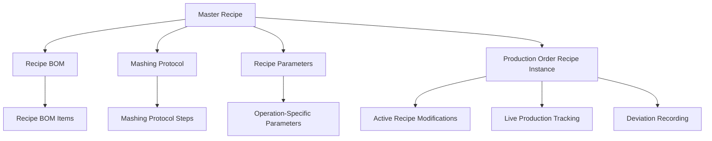

# Recipe Management System

## Overview

The Recipe Management system forms the foundation of the MES Phase 1 initiative, providing comprehensive management of master recipes, active recipe instances, and the transformation of recipe specifications into production-ready configurations. This system ensures consistent production while allowing for real-time modifications during active production.

## System Architecture

### Core Components



## Master Recipe System

### Recipe Model Structure

```prisma
model Recipe {
  id                             String                          @id @default(cuid())
  globalId                       String?                         @unique @default(cuid())
  Recipe                         String                          @unique // Recipe name
  
  // Recipe Specifications
  whiskeyType                    EnumRecipeWhiskeyType?          @default(RyeBourbon)
  cooksPerFerm                   Int?                            @default(3)
  totalCooks                     Int?
  totalFermenters                Int?
  
  // Metadata
  active                         Boolean?                        @default(true)
  isClassDefinition              Boolean?                        @default(true)
  revision                       Int?                            @default(0)
  schemaVersion                  String?                         @default("0001-b")
  
  // Customer and Recipe Group Links
  customer                       Customer                        @relation(fields: [customerId], references: [id])
  customerId                     String
  customerCode                   String?
  recipeGroup                    RecipeGroup?                    @relation(fields: [recipeGroupId], references: [id])
  recipeGroupId                  String?
  
  // Process Links
  mashingProtocol                MashingProtocol?                @relation(fields: [mashingProtocolId], references: [id])
  mashingProtocolId              String?
  unitProcedures                 UnitProcedure[]
  
  // Recipe Components
  recipeBoms                     RecipeBom[]
  parameters                     RecipeParameter[]
  
  // Production Links
  productionOrders               ProductionOrder[]
  scheduleOrders                 ScheduleOrder[]
  productionOrderRecipeInstances ProductionOrderRecipeInstance[]
  lots                           Lot[]
  
  // Inheritance
  classId                        Recipe?                         @relation(name: "RecipeClassIdRecipeInstances", fields: [classIdId], references: [id])
  classIdId                      String?
  instances                      Recipe[]                        @relation(name: "RecipeClassIdRecipeInstances")
  
  // Audit
  createdAt                      DateTime                        @default(now())
  createdBy                      String
  updatedAt                      DateTime                        @updatedAt
  updatedBy                      String?
  comments                       Comment[]
}
```

### Whiskey Type Classifications

```typescript
enum EnumRecipeWhiskeyType {
  RyeBourbon        // Rye-forward bourbon
  WheatedBourbon    // Wheat-based bourbon
  FourGrainBourbon  // Four-grain bourbon blend
  RyeWhiskey        // Straight rye whiskey
  WheatWhiskey      // Wheat whiskey
  MaltWhiskey       // Malt whiskey
  FourGrainWhiskey  // Four-grain whiskey blend
}
```

### Recipe BOM Management

#### RecipeBom Model
```prisma
model RecipeBom {
  id                             String                        @id @default(cuid())
  
  // Master/Instance Management
  master                         Boolean?                      @default(false)
  running                        Boolean?                      @default(false)
  revision                       String?
  
  // Master Recipe Relationships
  masterRecipeBom                RecipeBom?                    @relation(name: "masterRecipeBom", fields: [masterReceipeBomId], references: [id])
  masterReceipeBomId             String?
  masterInstances                RecipeBom[]                   @relation(name: "masterRecipeBom")
  
  // Running Instance Relationships
  runningRecipeBom               RecipeBom?                    @relation(name: "runningRecipeBom", fields: [runningRecipeBomId], references: [id])
  runningRecipeBomId             String?
  runningInstances               RecipeBom[]                   @relation(name: "runningRecipeBom")
  
  // Recipe Links
  recipe                         Recipe[]
  productionOrderRecipeInstances ProductionOrderRecipeInstance[]
  
  // BOM Items
  recipeBomITem                  RecipeBomItem[]
  
  // Audit
  createdAt                      DateTime                      @default(now())
  updatedAt                      DateTime                      @updatedAt
  schemaVersion                  String?
}
```

#### RecipeBomItem Model
```prisma
model RecipeBomItem {
  id                    String                         @id @default(cuid())
  globalId              String?                        @unique @default(cuid())
  
  // Item Specifications
  operation             EnumRecipeBomItemOperation
  quantity              Float?
  
  // Item Links
  item                  Item?                          @relation(fields: [itemId], references: [id])
  itemId                String?
  displayUnits          Units?                         @relation(fields: [displayUnitsId], references: [id])
  displayUnitsId        String?
  
  // Recipe BOM Link
  recipeBoms            RecipeBom?                     @relation(fields: [recipeBomsId], references: [id])
  recipeBomsId          String?
  
  // Process Links
  mashingProtocolSteps  MashingProtocolStep[]
  recipeBomActuals      RecipeBomActual[]
  
  // Class Definition Management
  isClassDefinition     Boolean?                       @default(false)
  activeInstance        RecipeBomItem?                 @relation(name: "activeInstance", fields: [activeInstanceId], references: [id])
  activeInstanceId      String?                        @unique
  classId               RecipeBomItem?                 @relation(name: "activeInstance")
  
  // Audit
  createdAt             DateTime                       @default(now())
  createdBy             String
  updatedAt             DateTime                       @updatedAt
  updatedBy             DateTime?
  schemaVersion         String?
}

enum EnumRecipeBomItemOperation {
  Mashing01       // Mashing operation items
  Fermentation01  // Fermentation operation items
  Distillation01  // Distillation operation items
  Processing01    // Processing operation items
}
```

### Mashing Protocol Management

#### MashingProtocol Model
```prisma
model MashingProtocol {
  id                             String                             @id @default(cuid())
  name                           String                             @unique
  
  // Template Management
  isTemplate                     Boolean?                           @default(false)
  templateCategory               EnumMashingProtocolTemplateCategory?
  templateDescription            String?
  
  // Master/Instance Management
  master                         Boolean?                           @default(false)
  running                        Boolean?                           @default(false)
  revision                       String?
  
  // Master Relationships
  masterMashingProtocol          MashingProtocol?                   @relation(name: "masterMashingProtocol", fields: [masterMashingProtocolId], references: [id])
  masterMashingProtocolId        String?
  masterInstances                MashingProtocol[]                  @relation(name: "masterMashingProtocol")
  
  // Running Relationships
  runningMashingProtocol         MashingProtocol?                   @relation(name: "runningMashingProtocol", fields: [runningMashingProtocolId], references: [id])
  runningMashingProtocolId       String?
  runningInstances               MashingProtocol[]                  @relation(name: "runningMashingProtocol")
  
  // Protocol Steps
  steps                          MashingProtocolStep[]
  mashingProtocolStepActuals     MashingProtocolStepActual[]
  
  // Recipe and Production Links
  recipes                        Recipe[]
  productionOrderRecipeInstances ProductionOrderRecipeInstance[]
  
  // Audit
  createdAt                      DateTime                           @default(now())
  createdBy                      String
  updatedAt                      DateTime                           @updatedAt
  updatedBy                      String?
  schemaVersion                  String?
}

enum EnumMashingProtocolTemplateCategory {
  RyeBourbon      // Rye bourbon template
  WheatedBourbon  // Wheated bourbon template
  FourGrainBourbon // Four-grain bourbon template
  RyeWhiskey      // Rye whiskey template
  WheatWhiskey    // Wheat whiskey template
  MaltWhiskey     // Malt whiskey template
}
```

#### MashingProtocolStep Model
```prisma
model MashingProtocolStep {
  id                         String                           @id @default(cuid())
  
  // Step Configuration
  index                      Int?
  stepType                   EnumMashingProtocolStepStepType?
  holdType                   EnumMashingProtocolStepHoldType?
  stepTime                   Int?
  promptMessage              String?
  
  // Temperature Control
  temperatureSetpoint        Float?
  temperatureActual          Float?
  heatEnabled                Boolean?                         @default(false)
  heatTempSp                 Float?
  coolEnabled                Boolean?                         @default(false)
  coolTempSp                 Float?
  
  // Agitation Control
  agitatorEnabled            Boolean?                         @default(false)
  agitatorSpdSp              Float?
  
  // Protocol Link
  mashingProtocol            MashingProtocol?                 @relation(fields: [mashingProtocolId], references: [id])
  mashingProtocolId          String?
  
  // Material Links
  recipeBomItem              RecipeBomItem[]
  
  // Actual Values
  mashingProtocolStepActuals MashingProtocolStepActual[]
  
  // Audit
  createdAt                  DateTime                         @default(now())
  createdBy                  String
  updatedAt                  DateTime                         @updatedAt
  updatedBy                  String?
  schemaVersion              String?
}

enum EnumMashingProtocolStepStepType {
  Hold        // Temperature hold step
  LiquidAdd   // Liquid addition step
  Corn        // Corn addition step
  Wheat       // Wheat addition step
  Rye         // Rye addition step
  PreMalt     // Pre-malt addition step
  Malt        // Malt addition step
  Prompt      // Operator prompt step
  AdditiveAdd // Additive addition step
}

enum EnumMashingProtocolStepHoldType {
  Heat  // Heating hold
  Cool  // Cooling hold
  Hold  // Temperature hold
}
```

### Recipe Parameters

#### RecipeParameter Model
```prisma
model RecipeParameter {
  id                         String                                 @id @default(cuid())
  globalId                   String?                                @unique @default(cuid())
  
  // Parameter Definition
  recipeParamName            String?
  recipeParamDescription     String?
  description                String?
  className                  String?
  
  // Value Specifications
  recipeSetpointType         EnumRecipeParameterRecipeSetpointType?
  recipeNumericalSetpoint    Float?
  recipeSetpointBooleanValue Boolean?
  recipeSetpointLowerLimit   Float?
  recipeSetpointUpperLimit   Float?
  
  // Configuration
  active                     Boolean?
  configurable               Boolean?                               @default(true)
  required                   Boolean?                               @default(true)
  isClassDefinition          Boolean?                               @default(false)
  revision                   Int?                                   @default(0)
  
  // Operation Link
  operation                  Operation?                             @relation(fields: [operationId], references: [id])
  operationId                String?
  
  // Units
  units                      Units?                                 @relation(fields: [unitsId], references: [id])
  unitsId                    String?
  
  // Recipe Links
  recipe                     Recipe[]
  
  // Audit
  createdAt                  DateTime                               @default(now())
  createdBy                  String?
  updatedAt                  DateTime                               @updatedAt
  updatedBy                  String?
  schemaVersion              String?                                @default("0001-alpha")
}

enum EnumRecipeParameterRecipeSetpointType {
  Boolean  // Boolean parameter
  Numeric  // Numeric parameter
  Text     // Text parameter
}
```

## Active Recipe Instance Management

### ProductionOrderRecipeInstance

The `ProductionOrderRecipeInstance` model represents the live, production-specific instantiation of a master recipe. This allows for real-time modifications during production while preserving the integrity of master recipes.

```prisma
model ProductionOrderRecipeInstance {
  id                String              @id @default(cuid())
  
  // Production Links
  productionOrder   ProductionOrder     @relation(fields: [productionOrderId], references: [id])
  productionOrderId String
  recipe            Recipe              @relation(fields: [recipeId], references: [id])
  recipeId          String
  
  // Active Recipe Components
  recipeBom         RecipeBom[]
  mashingProtocol   MashingProtocol[]
  recipeBomActuals  RecipeBomActual[]
  batches           Batch[]
  
  // Audit
  createdAt         DateTime            @default(now())
  createdBy         String
  updatedAt         DateTime            @updatedAt
  updatedBy         String?
  schemaVersion     String?
}
```

### Key Features of Recipe Instances

#### 1. Independent Recipe Instantiation
- **Master Recipe Preservation**: Original recipe specifications remain unchanged
- **Production-Specific Scaling**: Quantities adjusted for actual production requirements
- **Real-time Modifications**: Live changes during production without affecting master
- **Deviation Tracking**: Records all changes from original specifications

#### 2. Quantity Normalization and Scaling

```typescript
interface RecipeScaling {
  originalQuantities: Record<string, number>;
  scalingFactor: number;
  productionQuantities: Record<string, number>;
  operationalEfficiency: number;
}

function scaleRecipeForProduction(
  masterRecipe: Recipe,
  productionOrder: ProductionOrder,
  operationalEfficiency: number
): RecipeScaling {
  const scalingFactor = calculateScalingFactor(
    masterRecipe.baseQuantity,
    productionOrder.quantity,
    operationalEfficiency
  );
  
  const productionQuantities = scaleRecipeBomItems(
    masterRecipe.recipeBom.items,
    scalingFactor
  );
  
  return {
    originalQuantities: extractOriginalQuantities(masterRecipe.recipeBom.items),
    scalingFactor,
    productionQuantities,
    operationalEfficiency
  };
}
```

#### 3. Real-time Recipe Modifications

```typescript
interface RecipeModification {
  modificationId: string;
  timestamp: DateTime;
  modifiedBy: string;
  modificationType: 'QUANTITY_CHANGE' | 'INGREDIENT_SUBSTITUTION' | 'PROCESS_ADJUSTMENT';
  originalValue: any;
  newValue: any;
  reason: string;
  approved: boolean;
  approvedBy?: string;
}

async function modifyActiveRecipe(
  instanceId: string,
  modification: RecipeModification
): Promise<ProductionOrderRecipeInstance> {
  // Validate modification permissions
  await validateModificationPermissions(modification.modifiedBy, modification.modificationType);
  
  // Apply modification
  const updatedInstance = await applyRecipeModification(instanceId, modification);
  
  // Record deviation
  await recordRecipeDeviation(instanceId, modification);
  
  // Notify stakeholders
  await notifyRecipeModification(instanceId, modification);
  
  return updatedInstance;
}
```

### Recipe BOM Actuals

#### RecipeBomActual Model
```prisma
model RecipeBomActual {
  id                              String                         @id @default(cuid())
  
  // Actual Value
  value                           Float?
  
  // Links
  recipeBomItem                   RecipeBomItem                  @relation(fields: [recipeBomItemId], references: [id])
  recipeBomItemId                 String
  productionOrderRecipeInstance   ProductionOrderRecipeInstance? @relation(fields: [productionOrderRecipeInstanceId], references: [id])
  productionOrderRecipeInstanceId String?
  mashingProtocolStepActual       MashingProtocolStepActual?     @relation(fields: [mashingProtocolStepActualId], references: [id])
  mashingProtocolStepActualId     String?
  
  // Audit
  createdAt                       DateTime                       @default(now())
  createdBy                       String
  updatedAt                       DateTime                       @updatedAt
  updatedBy                       String?
}
```

### Mashing Protocol Step Actuals

#### MashingProtocolStepActual Model
```prisma
model MashingProtocolStepActual {
  id                    String                @id @default(cuid())
  
  // Actual Values
  actualValue           Float
  timeActualValue       Float?
  stepCompletedAt       DateTime?
  
  // Links
  mashingProtocol       MashingProtocol       @relation(fields: [mashingProtocolId], references: [id])
  mashingProtocolId     String
  mashingProtocolStep   MashingProtocolStep   @relation(fields: [mashingProtocolStepId], references: [id])
  mashingProtocolStepId String
  recipeBomActual       RecipeBomActual[]
  
  // Audit
  createdAt             DateTime              @default(now())
  createdBy             String
  updatedAt             DateTime              @updatedAt
  updatedBy             String?
  schemaVersion         String?
}
```

## Recipe Generation and Creation

### Recipe Generation Service

The recipe generation system provides automated creation of recipes based on templates and customer requirements.

```typescript
interface RecipeGenerationInput {
  customerId: string;
  whiskeyType: EnumRecipeWhiskeyType;
  targetProof: number;
  mashBill: MashBillComposition;
  specialRequirements?: string[];
  templateId?: string;
}

interface MashBillComposition {
  corn: number;      // Percentage
  wheat?: number;    // Percentage
  rye?: number;      // Percentage
  malt: number;      // Percentage
  specialty?: SpecialtyGrain[];
}

interface SpecialtyGrain {
  grainType: string;
  percentage: number;
  purpose: string;
}

class RecipeGenerationService {
  async generateRecipe(input: RecipeGenerationInput): Promise<Recipe> {
    // Validate mash bill composition
    await this.validateMashBill(input.mashBill);
    
    // Select appropriate template
    const template = await this.selectTemplate(input.whiskeyType, input.templateId);
    
    // Generate recipe BOM
    const recipeBom = await this.generateRecipeBom(input.mashBill, template);
    
    // Generate mashing protocol
    const mashingProtocol = await this.generateMashingProtocol(input.whiskeyType, template);
    
    // Generate recipe parameters
    const recipeParameters = await this.generateRecipeParameters(input, template);
    
    // Create recipe
    return await this.createRecipe({
      input,
      recipeBom,
      mashingProtocol,
      recipeParameters
    });
  }
  
  private async validateMashBill(mashBill: MashBillComposition): Promise<void> {
    const total = mashBill.corn + (mashBill.wheat || 0) + (mashBill.rye || 0) + mashBill.malt;
    
    if (Math.abs(total - 100) > 0.01) {
      throw new Error(`Mash bill must total 100%, got ${total}%`);
    }
    
    // Additional validation rules
    if (mashBill.corn < 51) {
      throw new Error('Bourbon requires at least 51% corn');
    }
  }
  
  private async generateRecipeBom(
    mashBill: MashBillComposition,
    template: RecipeTemplate
  ): Promise<RecipeBom> {
    const bomItems: RecipeBomItemInput[] = [];
    
    // Generate grain items
    bomItems.push(...await this.generateGrainItems(mashBill));
    
    // Generate additive items
    bomItems.push(...await this.generateAdditiveItems(template));
    
    // Generate yeast items
    bomItems.push(...await this.generateYeastItems(template));
    
    return await this.createRecipeBom(bomItems);
  }
}
```

### Recipe Template System

```typescript
interface RecipeTemplate {
  id: string;
  name: string;
  category: EnumMashingProtocolTemplateCategory;
  description: string;
  
  // Template Components
  bomTemplate: BomTemplate;
  mashingProtocolTemplate: MashingProtocolTemplate;
  parameterTemplate: ParameterTemplate;
  
  // Configuration
  defaultMashBill: MashBillComposition;
  recommendedYeast: string[];
  specialInstructions: string;
}

interface BomTemplate {
  grainRatios: Record<string, number>;
  additives: AdditiveTemplate[];
  yeastOptions: YeastTemplate[];
}

interface MashingProtocolTemplate {
  steps: MashingStepTemplate[];
  totalDuration: number;
  temperatureProfile: TemperatureProfile;
}
```

## Recipe Search and Discovery

### Search Implementation

```typescript
interface RecipeSearchInput {
  query?: string;
  whiskeyType?: EnumRecipeWhiskeyType;
  customerId?: string;
  active?: boolean;
  mashBillFilters?: MashBillFilters;
  createdDateRange?: DateRange;
  tags?: string[];
}

interface MashBillFilters {
  cornMin?: number;
  cornMax?: number;
  wheatMin?: number;
  wheatMax?: number;
  ryeMin?: number;
  ryeMax?: number;
  maltMin?: number;
  maltMax?: number;
}

class RecipeSearchService {
  async searchRecipes(input: RecipeSearchInput): Promise<Recipe[]> {
    const query = this.buildSearchQuery(input);
    
    return await this.prisma.recipe.findMany({
      where: query,
      include: {
        customer: true,
        recipeGroup: true,
        recipeBoms: {
          include: {
            recipeBomITem: {
              include: {
                item: true
              }
            }
          }
        },
        mashingProtocol: {
          include: {
            steps: true
          }
        },
        parameters: true
      },
      orderBy: [
        { updatedAt: 'desc' },
        { Recipe: 'asc' }
      ]
    });
  }
  
  private buildSearchQuery(input: RecipeSearchInput): any {
    const where: any = {};
    
    if (input.query) {
      where.OR = [
        { Recipe: { contains: input.query, mode: 'insensitive' } },
        { customerCode: { contains: input.query, mode: 'insensitive' } },
        { customer: { name: { contains: input.query, mode: 'insensitive' } } }
      ];
    }
    
    if (input.whiskeyType) {
      where.whiskeyType = input.whiskeyType;
    }
    
    if (input.customerId) {
      where.customerId = input.customerId;
    }
    
    if (input.active !== undefined) {
      where.active = input.active;
    }
    
    // Mash bill filters would require complex JSON queries or computed fields
    if (input.mashBillFilters) {
      where.recipeBoms = {
        some: {
          recipeBomITem: {
            some: this.buildMashBillQuery(input.mashBillFilters)
          }
        }
      };
    }
    
    return where;
  }
}
```

## API Endpoints

### Recipe Management

#### Create Recipe
```http
POST /api/recipes
Content-Type: application/json

{
  "Recipe": "Premium Bourbon Blend",
  "whiskeyType": "RyeBourbon",
  "customerId": "customer-id",
  "customerCode": "CUST001",
  "cooksPerFerm": 3,
  "totalCooks": 12,
  "totalFermenters": 4
}
```

#### Generate Recipe
```http
POST /api/recipes/generate
Content-Type: application/json

{
  "customerId": "customer-id",
  "whiskeyType": "RyeBourbon",
  "targetProof": 120,
  "mashBill": {
    "corn": 65,
    "rye": 20,
    "wheat": 10,
    "malt": 5
  },
  "templateId": "rye-bourbon-template"
}
```

#### Search Recipes
```http
GET /api/recipes/search?query=bourbon&whiskeyType=RyeBourbon&active=true
```

#### Get Recipe Details
```http
GET /api/recipes/{id}?include=bom,protocol,parameters
```

### Recipe Instance Management

#### Create Recipe Instance
```http
POST /api/productionOrderRecipeInstances
Content-Type: application/json

{
  "productionOrderId": "production-order-id",
  "recipeId": "recipe-id",
  "scalingFactor": 1.2,
  "modifications": []
}
```

#### Modify Active Recipe
```http
PUT /api/productionOrderRecipeInstances/{id}/modify
Content-Type: application/json

{
  "modificationType": "QUANTITY_CHANGE",
  "targetItem": "recipe-bom-item-id",
  "newValue": 125.5,
  "reason": "Quality adjustment based on grain moisture content",
  "approvedBy": "supervisor-id"
}
```

#### Record Recipe Actual
```http
POST /api/recipeBomActuals
Content-Type: application/json

{
  "recipeBomItemId": "recipe-bom-item-id",
  "productionOrderRecipeInstanceId": "instance-id",
  "actualValue": 123.4,
  "recordedBy": "operator-id",
  "timestamp": "2025-01-15T14:30:00Z"
}
```

## GraphQL Schema

### Recipe Types
```graphql
type Recipe {
  id: String!
  globalId: String
  Recipe: String!
  whiskeyType: RecipeWhiskeyType
  cooksPerFerm: Int
  totalCooks: Int
  totalFermenters: Int
  active: Boolean
  isClassDefinition: Boolean
  revision: Int
  
  # Relationships
  customer: Customer!
  customerCode: String
  recipeGroup: RecipeGroup
  mashingProtocol: MashingProtocol
  recipeBoms: [RecipeBom!]!
  parameters: [RecipeParameter!]!
  unitProcedures: [UnitProcedure!]!
  
  # Production Links
  productionOrders: [ProductionOrder!]!
  scheduleOrders: [ScheduleOrder!]!
  productionOrderRecipeInstances: [ProductionOrderRecipeInstance!]!
  lots: [Lot!]!
  
  # Inheritance
  classId: Recipe
  instances: [Recipe!]!
  
  # Audit
  createdAt: DateTime!
  createdBy: String!
  updatedAt: DateTime!
  updatedBy: String
  comments: [Comment!]!
}

type RecipeBom {
  id: String!
  master: Boolean
  running: Boolean
  revision: String
  
  # Relationships
  masterRecipeBom: RecipeBom
  masterInstances: [RecipeBom!]!
  runningRecipeBom: RecipeBom
  runningInstances: [RecipeBom!]!
  recipe: [Recipe!]!
  recipeBomItems: [RecipeBomItem!]!
  productionOrderRecipeInstances: [ProductionOrderRecipeInstance!]!
  
  createdAt: DateTime!
  updatedAt: DateTime!
}

type RecipeBomItem {
  id: String!
  globalId: String
  operation: RecipeBomItemOperation!
  quantity: Float
  
  # Item and Units
  item: Item
  displayUnits: Units
  
  # Relationships
  recipeBoms: RecipeBom
  mashingProtocolSteps: [MashingProtocolStep!]!
  recipeBomActuals: [RecipeBomActual!]!
  
  # Class Definition
  isClassDefinition: Boolean
  activeInstance: RecipeBomItem
  classId: RecipeBomItem
  
  createdAt: DateTime!
  createdBy: String!
  updatedAt: DateTime!
}

type ProductionOrderRecipeInstance {
  id: String!
  
  # Production Links
  productionOrder: ProductionOrder!
  recipe: Recipe!
  
  # Active Components
  recipeBom: [RecipeBom!]!
  mashingProtocol: [MashingProtocol!]!
  recipeBomActuals: [RecipeBomActual!]!
  batches: [Batch!]!
  
  createdAt: DateTime!
  createdBy: String!
  updatedAt: DateTime!
  updatedBy: String
}

enum RecipeWhiskeyType {
  RyeBourbon
  WheatedBourbon
  FourGrainBourbon
  RyeWhiskey
  WheatWhiskey
  MaltWhiskey
  FourGrainWhiskey
}

enum RecipeBomItemOperation {
  Mashing01
  Fermentation01
  Distillation01
  Processing01
}
```

### Mutations
```graphql
type Mutation {
  createRecipe(data: CreateRecipeInput!): Recipe!
  updateRecipe(where: RecipeWhereUniqueInput!, data: UpdateRecipeInput!): Recipe!
  deleteRecipe(where: RecipeWhereUniqueInput!): Recipe!
  
  generateRecipe(data: RecipeGenerationInput!): Recipe!
  
  createProductionOrderRecipeInstance(data: CreateProductionOrderRecipeInstanceInput!): ProductionOrderRecipeInstance!
  modifyActiveRecipe(instanceId: String!, modification: RecipeModificationInput!): ProductionOrderRecipeInstance!
  
  createRecipeBomActual(data: CreateRecipeBomActualInput!): RecipeBomActual!
  updateRecipeBomActual(where: RecipeBomActualWhereUniqueInput!, data: UpdateRecipeBomActualInput!): RecipeBomActual!
  
  createMashingProtocolStepActual(data: CreateMashingProtocolStepActualInput!): MashingProtocolStepActual!
}

input RecipeGenerationInput {
  customerId: String!
  whiskeyType: RecipeWhiskeyType!
  targetProof: Float!
  mashBill: MashBillCompositionInput!
  specialRequirements: [String!]
  templateId: String
}

input MashBillCompositionInput {
  corn: Float!
  wheat: Float
  rye: Float
  malt: Float!
  specialty: [SpecialtyGrainInput!]
}

input RecipeModificationInput {
  modificationType: RecipeModificationType!
  targetItem: String!
  newValue: Float!
  reason: String!
  approvedBy: String
}

enum RecipeModificationType {
  QUANTITY_CHANGE
  INGREDIENT_SUBSTITUTION
  PROCESS_ADJUSTMENT
}
```

### Queries
```graphql
type Query {
  recipe(where: RecipeWhereUniqueInput!): Recipe
  recipes(
    where: RecipeWhereInput
    orderBy: [RecipeOrderByInput!]
    take: Int
    skip: Int
  ): [Recipe!]!
  
  searchRecipes(input: RecipeSearchInput!): [Recipe!]!
  
  productionOrderRecipeInstance(where: ProductionOrderRecipeInstanceWhereUniqueInput!): ProductionOrderRecipeInstance
  productionOrderRecipeInstances(
    where: ProductionOrderRecipeInstanceWhereInput
    orderBy: [ProductionOrderRecipeInstanceOrderByInput!]
    take: Int
    skip: Int
  ): [ProductionOrderRecipeInstance!]!
  
  recipeTemplates(category: MashingProtocolTemplateCategory): [RecipeTemplate!]!
  mashBillAnalysis(recipeId: String!): MashBillAnalysis!
}

input RecipeSearchInput {
  query: String
  whiskeyType: RecipeWhiskeyType
  customerId: String
  active: Boolean
  mashBillFilters: MashBillFiltersInput
  createdDateRange: DateRangeInput
  tags: [String!]
}
```

## Performance Optimization

### Database Indexing Strategy
- **Recipe Name**: Unique index for fast recipe lookups
- **Customer Recipes**: Composite index on customerId + active
- **Recipe Type**: Index on whiskeyType for category searches
- **Global ID**: Unique index for cross-system references
- **Timeline**: Index on createdAt/updatedAt for temporal queries

### Caching Strategy
- **Master Recipes**: Cache frequently accessed recipes
- **Templates**: Cache recipe templates for generation
- **BOM Data**: Cache recipe BOM structures
- **Search Results**: Cache common search queries

### Query Optimization
- **Selective Includes**: Only load required relationships
- **Pagination**: Implement cursor-based pagination for large result sets
- **Aggregations**: Use database aggregations for summary data
- **Computed Fields**: Cache complex calculations

## Security and Compliance

### Access Control
- **Recipe Viewing**: Role-based access to recipe information
- **Recipe Modification**: Restricted modification permissions
- **Active Recipe Changes**: Supervisor approval for production changes
- **Audit Trail**: Complete tracking of all recipe changes

### Data Protection
- **Recipe IP**: Protect proprietary recipe formulations
- **Customer Data**: Secure customer-specific recipe information
- **Production Data**: Protect actual production values and deviations

### Regulatory Compliance
- **TTB Requirements**: Support TTB formula and process documentation
- **Batch Records**: Maintain complete batch production records
- **Traceability**: Full ingredient and process traceability
- **Change Control**: Documented change control for recipe modifications

---

*This documentation provides comprehensive coverage of the Recipe Management system within the MES Phase 1 initiative. For integration details with other systems, refer to the related documentation sections.*