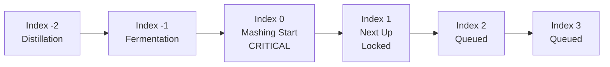
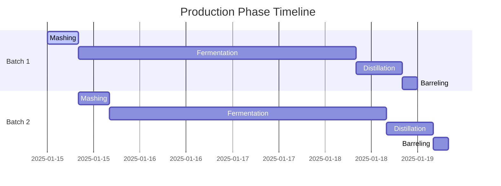

# Schedule Management & Queue System

## Overview

The Schedule Management system provides comprehensive production scheduling capabilities through a queue-based architecture. This system manages the sequencing, timing, and resource allocation for production orders while providing real-time visibility into production status and progress.

## Queue-Based Scheduling Architecture

### Core Concepts

The scheduling system uses a **queue index** as the primary mechanism for managing production order sequencing. This index-based approach provides precise control over production flow and resource allocation.

#### Queue Index Values
- **Index = 0**: Critical position - mashing start (active production)
- **Negative Index (-1, -2, etc.)**: Currently running on the production line
- **Positive Index (1, 2, 3, etc.)**: Future positions in the queue
- **Index = 1**: Often locked when milling has started queuing resources for next mash

### Queue Position Management



### Database Schema

#### ScheduleOrderQueue Model
```prisma
model ScheduleOrderQueue {
  id            String         @id @default(cuid())
  globalId      String?        @unique @default(cuid())
  queueIndex    Int?           @unique
  
  // Relationships
  scheduleOrder ScheduleOrder?
  areas         Asset[]
  
  // Audit fields
  createdAt     DateTime       @default(now())
  createdBy     String
  updatedAt     DateTime       @updatedAt
  updatedBy     String?
  schemaVersion String?        @default("0001-b")
}
```

#### ScheduleOrder Model
```prisma
model ScheduleOrder {
  id                             String                   @id @default(cuid())
  globalId                       String?                  @unique @default(cuid())
  name                           String?                  @unique
  
  // Timeline Management
  estimatedStart                 DateTime?
  estimatedEnd                   DateTime?
  estimatedMashingStartTime      DateTime?
  estimatedMashingDuration       Float?
  estimatedFermentationStartTime DateTime?
  estimatedFermentationDuration  Float?
  estimatedDistillationStartTime DateTime?
  estimatedDistillationDuration  Float?
  estimatedBarrelingStartTime    DateTime?
  estimatedProcessingStartTime   DateTime?
  estimatedTotalProductionDuration Float?
  
  // Actual Tracking
  actualStart                    DateTime?
  actualEnd                      DateTime?
  
  // Production Specifications
  totalBarrels                   Int?
  totalProofGallons              Float?
  productionOrderAllocation      Json
  
  // Status Management
  status                         EnumScheduleOrderStatus? @default(Created)
  
  // Queue Integration
  scheduleOrderQueues            ScheduleOrderQueue?      @relation(fields: [scheduleOrderQueueId], references: [id])
  scheduleOrderQueueId           String?                  @unique
  
  // Recipe and Customer Links
  recipeName                     String
  recipeGroup                    RecipeGroup              @relation(fields: [recipeGroupId], references: [id])
  recipeGroupId                  String
  scheduleOrderRecipe            Recipe?                  @relation(fields: [scheduleOrderRecipeId], references: [id])
  scheduleOrderRecipeId          String?
  customers                      Customer[]
  productionOrders               ProductionOrder[]
}
```

## Production Phase Timing

The scheduling system manages four primary production phases with standardized durations and dependencies.

### Phase Definitions

| Phase | Default Duration | Dependencies | Key Activities |
|-------|-----------------|--------------|----------------|
| **Mashing** | 8 hours | - | Grain processing, cooking, enzyme addition |
| **Fermentation** | 72 hours (3 days) | Mashing completion | Yeast addition, sugar conversion, monitoring |
| **Distillation** | 12 hours | Fermentation completion | Alcohol separation, cut management |
| **Barreling** | Variable | Distillation completion | Proofing, barrel filling, warehouse entry |

### Sequential Processing



### Timeline Calculation Engine

The system automatically calculates production timelines based on:
- **Start Date**: User-provided or system-calculated
- **Phase Durations**: Standard or recipe-specific durations
- **Resource Availability**: Equipment and capacity constraints
- **Queue Position**: Current position in production queue

#### Calculation Logic
```typescript
interface PhaseTimeline {
  mashingStart: DateTime;
  mashingEnd: DateTime;
  fermentationStart: DateTime;
  fermentationEnd: DateTime;
  distillationStart: DateTime;
  distillationEnd: DateTime;
  barrelingStart: DateTime;
  barrelingEnd: DateTime;
  totalDuration: number;
}

function calculateTimeline(startDate: DateTime, recipeDurations?: PhaseDurations): PhaseTimeline {
  const durations = recipeDurations || DEFAULT_DURATIONS;
  
  return {
    mashingStart: startDate,
    mashingEnd: startDate.plus({ hours: durations.mashing }),
    fermentationStart: startDate.plus({ hours: durations.mashing }),
    fermentationEnd: startDate.plus({ hours: durations.mashing + durations.fermentation }),
    distillationStart: startDate.plus({ hours: durations.mashing + durations.fermentation }),
    distillationEnd: startDate.plus({ hours: durations.mashing + durations.fermentation + durations.distillation }),
    barrelingStart: startDate.plus({ hours: durations.mashing + durations.fermentation + durations.distillation }),
    barrelingEnd: startDate.plus({ hours: durations.mashing + durations.fermentation + durations.distillation + durations.barreling }),
    totalDuration: durations.mashing + durations.fermentation + durations.distillation + durations.barreling
  };
}
```

## Queue Management Operations

### Adding Orders to Queue

When a production order is added to the schedule queue, the system:

1. **Determines Queue Position**: Finds next available index
2. **Creates Schedule Order**: If not already exists
3. **Creates Queue Entry**: Links schedule order to queue position
4. **Calculates Timeline**: Based on current queue and resource availability
5. **Updates Estimates**: Propagates timing to production orders

```typescript
async addProductionOrderToQueue(
  productionOrderId: string,
  startDate?: DateTime,
  priority?: number
): Promise<ScheduleOrderQueue> {
  // Find or create schedule order
  const scheduleOrder = await this.findOrCreateScheduleOrder(productionOrderId);
  
  // Determine queue position
  const queueIndex = await this.getNextQueueIndex(priority);
  
  // Create queue entry
  const queueEntry = await this.prisma.scheduleOrderQueue.create({
    data: {
      queueIndex,
      scheduleOrder: { connect: { id: scheduleOrder.id } },
      createdBy: 'system'
    }
  });
  
  // Calculate and update timelines
  await this.updateTimelines(queueEntry.id, startDate);
  
  return queueEntry;
}
```

### Queue Position Changes

#### Moving Orders in Queue
```typescript
async updateQueuePosition(
  scheduleOrderQueueId: string,
  newIndex: number
): Promise<ScheduleOrderQueue> {
  // Validate new position
  await this.validateQueuePosition(newIndex);
  
  // Update queue index
  const updatedQueue = await this.prisma.scheduleOrderQueue.update({
    where: { id: scheduleOrderQueueId },
    data: { queueIndex: newIndex }
  });
  
  // Recalculate affected timelines
  await this.recalculateQueueTimelines();
  
  return updatedQueue;
}
```

#### Starting Production (Moving to Index 0)
```typescript
async startProduction(scheduleOrderQueueId: string): Promise<void> {
  // Move to critical index 0
  await this.updateQueuePosition(scheduleOrderQueueId, 0);
  
  // Update schedule order status
  await this.updateScheduleOrderStatus(scheduleOrderId, 'InProgress');
  
  // Update production order statuses
  await this.updateProductionOrderStatuses(scheduleOrderId, 'InProgress');
  
  // Trigger production notifications
  await this.notifyProductionStart(scheduleOrderId);
}
```

#### Advancing Through Production
```typescript
async advanceProduction(scheduleOrderQueueId: string): Promise<void> {
  const currentQueue = await this.getQueueEntry(scheduleOrderQueueId);
  
  if (currentQueue.queueIndex === 0) {
    // Move to active production (negative index)
    await this.updateQueuePosition(scheduleOrderQueueId, -1);
  } else if (currentQueue.queueIndex < 0) {
    // Advance through production phases
    await this.updateQueuePosition(scheduleOrderQueueId, currentQueue.queueIndex - 1);
  }
  
  // Update phase-specific tracking
  await this.updatePhaseProgress(scheduleOrderQueueId);
}
```

### Completing Production
```typescript
async completeProduction(scheduleOrderQueueId: string): Promise<void> {
  // Remove from queue
  await this.removeFromQueue(scheduleOrderQueueId);
  
  // Update final statuses
  await this.updateScheduleOrderStatus(scheduleOrderId, 'Complete');
  await this.updateProductionOrderStatuses(scheduleOrderId, 'Complete');
  
  // Trigger completion workflows
  await this.processProductionCompletion(scheduleOrderId);
  
  // Advance queue
  await this.advanceQueuePositions();
}
```

## Estimation Engine

### Resource Estimation

The system provides automated estimation of production requirements based on order specifications and operational parameters.

#### Key Estimation Variables
- **Cooks per Fermenter**: Recipe-specific ratios
- **Barrels per Fermenter**: Based on efficiency and yield
- **Proof Gallons per Barrel**: Container specifications
- **Total Grain Weight**: Recipe BOM calculations
- **Processing Duration**: Phase-specific timings

#### Estimation Calculations
```typescript
interface EstimationInputs {
  orderQuantity: number;
  recipeId: string;
  targetProof: number;
  containerType: string;
  operationalEfficiency: number;
}

interface EstimationResults {
  totalCooks: number;
  totalFermenters: number;
  totalBarrels: number;
  totalProofGallons: number;
  totalGrainWeight: number;
  estimatedDuration: number;
  resourceRequirements: ResourceRequirements;
}

function calculateEstimations(inputs: EstimationInputs): EstimationResults {
  const recipe = getRecipe(inputs.recipeId);
  const efficiency = inputs.operationalEfficiency || DEFAULT_EFFICIENCY;
  
  // Calculate basic requirements
  const totalFermenters = Math.ceil(inputs.orderQuantity / STANDARD_FERMENTER_CAPACITY);
  const totalCooks = totalFermenters * recipe.cooksPerFermenter;
  const totalBarrels = totalFermenters * efficiency.barrelsPerFermenter;
  const totalProofGallons = totalBarrels * getProofGallonsPerBarrel(inputs.containerType);
  
  // Calculate grain requirements
  const totalGrainWeight = calculateGrainWeight(recipe.bom, totalCooks);
  
  // Calculate duration
  const estimatedDuration = calculateProductionDuration(totalCooks, totalFermenters);
  
  return {
    totalCooks,
    totalFermenters,
    totalBarrels,
    totalProofGallons,
    totalGrainWeight,
    estimatedDuration,
    resourceRequirements: calculateResourceRequirements(inputs)
  };
}
```

### Timeline Estimation

#### Current Run Rate Analysis
The system analyzes current production performance to provide realistic timeline estimates:

```typescript
interface RunRateAnalysis {
  averagePhaseCompletionTime: Record<string, number>;
  currentEfficiency: number;
  equipmentUtilization: number;
  qualityMetrics: QualityMetrics;
}

async function analyzeCurrentRunRates(): Promise<RunRateAnalysis> {
  const recentProduction = await getRecentProductionData(30); // Last 30 days
  
  return {
    averagePhaseCompletionTime: calculateAveragePhaseTimings(recentProduction),
    currentEfficiency: calculateEfficiency(recentProduction),
    equipmentUtilization: calculateUtilization(recentProduction),
    qualityMetrics: calculateQualityMetrics(recentProduction)
  };
}
```

#### Deviation Tracking
```typescript
interface DeviationRecord {
  scheduleOrderId: string;
  phase: ProductionPhase;
  plannedStart: DateTime;
  actualStart: DateTime;
  plannedDuration: number;
  actualDuration: number;
  deviationMinutes: number;
  deviationPercentage: number;
  reason?: string;
}

async function trackDeviation(
  scheduleOrderId: string,
  phase: ProductionPhase,
  actualTiming: PhaseActual
): Promise<DeviationRecord> {
  const planned = await getPlannedTiming(scheduleOrderId, phase);
  const deviation = calculateDeviation(planned, actualTiming);
  
  // Store deviation record
  await this.prisma.deviationRecord.create({
    data: {
      scheduleOrderId,
      phase,
      ...planned,
      ...actualTiming,
      ...deviation
    }
  });
  
  return deviation;
}
```

## API Endpoints

### Queue Management

#### Add Production Order to Queue
```http
POST /api/scheduleOrderQueues/add-production-order-to-queue/{productionOrderId}
Content-Type: application/json

{
  "startDate": "2025-01-15T08:00:00Z",
  "priority": 1,
  "username": "operator"
}
```

#### Update Queue Position
```http
PUT /api/scheduleOrderQueues/{id}/queue-position
Content-Type: application/json

{
  "queueIndex": 2,
  "reason": "Priority change requested"
}
```

#### Start Production
```http
POST /api/scheduleOrderQueues/{id}/start
Content-Type: application/json

{
  "actualStartTime": "2025-01-15T08:15:00Z",
  "operator": "john.doe"
}
```

#### Advance Production Phase
```http
POST /api/scheduleOrderQueues/{id}/advance
Content-Type: application/json

{
  "phase": "fermentation",
  "timestamp": "2025-01-15T16:30:00Z"
}
```

#### Complete Production
```http
POST /api/scheduleOrderQueues/{id}/complete
Content-Type: application/json

{
  "completionTime": "2025-01-19T14:00:00Z",
  "finalQuantity": 485,
  "qualityNotes": "Excellent batch quality"
}
```

### Timeline Management

#### Get Queue Timeline
```http
GET /api/scheduleOrderQueues/timeline
```

Response:
```json
{
  "currentQueue": [
    {
      "queueIndex": -1,
      "scheduleOrderId": "so-001",
      "phase": "fermentation",
      "estimatedCompletion": "2025-01-17T08:00:00Z"
    },
    {
      "queueIndex": 0,
      "scheduleOrderId": "so-002",
      "phase": "mashing",
      "estimatedStart": "2025-01-17T08:00:00Z"
    },
    {
      "queueIndex": 1,
      "scheduleOrderId": "so-003",
      "estimatedStart": "2025-01-17T16:00:00Z"
    }
  ],
  "estimatedTimeline": {
    "totalQueuedOrders": 5,
    "estimatedCompletionDate": "2025-01-25T17:00:00Z",
    "averageWaitTime": "2.5 days"
  }
}
```

#### Update Timeline Estimates
```http
PUT /api/scheduleOrders/{id}/timeline
Content-Type: application/json

{
  "estimatedMashingDuration": 9.5,
  "estimatedFermentationDuration": 75.0,
  "estimatedDistillationDuration": 11.5,
  "reason": "Recipe-specific adjustments"
}
```

### Resource Planning

#### Get Resource Requirements
```http
GET /api/scheduleOrders/{id}/resource-requirements
```

#### Update Resource Allocation
```http
PUT /api/scheduleOrders/{id}/resource-allocation
Content-Type: application/json

{
  "fermenterAllocation": [1, 3, 5],
  "distillationSlots": ["slot-a", "slot-b"],
  "barreling": {
    "warehouseSection": "A-1",
    "barrelCount": 450
  }
}
```

## GraphQL Schema

### Queue Management Types
```graphql
type ScheduleOrderQueue {
  id: String!
  queueIndex: Int
  scheduleOrder: ScheduleOrder
  areas: [Asset!]!
  createdAt: DateTime!
  updatedAt: DateTime!
}

type ScheduleOrder {
  id: String!
  name: String
  recipeName: String!
  status: ScheduleOrderStatus
  
  # Timeline fields
  estimatedStart: DateTime
  estimatedEnd: DateTime
  estimatedMashingStartTime: DateTime
  estimatedMashingDuration: Float
  estimatedFermentationStartTime: DateTime
  estimatedFermentationDuration: Float
  estimatedDistillationStartTime: DateTime
  estimatedDistillationDuration: Float
  
  # Actual tracking
  actualStart: DateTime
  actualEnd: DateTime
  
  # Production data
  totalBarrels: Int
  totalProofGallons: Float
  productionOrderAllocation: JSON
  
  # Relationships
  recipeGroup: RecipeGroup!
  scheduleOrderQueues: ScheduleOrderQueue
  productionOrders: [ProductionOrder!]!
  customers: [Customer!]!
}

enum ScheduleOrderStatus {
  Created
  Scheduled
  InProgress
  Complete
}

type QueueTimeline {
  currentQueue: [QueuePosition!]!
  estimatedTimeline: TimelineEstimate!
  resourceUtilization: ResourceUtilization!
}

type QueuePosition {
  queueIndex: Int!
  scheduleOrder: ScheduleOrder!
  currentPhase: ProductionPhase
  estimatedStart: DateTime
  estimatedCompletion: DateTime
  progress: Float
}
```

### Mutations
```graphql
type Mutation {
  addProductionOrderToQueue(
    productionOrderId: String!
    input: AddToQueueInput!
  ): ScheduleOrderQueue!
  
  updateQueuePosition(
    queueId: String!
    newIndex: Int!
    reason: String
  ): ScheduleOrderQueue!
  
  startProduction(
    queueId: String!
    input: StartProductionInput!
  ): ScheduleOrderQueue!
  
  advanceProduction(
    queueId: String!
    input: AdvanceProductionInput!
  ): ScheduleOrderQueue!
  
  completeProduction(
    queueId: String!
    input: CompleteProductionInput!
  ): ScheduleOrderQueue!
  
  updateTimeline(
    scheduleOrderId: String!
    input: TimelineUpdateInput!
  ): ScheduleOrder!
}

input AddToQueueInput {
  startDate: DateTime
  priority: Int
  username: String!
}

input StartProductionInput {
  actualStartTime: DateTime!
  operator: String!
  notes: String
}

input AdvanceProductionInput {
  phase: ProductionPhase!
  timestamp: DateTime!
  actualValues: PhaseActualInput
}

input CompleteProductionInput {
  completionTime: DateTime!
  finalQuantity: Float
  qualityNotes: String
  barrelCount: Int
}
```

### Queries
```graphql
type Query {
  scheduleOrderQueue(id: String!): ScheduleOrderQueue
  scheduleOrderQueues(
    where: ScheduleOrderQueueWhereInput
    orderBy: ScheduleOrderQueueOrderByInput
    take: Int
    skip: Int
  ): [ScheduleOrderQueue!]!
  
  queueTimeline: QueueTimeline!
  
  productionEstimates(
    input: EstimationInput!
  ): EstimationResults!
  
  resourceAvailability(
    startDate: DateTime!
    endDate: DateTime!
  ): ResourceAvailability!
}
```

## Performance Considerations

### Database Optimization
- **Queue Index Uniqueness**: Ensures consistent queue ordering
- **Timeline Indexing**: Fast queries for schedule lookups
- **Pagination**: Large queue result pagination
- **Caching**: Frequently accessed timeline data

### Real-time Updates
- **WebSocket Integration**: Live queue status updates
- **Event Broadcasting**: Queue change notifications
- **Optimistic Updates**: UI responsiveness during operations

### Scalability
- **Async Processing**: Non-blocking queue operations
- **Batch Updates**: Multiple queue changes in single transaction
- **Resource Pooling**: Database connection optimization

## Monitoring and Alerts

### Queue Health Monitoring
- **Queue Depth**: Number of orders waiting
- **Average Wait Time**: Time from queue entry to production start
- **Throughput**: Orders completed per time period
- **Deviation Metrics**: Planned vs. actual performance

### Alert Conditions
- **Queue Overflow**: More orders than capacity
- **Stalled Production**: Orders stuck in queue positions
- **Timeline Deviations**: Significant delays or accelerations
- **Resource Conflicts**: Equipment or capacity constraints

### Dashboard Metrics
```typescript
interface QueueMetrics {
  currentQueueDepth: number;
  averageWaitTime: number;
  dailyThroughput: number;
  onTimePerformance: number;
  resourceUtilization: number;
  upcomingDeadlines: ScheduleAlert[];
}
```

---

*This documentation provides comprehensive coverage of the Schedule Management and Queue System within the MES Phase 1 initiative. For integration details with other systems, refer to the related documentation sections.*