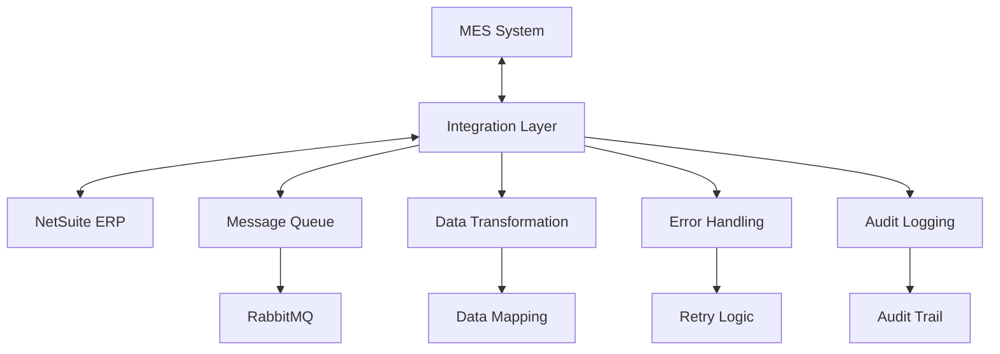

# NetSuite ERP Integration

## Overview

The NetSuite ERP integration provides seamless data flow between the MES system and WhiskeyHouse's enterprise resource planning system. This integration ensures data consistency across manufacturing, inventory, financial, and customer management systems while maintaining real-time synchronization of critical business data.

## Integration Architecture

### System Architecture


### Integration Patterns
- **Real-time Sync**: Critical data synchronized immediately
- **Batch Processing**: Non-critical data processed in scheduled batches
- **Event-driven**: Changes trigger automatic synchronization
- **Bidirectional**: Data flows both directions as needed
- **Fault Tolerant**: Robust error handling and retry mechanisms

## Data Synchronization Scope

### Master Data Synchronization

#### Items (Products)
```typescript
interface ItemSyncData {
  // MES to NetSuite
  erpId: string;           // NetSuite internal ID
  itemNumber: string;      // Unique item identifier
  itemName: string;        // Display name
  itemDescription: string; // Full description
  itemType: string;        // Item type classification
  itemClass: string;       // Item class
  itemGroup: string;       // Item group
  active: boolean;         // Status
  
  // NetSuite specific fields
  netsuiteFields: {
    subsidiary: string;
    location: string;
    department: string;
    class: string;
    unitType: string;
    isInactive: boolean;
    customFields: Record<string, any>;
  };
}
```

**Sync Direction**: Bidirectional
**Frequency**: Real-time for new items, daily batch for updates
**Trigger Events**:
- New item creation in MES
- Item updates in NetSuite
- Status changes (active/inactive)

#### Customers
```typescript
interface CustomerSyncData {
  // MES to NetSuite
  erpId: string;
  customerCode: string;
  name: string;
  address: string;
  email: string;
  phone: string;
  active: boolean;
  
  // NetSuite specific fields
  netsuiteFields: {
    subsidiary: string;
    category: string;
    terms: string;
    creditLimit: number;
    taxable: boolean;
    customFields: Record<string, any>;
  };
}
```

**Sync Direction**: NetSuite to MES (primary), MES to NetSuite (updates)
**Frequency**: Real-time for critical changes, hourly batch for routine updates
**Trigger Events**:
- New customer creation
- Contact information updates
- Credit status changes

#### Vendors
```typescript
interface VendorSyncData {
  // MES to NetSuite
  erpId: string;
  name: string;
  contactInformation: object;
  additionalDetails: object;
  active: boolean;
  
  // NetSuite specific fields
  netsuiteFields: {
    subsidiary: string;
    category: string;
    terms: string;
    currency: string;
    taxable: boolean;
    customFields: Record<string, any>;
  };
}
```

**Sync Direction**: NetSuite to MES
**Frequency**: Daily batch processing
**Trigger Events**:
- New vendor registration
- Vendor information updates
- Status changes

### Transaction Data Synchronization

#### Production Orders → Work Orders
```typescript
interface ProductionOrderSync {
  // MES Production Order
  productionOrder: {
    id: string;
    name: string;
    quantity: number;
    finalProof: number;
    containerType: string;
    status: string;
    customerId: string;
    recipeId: string;
    bomId: string;
    fgItemId: string;
    startDate: string;
    endDate: string;
  };
  
  // NetSuite Work Order
  netsuiteWorkOrder: {
    tranId: string;           // Work order number
    subsidiary: string;       // Business unit
    location: string;         // Manufacturing location
    department: string;       // Production department
    class: string;           // Cost center
    item: string;            // Finished goods item
    quantity: number;        // Production quantity
    plannedWork: string;     // Planned work type
    startDate: string;       // Planned start
    endDate: string;         // Planned completion
    status: string;          // Work order status
    customFields: object;    // MES-specific data
  };
}
```

**Sync Direction**: MES to NetSuite
**Frequency**: Real-time on production order creation/updates
**Trigger Events**:
- Production order creation
- Status changes (Planned → In Progress → Complete)
- Quantity adjustments
- Timeline modifications

#### Inventory Transactions
```typescript
interface InventorySync {
  // MES Inventory Transaction
  mesTransaction: {
    type: 'RECEIPT' | 'CONSUMPTION' | 'TRANSFER' | 'ADJUSTMENT';
    itemId: string;
    quantity: number;
    units: string;
    location: string;
    lotNumber: string;
    transactionDate: string;
    reference: string;       // PO, Batch, etc.
  };
  
  // NetSuite Inventory Transaction
  netsuiteTransaction: {
    type: string;            // Transaction type
    item: string;            // NetSuite item ID
    location: string;        // NetSuite location
    quantity: number;        // Transaction quantity
    units: string;           // Unit of measure
    binNumber: string;       // Bin location
    lotNumber: string;       // Lot tracking
    memo: string;           // Transaction memo
    department: string;      // Department
    class: string;          // Class
    customFields: object;    // Additional data
  };
}
```

**Sync Direction**: MES to NetSuite
**Frequency**: Real-time for critical transactions, batched for routine adjustments
**Trigger Events**:
- Material receipts
- Production consumption
- Inventory transfers
- Cycle count adjustments

## Integration Implementation

### Service Architecture

#### NetSuite Integration Service
```typescript
@Injectable()
export class NetSuiteIntegrationService {
  constructor(
    private readonly prisma: PrismaService,
    private readonly rabbitMQ: RabbitMQProducerService,
    private readonly logger: Logger,
    private readonly auditService: AuditService
  ) {}

  // Master data synchronization
  async syncItem(itemId: string, direction: 'TO_NETSUITE' | 'FROM_NETSUITE'): Promise<void> {
    try {
      if (direction === 'TO_NETSUITE') {
        await this.pushItemToNetSuite(itemId);
      } else {
        await this.pullItemFromNetSuite(itemId);
      }
    } catch (error) {
      await this.handleSyncError('ITEM_SYNC', itemId, error);
    }
  }

  async syncCustomer(customerId: string, direction: 'TO_NETSUITE' | 'FROM_NETSUITE'): Promise<void> {
    try {
      if (direction === 'TO_NETSUITE') {
        await this.pushCustomerToNetSuite(customerId);
      } else {
        await this.pullCustomerFromNetSuite(customerId);
      }
    } catch (error) {
      await this.handleSyncError('CUSTOMER_SYNC', customerId, error);
    }
  }

  // Transaction synchronization
  async syncProductionOrder(productionOrderId: string): Promise<void> {
    try {
      const productionOrder = await this.getProductionOrderDetails(productionOrderId);
      const workOrder = await this.createNetSuiteWorkOrder(productionOrder);
      await this.updateProductionOrderWithNetSuiteId(productionOrderId, workOrder.id);
      
      this.logger.log(`Synced production order ${productionOrderId} to NetSuite work order ${workOrder.id}`);
    } catch (error) {
      await this.handleSyncError('PRODUCTION_ORDER_SYNC', productionOrderId, error);
    }
  }

  async syncInventoryTransaction(transactionData: InventoryTransactionData): Promise<void> {
    try {
      const netsuiteTransaction = await this.createNetSuiteInventoryTransaction(transactionData);
      await this.recordSyncSuccess('INVENTORY_TRANSACTION', transactionData.id, netsuiteTransaction.id);
      
      this.logger.log(`Synced inventory transaction ${transactionData.id} to NetSuite`);
    } catch (error) {
      await this.handleSyncError('INVENTORY_TRANSACTION', transactionData.id, error);
    }
  }

  // Error handling and retry
  private async handleSyncError(syncType: string, entityId: string, error: any): Promise<void> {
    this.logger.error(`Sync error for ${syncType} ${entityId}: ${error.message}`);
    
    await this.auditService.logSyncError({
      syncType,
      entityId,
      error: error.message,
      timestamp: new Date(),
      retryCount: 0
    });

    // Queue for retry
    await this.rabbitMQ.emitMessage('netsuite.sync.retry', {
      syncType,
      entityId,
      error: error.message,
      timestamp: new Date()
    });
  }
}
```

#### Data Transformation Service
```typescript
@Injectable()
export class DataTransformationService {
  // Item transformation
  transformItemForNetSuite(mesItem: Item): NetSuiteItemData {
    return {
      itemid: mesItem.itemNumber,
      displayname: mesItem.itemName,
      description: mesItem.itemDescription,
      itemtype: this.mapItemType(mesItem.itemType),
      class: this.mapItemClass(mesItem.itemClass),
      department: this.mapItemGroup(mesItem.itemGroup),
      isinactive: !mesItem.active,
      unitstype: this.mapUnits(mesItem.units),
      subsidiary: this.getSubsidiary(),
      location: this.getDefaultLocation(),
      customfields: {
        custitem_mes_id: mesItem.id,
        custitem_mes_global_id: mesItem.globalId,
        custitem_item_revision: mesItem.itemRevision,
        custitem_base_bom_item: mesItem.baseBomItem
      }
    };
  }

  // Production Order transformation
  transformProductionOrderForNetSuite(
    productionOrder: ProductionOrder,
    recipe: Recipe,
    customer: Customer
  ): NetSuiteWorkOrderData {
    return {
      tranid: productionOrder.name,
      subsidiary: this.getSubsidiary(),
      location: this.getProductionLocation(),
      department: this.getProductionDepartment(),
      class: this.getProductionClass(),
      item: productionOrder.fgItemId,
      quantity: productionOrder.quantity,
      units: this.mapUnits(productionOrder.units),
      startdate: productionOrder.startDate,
      enddate: productionOrder.endDate,
      status: this.mapProductionOrderStatus(productionOrder.status),
      memo: `MES Production Order: ${productionOrder.name}`,
      customfields: {
        custbody_mes_production_order_id: productionOrder.id,
        custbody_mes_recipe_id: recipe.id,
        custbody_final_proof: productionOrder.finalProof,
        custbody_container_type: productionOrder.containerType,
        custbody_customer_code: customer.customerCode,
        custbody_whiskey_type: recipe.whiskeyType
      }
    };
  }

  // Inventory transaction transformation
  transformInventoryForNetSuite(
    transaction: InventoryTransactionData
  ): NetSuiteInventoryData {
    return {
      type: this.mapTransactionType(transaction.type),
      item: transaction.itemId,
      location: this.mapLocation(transaction.location),
      quantity: transaction.quantity,
      units: this.mapUnits(transaction.units),
      binNumber: this.mapBinNumber(transaction.binNumber),
      lotNumber: transaction.lotNumber,
      trandate: transaction.transactionDate,
      memo: transaction.memo || this.generateMemo(transaction),
      department: this.getDepartment(transaction.department),
      class: this.getClass(transaction.class),
      customfields: {
        custbody_mes_transaction_id: transaction.id,
        custbody_mes_reference: transaction.reference,
        custbody_mes_batch_id: transaction.batchId
      }
    };
  }

  // Mapping utilities
  private mapItemType(mesItemType: string): string {
    const mapping = {
      'RM': 'InvtPart',      // Raw Material
      'FG': 'InvtPart',      // Finished Goods
      'WIP': 'InvtPart',     // Work in Process
      'PKG': 'InvtPart',     // Packaging
      'SVC': 'Service'       // Service
    };
    return mapping[mesItemType] || 'InvtPart';
  }

  private mapProductionOrderStatus(mesStatus: string): string {
    const mapping = {
      'Planned': 'Planned',
      'Committed': 'Released',
      'Initiated': 'InProcess',
      'InProgress': 'InProcess',
      'Complete': 'Built'
    };
    return mapping[mesStatus] || 'Planned';
  }

  private mapTransactionType(mesType: string): string {
    const mapping = {
      'RECEIPT': 'invtadjst',
      'CONSUMPTION': 'invtadjst',
      'TRANSFER': 'invttransfer',
      'ADJUSTMENT': 'invtadjst'
    };
    return mapping[mesType] || 'invtadjst';
  }
}
```

### Message Queue Integration

#### RabbitMQ Message Patterns
```typescript
// NetSuite sync message topics
export const NetSuiteSyncTopics = {
  // Outbound (MES to NetSuite)
  ITEM_CREATE: 'netsuite.item.create',
  ITEM_UPDATE: 'netsuite.item.update',
  CUSTOMER_UPDATE: 'netsuite.customer.update',
  PRODUCTION_ORDER_CREATE: 'netsuite.workorder.create',
  PRODUCTION_ORDER_UPDATE: 'netsuite.workorder.update',
  INVENTORY_TRANSACTION: 'netsuite.inventory.transaction',
  
  // Inbound (NetSuite to MES)
  ITEM_SYNC_INBOUND: 'netsuite.item.sync.inbound',
  CUSTOMER_SYNC_INBOUND: 'netsuite.customer.sync.inbound',
  VENDOR_SYNC_INBOUND: 'netsuite.vendor.sync.inbound',
  
  // Error handling
  SYNC_ERROR: 'netsuite.sync.error',
  SYNC_RETRY: 'netsuite.sync.retry',
  SYNC_SUCCESS: 'netsuite.sync.success'
};

// Message handlers
@Injectable()
export class NetSuiteSyncConsumer {
  @RabbitSubscribe({
    exchange: 'netsuite',
    routingKey: 'item.create',
    queue: 'netsuite-item-create'
  })
  async handleItemCreate(message: ItemCreateMessage): Promise<void> {
    try {
      await this.netsuiteService.createItem(message.itemData);
      await this.publishSyncSuccess('ITEM_CREATE', message.itemId);
    } catch (error) {
      await this.publishSyncError('ITEM_CREATE', message.itemId, error);
    }
  }

  @RabbitSubscribe({
    exchange: 'netsuite',
    routingKey: 'workorder.create',
    queue: 'netsuite-workorder-create'
  })
  async handleWorkOrderCreate(message: WorkOrderCreateMessage): Promise<void> {
    try {
      await this.netsuiteService.createWorkOrder(message.workOrderData);
      await this.publishSyncSuccess('WORKORDER_CREATE', message.productionOrderId);
    } catch (error) {
      await this.publishSyncError('WORKORDER_CREATE', message.productionOrderId, error);
    }
  }

  @RabbitSubscribe({
    exchange: 'netsuite',
    routingKey: 'sync.retry',
    queue: 'netsuite-sync-retry'
  })
  async handleSyncRetry(message: SyncRetryMessage): Promise<void> {
    if (message.retryCount < MAX_RETRY_ATTEMPTS) {
      await this.retrySyncOperation(message);
    } else {
      await this.handleMaxRetriesExceeded(message);
    }
  }
}
```

## API Integration

### NetSuite REST API Integration
```typescript
@Injectable()
export class NetSuiteApiService {
  private readonly baseUrl: string;
  private readonly authConfig: NetSuiteAuthConfig;

  constructor() {
    this.baseUrl = process.env.NETSUITE_REST_URL;
    this.authConfig = {
      consumerKey: process.env.NETSUITE_CONSUMER_KEY,
      consumerSecret: process.env.NETSUITE_CONSUMER_SECRET,
      accessToken: process.env.NETSUITE_ACCESS_TOKEN,
      accessTokenSecret: process.env.NETSUITE_ACCESS_TOKEN_SECRET,
      account: process.env.NETSUITE_ACCOUNT,
      realm: process.env.NETSUITE_REALM
    };
  }

  // Item operations
  async createItem(itemData: NetSuiteItemData): Promise<NetSuiteResponse> {
    const url = `${this.baseUrl}/record/v1/inventoryitem`;
    return await this.makeAuthenticatedRequest('POST', url, itemData);
  }

  async updateItem(itemId: string, itemData: Partial<NetSuiteItemData>): Promise<NetSuiteResponse> {
    const url = `${this.baseUrl}/record/v1/inventoryitem/${itemId}`;
    return await this.makeAuthenticatedRequest('PATCH', url, itemData);
  }

  async getItem(itemId: string): Promise<NetSuiteItemData> {
    const url = `${this.baseUrl}/record/v1/inventoryitem/${itemId}`;
    const response = await this.makeAuthenticatedRequest('GET', url);
    return response.data;
  }

  // Work order operations
  async createWorkOrder(workOrderData: NetSuiteWorkOrderData): Promise<NetSuiteResponse> {
    const url = `${this.baseUrl}/record/v1/workorder`;
    return await this.makeAuthenticatedRequest('POST', url, workOrderData);
  }

  async updateWorkOrder(workOrderId: string, workOrderData: Partial<NetSuiteWorkOrderData>): Promise<NetSuiteResponse> {
    const url = `${this.baseUrl}/record/v1/workorder/${workOrderId}`;
    return await this.makeAuthenticatedRequest('PATCH', url, workOrderData);
  }

  // Inventory transaction operations
  async createInventoryTransaction(transactionData: NetSuiteInventoryData): Promise<NetSuiteResponse> {
    const url = `${this.baseUrl}/record/v1/inventoryadjustment`;
    return await this.makeAuthenticatedRequest('POST', url, transactionData);
  }

  // Customer operations
  async getCustomer(customerId: string): Promise<NetSuiteCustomerData> {
    const url = `${this.baseUrl}/record/v1/customer/${customerId}`;
    const response = await this.makeAuthenticatedRequest('GET', url);
    return response.data;
  }

  async updateCustomer(customerId: string, customerData: Partial<NetSuiteCustomerData>): Promise<NetSuiteResponse> {
    const url = `${this.baseUrl}/record/v1/customer/${customerId}`;
    return await this.makeAuthenticatedRequest('PATCH', url, customerData);
  }

  // Authentication and request handling
  private async makeAuthenticatedRequest(
    method: string,
    url: string,
    data?: any
  ): Promise<NetSuiteResponse> {
    const headers = this.generateOAuthHeaders(method, url);
    
    try {
      const response = await axios({
        method,
        url,
        headers,
        data
      });
      
      return {
        success: true,
        data: response.data,
        statusCode: response.status
      };
    } catch (error) {
      this.logger.error(`NetSuite API error: ${error.message}`);
      throw new NetSuiteApiException(error.message, error.response?.status);
    }
  }

  private generateOAuthHeaders(method: string, url: string): Record<string, string> {
    // OAuth 1.0 signature generation for NetSuite
    const timestamp = Math.floor(Date.now() / 1000).toString();
    const nonce = this.generateNonce();
    
    const params = {
      oauth_consumer_key: this.authConfig.consumerKey,
      oauth_token: this.authConfig.accessToken,
      oauth_signature_method: 'HMAC-SHA256',
      oauth_timestamp: timestamp,
      oauth_nonce: nonce,
      oauth_version: '1.0'
    };

    const signature = this.generateSignature(method, url, params);
    params['oauth_signature'] = signature;

    const authHeader = 'OAuth ' + Object.entries(params)
      .map(([key, value]) => `${key}="${encodeURIComponent(value)}"`)
      .join(', ');

    return {
      'Authorization': authHeader,
      'Content-Type': 'application/json',
      'Accept': 'application/json'
    };
  }
}
```

## Error Handling and Monitoring

### Error Handling Strategy
```typescript
@Injectable()
export class NetSuiteSyncErrorHandler {
  private readonly maxRetries = 3;
  private readonly retryDelays = [1000, 5000, 15000]; // ms

  async handleSyncError(
    syncType: string,
    entityId: string,
    error: any,
    retryCount: number = 0
  ): Promise<void> {
    // Log error details
    this.logger.error(`NetSuite sync error: ${syncType} ${entityId}`, {
      error: error.message,
      stack: error.stack,
      retryCount,
      timestamp: new Date()
    });

    // Determine if error is retryable
    if (this.isRetryableError(error) && retryCount < this.maxRetries) {
      await this.scheduleRetry(syncType, entityId, retryCount + 1);
    } else {
      await this.handlePermanentFailure(syncType, entityId, error);
    }

    // Record error in audit log
    await this.auditService.logSyncError({
      syncType,
      entityId,
      error: error.message,
      retryCount,
      timestamp: new Date(),
      isPermanent: retryCount >= this.maxRetries
    });
  }

  private isRetryableError(error: any): boolean {
    const retryableStatuses = [429, 500, 502, 503, 504];
    const retryableMessages = [
      'timeout',
      'connection reset',
      'socket hang up',
      'rate limit'
    ];

    return retryableStatuses.includes(error.status) ||
           retryableMessages.some(msg => error.message.toLowerCase().includes(msg));
  }

  private async scheduleRetry(
    syncType: string,
    entityId: string,
    retryCount: number
  ): Promise<void> {
    const delay = this.retryDelays[retryCount - 1] || 15000;
    
    setTimeout(async () => {
      await this.rabbitMQ.emitMessage('netsuite.sync.retry', {
        syncType,
        entityId,
        retryCount,
        scheduledAt: new Date()
      });
    }, delay);
  }

  private async handlePermanentFailure(
    syncType: string,
    entityId: string,
    error: any
  ): Promise<void> {
    // Mark entity as sync failed
    await this.markEntitySyncFailed(syncType, entityId, error);
    
    // Send alert to operations team
    await this.alertService.sendSyncFailureAlert({
      syncType,
      entityId,
      error: error.message,
      timestamp: new Date()
    });

    // Log for manual investigation
    this.logger.error(`Permanent sync failure: ${syncType} ${entityId}`, {
      error: error.message,
      requiresManualIntervention: true
    });
  }
}
```

### Monitoring and Alerting
```typescript
@Injectable()
export class NetSuiteSyncMonitoringService {
  private readonly syncMetrics = new Map<string, SyncMetrics>();

  async trackSyncSuccess(syncType: string, duration: number): Promise<void> {
    const metrics = this.getSyncMetrics(syncType);
    metrics.successCount++;
    metrics.totalDuration += duration;
    metrics.lastSuccess = new Date();
    
    await this.updateMetricsInDatabase(syncType, metrics);
  }

  async trackSyncFailure(syncType: string, error: any): Promise<void> {
    const metrics = this.getSyncMetrics(syncType);
    metrics.failureCount++;
    metrics.lastFailure = new Date();
    metrics.lastError = error.message;
    
    await this.updateMetricsInDatabase(syncType, metrics);
    
    // Check if failure rate is too high
    if (this.isFailureRateTooHigh(metrics)) {
      await this.alertService.sendHighFailureRateAlert(syncType, metrics);
    }
  }

  async generateSyncReport(): Promise<SyncReport> {
    const report: SyncReport = {
      generatedAt: new Date(),
      syncTypes: []
    };

    for (const [syncType, metrics] of this.syncMetrics) {
      const successRate = metrics.successCount / (metrics.successCount + metrics.failureCount);
      const avgDuration = metrics.totalDuration / metrics.successCount;

      report.syncTypes.push({
        syncType,
        successCount: metrics.successCount,
        failureCount: metrics.failureCount,
        successRate,
        averageDuration: avgDuration,
        lastSuccess: metrics.lastSuccess,
        lastFailure: metrics.lastFailure,
        status: this.getSyncHealthStatus(metrics)
      });
    }

    return report;
  }

  private isFailureRateTooHigh(metrics: SyncMetrics): boolean {
    const totalOperations = metrics.successCount + metrics.failureCount;
    if (totalOperations < 10) return false; // Not enough data
    
    const failureRate = metrics.failureCount / totalOperations;
    return failureRate > 0.1; // 10% threshold
  }

  private getSyncHealthStatus(metrics: SyncMetrics): 'HEALTHY' | 'WARNING' | 'CRITICAL' {
    const totalOps = metrics.successCount + metrics.failureCount;
    if (totalOps === 0) return 'WARNING';
    
    const failureRate = metrics.failureCount / totalOps;
    const timeSinceLastSuccess = Date.now() - (metrics.lastSuccess?.getTime() || 0);
    
    if (failureRate > 0.2 || timeSinceLastSuccess > 24 * 60 * 60 * 1000) {
      return 'CRITICAL';
    } else if (failureRate > 0.1 || timeSinceLastSuccess > 12 * 60 * 60 * 1000) {
      return 'WARNING';
    } else {
      return 'HEALTHY';
    }
  }
}
```

## Configuration and Deployment

### Environment Configuration
```typescript
// NetSuite integration configuration
export interface NetSuiteConfig {
  // API Configuration
  restUrl: string;
  account: string;
  realm: string;
  
  // OAuth Authentication
  consumerKey: string;
  consumerSecret: string;
  accessToken: string;
  accessTokenSecret: string;
  
  // Sync Configuration
  batchSize: number;
  syncInterval: number;
  retryAttempts: number;
  timeoutMs: number;
  
  // Mapping Configuration
  subsidiary: string;
  defaultLocation: string;
  defaultDepartment: string;
  defaultClass: string;
  
  // Feature Flags
  enableRealTimeSync: boolean;
  enableBatchSync: boolean;
  enableErrorRetry: boolean;
  enableAuditLogging: boolean;
}

// Environment-specific configurations
const netsuiteConfig: Record<string, NetSuiteConfig> = {
  development: {
    restUrl: process.env.NETSUITE_SANDBOX_URL,
    account: process.env.NETSUITE_SANDBOX_ACCOUNT,
    realm: process.env.NETSUITE_SANDBOX_REALM,
    consumerKey: process.env.NETSUITE_DEV_CONSUMER_KEY,
    consumerSecret: process.env.NETSUITE_DEV_CONSUMER_SECRET,
    accessToken: process.env.NETSUITE_DEV_ACCESS_TOKEN,
    accessTokenSecret: process.env.NETSUITE_DEV_ACCESS_TOKEN_SECRET,
    batchSize: 10,
    syncInterval: 300000, // 5 minutes
    retryAttempts: 3,
    timeoutMs: 30000,
    subsidiary: '1',
    defaultLocation: '1',
    defaultDepartment: '1',
    defaultClass: '1',
    enableRealTimeSync: true,
    enableBatchSync: true,
    enableErrorRetry: true,
    enableAuditLogging: true
  },
  
  production: {
    restUrl: process.env.NETSUITE_PROD_URL,
    account: process.env.NETSUITE_PROD_ACCOUNT,
    realm: process.env.NETSUITE_PROD_REALM,
    consumerKey: process.env.NETSUITE_PROD_CONSUMER_KEY,
    consumerSecret: process.env.NETSUITE_PROD_CONSUMER_SECRET,
    accessToken: process.env.NETSUITE_PROD_ACCESS_TOKEN,
    accessTokenSecret: process.env.NETSUITE_PROD_ACCESS_TOKEN_SECRET,
    batchSize: 50,
    syncInterval: 60000, // 1 minute
    retryAttempts: 5,
    timeoutMs: 60000,
    subsidiary: '1',
    defaultLocation: '1',
    defaultDepartment: '1',
    defaultClass: '1',
    enableRealTimeSync: true,
    enableBatchSync: true,
    enableErrorRetry: true,
    enableAuditLogging: true
  }
};
```

## Testing Strategy

### Integration Testing
```typescript
describe('NetSuite Integration', () => {
  let netsuiteService: NetSuiteIntegrationService;
  let mockNetSuiteApi: jest.Mocked<NetSuiteApiService>;

  beforeEach(async () => {
    const module = await Test.createTestingModule({
      providers: [
        NetSuiteIntegrationService,
        {
          provide: NetSuiteApiService,
          useValue: createMockNetSuiteApi()
        }
      ]
    }).compile();

    netsuiteService = module.get<NetSuiteIntegrationService>(NetSuiteIntegrationService);
    mockNetSuiteApi = module.get(NetSuiteApiService);
  });

  describe('Item Synchronization', () => {
    it('should successfully sync item to NetSuite', async () => {
      // Arrange
      const itemId = 'test-item-id';
      const mockResponse = { success: true, id: 'ns-item-123' };
      mockNetSuiteApi.createItem.mockResolvedValue(mockResponse);

      // Act
      await netsuiteService.syncItem(itemId, 'TO_NETSUITE');

      // Assert
      expect(mockNetSuiteApi.createItem).toHaveBeenCalledWith(
        expect.objectContaining({
          itemid: expect.any(String),
          displayname: expect.any(String)
        })
      );
    });

    it('should handle NetSuite API errors gracefully', async () => {
      // Arrange
      const itemId = 'test-item-id';
      const error = new Error('NetSuite API Error');
      mockNetSuiteApi.createItem.mockRejectedValue(error);

      // Act & Assert
      await expect(
        netsuiteService.syncItem(itemId, 'TO_NETSUITE')
      ).resolves.not.toThrow();
      
      // Verify error was logged and retry was scheduled
      expect(mockRabbitMQ.emitMessage).toHaveBeenCalledWith(
        'netsuite.sync.retry',
        expect.objectContaining({
          syncType: 'ITEM_SYNC',
          entityId: itemId
        })
      );
    });
  });

  describe('Production Order Synchronization', () => {
    it('should create work order in NetSuite', async () => {
      // Test implementation
    });

    it('should update work order status', async () => {
      // Test implementation
    });
  });
});
```

## Performance Optimization

### Batch Processing
```typescript
@Injectable()
export class NetSuiteBatchProcessor {
  private readonly batchSize = 50;
  private readonly processingInterval = 60000; // 1 minute

  @Cron(CronExpression.EVERY_MINUTE)
  async processBatchUpdates(): Promise<void> {
    try {
      // Process item updates
      await this.processBatchItems();
      
      // Process inventory transactions
      await this.processBatchInventoryTransactions();
      
      // Process customer updates
      await this.processBatchCustomerUpdates();
      
    } catch (error) {
      this.logger.error('Batch processing error:', error);
    }
  }

  private async processBatchItems(): Promise<void> {
    const pendingItems = await this.getPendingItemUpdates(this.batchSize);
    
    if (pendingItems.length === 0) return;

    const batchPromises = pendingItems.map(item => 
      this.netsuiteService.syncItem(item.id, 'TO_NETSUITE')
    );

    await Promise.allSettled(batchPromises);
    
    this.logger.log(`Processed ${pendingItems.length} item updates`);
  }

  private async processBatchInventoryTransactions(): Promise<void> {
    const pendingTransactions = await this.getPendingInventoryTransactions(this.batchSize);
    
    if (pendingTransactions.length === 0) return;

    // Group transactions by type for efficient processing
    const groupedTransactions = this.groupTransactionsByType(pendingTransactions);
    
    for (const [type, transactions] of groupedTransactions) {
      await this.processBatchTransactionType(type, transactions);
    }
  }
}
```

---

*This NetSuite integration documentation provides comprehensive coverage of ERP integration within the MES Phase 1 initiative. For specific implementation details and troubleshooting guides, refer to the related technical documentation sections.*