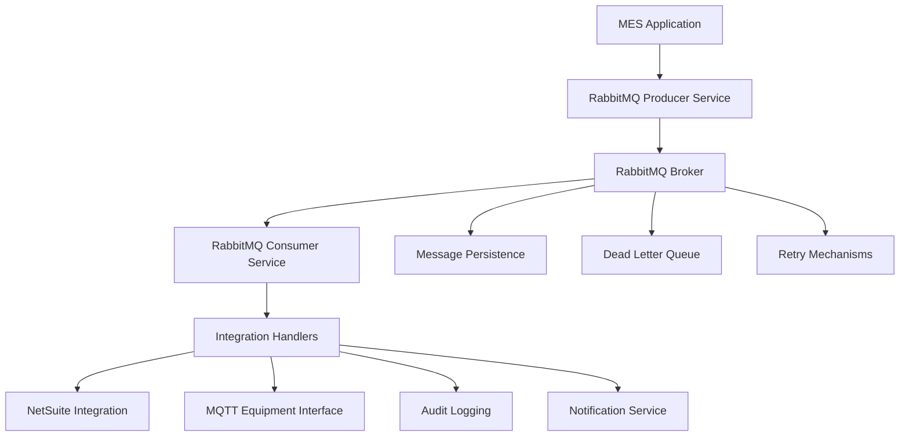

# RabbitMQ Messaging Integration

## Overview

The RabbitMQ messaging system provides asynchronous communication and integration capabilities for the MES Phase 1 initiative. This robust messaging infrastructure enables real-time data flow between system components, external integrations, and equipment interfaces while ensuring reliability, scalability, and fault tolerance.

## Messaging Architecture

### System Architecture


### Core Components
- **Message Producer**: Publishes messages to exchanges
- **Message Consumer**: Subscribes to queues and processes messages
- **Exchanges**: Route messages to appropriate queues
- **Queues**: Store messages for consumption
- **Dead Letter Queues**: Handle failed message processing
- **Message Persistence**: Ensures message durability

## Message Topics and Routing

### Topic Structure
```
{company}.{facility}.{area}.{entity}.{operation}
```

#### Examples:
- `whk.distillery.production.productionorder.create`
- `whk.distillery.inventory.receipt.update`
- `whk.distillery.quality.test.complete`

### Message Routing Schema

#### Production Order Messages
```typescript
export const ProductionOrderTopics = {
  CREATE: 'whk.distillery.production.productionorder.create',
  UPDATE: 'whk.distillery.production.productionorder.update',
  STATUS_CHANGE: 'whk.distillery.production.productionorder.status',
  COMPLETE: 'whk.distillery.production.productionorder.complete',
  DELETE: 'whk.distillery.production.productionorder.delete'
};
```

#### Schedule Order Messages
```typescript
export const ScheduleOrderTopics = {
  CREATE: 'whk.distillery.scheduling.scheduleorder.create',
  UPDATE: 'whk.distillery.scheduling.scheduleorder.update',
  QUEUE_ADD: 'whk.distillery.scheduling.queue.add',
  QUEUE_REMOVE: 'whk.distillery.scheduling.queue.remove',
  QUEUE_POSITION_CHANGE: 'whk.distillery.scheduling.queue.position'
};
```

#### Inventory Messages
```typescript
export const InventoryTopics = {
  RECEIPT: 'whk.distillery.inventory.receipt.create',
  CONSUMPTION: 'whk.distillery.inventory.consumption.record',
  TRANSFER: 'whk.distillery.inventory.transfer.execute',
  ADJUSTMENT: 'whk.distillery.inventory.adjustment.apply',
  COUNT: 'whk.distillery.inventory.count.update'
};
```

#### Recipe Messages
```typescript
export const RecipeTopics = {
  CREATE: 'whk.distillery.recipe.master.create',
  UPDATE: 'whk.distillery.recipe.master.update',
  INSTANCE_CREATE: 'whk.distillery.recipe.instance.create',
  INSTANCE_MODIFY: 'whk.distillery.recipe.instance.modify',
  ACTUAL_RECORD: 'whk.distillery.recipe.actual.record'
};
```

#### Quality and Testing Messages
```typescript
export const QualityTopics = {
  TEST_SCHEDULED: 'whk.distillery.quality.test.scheduled',
  TEST_COMPLETE: 'whk.distillery.quality.test.complete',
  TEST_FAILED: 'whk.distillery.quality.test.failed',
  PARAMETER_DEVIATION: 'whk.distillery.quality.parameter.deviation',
  COMPLIANCE_ALERT: 'whk.distillery.quality.compliance.alert'
};
```

#### Equipment Integration Messages
```typescript
export const EquipmentTopics = {
  STATUS_UPDATE: 'whk.distillery.equipment.status.update',
  PARAMETER_CHANGE: 'whk.distillery.equipment.parameter.change',
  ALARM: 'whk.distillery.equipment.alarm.triggered',
  MAINTENANCE: 'whk.distillery.equipment.maintenance.required',
  DATA_COLLECTION: 'whk.distillery.equipment.data.collect'
};
```

## Message Producer Implementation

### RabbitMQ Producer Service
```typescript
@Injectable()
export class RabbitMQProducerService {
  constructor(
    @Inject(WINSTON_MODULE_NEST_PROVIDER) private readonly logger: Logger
  ) {}

  async emitMessage(
    topic: string,
    payload: any,
    options?: MessageOptions
  ): Promise<void> {
    try {
      const message: StandardMessage = {
        id: this.generateMessageId(),
        timestamp: new Date().toISOString(),
        topic,
        version: '1.0',
        source: 'whk-mes',
        payload,
        metadata: {
          correlationId: options?.correlationId || this.generateCorrelationId(),
          userId: options?.userId,
          sessionId: options?.sessionId,
          priority: options?.priority || 'normal',
          retryCount: 0,
          maxRetries: options?.maxRetries || 3
        }
      };

      await this.publishToExchange(topic, message, options);
      
      this.logger.log(`Message published: ${topic}`, {
        messageId: message.id,
        correlationId: message.metadata.correlationId
      });

    } catch (error) {
      this.logger.error(`Failed to publish message: ${topic}`, {
        error: error.message,
        payload,
        stack: error.stack
      });
      throw new MessagePublishException(topic, error.message);
    }
  }

  async emitProductionOrderMessage(
    operation: 'create' | 'update' | 'delete',
    productionOrder: ProductionOrder,
    options?: MessageOptions
  ): Promise<void> {
    const topic = ProductionOrderTopics[operation.toUpperCase()];
    const payload: ProductionOrderMessagePayload = {
      recordName: 'ProductionOrder',
      event_type: operation,
      data: productionOrder,
      timestamp: new Date().toISOString()
    };

    await this.emitMessage(topic, payload, options);
  }

  async emitScheduleOrderMessage(
    operation: 'create' | 'update' | 'queue_add' | 'queue_remove',
    scheduleOrder: ScheduleOrder,
    additionalData?: any,
    options?: MessageOptions
  ): Promise<void> {
    const topicMap = {
      'create': ScheduleOrderTopics.CREATE,
      'update': ScheduleOrderTopics.UPDATE,
      'queue_add': ScheduleOrderTopics.QUEUE_ADD,
      'queue_remove': ScheduleOrderTopics.QUEUE_REMOVE
    };

    const topic = topicMap[operation];
    const payload: ScheduleOrderMessagePayload = {
      recordName: 'ScheduleOrder',
      event_type: operation,
      data: scheduleOrder,
      additionalData,
      timestamp: new Date().toISOString()
    };

    await this.emitMessage(topic, payload, options);
  }

  async emitInventoryMessage(
    operation: 'receipt' | 'consumption' | 'transfer' | 'adjustment',
    inventoryData: InventoryMessageData,
    options?: MessageOptions
  ): Promise<void> {
    const topicMap = {
      'receipt': InventoryTopics.RECEIPT,
      'consumption': InventoryTopics.CONSUMPTION,
      'transfer': InventoryTopics.TRANSFER,
      'adjustment': InventoryTopics.ADJUSTMENT
    };

    const topic = topicMap[operation];
    const payload: InventoryMessagePayload = {
      recordName: 'Inventory',
      event_type: operation,
      data: inventoryData,
      timestamp: new Date().toISOString()
    };

    await this.emitMessage(topic, payload, options);
  }

  private async publishToExchange(
    topic: string,
    message: StandardMessage,
    options?: MessageOptions
  ): Promise<void> {
    const exchange = this.getExchangeForTopic(topic);
    const routingKey = this.getRoutingKeyForTopic(topic);
    
    const publishOptions: amqp.Options.Publish = {
      persistent: true,
      messageId: message.id,
      timestamp: Date.now(),
      correlationId: message.metadata.correlationId,
      priority: this.mapPriority(message.metadata.priority),
      expiration: options?.ttl?.toString(),
      headers: {
        version: message.version,
        source: message.source,
        retryCount: message.metadata.retryCount
      }
    };

    await this.channel.publish(
      exchange,
      routingKey,
      Buffer.from(JSON.stringify(message)),
      publishOptions
    );
  }

  private getExchangeForTopic(topic: string): string {
    const parts = topic.split('.');
    if (parts.length >= 3) {
      return `${parts[0]}.${parts[1]}.${parts[2]}`; // whk.distillery.production
    }
    return 'whk.default';
  }

  private getRoutingKeyForTopic(topic: string): string {
    return topic.replace(/\./g, '_');
  }

  private generateMessageId(): string {
    return `msg_${Date.now()}_${Math.random().toString(36).substr(2, 9)}`;
  }

  private generateCorrelationId(): string {
    return `corr_${Date.now()}_${Math.random().toString(36).substr(2, 9)}`;
  }

  private mapPriority(priority: string): number {
    const priorityMap = {
      'low': 1,
      'normal': 5,
      'high': 8,
      'critical': 10
    };
    return priorityMap[priority] || 5;
  }
}
```

## Message Consumer Implementation

### RabbitMQ Consumer Service
```typescript
@Injectable()
export class RabbitMQConsumerService {
  constructor(
    @Inject(WINSTON_MODULE_NEST_PROVIDER) private readonly logger: Logger,
    private readonly auditService: AuditService,
    private readonly notificationService: NotificationService
  ) {}

  @RabbitSubscribe({
    exchange: 'whk.distillery.production',
    routingKey: 'productionorder.create',
    queue: 'production-order-create',
    queueOptions: {
      durable: true,
      deadLetterExchange: 'whk.dlx',
      deadLetterRoutingKey: 'production-order-create.failed'
    }
  })
  async handleProductionOrderCreate(
    message: StandardMessage<ProductionOrderMessagePayload>,
    context: RabbitContext
  ): Promise<void> {
    try {
      this.logger.log('Processing production order create message', {
        messageId: message.id,
        correlationId: message.metadata.correlationId,
        productionOrderId: message.payload.data.id
      });

      // Process the production order creation
      await this.processProductionOrderCreate(message.payload);

      // Send notifications
      await this.notifyProductionOrderCreated(message.payload.data);

      // Acknowledge message
      context.channel.ack(context.message);

    } catch (error) {
      await this.handleMessageError(message, error, context);
    }
  }

  @RabbitSubscribe({
    exchange: 'whk.distillery.scheduling',
    routingKey: 'scheduleorder.update',
    queue: 'schedule-order-update',
    queueOptions: {
      durable: true,
      deadLetterExchange: 'whk.dlx'
    }
  })
  async handleScheduleOrderUpdate(
    message: StandardMessage<ScheduleOrderMessagePayload>,
    context: RabbitContext
  ): Promise<void> {
    try {
      this.logger.log('Processing schedule order update message', {
        messageId: message.id,
        scheduleOrderId: message.payload.data.id
      });

      // Process the schedule order update
      await this.processScheduleOrderUpdate(message.payload);

      // Update dependent production orders
      await this.updateDependentProductionOrders(message.payload.data);

      // Acknowledge message
      context.channel.ack(context.message);

    } catch (error) {
      await this.handleMessageError(message, error, context);
    }
  }

  @RabbitSubscribe({
    exchange: 'whk.distillery.inventory',
    routingKey: 'receipt.create',
    queue: 'inventory-receipt-create',
    queueOptions: {
      durable: true,
      prefetch: 10
    }
  })
  async handleInventoryReceipt(
    message: StandardMessage<InventoryMessagePayload>,
    context: RabbitContext
  ): Promise<void> {
    try {
      this.logger.log('Processing inventory receipt message', {
        messageId: message.id,
        itemId: message.payload.data.itemId,
        quantity: message.payload.data.quantity
      });

      // Process inventory receipt
      await this.processInventoryReceipt(message.payload);

      // Update NetSuite if configured
      await this.syncInventoryToNetSuite(message.payload.data);

      // Trigger quality testing if required
      await this.triggerQualityTesting(message.payload.data);

      context.channel.ack(context.message);

    } catch (error) {
      await this.handleMessageError(message, error, context);
    }
  }

  @RabbitSubscribe({
    exchange: 'whk.distillery.quality',
    routingKey: 'test.complete',
    queue: 'quality-test-complete',
    queueOptions: {
      durable: true
    }
  })
  async handleQualityTestComplete(
    message: StandardMessage<QualityTestMessagePayload>,
    context: RabbitContext
  ): Promise<void> {
    try {
      this.logger.log('Processing quality test completion message', {
        messageId: message.id,
        testId: message.payload.data.testId,
        passed: message.payload.data.passed
      });

      // Process test results
      await this.processQualityTestResults(message.payload);

      // Update lot status if applicable
      await this.updateLotQualityStatus(message.payload.data);

      // Send notifications for failed tests
      if (!message.payload.data.passed) {
        await this.notifyQualityTestFailure(message.payload.data);
      }

      context.channel.ack(context.message);

    } catch (error) {
      await this.handleMessageError(message, error, context);
    }
  }

  private async handleMessageError(
    message: StandardMessage,
    error: any,
    context: RabbitContext
  ): Promise<void> {
    this.logger.error('Message processing error', {
      messageId: message.id,
      topic: message.topic,
      error: error.message,
      retryCount: message.metadata.retryCount
    });

    // Increment retry count
    message.metadata.retryCount++;

    if (message.metadata.retryCount <= message.metadata.maxRetries) {
      // Requeue for retry with delay
      await this.requeueWithDelay(message, context);
    } else {
      // Send to dead letter queue
      await this.sendToDeadLetterQueue(message, error, context);
    }
  }

  private async requeueWithDelay(
    message: StandardMessage,
    context: RabbitContext
  ): Promise<void> {
    const delay = Math.min(1000 * Math.pow(2, message.metadata.retryCount), 30000);
    
    setTimeout(() => {
      context.channel.nack(context.message, false, true);
    }, delay);
  }

  private async sendToDeadLetterQueue(
    message: StandardMessage,
    error: any,
    context: RabbitContext
  ): Promise<void> {
    // Log permanent failure
    this.logger.error('Message permanently failed', {
      messageId: message.id,
      topic: message.topic,
      error: error.message,
      retryCount: message.metadata.retryCount
    });

    // Send alert
    await this.notificationService.sendMessageFailureAlert({
      messageId: message.id,
      topic: message.topic,
      error: error.message,
      payload: message.payload
    });

    // Reject message (will go to DLQ if configured)
    context.channel.nack(context.message, false, false);
  }
}
```

## Message Schemas and Validation

### Standard Message Format
```typescript
interface StandardMessage<T = any> {
  id: string;
  timestamp: string;
  topic: string;
  version: string;
  source: string;
  payload: T;
  metadata: MessageMetadata;
}

interface MessageMetadata {
  correlationId: string;
  userId?: string;
  sessionId?: string;
  priority: 'low' | 'normal' | 'high' | 'critical';
  retryCount: number;
  maxRetries: number;
  tags?: string[];
  context?: Record<string, any>;
}
```

### Production Order Message Schema
```typescript
interface ProductionOrderMessagePayload {
  recordName: 'ProductionOrder';
  event_type: 'create' | 'update' | 'delete' | 'status_change';
  data: ProductionOrder;
  changes?: Partial<ProductionOrder>;
  previousData?: Partial<ProductionOrder>;
  timestamp: string;
}

// JSON Schema for validation
const productionOrderMessageSchema = {
  type: 'object',
  required: ['recordName', 'event_type', 'data', 'timestamp'],
  properties: {
    recordName: { const: 'ProductionOrder' },
    event_type: { enum: ['create', 'update', 'delete', 'status_change'] },
    data: {
      type: 'object',
      required: ['id', 'customerId', 'bomId'],
      properties: {
        id: { type: 'string' },
        name: { type: 'string' },
        quantity: { type: 'number', minimum: 0 },
        finalProof: { type: 'number', minimum: 0, maximum: 200 },
        containerType: { enum: ['LargeBarrel', 'SmallBarrel', 'BulkLoadout'] },
        status: { enum: ['Planned', 'Committed', 'Initiated', 'InProgress', 'Complete'] },
        customerId: { type: 'string' },
        bomId: { type: 'string' }
      }
    },
    timestamp: { type: 'string', format: 'date-time' }
  }
};
```

### Schedule Order Message Schema
```typescript
interface ScheduleOrderMessagePayload {
  recordName: 'ScheduleOrder';
  event_type: 'create' | 'update' | 'queue_add' | 'queue_remove' | 'position_change';
  data: ScheduleOrder;
  additionalData?: {
    queueIndex?: number;
    previousQueueIndex?: number;
    affectedOrders?: string[];
  };
  timestamp: string;
}
```

### Inventory Message Schema
```typescript
interface InventoryMessagePayload {
  recordName: 'Inventory';
  event_type: 'receipt' | 'consumption' | 'transfer' | 'adjustment';
  data: InventoryMessageData;
  timestamp: string;
}

interface InventoryMessageData {
  itemId: string;
  locationId: string;
  quantity: number;
  units: string;
  lotNumber?: string;
  reference?: string;
  userId: string;
  transactionDate: string;
}
```

## Message Validation Service

```typescript
@Injectable()
export class MessageValidationService {
  private readonly schemas = new Map<string, any>();

  constructor() {
    this.initializeSchemas();
  }

  private initializeSchemas(): void {
    this.schemas.set('ProductionOrder', productionOrderMessageSchema);
    this.schemas.set('ScheduleOrder', scheduleOrderMessageSchema);
    this.schemas.set('Inventory', inventoryMessageSchema);
    this.schemas.set('Quality', qualityMessageSchema);
  }

  async validateMessage(message: StandardMessage): Promise<ValidationResult> {
    try {
      // Validate standard message structure
      await this.validateStandardStructure(message);

      // Validate payload based on record type
      if (message.payload.recordName) {
        await this.validatePayload(message.payload);
      }

      return { valid: true };
      
    } catch (error) {
      return {
        valid: false,
        errors: [error.message],
        details: error.details
      };
    }
  }

  private async validateStandardStructure(message: StandardMessage): Promise<void> {
    const required = ['id', 'timestamp', 'topic', 'version', 'source', 'payload', 'metadata'];
    const missing = required.filter(field => !message[field]);
    
    if (missing.length > 0) {
      throw new ValidationException(`Missing required fields: ${missing.join(', ')}`);
    }

    // Validate timestamp format
    if (!this.isValidISOString(message.timestamp)) {
      throw new ValidationException('Invalid timestamp format');
    }

    // Validate metadata
    this.validateMetadata(message.metadata);
  }

  private async validatePayload(payload: any): Promise<void> {
    const schema = this.schemas.get(payload.recordName);
    if (!schema) {
      throw new ValidationException(`No schema found for record type: ${payload.recordName}`);
    }

    const ajv = new Ajv({ allErrors: true });
    const validate = ajv.compile(schema);
    
    if (!validate(payload)) {
      throw new ValidationException('Payload validation failed', {
        errors: validate.errors
      });
    }
  }

  private validateMetadata(metadata: MessageMetadata): void {
    if (!metadata.correlationId) {
      throw new ValidationException('Missing correlationId in metadata');
    }

    if (!['low', 'normal', 'high', 'critical'].includes(metadata.priority)) {
      throw new ValidationException('Invalid priority value');
    }

    if (metadata.retryCount < 0 || metadata.maxRetries < 0) {
      throw new ValidationException('Invalid retry configuration');
    }
  }

  private isValidISOString(str: string): boolean {
    try {
      const date = new Date(str);
      return date.toISOString() === str;
    } catch {
      return false;
    }
  }
}
```

## Dead Letter Queue Handling

### Dead Letter Queue Configuration
```typescript
@Injectable()
export class DeadLetterQueueService {
  constructor(
    @Inject(WINSTON_MODULE_NEST_PROVIDER) private readonly logger: Logger,
    private readonly alertService: AlertService,
    private readonly auditService: AuditService
  ) {}

  @RabbitSubscribe({
    exchange: 'whk.dlx',
    routingKey: '#',
    queue: 'dead-letter-queue',
    queueOptions: {
      durable: true,
      arguments: {
        'x-message-ttl': 7 * 24 * 60 * 60 * 1000 // 7 days
      }
    }
  })
  async handleDeadLetterMessage(
    message: any,
    context: RabbitContext
  ): Promise<void> {
    try {
      const originalTopic = context.message.fields.routingKey.replace('.failed', '');
      
      this.logger.error('Message sent to dead letter queue', {
        originalTopic,
        messageId: message.id,
        correlationId: message.metadata?.correlationId,
        retryCount: message.metadata?.retryCount
      });

      // Log to audit system
      await this.auditService.logDeadLetterMessage({
        messageId: message.id,
        originalTopic,
        payload: message.payload,
        error: 'Maximum retries exceeded',
        timestamp: new Date()
      });

      // Send alert for critical messages
      if (this.isCriticalMessage(originalTopic)) {
        await this.alertService.sendCriticalMessageFailureAlert({
          messageId: message.id,
          topic: originalTopic,
          payload: message.payload
        });
      }

      // Store for manual investigation
      await this.storeForManualReview(message, originalTopic);

      context.channel.ack(context.message);

    } catch (error) {
      this.logger.error('Error processing dead letter message', error);
      context.channel.nack(context.message, false, false);
    }
  }

  private isCriticalMessage(topic: string): boolean {
    const criticalTopics = [
      'productionorder.create',
      'productionorder.status',
      'inventory.receipt',
      'quality.test.failed'
    ];
    
    return criticalTopics.some(criticalTopic => topic.includes(criticalTopic));
  }

  private async storeForManualReview(message: any, originalTopic: string): Promise<void> {
    await this.prisma.deadLetterMessage.create({
      data: {
        messageId: message.id,
        originalTopic,
        payload: message.payload,
        metadata: message.metadata,
        receivedAt: new Date(),
        status: 'PENDING_REVIEW'
      }
    });
  }

  async reprocessDeadLetterMessage(messageId: string): Promise<void> {
    const deadMessage = await this.prisma.deadLetterMessage.findUnique({
      where: { messageId }
    });

    if (!deadMessage) {
      throw new Error(`Dead letter message not found: ${messageId}`);
    }

    // Recreate original message
    const originalMessage: StandardMessage = {
      id: this.generateNewMessageId(),
      timestamp: new Date().toISOString(),
      topic: deadMessage.originalTopic,
      version: '1.0',
      source: 'whk-mes-dlq-reprocess',
      payload: deadMessage.payload,
      metadata: {
        ...deadMessage.metadata,
        retryCount: 0,
        correlationId: this.generateNewCorrelationId(),
        tags: ['reprocessed', 'from-dlq']
      }
    };

    // Republish message
    await this.rabbitMQProducer.emitMessage(
      deadMessage.originalTopic,
      originalMessage.payload,
      { correlationId: originalMessage.metadata.correlationId }
    );

    // Update dead letter record
    await this.prisma.deadLetterMessage.update({
      where: { messageId },
      data: {
        status: 'REPROCESSED',
        reprocessedAt: new Date(),
        newMessageId: originalMessage.id
      }
    });

    this.logger.log(`Dead letter message reprocessed: ${messageId} -> ${originalMessage.id}`);
  }
}
```

## Performance Monitoring

### Message Queue Metrics
```typescript
@Injectable()
export class MessageQueueMetricsService {
  private readonly metrics = new Map<string, QueueMetrics>();

  @Cron(CronExpression.EVERY_30_SECONDS)
  async collectMetrics(): Promise<void> {
    try {
      // Collect queue depth metrics
      await this.collectQueueDepthMetrics();
      
      // Collect processing rate metrics
      await this.collectProcessingRateMetrics();
      
      // Collect error rate metrics
      await this.collectErrorRateMetrics();
      
      // Update monitoring dashboard
      await this.updateMonitoringDashboard();
      
    } catch (error) {
      this.logger.error('Error collecting queue metrics', error);
    }
  }

  private async collectQueueDepthMetrics(): Promise<void> {
    const queues = [
      'production-order-create',
      'schedule-order-update',
      'inventory-receipt-create',
      'quality-test-complete',
      'dead-letter-queue'
    ];

    for (const queueName of queues) {
      try {
        const queueInfo = await this.getQueueInfo(queueName);
        
        this.metrics.set(queueName, {
          ...this.metrics.get(queueName),
          messageCount: queueInfo.messageCount,
          consumerCount: queueInfo.consumerCount,
          lastUpdated: new Date()
        });

        // Alert if queue depth is too high
        if (queueInfo.messageCount > 1000) {
          await this.alertService.sendQueueDepthAlert(queueName, queueInfo.messageCount);
        }
        
      } catch (error) {
        this.logger.error(`Error collecting metrics for queue ${queueName}`, error);
      }
    }
  }

  private async collectProcessingRateMetrics(): Promise<void> {
    // Implementation for tracking message processing rates
    const processingStats = await this.getProcessingStats();
    
    for (const [topic, stats] of processingStats) {
      const metrics = this.metrics.get(topic) || {};
      metrics.messagesPerMinute = stats.messagesPerMinute;
      metrics.averageProcessingTime = stats.averageProcessingTime;
      this.metrics.set(topic, metrics);
    }
  }

  async getQueueHealthStatus(): Promise<QueueHealthReport> {
    const report: QueueHealthReport = {
      overall: 'HEALTHY',
      queues: [],
      generatedAt: new Date()
    };

    for (const [queueName, metrics] of this.metrics) {
      const status = this.determineQueueHealth(metrics);
      
      report.queues.push({
        name: queueName,
        status,
        messageCount: metrics.messageCount,
        consumerCount: metrics.consumerCount,
        processingRate: metrics.messagesPerMinute,
        errorRate: metrics.errorRate,
        lastProcessed: metrics.lastProcessed
      });

      if (status === 'CRITICAL') {
        report.overall = 'CRITICAL';
      } else if (status === 'WARNING' && report.overall === 'HEALTHY') {
        report.overall = 'WARNING';
      }
    }

    return report;
  }

  private determineQueueHealth(metrics: QueueMetrics): 'HEALTHY' | 'WARNING' | 'CRITICAL' {
    // Critical conditions
    if (metrics.messageCount > 5000 || 
        metrics.errorRate > 0.1 || 
        metrics.consumerCount === 0) {
      return 'CRITICAL';
    }

    // Warning conditions
    if (metrics.messageCount > 1000 || 
        metrics.errorRate > 0.05 || 
        metrics.averageProcessingTime > 30000) {
      return 'WARNING';
    }

    return 'HEALTHY';
  }
}
```

## Configuration and Deployment

### RabbitMQ Configuration
```typescript
export interface RabbitMQConfig {
  // Connection settings
  host: string;
  port: number;
  username: string;
  password: string;
  vhost: string;
  
  // Connection options
  heartbeat: number;
  connectionTimeout: number;
  channelMax: number;
  frameMax: number;
  
  // Queue settings
  defaultQueueOptions: {
    durable: boolean;
    autoDelete: boolean;
    exclusive: boolean;
    messageTtl: number;
    maxLength: number;
  };
  
  // Exchange settings
  defaultExchangeOptions: {
    durable: boolean;
    autoDelete: boolean;
    type: string;
  };
  
  // Consumer settings
  prefetchCount: number;
  noAck: boolean;
  
  // Retry settings
  maxRetries: number;
  retryDelay: number;
  exponentialBackoff: boolean;
  
  // Dead letter settings
  deadLetterExchange: string;
  deadLetterTtl: number;
}

// Environment-specific configurations
const rabbitMQConfig: Record<string, RabbitMQConfig> = {
  development: {
    host: 'localhost',
    port: 5672,
    username: 'guest',
    password: 'guest',
    vhost: '/',
    heartbeat: 60,
    connectionTimeout: 30000,
    channelMax: 0,
    frameMax: 0,
    defaultQueueOptions: {
      durable: true,
      autoDelete: false,
      exclusive: false,
      messageTtl: 24 * 60 * 60 * 1000, // 24 hours
      maxLength: 10000
    },
    defaultExchangeOptions: {
      durable: true,
      autoDelete: false,
      type: 'topic'
    },
    prefetchCount: 10,
    noAck: false,
    maxRetries: 3,
    retryDelay: 5000,
    exponentialBackoff: true,
    deadLetterExchange: 'whk.dlx',
    deadLetterTtl: 7 * 24 * 60 * 60 * 1000 // 7 days
  },
  
  production: {
    host: process.env.RABBITMQ_HOST,
    port: parseInt(process.env.RABBITMQ_PORT) || 5672,
    username: process.env.RABBITMQ_USERNAME,
    password: process.env.RABBITMQ_PASSWORD,
    vhost: process.env.RABBITMQ_VHOST || '/',
    heartbeat: 30,
    connectionTimeout: 10000,
    channelMax: 100,
    frameMax: 131072,
    defaultQueueOptions: {
      durable: true,
      autoDelete: false,
      exclusive: false,
      messageTtl: 24 * 60 * 60 * 1000,
      maxLength: 50000
    },
    defaultExchangeOptions: {
      durable: true,
      autoDelete: false,
      type: 'topic'
    },
    prefetchCount: 50,
    noAck: false,
    maxRetries: 5,
    retryDelay: 1000,
    exponentialBackoff: true,
    deadLetterExchange: 'whk.dlx',
    deadLetterTtl: 7 * 24 * 60 * 60 * 1000
  }
};
```

## Testing Strategy

### Integration Testing
```typescript
describe('RabbitMQ Integration', () => {
  let rabbitMQService: RabbitMQProducerService;
  let testHelper: RabbitMQTestHelper;

  beforeEach(async () => {
    testHelper = new RabbitMQTestHelper();
    await testHelper.setupTestEnvironment();
    
    const module = await Test.createTestingModule({
      providers: [RabbitMQProducerService]
    }).compile();

    rabbitMQService = module.get<RabbitMQProducerService>(RabbitMQProducerService);
  });

  afterEach(async () => {
    await testHelper.cleanup();
  });

  describe('Message Publishing', () => {
    it('should publish production order message successfully', async () => {
      // Arrange
      const productionOrder = createTestProductionOrder();
      
      // Act
      await rabbitMQService.emitProductionOrderMessage('create', productionOrder);
      
      // Assert
      const messages = await testHelper.getMessagesFromQueue('production-order-create');
      expect(messages).toHaveLength(1);
      expect(messages[0].payload.data.id).toBe(productionOrder.id);
    });

    it('should handle message publishing errors gracefully', async () => {
      // Arrange
      await testHelper.simulateConnectionFailure();
      
      // Act & Assert
      await expect(
        rabbitMQService.emitMessage('test.topic', { test: 'data' })
      ).rejects.toThrow(MessagePublishException);
    });
  });

  describe('Message Consumption', () => {
    it('should process valid messages successfully', async () => {
      // Arrange
      const testMessage = createTestMessage();
      await testHelper.publishMessage('test.queue', testMessage);
      
      // Act
      const result = await testHelper.waitForMessageProcessing();
      
      // Assert
      expect(result.success).toBe(true);
    });

    it('should handle invalid messages appropriately', async () => {
      // Arrange
      const invalidMessage = { invalid: 'data' };
      await testHelper.publishMessage('test.queue', invalidMessage);
      
      // Act
      const result = await testHelper.waitForMessageProcessing();
      
      // Assert
      expect(result.success).toBe(false);
      expect(result.error).toContain('validation');
    });
  });
});
```

---

*This RabbitMQ messaging documentation provides comprehensive coverage of the messaging infrastructure within the MES Phase 1 initiative. For specific implementation details and troubleshooting guides, refer to the related technical documentation sections.*