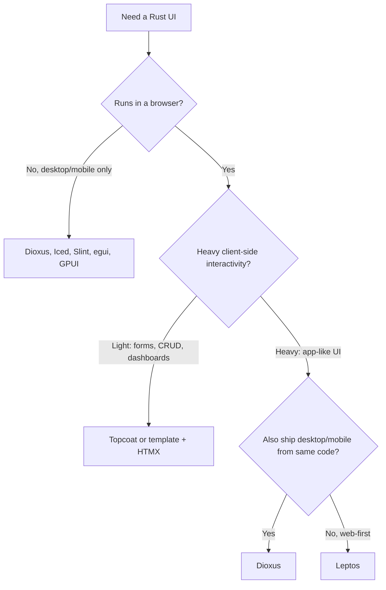

# Rust Frontend Frameworks — Landscape & Deep Dives

> [!abstract] Bottom line
> Topcoat is real, but it is far from the only option — and it isn't the most mature one. The Rust frontend field has two clear front-runners, **[[#Top Pick — Leptos|Leptos]]** (best for web apps) and **[[#Second Pick — Dioxus|Dioxus]]** (best for one codebase across web, desktop and mobile), plus a long tail of smaller or stalled projects. Topcoat is a third, genuinely different path: server-rendered pages with no WebAssembly at all. It is worth a spike, but at roughly three months old it is not yet a foundation for production work.
>
> Status snapshot as of **15 Oct 2026**. Versions and star counts move quickly — re-check before committing.

## Contents
- [[#How to read the landscape]]
- [[#Viable frameworks]]
- [[#Top Pick — Leptos]]
- [[#Second Pick — Dioxus]]
- [[#Leptos vs Dioxus vs Topcoat at a glance]]
- [[#Glossary]]
- [[#Sources]]

---

## How to read the landscape

"Frontend in Rust" covers three architecturally different approaches. Picking the approach first narrows the framework choice to two or three candidates.

1. **Browser frameworks compiled to WebAssembly.** Your Rust code is compiled to WebAssembly (WASM — a compact binary instruction format that browsers execute alongside JavaScript) and runs in the browser, manipulating the DOM (Document Object Model — the browser's live tree of page elements) much like React or SolidJS do. Most also offer SSR (server-side rendering — producing the initial HTML on the server so the page appears before any client code loads). HTML is HyperText Markup Language; JS is JavaScript. Leptos, Dioxus, Yew and Sycamore live here.
2. **Server-rendered ("hypermedia") frameworks.** All markup is produced on the server; the browser receives HTML plus a small amount of JavaScript for interactivity. No WASM build target. Topcoat lives here, alongside the do-it-yourself pattern of a Rust template engine plus HTMX (a small JavaScript library that swaps server-rendered HTML fragments into the page in response to user events).
3. **GPU/canvas UI toolkits that can also target the web.** GPU = Graphics Processing Unit; UI = User Interface. These draw their own pixels to a `<canvas>` element rather than using the DOM. Great for tools, editors and visualizations; weaker for accessibility, text selection and SEO (search engine optimization — how well search engines can index the page). egui, Iced, Slint, Makepad and Xilem fall here.



CRUD = Create, Read, Update, Delete (the basic data-entry operations most business apps are built from).

---

## Viable frameworks

**Legend:** ✅ active and usable · 🟡 usable but niche, slow-moving or experimental · ⛔ inactive or archived (listed so you can rule it out). "Reactivity model" is how the framework decides what to redraw when state changes (see [[#^fine-grained|fine-grained reactivity]] and [[#^vdom|virtual DOM]]).

### A. Browser (WASM) frameworks

| Framework | Status | Latest (verified) | Reactivity model | SSR | Notes |
|---|---|---|---|---|---|
| **Leptos** | ✅ | 0.8.x stable; 0.9 in alpha since May 2026 | Fine-grained signals | Yes — streaming, islands, server functions | Web-first full-stack; closest analogue to SolidStart / Next.js. **Top pick.** |
| **Dioxus** | ✅ | 0.7.10 stable (30 Jul 2026); 0.8.0-alpha.1 (31 Jul 2026) | Signals + virtual DOM | Yes — fullstack, SSG | Web + desktop + mobile from one codebase; largest community (~39k GitHub stars). **Second pick.** |
| **Yew** | ✅ | 0.23.0 (10 Mar 2026) | Virtual DOM, React-style hooks | Yes (more manual setup) | The original Rust web framework; client-side-rendering heritage; stable but slower-moving. |
| **Sycamore** | 🟡 | 0.9.2 (Sep 2025) | Fine-grained signals | Yes, with hydration | SolidJS-inspired like Leptos, but its own docs concede Leptos has the larger community. |
| **Dominator** | 🟡 | — | Fine-grained (signals crate) | No | Very fast, low-level, sparse docs. |
| **Sauron** | 🟡 | — | TEA (The Elm Architecture) | Yes | Elm-style model/update/view. Small community. |
| **Silkenweb** | 🟡 | — | Fine-grained | Yes | Small project. |
| **MoonZoon** | 🟡 | — | Fine-grained | No | Opinionated full-stack; low velocity. |
| **Percy, Seed, Kobold, mogwai, Perseus** | ⛔ | — | Various | — | Inactive, archived, or effectively superseded. Avoid for new work. |

Terms used above, defined in full in the deep dives: a **signal** is a reactive cell that notifies the UI pieces reading it when its value changes; **hydration** is client code taking over server-rendered HTML; **islands** are isolated interactive regions on an otherwise static page; a **server function** is a Rust function that runs on the server but is called from client code like a local function; **streaming** SSR sends the page in chunks as data becomes ready; **SSG** is Static Site Generation (pre-rendering pages at build time). "—" means current version not verified for this note.

### B. Server-rendered frameworks (no WASM)

| Framework | Status | Latest (verified) | Notes |
|---|---|---|---|
| **Topcoat** | 🟡 | v0.9 (24 Sep 2026) | From the Tokio project (Carl Lerche & Julien Scholz). Announced 22 Jul 2026; still labelled early-stage and experimental. Batteries-included, Rails-like; pairs with the **Toasty** ORM. See [[#Honorable mention — Topcoat]]. |
| **Axum/Actix + Maud/Askama + HTMX** | ✅ (pattern, not a framework) | — | Assemble-it-yourself. Mature parts, more glue code. |

ORM = Object-Relational Mapper (a library that maps database rows to language types so you query with code rather than raw SQL, Structured Query Language).

### C. GPU/canvas toolkits with a web target

| Toolkit | Status | Primary target | Web story |
|---|---|---|---|
| **egui** | ✅ | Desktop tools | Solid WASM support via `eframe`; ImGUI (Immediate-Mode Graphical User Interface — the whole UI is redescribed every frame) style. Excellent for internal tools/visualizers. |
| **Iced** | ✅ | Desktop | TEA architecture; web is secondary. |
| **Slint** | ✅ | Desktop & embedded | Own `.slint` markup language; WASM demos exist; commercial licensing option. |
| **Makepad** | 🟡 | Desktop/mobile/web | GPU-native, company-backed, unique live-design tooling. |
| **Xilem** | 🟡 | Desktop | Linebender's experimental next-gen toolkit; `xilem_web` is experimental. |
| **GPUI** | 🟡 | Desktop | Powers the Zed editor; no browser target. |

GUI = Graphical User Interface.

### D. Desktop shells (not UI frameworks)

**Tauri** packages any of the above (or a JS/TS frontend) as a desktop/mobile app using the system webview. TS = TypeScript. It is a container, not a way to write the UI — pair it with Leptos, Yew, Sycamore, etc.

---

## Top Pick — Leptos

> [!success] Why Leptos is #1
> For **web** frontend work specifically, Leptos is the most complete and best-performing option. It is the only Rust framework with the full modern full-stack feature set — streaming SSR, partial hydration ("islands"), type-safe server functions, and route-level WASM code splitting — and its fine-grained reactivity avoids the diffing overhead of virtual-DOM frameworks. If you have used Next.js or SolidStart, the mental model maps over almost directly.

### Snapshot

| Item | Detail |
|---|---|
| Repo | `leptos-rs/leptos` (~20.8k stars) |
| Lead | Greg Johnston (`gbj`), large contributor base |
| Stable line | 0.8.x (0.8.0 released May 2025; patch crates versioned independently since 0.8.6) |
| Next | 0.9.0-alpha (May 2026) — ecosystem crates are already targeting it |
| License | MIT / Apache-2.0 dual license |
| Server integrations | Axum (primary), Actix Web |
| Build tooling | `cargo-leptos` (full-stack), Trunk (client-only) |

MIT = Massachusetts Institute of Technology (the permissive "MIT License" is named after it).

### Architecture

Leptos is built on **signals** — small reactive cells that hold a value and know which pieces of UI read them. When a signal changes, Leptos updates *only* the specific DOM text node or attribute that depends on it. There is no virtual DOM and components run **once** to set up the graph rather than re-running on every change. This is **[[#^fine-grained|fine-grained reactivity]]**, the same model as SolidJS.

Internally (since 0.7) the stack is split into:

- **`reactive_graph`** — the framework-independent signal/effect/memo engine.
- **`tachys`** — the renderer that turns `view!` output into DOM operations, HTML strings (for SSR), or hydration instructions.
- **`leptos_router`**, **`leptos_meta`** (title/meta/stylesheet tags), **`server_fn`** (the RPC layer), and the server integrations (`leptos_axum`, `leptos_actix`).

RPC = Remote Procedure Call (calling a function that executes on another machine as if it were local).

#### Rendering modes

| Mode | What happens | Use when |
|---|---|---|
| **CSR** (client-side rendering) | Ship an empty page + WASM; everything renders in the browser | Internal tools, prototypes, static hosting |
| **SSR + hydration** | Server renders full HTML; WASM then "hydrates" it — attaches event handlers and reactivity to the existing markup | Public apps, SEO, fast first paint |
| **Islands** | Server renders everything; only components marked `#[island]` ship WASM and hydrate | Mostly-static pages with a few interactive regions; smallest bundles |

**Hydration** = the step where client code takes over server-rendered HTML without re-creating it. **Islands** = an architecture where the page is static HTML except for isolated interactive "islands," each hydrated independently.

### Core concepts with code

```rust
use leptos::prelude::*;

#[component]
fn Counter(initial: i32) -> impl IntoView {
    // signal() returns a (reader, writer) pair
    let (count, set_count) = signal(initial);
    // a derived value: just a closure that reads a signal
    let double = move || count.get() * 2;

    view! {
        <button on:click=move |_| set_count.update(|n| *n += 1)>
            "Clicked " {count} " times (double: " {double} ")"
        </button>
    }
}

fn main() {
    leptos::mount::mount_to_body(|| view! { <Counter initial=0 /> });
}
```

- **`#[component]`** — attribute macro that turns a function into a component with typed props.
- **`view!`** — macro accepting HTML-like syntax (similar to JSX, JavaScript XML, the React markup syntax) and type-checking it at compile time. `on:click` binds events; `{count}` binds a signal reactively.
- **Memos** (`Memo::new`) cache derived values; **effects** (`Effect::new`) run side-effects when dependencies change.
- **Stores** (`reactive_stores`) give field-level reactivity on nested structs — update `state.user.name` without notifying everything that reads `state`.

#### Server functions

The headline full-stack feature. You write an `async` function once; on the server it is the real implementation, and in the WASM build the macro replaces its body with an HTTP (HyperText Transfer Protocol) call to an auto-generated endpoint.

```rust
#[server]
pub async fn add_todo(title: String) -> Result<(), ServerFnError> {
    // runs only on the server — safe to touch the database, secrets, files
    let pool = expect_context::<sqlx::PgPool>();
    sqlx::query("INSERT INTO todos (title) VALUES ($1)")
        .bind(title)
        .execute(&pool)
        .await?;
    Ok(())
}

#[component]
fn NewTodo() -> impl IntoView {
    let add = ServerAction::<AddTodo>::new();
    view! {
        // progressively enhanced: works as a plain <form> before WASM loads
        <ActionForm action=add>
            <input type="text" name="title" />
            <button type="submit">"Add"</button>
        </ActionForm>
    }
}
```

**Server function** = a function annotated with `#[server]` that the framework turns into a typed client/server endpoint pair, eliminating hand-written API (Application Programming Interface) routes and duplicated request/response types. Since 0.8, server functions can also carry **WebSockets** (persistent two-way browser↔server connections), and you can use your own error types instead of `ServerFnError`.

#### Async data: Resources and Suspense

- **Resource** — a signal backed by an async loader (usually a server function) that refetches when its source signals change.
- **`<Suspense/>`** — shows a fallback until the resources read inside it resolve; on the server, it enables **streaming SSR** (send the page shell immediately, stream in each suspended section as its data arrives).
- **`<Transition/>`** — like Suspense but keeps the old content visible during refetches instead of flashing the fallback.

#### Routing and code splitting

`leptos_router` provides nested routes, typed params, and `<A/>` links. Since **0.8.5**, routes and functions can be lazy-loaded: `#[lazy_route]` and `#[lazy]` split the WASM binary so each route downloads only its own code — the Rust equivalent of JS dynamic imports.

### Tooling and developer experience (DX)

DX = Developer Experience.

| Tool | Purpose |
|---|---|
| `cargo-leptos` | Builds the server binary and the WASM client together, compiles CSS (Cascading Style Sheets — including Tailwind/SASS), runs the dev server with live reload |
| `leptosfmt` | Formatter for `view!` macro bodies (rustfmt can't format macro contents) |
| `--cfg=erase_components` | Dev-mode flag (default in recent `cargo-leptos`) that type-erases components to cut compile times substantially |
| Hot reload | Re-applies `view!` markup changes without a full recompile |
| `leptos-use` | Large utility-hook library (mouse, storage, intersection observer, etc.) inspired by VueUse |
| UI kits | Thaw, Leptonic, Rust-UI/shadcn ports; Tailwind works out of the box |

### Getting started

```bash
rustup target add wasm32-unknown-unknown
cargo install --locked cargo-leptos
cargo leptos new --git leptos-rs/start-axum   # SSR + Axum template
cd <project> && cargo leptos watch           # dev server with reload
```

For a client-only app: `cargo install --locked trunk`, add `leptos = { version = "0.8", features = ["csr"] }`, then `trunk serve`.

### Strengths

- Best raw performance among DOM-based Rust frameworks (no diffing; updates touch only what changed).
- The most complete web full-stack feature set: streaming SSR, islands, server functions, actions/forms with progressive enhancement, WASM code splitting.
- One language and one type system across server and client — a renamed field is a compile error on both sides.
- Clean fit with Axum/Tower middleware and the wider Tokio ecosystem.
- Excellent documentation (the "Leptos Book") and an active community.

### Weaknesses and risks

- **Pre-1.0.** Each minor version (0.5 → 0.6 → 0.7 → 0.8) has brought breaking changes; 0.7 was a ground-up rewrite. Expect a migration when 0.9 goes stable.
- **Web only.** No first-party desktop or mobile renderer (wrap in Tauri if needed).
- **Compile times.** Large `view!` trees are slow to build; `erase_components` and hot-reload mitigate but don't eliminate this. Iteration is slower than a Vite + React loop.
- **Ecosystem size.** Far fewer ready-made components than React; you'll write more yourself or call JS libraries via `wasm-bindgen`.
- **Fine-grained gotchas.** Reading a signal outside a reactive context (e.g., `count.get()` in the component body instead of a closure) silently loses reactivity — the classic SolidJS pitfall.

### Best-fit use cases

Public-facing or SEO-sensitive web apps; full-stack internal apps where you want a single Rust codebase from database to button; highly interactive UIs (dashboards with many live values, editors) where fine-grained updates pay off.

---

## Second Pick — Dioxus

> [!info] Why Dioxus is #2
> Dioxus is the most *ambitious* Rust UI framework and has the largest community. Its killer features are **reach** — one codebase for web, desktop, mobile and server — and **developer experience**, notably runtime hot-patching of Rust code. It ranks second for *web* work because it still uses a virtual DOM (more overhead than Leptos), its SSR story is less integrated, and it is mid-transition from 0.7 to 0.8.

### Snapshot

| Item | Detail |
|---|---|
| Repo | `DioxusLabs/dioxus` (~39k stars, ~1.9k forks) |
| Backing | Dioxus Labs (company); lead Jonathan Kelley (`jkelleyrtp`) |
| Stable line | 0.7.x — 0.7.0 shipped 31 Oct 2025; 0.7.10 on 30 Jul 2026 |
| Next | 0.8.0-alpha.0 (19 May 2026), 0.8.0-alpha.1 (31 Jul 2026); 0.7.6 was announced as the intended final 0.7 feature release |
| License | MIT / Apache-2.0 |
| Renderers | Web (WASM), Desktop (system webview), Mobile (iOS/Android), Dioxus Native (GPU), SSR/LiveView |
| Build tooling | `dx` CLI (Command-Line Interface) |

### Architecture

Dioxus is **React-shaped**: components are functions that return an `Element`, and state lives in hooks. Under the hood it uses a **[[#^vdom|virtual DOM]]** — each render produces a lightweight tree that is diffed against the previous one, and only the differences are applied. Dioxus reduces the usual cost by compiling `rsx!` into **templates**: static structure is known at compile time, so only the dynamic slots are diffed.

Since 0.5, state uses **signals** (`use_signal`) — `Copy`-able handles that, unlike React's `useState`, do not require dependency arrays or cloning to move into closures. Per the Dioxus team's own comparison, Leptos uses signals to drive *both* reactivity and rendering, while Dioxus uses signals for reactivity and the virtual DOM for rendering.

The core is **renderer-agnostic**, which is what enables the multi-platform story:

| Renderer | How it draws | Notes |
|---|---|---|
| `dioxus-web` | DOM via WASM | Standard browser target; hash-router support added in 0.7 |
| `dioxus-desktop` | System webview via `wry` | Small binaries vs Electron; native Rust access without IPC (inter-process communication) glue |
| `dioxus-mobile` | Webview on iOS/Android | 0.7.4 added FFI (Foreign Function Interface) bridges for Kotlin, Java and Swift, plus iOS widget bundling |
| **Dioxus Native** | GPU-painted via **Blitz** + WGPU | No webview at all; major quality upgrade in 0.8 alpha (incremental rendering, custom elements) |
| SSR / LiveView | HTML from server; LiveView streams DOM patches over a WebSocket | Server-driven UI à la Phoenix LiveView |

**Blitz** = Dioxus Labs' modular HTML/CSS layout and rendering engine, usable independently of Dioxus. **WGPU** = a Rust implementation of the WebGPU graphics API (Application Programming Interface) that runs on Vulkan, Metal, DirectX 12 and in browsers. GPU = Graphics Processing Unit. **Electron** = the JS framework that bundles a full Chromium browser with each desktop app.

### Core concepts with code

```rust
use dioxus::prelude::*;

fn main() {
    dioxus::launch(App); // same entry point for web, desktop, mobile
}

#[component]
fn App() -> Element {
    let mut count = use_signal(|| 0);

    rsx! {
        h1 { "High-five counter: {count}" }
        button { onclick: move |_| count += 1, "Up high!" }
        button { onclick: move |_| count -= 1, "Down low!" }
    }
}
```

- **`rsx!`** — Dioxus' own markup DSL (domain-specific language — a mini-language embedded in Rust). Rust-struct-like syntax (`div { class: "x", "text" }`) rather than HTML tags; supports inline format strings like `"{count}"`.
- **Hooks** — `use_signal`, `use_memo`, `use_effect`, `use_resource` (async data), `use_context` / `use_context_provider` (dependency injection down the tree).
- **Stores** — field-level reactive state for nested structs (since 0.7).
- **Server functions** — `#[server]` works as in Leptos; 0.7's "fullstack overhaul" added Axum-style typed routes (`#[get("/api/...")]`), server-only extractors, and WebSocket streams.

```rust
#[server]
async fn get_greeting(name: String) -> Result<String, ServerFnError> {
    Ok(format!("Hello, {name} — from the server"))
}

#[component]
fn Greeting() -> Element {
    let greeting = use_server_future(|| get_greeting("Ferris".into()))?;
    rsx! { p { "{greeting:?}" } }
}
```

### Tooling and DX — Dioxus' biggest advantage

| Tool | Purpose |
|---|---|
| `dx` CLI | `dx new`, `dx serve`, `dx bundle` (installers: MSI, DMG, AppImage, APK, IPA), `dx fmt` (formats `rsx!`), shell completions |
| **Subsecond hot-patching** | Recompiles and swaps *Rust function bodies* into the running app — not just markup — typically in under a second. Enabled by default in the 0.8 alphas. The CLI also works with non-Dioxus projects. |
| **Manganis** | The `asset!()` macro system: declares images/CSS/fonts in code, optimizes and content-hashes them at build time |
| **Dioxus Primitives** | First-party, unstyled, accessible components modeled on Radix UI (dialogs, menus, tabs) |
| Scoped CSS / CSS modules | Added in 0.7.3 |
| SSG | Static site generation — pre-render routes to HTML files at build time |

MSI = Microsoft Installer package; DMG = macOS disk image; APK = Android Package; IPA = iOS App Store Package.

### Getting started

```bash
curl -sSL https://dioxus.dev/install.sh | sh     # or: cargo binstall dioxus-cli
dx new my-app                                    # interactive template picker
cd my-app
dx serve --platform web                          # or desktop / ios / android
```

### Strengths

- **One codebase, every platform** — the only mature Rust option for web + desktop + mobile.
- **Best-in-class iteration speed** thanks to Subsecond hot-patching; this largely neutralizes Rust's compile-time penalty during UI work.
- **Largest community and funded core team** — more examples, more third-party crates, more momentum.
- Familiar to React developers (components, hooks, context).
- Integrated asset pipeline, bundler and formatter — less tooling assembly than Leptos.

### Weaknesses and risks

- **Virtual-DOM overhead** — fast in practice, but Leptos wins benchmarks on update-heavy UIs.
- **`rsx!` is not HTML** — you can't paste HTML/Tailwind snippets in directly without translation (tools exist).
- **0.7 → 0.8 transition in progress** — 0.8 alphas carry breaking API and behavior changes; the 0.7 line is in maintenance.
- **Breadth vs depth** — web-specific features (islands, progressive-enhancement forms) are less developed than in Leptos.
- **Desktop/mobile use a webview** (unless you adopt the still-maturing Dioxus Native), so rendering varies slightly by OS (operating system) webview engine.

### Best-fit use cases

Cross-platform products (a web dashboard plus a desktop or mobile companion app); desktop internal tools where you want a modern UI without Electron; teams coming from React; anyone who values fast iteration loops above peak web performance.

---

## Honorable mention — Topcoat

> [!warning] Not ranked in the top two — but worth watching
> Topcoat takes a deliberately different path, and that's exactly why it isn't a like-for-like competitor to Leptos or Dioxus.

- **What it is:** a modular, batteries-included, *server-rendered* full-stack framework from the Tokio project, built by Carl Lerche (a former Ruby on Rails core team member) and Julien Scholz. The stated goal is Rails-level productivity in Rust.
- **How interactivity works:** inside `view!`, a `$(...)` **runtime expression** is a type-checked subset of Rust that Topcoat evaluates on the server for the first render *and transpiles to JavaScript* to re-run in the browser — no WASM, no client build step. A **`signal`** declared in a view lives in the browser. A **shard** (`#[shard]`) is a component that re-renders on the server whenever its arguments change, with the result morphed into the page.
- **Since v0.8–0.9:** signals can be read during server rendering (Topcoat automatically refetches only the dependent fragments); `live!`/`emit!` macros stream UI updates; built-in `suspense` and `error_boundary`; server push over WebSockets (v0.9, 24 Sep 2026).
- **Batteries:** module-based routing with auto-discovery, request-scoped memoization (`#[memoize]`), asset pipeline with content hashing, Fontsource fonts and Iconify icons via macros, Node-free Tailwind, a shadcn/ui-style component library vendored into your source tree, HTMX and Alpine.js integrations, and the **Toasty** async ORM.
- **Why not top two:** announced 22 Jul 2026 and still labelled early-stage/experimental; its own roadmap lists client reactivity as incomplete; small ecosystem; and it isn't a client-side framework, so offline-capable or very latency-sensitive UIs are out of scope.
- **When to pick it anyway:** server-heavy CRUD apps, admin panels and live dashboards where you'd otherwise reach for Rails, Phoenix LiveView or Django + HTMX — and you want zero WASM.

---

## Leptos vs Dioxus vs Topcoat at a glance

| Dimension | Leptos | Dioxus | Topcoat |
|---|---|---|---|
| Paradigm | Fine-grained, SolidJS-like | React-like, signals + VDOM | Server-rendered + transpiled JS snippets |
| Client runtime | WASM | WASM (web) / native | Small JS runtime, no WASM |
| Markup | `view!` (HTML-like) | `rsx!` (Rust-like DSL) | `view!` (HTML-like) |
| Platforms | Web | Web, desktop, mobile, native GPU | Web |
| SSR | Streaming, islands, hydration | Fullstack SSR, SSG, LiveView | Always (it is the model) |
| Server ↔ client | `#[server]` functions | `#[server]` + typed routes | Shards, signals, `live!` |
| Hot reload | Markup hot-reload | Full Rust hot-patching (Subsecond) | Dev server reload |
| Maturity | High (pre-1.0) | High (pre-1.0) | Early / experimental |
| Community | Large | Largest | Small, growing |
| Best for | Web-first apps | Cross-platform apps | Server-heavy CRUD/dashboards |

VDOM = virtual DOM.

**Suggested evaluation path:** build the same small app — a list page backed by a database, a form with validation, and one live-updating widget — in Leptos first, then Dioxus. Time the edit-compile-refresh loop in each. If the app turns out to be mostly server-driven, port it to Topcoat as a third data point.

---

## Glossary

Terms are listed alphabetically. Entries with a `^` block ID can be linked from other notes, e.g. `[[Rust Frontend Frameworks#^signal]]`.

- **API** — Application Programming Interface; the defined way one piece of software calls another. ^api
- **Blitz** — Dioxus Labs' modular HTML/CSS rendering engine; powers Dioxus Native. ^blitz
- **`cargo-leptos`** — Leptos build tool that compiles server binary, WASM client and CSS together and runs a dev server. ^cargo-leptos
- **CLI** — Command-Line Interface. ^cli
- **Component** — a reusable function that returns UI; marked with `#[component]` in Leptos, Dioxus and Topcoat. ^component
- **CRUD** — Create, Read, Update, Delete. ^crud
- **CSR** — Client-Side Rendering; the browser builds the page from scratch using client code. ^csr
- **CSS** — Cascading Style Sheets. ^css
- **DOM** — Document Object Model; the browser's live, scriptable tree of page elements. ^dom
- **DSL** — Domain-Specific Language; a small language specialized for one job (e.g., `rsx!`). ^dsl
- **DX** — Developer Experience. ^dx
- **`dx`** — the Dioxus CLI (`dx serve`, `dx bundle`, `dx fmt`). ^dx-cli
- **Effect** — a reactive callback that re-runs a side-effect when the signals it reads change. ^effect
- **Electron** — a framework that ships a full Chromium browser with each desktop app. ^electron
- **`erase_components`** — Leptos compile flag that type-erases component trees to speed up dev builds. ^erase
- **FFI** — Foreign Function Interface; calling code written in another language. ^ffi
- **Fine-grained reactivity** — updating only the exact DOM nodes that depend on changed state, with no diffing (Leptos, Sycamore, SolidJS). ^fine-grained
- **FRP** — Functional Reactive Programming; modeling UI as values that change over time. ^frp
- **GPU** — Graphics Processing Unit. ^gpu
- **GUI** — Graphical User Interface. ^gui
- **Hot-patching** — replacing compiled function bodies in a running program without restarting it (Dioxus Subsecond). ^hotpatch
- **HTML** — HyperText Markup Language. ^html
- **HTMX** — a small JS library that swaps server-rendered HTML fragments into a page on user events. ^htmx
- **HTTP** — HyperText Transfer Protocol. ^http
- **Hydration** — attaching client-side interactivity to HTML that was rendered on the server, without re-creating it. ^hydration
- **ImGUI** — Immediate-Mode GUI; the UI is redescribed from scratch every frame (egui). ^imgui
- **IPC** — Inter-Process Communication. ^ipc
- **Islands** — architecture where a page is static HTML except for isolated interactive regions that hydrate independently (`#[island]` in Leptos). ^islands
- **JS / TS** — JavaScript / TypeScript. ^js
- **JSX** — JavaScript XML; React's HTML-in-JS syntax. XML = Extensible Markup Language. ^jsx
- **`live!` / `emit!`** — Topcoat macros for views that stream successive UI updates from the server. ^live
- **LiveView** — server-driven UI where the server holds state and streams DOM patches over a WebSocket (Phoenix origin; Dioxus renderer). ^liveview
- **Manganis** — Dioxus asset system behind the `asset!()` macro. ^manganis
- **Memo** — a cached derived value that recomputes only when its inputs change. ^memo
- **ORM** — Object-Relational Mapper. ^orm
- **OS** — Operating System. ^os
- **`reactive_graph`** — Leptos' standalone reactive engine crate. ^reactive-graph
- **Resource** — an async-loaded reactive value (Leptos `Resource`, Dioxus `use_resource`). ^resource
- **RPC** — Remote Procedure Call. ^rpc
- **`rsx!`** — Dioxus' Rust-like markup macro. ^rsx
- **Runtime expression `$(...)`** — Topcoat syntax for type-checked Rust that runs on the server and is transpiled to JS for the browser. ^runtime-expr
- **SEO** — Search Engine Optimization. ^seo
- **Server function** — a `#[server]` function compiled into a server implementation plus an auto-generated typed client call. ^server-fn
- **Shard** — a Topcoat component (`#[shard]`) that re-renders on the server when its inputs change and is morphed into the page. ^shard
- **Signal** — a reactive cell holding a value that notifies its readers when it changes. ^signal
- **SQL** — Structured Query Language. ^sql
- **SSG** — Static Site Generation; pre-rendering pages to HTML at build time. ^ssg
- **SSR** — Server-Side Rendering. ^ssr
- **Store** — field-level reactive container for nested structs (Leptos `reactive_stores`, Dioxus stores). ^store
- **Streaming SSR** — sending the page shell immediately, then streaming in each async section as its data resolves. ^streaming
- **Subsecond** — Dioxus' Rust hot-patching engine. ^subsecond
- **Suspense** — a boundary that shows fallback UI until async data inside it is ready. ^suspense
- **`tachys`** — Leptos' rendering layer (DOM, HTML strings, hydration). ^tachys
- **Tauri** — Rust framework that packages a web frontend as a desktop/mobile app using the system webview. ^tauri
- **TEA** — The Elm Architecture: model → update → view. ^tea
- **Toasty** — Tokio's async ORM, paired with Topcoat. ^toasty
- **Trunk** — WASM bundler/dev server for client-only Rust apps. ^trunk
- **UI / UX** — User Interface / User Experience. ^ui
- **`view!`** — HTML-like markup macro in Leptos and Topcoat. ^view
- **Virtual DOM (VDOM)** — an in-memory UI tree that is diffed against the previous render to compute minimal DOM changes (React, Yew, Dioxus). ^vdom
- **WASM** — WebAssembly. ^wasm
- **`wasm-bindgen` / `web-sys`** — crates that bridge Rust↔JS and expose browser APIs to Rust. ^wasm-bindgen
- **WebSocket** — persistent, two-way browser↔server connection. ^websocket
- **WGPU** — Rust implementation of the WebGPU graphics API, running on Vulkan, Metal, DirectX 12 and browsers. ^wgpu
- **`wry`** — cross-platform webview library used by Tauri and Dioxus Desktop. ^wry

---

## Sources

- [Announcing Topcoat — Tokio blog (22 Jul 2026)](https://tokio.rs/blog/2026-07-22-announcing-topcoat)
- [Topcoat is pushing the boundary of server applications — Tokio blog (24 Sep 2026)](https://tokio.rs/blog/2026-09-24-topcoat-server-applications)
- [tokio-rs/topcoat on GitHub](https://github.com/tokio-rs/topcoat) · [docs.rs/topcoat](https://docs.rs/topcoat)
- [Leptos v0.8.0 release notes](https://github.com/leptos-rs/leptos/releases/tag/v0.8.0)
- [Leptos crate versions incl. 0.9.0-alpha (docs.rs, leptos_dom)](https://docs.rs/crate/leptos_dom/latest)
- [Dioxus releases (0.7.x, 0.8 alphas)](https://github.com/DioxusLabs/dioxus/releases)
- [Dioxus vs other frameworks (Dioxus README)](https://github.com/paulormart/dioxus)
- [Yew 0.22 release post](https://yew.rs/blog/2025/11/29/release-0-22) · [Yew 0.23 changelog via Dependabot](https://github.com/koa/rust-fullstack/pull/181)
- [Sycamore on lib.rs](https://lib.rs/crates/sycamore)
- [Rust web framework comparison (flosse)](https://github.com/flosse/rust-web-framework-comparison)
