# Forge Platform

## Industrial data operations for a manufacturing enterprise

Onboarding tutorial · two tracks from one landing fork · software-dev / contributor onboarding and an end-user overview of the framework.

`Last verified: 2026-11-23` against the repository `reh3376/forge` at the merge of PR 168 (branch `main`). Both tracks are reviewed against each change and updated before every push, and this date moves with each push. The last review of every slide from end to end was on 2026-11-19 (FB-170).

**Companions**: [`README.md`](https://github.com/reh3376/forge/blob/main/README.md) · [`docs/VISION.md`](https://github.com/reh3376/forge/blob/main/docs/VISION.md) · [`docs/WHERE-WE-ARE-GOING.md`](https://github.com/reh3376/forge/blob/main/docs/WHERE-WE-ARE-GOING.md) · [`docs/WHERE-WE-ARE.md`](https://github.com/reh3376/forge/blob/main/docs/WHERE-WE-ARE.md) · [`docs/ROADMAP.md`](https://github.com/reh3376/forge/blob/main/docs/ROADMAP.md) · [`docs/PRINCIPLES.md`](https://github.com/reh3376/forge/blob/main/docs/PRINCIPLES.md) · [`BACKLOG.md`](https://github.com/reh3376/forge/blob/main/BACKLOG.md)

note:
- Every substantive claim in this deck traces to one of the companion documents or to shipped code. The key docs are the source of truth; this deck is the guided path through them.
- Where something is not built yet, the deck says so. "Honest" sub-sections exist for that reason: the gap between the vision and the snapshot is the work.
- The deck is regenerated from `docs/tutorial.md` by tutorial-forge (`scripts/tutorial-forge/`); edit the source, not the HTML.

---

<!-- .slide: id="landing-fork" -->

## The Two Paths

Two walkthroughs branch from here.

| | **Software Dev / Contributor Onboarding** | **End User Overview** |
|---|---|---|
| **For** | Engineers and technical PMs who will build on or inside Forge | Operators, supervisors and managers who will run a Forge site or decide from it |
| **Depth** | ~100 min, engineering-dense, code pointers throughout | ~50 min, plain language, no code required |
| **Covers** | contract, storage, governance, OT module and the three layers of process control, modules and SDK, context and curation, security, one clock across the platform, the contributor workflow, the current state | what Forge is for, how data flows, the hub in operation, a site's systems as modules, the plant floor and the layers of control above it, context and decisions, governance, screens, roles, one clock, operations |
| **Next** | Continue below ↓ (Contents → F1 Opening) | [Jump to the End User path →](#end-user-path) |

note:
- The dev path is the default: keep scrolling. The end-user path is complete on its own and never sends an operator into the dev path for a topic.
- The left-margin sidebar lists every section and every diagram; clicking an acronym jumps to the glossary at the end, and a "Return to Previous" button returns to the place left.

---

<!-- .slide: id="table-of-contents" -->

## Table of Contents

**Software Dev Path**: **[F1 Opening](#f1--opening)** → **[F2 The Hub ↔ Spoke Contract](#f2--the-hub-spoke-contract)** → **[F3 Storage](#f3--storage-and-the-hubs-databases)** → **[F4 Spec-First Governance](#f4--governance-fxts)** → **[F5 The Plant-Floor Module](#f5--the-forge-ot)** → **[F6 Modules, Module Builder, forge-display](#f6--modules-the-sdk-and-forge-display)** → **[F7 Context, Curation, Decisions](#f7--context-curation-and-decisions)** → **[F8 Security, Identity, Federation](#f8--security-identity-and-federation)** → **[F9 One Clock](#f9--one-clock)** → **[F10 Contributing](#f10--contributing)** → **[F11 Conclusion](#f11--conclusion)**

**End User Path**: **[U1 Start Here](#end-user-path)** → **[U2 How Data Flows](#u2--how-data-flows)** → **[U3 The Hub in Operation](#u3--the-hub-you-run)** → **[U4 A Site's Systems as Modules](#u4--your-systems-as-spokes)** → **[U5 The Plant Floor](#u5--the-plant-floor)** → **[U6 Context, Products, Decisions](#u6--context-products-and-decisions)** → **[U7 Governance for Users](#u7--governance-for-users)** → **[U8 Screens](#u8--screens)** → **[U9 Identity, Roles, Credentials](#u9--identity-roles-and-credentials)** → **[U10 One Clock](#u10--one-clock)** → **[U11 Operations](#u11--operations)** → **[U12 Where to Go Next](#u12--where-to-go-next)**

| § | Section | Target | What the reader leaves with |
|---|---|---:|---|
| [F1](#f1--opening) | Opening: definition, thesis, the twelve problems, the vocabulary, the finished system, one value end to end, honest state, the key docs | ~15 min | the shape of the platform and how to read its documents |
| [F2](#f2--the-hub-spoke-contract) | The hub ↔ module contract: `AdapterService`, `ContextualRecord`, transport, ingest, and the signed transport contract | ~14 min | what crosses the hub boundary, how, and what it must guarantee |
| [F3](#f3--storage-and-the-hubs-databases) | Storage: hub-owned databases, routing, migrations, Forge-issued credentials | ~8 min | where data lands and who may touch it |
| [F4](#f4--governance-fxts) | **Spec-first governance** (headline): the four layers, the FxTS family, what every framework provides, hashing and the owner's approval, what every module must do, governed lists | ~20 min | why nothing changes silently, and what every module is held to |
| [F5](#f5--the-forge-ot) | The plant-floor module (forge-ot): tags, alarms, the write defense chain, changeover, one clock, the three-layer process control framework | ~15 min | how the plant floor is reached safely, and what will sit above the PLC |
| [F6](#f6--modules-the-sdk-and-forge-display) | Modules: kinds and names, what a module is made of, the order of building, the template, forge-display and its designer, integration modules built on site | ~14 min | how capability is built, shown, and extended at an installation |
| [F7](#f7--context-curation-and-decisions) | Context, curation and decisions | ~8 min | how a value becomes decision-quality |
| [F8](#f8--security-identity-and-federation) | Security, identity and federation | ~8 min | roles per hub, credentials, the hub hierarchy, repo posture |
| [F9](#f9--one-clock) | One clock: why every timestamp must agree, the time authority at every level, what a record carries, measuring, declaring, the time contract with every counterpart, and failing closed | ~10 min | how time is kept the same from the top hub to a PLC, and how code is held to it |
| [F10](#f10--contributing) | Contributing: setup, the workflow, the rules that bind, where things go, adding a module, deciding with the owner | ~12 min | how to land a change, and when to ask |
| [F11](#f11--conclusion) | Conclusion: honest state, milestones, the decision queue, next | ~6 min | where to go from here |

Use the left-margin sidebar for section and diagram navigation.

note:
- F4 is the headline section for contributors: everything else either feeds a spec or is gated by one.
- Natural pauses: after F1's honest state, after F4's hashing rules, after F10's rules that bind.

---

<!-- SECTION F1, OPENING -->
<!-- .slide: id="f1--opening" -->

# F1 · Opening

**Nav**: [⇤ TOC](#table-of-contents) · [⇅ Landing fork](#landing-fork) · [F2 →](#f2--the-hub-spoke-contract)

What Forge is, the thesis behind it, the twelve problems it is built to solve, what the finished system looks like, where it honestly stands today, and how to read its documents.

note:
- Source: `docs/VISION.md` §1–§3, `docs/WHERE-WE-ARE.md` §1, `docs/WHERE-WE-ARE-GOING.md` §6.

---

## What Forge Is

**Forge is the industrial data operations platform for a manufacturing enterprise.**

- It connects every operational system a plant runs on: SCADA/PLC, MES, WMS, CMMS, ERP, QMS, historians, network management, lab and scanner devices.
- It turns their output into **one governed record type with manufacturing context attached**.
- It curates that into **decision-quality data products** with lineage and quality objectives.
- It renders every operator and management interface **from declarative specifications**.

**Why it was built:** the Forge is first and foremost a manufacturing sector solution for properly deployed digital infrastructure. The ultimate goal is to facilitate an enterprise's ability to make better decisions at all levels of the business based on the data generated within the business.

**Forge is a dynamic framework, not a fixed product (A-19).** Manufacturing differs from plant to plant even within one sector, so Forge is instantiated for a facility, a site or an enterprise by customization. That build-out is done in the **forge designer**, where users build with tools and widgets that are each governed by a specification. A user builds only within what the specifications allow.

Forge is also a **governed engineering platform**: every contract between components is a machine-checked specification with a hash that only the owner approves, so that neither people nor AI coding agents can change an interface silently.

note:
- `docs/VISION.md` §1; decision A-19 in `docs/ROADMAP.md` §1.
- The vision is written in the present tense about a system that does not fully exist yet. The gap is the work, and "Where Forge Is Today" says exactly where it is.

---

## The Thesis

**Bad manufacturing decisions come from missing quality, context and correlation, not from missing data.**

| Forge is built so that… | which means |
|---|---|
| every datum is **validated** | quality codes travel with the value; a bad value is marked, not hidden |
| every datum carries **where / when / what / who** it belongs to | site, area, equipment, lot, shift, operator, work order, operating mode |
| any two data can be **joined** by that context | correlation is a query, not a project |
| the **decision** taken on it is itself recorded and measured | what was known, what was decided, what happened |

Poor decisions are far more costly than generally realised: the cost is spread across many units and shifts, and the root cause of a confidently wrong decision is rarely captured.

note:
- `README.md` "What Forge Does" and `docs/VISION.md` §1. The research basis (two BBD papers on information architecture and human judgment) is summarised in `docs/PRINCIPLES.md` §4.

---

## The Twelve Problems

Each is stated as it is experienced in a plant; each has a component that carries it and a definition of solved (`docs/VISION.md` §2).

| # | Problem | What Forge does about it |
|---|---|---|
| P-1 | Every system is an island with its own data shape | hub and spoke: one contract, one record type |
| P-2 | Values arrive without context | context is declared per module and enforced at ingest |
| P-3 | Nothing can be trusted enough to decide on | curation with lineage and quality objectives |
| P-4 | SCADA and HMI lock the plant to one vendor | an open OT module over OPC-UA; vendor software behind an integration module |
| P-5 | Integrations are one-off projects that rot | a module SDK, machine-checked contracts as CI gates, and integration modules an installation builds itself in the designer |
| P-6 | Writing to the plant floor is unsafe | a defense chain in the core for every write; a command is never delivered late |
| P-7 | Contracts change silently, now also by AI agents | hash governance: every spec hashed, only the owner approves |
| P-8 | Every module ships its own UI | modules describe (FVTS), forge-display renders |
| P-9 | Decisions are not recorded, so their cost is never learned | the decision is a record with its products and lineage |
| P-10 | Multi-site enterprises break on the WAN | a hub of hubs along ISA-95; store and forward; sites keep working offline |
| P-11 | Credentials sprawl and nobody has a role model | the hub owns the databases; a central credential module; roles scoped per hub |
| P-12 | There is no production deployment story | Kubernetes per hub; compose is development only |

note:
- Keep this table in mind through the deck: F2 carries P-1 and P-2, F3 P-11, F4 P-5 and P-7, F5 P-4 and P-6, F6 P-5 and P-8, F7 P-2, P-3 and P-9, F8 P-10 and P-11, F11 P-12.

---

## The Vocabulary First

| Term | What it means in Forge |
|---|---|
| **forge-core** | The foundation and the administrative manager of a deployment (D-17 §11): one per deployment, above the top hub. The foundation is what every hub and module is built from (the contract, the FxTS frameworks, the SDK), and it is built. The manager knows every hub and module, monitors and alerts on their state, and is the one place administrative changes are made and distributed; it is not built. It administers and does not operate: a hub that cannot reach it keeps running. |
| **Hub** | forge-hub (Python, its own package `forge_hub` in `forge-hub/src/python` since 2026-11-23): an enterprise hub, site hubs and area hubs, each the manager of the modules and databases attached to it. It owns the transport, the ingest pipeline, the databases, context, curation, governance and the time. Hubs form a hierarchy: area hubs under a site hub under an enterprise hub. |
| **Module** (also **spoke**) | Anything that registers with a hub. A module speaks `forge.v1.AdapterService` to its hub over gRPC and reaches it no other way (A-1). |
| **Management module** | A module Forge builds for a business function: `forge-mes`, `forge-wms`, `forge-cmms`, `forge-nms`, `forge-ims`, `forge-historian`, `forge-scanner`. Named `forge-<service>`. |
| **Integration module** | A module that connects Forge to one third-party product: `forge-integ-erp-netsuite`. Named `forge-integ-<function>-<product>`. Its hub side is gRPC only; its application side uses whatever the product offers (REST, GraphQL, MQTT, OPC UA, SQL, …). Installations build their own in the designer. |
| **forge-ot** | The plant-floor module: PLC and OPC UA connections, tags, alarms, control writes. |
| **forge-display** | The one module that produces every user interface, the hub's own included (A-3). It has a run mode (render screens) and a design mode (the designer). It is the first module to be built (A-14). |
| **ContextualRecord** | The one record type. Every value that enters a hub is one: the value, its quality, its timestamps, and the manufacturing context it belongs to. |
| **FxTS** | The family of specification frameworks. Each governs one kind of repeatable thing: FACTS a module's data contract, FATS a hub API route, FTTS the transport, FVTS a screen, FMTS what every module must do. Every spec carries a hash the owner approves. |
| **The owner** | reh3376. Only the owner approves a spec's hash or signs a decision record. |

note:
- Every module has an alias as well as its id: `wms` for `forge-wms`, `netsuite` for `forge-integ-erp-netsuite`. The alias is in the module's FMTS spec.
- The management modules were built using existing applications as examples. They are Forge's own modules, not connectors to those applications. The repository names no existing company (A-16); a third-party product that an integration module integrates may be named.

---

## The Finished System

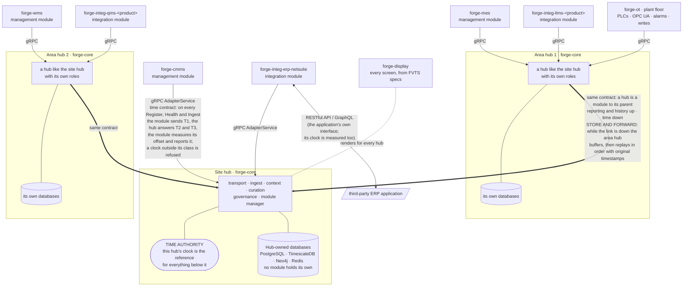

How to read it:

- **Three hubs, each with two modules.** Every hub is the same software (forge-core). An area hub serves the modules that run that area's processes; the site hub serves site-wide functions and collects from the area hubs.
- **Two kinds of module on each hub.** A management module is Forge's own; an integration module connects one third-party application. The integration module is the only thing that talks to that application, over the application's own interface (a RESTful API or GraphQL here; MQTT, OPC UA, SQL and others where the application offers them). Its hub side is gRPC, like every module.
- **The time contract is on every link.** The site hub is the time authority. Each exchange carries four timestamps, so both sides know the offset between their clocks. A clock outside its tolerance class is refused, never silently corrected. It reaches down to PLC connections and across to databases and third-party systems.
- **Store and forward is on every link.** A module or a child hub that cannot reach its parent keeps what it could not deliver and replays it in order. A command going down (a write to a process controller) is the opposite: never stored, and it expires.
- **Every hub owns its own databases, not only the top one.** The chart draws the full set of stores on the site hub to keep it readable, but each area hub has its own PostgreSQL, TimescaleDB and the rest, and stores the data of the modules attached to it. A hub at any level keeps working, and keeps storing, when the hub above it cannot be reached. A module gets a Forge-issued credential to its own schema on its own hub and holds no connection of its own.

note:
- `docs/VISION.md` §3. This is the finished system; the next slide says which boxes exist today.
- The link rules are the signed transport contract, `docs/decisions/transport-contract.md` (D-15). The time rules are `docs/decisions/one-clock-ot-source-time.md` (D-9) and the time contract in `docs/decisions/forge-module-requirements.md` (D-12). F2 and F9 go through them.
- Hub-to-hub links carry reporting and history and tolerate delay; nothing between hubs may be needed for a module to keep controlling its process.

---

## One Value, End to End

How the pieces work together, following one temperature reading from a PLC to a decision.

| Step | What happens | Where |
|---|---|---|
| 1 | A PLC produces a value. forge-ot reads it over OPC UA with the server's own timestamp, and has measured that server's clock. | F5, F9 |
| 2 | forge-ot builds a **ContextualRecord**: value, quality code, source time corrected by the measured offset, and context (site, area, equipment). | F2, F7 |
| 3 | forge-ot sends it to its hub with **Ingest** over gRPC. The same call is a time exchange and a probe of forge-ot's own clock. | F2, F9 |
| 4 | The hub checks the module (its FACTS spec matches its manifest, its clock is within its class), stamps receipt with the hub's clock, validates the record and refuses what is wrong, with a cause. | F2, F4 |
| 5 | The hub routes the record to the right database by its type and writes it. The module never touches a database. | F3 |
| 6 | The Context Engine enriches it (lot, batch, shift, operating mode). Curation turns many records into a **data product** with lineage and a quality score. | F7 |
| 7 | forge-display renders it on a screen from the module's FVTS spec. A person decides; the **decision** is a record too, with what was known. | F6, F7 |
| 8 | If the decision is a write to the plant, it goes back down as a command through the write defense chain, with an expiry. | F5 |

At every step a specification says what is allowed and a hash says the specification has not changed without the owner.

note:
- This table is the map of the deck: each row names the section that explains it.
- Steps 1 to 5 run today. Step 6 runs in part. Step 7's renderer does not exist yet. Step 8's defense chain exists; command expiry is decided and not built.

---

## Where Forge Is Today · Honest

From `docs/WHERE-WE-ARE.md`, the snapshot on 2026-11-23 at PR 168:

**Working**

1. **The hub-to-module contract works end to end.** A module registers, is checked against its FACTS spec, pushes records that are persisted, is pulled (Collect, Backfill, Subscribe) and receives write-backs, over TLS/mTLS both ways with per-module tokens.
2. **One clock is enforced on the links that exist.** Every Register, Health and Ingest is a time exchange. The hub refuses a module whose clock is outside its class or that reports no measurement; forge-ot does the same to each PLC connection. No record builder invents a source time.
3. **forge-ot runs inside the hub**: OPC UA connections, the tag engine, the control-write defense chain, and the MES changeover sequence.
4. **Governance is real for six frameworks** (FACTS, FATS, FTTS, FVTS, FMTS, FUTS) plus FHTS hashing. All 66 specs carry a hash; 64 are approved by the owner. So do the schemas they are written against and the five governed lists they choose values from. A run fails in every framework when a hash does not verify or is not approved. A test checks every framework against ten requirements on every run.
5. **Every module is checked against the module requirements.** Nine modules have an FMTS spec; eight are approved. A conformance kit runs each Python module against a reference hub with its clock set wrong, to prove it stops and says why.

**The modules, as they are**

| Module | What exists today |
|---|---|
| forge-ot | a Python module hosted in the hub; the most complete |
| forge-wms, forge-cmms, forge-nms, forge-ims, forge-historian, forge-scanner | each a Python adapter that holds the module's data contract (sources, context mapping, record shapes). The module's own logic, storage and screens are not built. The target is a Go module with Python scripting. |
| forge-integ-erp-netsuite | a hand-written integration adapter, the forerunner of what the designer will let an installation build |
| forge-mes | the **interim MES bridge**: an imported NestJS backend and Next.js frontend that speak the contract until the Go forge-mes exists. Its module spec is not approved. |
| forge-display | does not exist. Its contract (FVTS), a runner, a reference renderer and example messages do. |

**Decided and signed, not built**

| What | Record |
|---|---|
| The module requirements, sixteen of them, and the time contract | D-12 (the checker is built; the hub does not yet demand an approved spec at Register) |
| The integration module builder and the designer | D-13 |
| What every FxTS framework provides | D-14 (all five steps built) |
| The transport contract: versioning, delivery, store and forward, command expiry, security | D-15 |
| The three-layer process control framework | D-11 |

**Not built at all**: forge-display, any module in Go and the Go SDK, scoped roles in the gateway, the credential module (forge-creds), the hub hierarchy, Kubernetes deployment.

| Measure | Value (2026-11-19) |
|---|---|
| Python: forge-core (`forge-core/src/python/forge_core`) | 118 files, ~26,500 lines |
| Python: forge-hub (`forge-hub/src/python/forge_hub`) | 90 files, ~17,300 lines |
| Python: the modules (`src/forge`) | 154 files, ~33,400 lines |
| Python tests | 280 files, 5,159 collected, full suite green on the locked dependency set |
| Go (`forge-core/src/go/`) | 32 files, ~10,500 lines; `gofmt`, `go vet`, `go test` gate CI |
| Interim MES bridge (`modules/Forge MES`) | ~249,000 lines of TypeScript in the backend and ~87,000 in the frontend |
| `AdapterService` RPCs | 12 |
| Hub REST routes | 41 on the hub app, plus OT i3X (8) and OT control (16), plus the curation app |
| Storage migrations | 12 |
| Specs | 9 FACTS · 28 FATS · 9 FMTS · 1 FTTS · 2 FVTS · 17 FUTS |
| Signed decision records | 9 |
| Backlog | 170 items recorded, 75 done; every finding is fixed or recorded |

note:
- Wording rule from the owner: the NestJS/Next.js code under `modules/Forge MES` is "the interim MES bridge"; forge-mes is the Go module that replaces it. Never "TypeScript forge-mes".
- The numbers move with every push; `docs/WHERE-WE-ARE.md` §2 is current before each one, and a test fails if this deck's date and that document's disagree.

---

## The Key Documents and How to Read Them

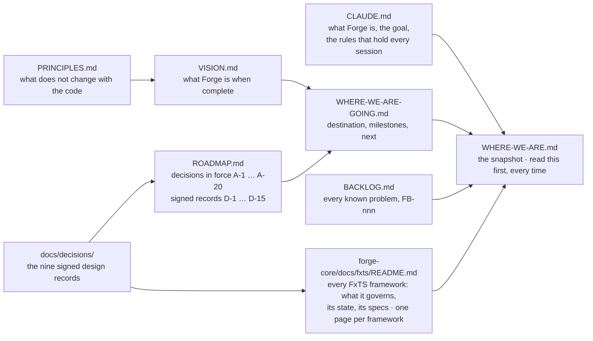

- **`CLAUDE.md`** (repository root) is what every coding agent reads first: what Forge is, why, the goal, the architecture rules and the workflow.
- **`WHERE-WE-ARE.md`** is the current state. Its "Pick-up point" paragraph says what was done last and what comes next. It changes **before every push**.
- **`ROADMAP.md`** §1 holds the decisions in force (A-1 to A-20). §5 lists the signed records (D-1 to D-15).
- **`docs/decisions/`** holds the signed design records. Each was decided by the owner one question at a time; a signed record is changed only by the owner.
- **`forge-core/docs/fxts/README.md`** is the summary of the specification frameworks: which exist, what each governs, its real state and its spec count, with a page per framework (`FACTS.md`, `FATS.md`, `FMTS.md`, `FTTS.md`, `FVTS.md`, `FHTS.md`, and the planned ones). A test keeps it true to the code.
- **`BACKLOG.md`** is the unit of work: one item per pull request; a finding is fixed or recorded, never skipped.
- **`VISION.md`** and **`PRINCIPLES.md`** change rarely: the finished product, and what does not change with the code.

| Signed record | What it decides |
|---|---|
| `roles.md` (D-1) | the role model: scoped roles, per-module roles, the hub hierarchy |
| `forge-mes-go.md` (D-3) | the Go design of forge-mes and the module layout |
| `one-clock-ot-source-time.md` (D-9) | one clock: measuring, tolerance classes, failing closed |
| `one-schema-registry.md` (D-10) | one schema registry |
| `process-control-framework.md` (D-11) | three layers of process control |
| `forge-module-requirements.md` (D-12) | what every module must do; the time contract; FMTS |
| `integration-module-builder.md` (D-13) | integration modules built on site in the designer |
| `fxts-framework-baseline.md` (D-14) | what every FxTS framework provides |
| `transport-contract.md` (D-15) | the hub-to-module transport contract |

note:
- These documents are the authority (A-12). Where guidance injected into a coding session disagrees with them, the documents win.
- A newcomer reads `CLAUDE.md` and VISION once, then `WHERE-WE-ARE.md` every time.

---

## Repository Tour

| Path | What lives there |
|---|---|
| `forge-core/src/python/forge_core` | `ContextualRecord`, decisions, adapters, manufacturing entities (ISA-95 hierarchy), the embedded MQTT broker, the context field registry, the schema-reference grammar, the clock (`clock.py`: time exchange, offsets, the gates) |
| `forge-hub/src/python/forge_hub/link` · `proto` · `proto_gen` | the gRPC hub and module sides, the proto set and the generated Python bindings |
| `forge-hub/src/python/forge_hub/ingest` | the ingest pipeline, the FACTS check at Register, receipt stamping |
| `forge-hub/src/python/forge_hub/storage` | router, factory, engines (PostgreSQL, TimescaleDB, Neo4j, Redis), access control, migrations |
| `forge-hub/src/python/forge_hub/context` · `registry` · `curation` | Context Engine, Schema Registry, curation (normalization, data products, pipeline, lineage, quality) |
| `forge-core/src/python/forge_core/fxts` | FxTS: one directory per built framework (`facts`, `fats`, `fmts`, `ftts`, `fvts`), each with `schema/`, `runners/`, `specs/`; `shared/` is the runner every framework is built on; `fhts/` is the hash framework; `fmts/conformance.py` is the conformance kit |
| `forge-hub/src/python/forge_hub/gateway` · `api` · `observer` · `cli` | auth and RBAC middleware, the hub FastAPI app, health, the `forge` CLI |
| `src/forge/modules/ot` | forge-ot: OPC-UA client, tag engine, alarming, control, MQTT, bridge, i3X, changeover |
| `forge-core/src/python/forge_core/sdk` | the module builder and the scripting SDK (`forge.*` namespace) |
| `forge-core/src/python/forge_core` | **forge-core**, the shared foundation, its own package `forge_core` since 2026-11-22 (D-17): the models and the clock, `fxts` (the frameworks), `sdk`, `adapter` (the base class and the generic adapters), `link` (a module's end of the link to a hub), `proto_gen`. Its language-neutral part is `forge-core/contract`: the proto files, every framework's schema with its released versions, and the governed lists (`forge_core.contract` says where it is; a built package and the image carry it). It imports nothing of the hub or of a module, and a test holds that (`tests/test_layer_imports.py`). The hub is its own package too, `forge_hub` in `forge-hub/src/python`; the modules are still in `src/forge` |
| `src/forge/adapters` | the Python adapters of eight modules (`forge_wms`, `forge_mes`, `forge_cmms`, `forge_nms`, `forge_ims`, `forge_historian`, `forge_scanner`, `forge_integ_erp_netsuite`), each with its manifest and config, and four empty generic packages (FB-148) |
| `forge-core/src/go/` | Go models mirroring the core models, the scaffold, generated bindings, daemon and CLI stubs |
| `modules/Forge MES` | the interim MES bridge (NestJS + Next.js), with its own `CLAUDE.md` |
| `tests/` | The modules' tests and the tests that span layers; `tests/governance/` holds the framework gates that use the hub or a module's spec. forge-core's own tests are in `forge-core/tests` and the hub's in `forge-hub/tests` |
| `docs/` | the key documents, `decisions/` (the signed records), `tutorial.md` (this deck's source). forge-core's and the hub's own documents are in `forge-core/docs` and `forge-hub/docs` |
| `deploy/docker` | the development compose stack and the hub image |

note:
- `README.md` "Project Structure" has the file-level tree. The README and the repository's About text are due a rewrite (FB-156).

---

## F1 Recap → F2

- Forge: one governed record type with context, curated into data products, every interface rendered from a spec, every contract hashed and owner-approved. A dynamic framework that each installation builds out in the designer.
- A hub and its modules; hubs in a hierarchy. Management modules are Forge's own; integration modules connect third-party products.
- Time and store and forward are on every link; the hub owns the databases.
- Today: the contract and one clock work, forge-ot runs in the hub, five specification frameworks are real and every spec is hashed. forge-display, modules in Go, scoped roles, the hub hierarchy and Kubernetes are not built. forge-display is first.
- Read `WHERE-WE-ARE.md` every time.

**Next**: what actually crosses the hub boundary.

---

<!-- SECTION F2, THE CONTRACT -->
<!-- .slide: id="f2--the-hub-spoke-contract" -->

# F2 · The Hub ↔ Spoke Contract

**Nav**: [← F1](#f1--opening) · [⇤ TOC](#table-of-contents) · [⇅ Landing fork](#landing-fork) · [F3 →](#f3--storage-and-the-hubs-databases)

One contract, `forge.v1.AdapterService`, carries everything between a module and its hub, and between a hub and the hub above it. This section covers the twelve RPCs, the one record type, the transport as it is built, what happens at Register and at Ingest, and the transport contract the owner has signed for what comes next.

A word on names: the code and the older documents say **spoke** and **adapter**; the decisions say **module**. They are the same thing: whatever registers with a hub.

note:
- Source: `docs/VISION.md` P-1, `docs/WHERE-WE-ARE.md` §3.1, `forge-core/contract/proto`, `forge-hub/src/python/forge_hub/link`, `forge-hub/src/python/forge_hub/ingest`.

---

## AdapterService · Twelve RPCs

| Group | RPC | Direction | Purpose |
|---|---|---|---|
| Lifecycle | `Register` | spoke → hub | present the manifest; the hub checks it against the spoke's FACTS spec (hash verified) before accepting |
| Lifecycle | `Configure`, `Start`, `Stop`, `Health` | hub → spoke | configure and run the adapter; report health, including clock offset |
| Push | `Ingest` | spoke → hub | stream `ContextualRecord`s; persisted and FACTS-checked |
| Pull | `Collect`, `Backfill` | hub → spoke | on-demand reads and historical ranges |
| Pull | `Subscribe`, `Unsubscribe` | hub → spoke | live streams of changes |
| Write-back | `Write` | hub → spoke | a session-bound callback into the source system |
| Discovery | `Discover` | hub → spoke | enumerate what the source exposes |

- Compiled protobuf over gRPC; JSON over gRPC is forbidden (decision A-1).
- Go and Python bindings generated from one proto set (`forge-core/contract/proto`, `forge-core/src/python/forge_core/proto_gen`, `forge-core/src/go/gen/forge`).
- A module is either hosted in the hub's process (forge-ot and the Python adapters today) or its own process in any language that speaks the proto (the interim MES bridge today; Go modules and the integration host later). Either way it reaches the hub through this service and nothing else: the hub's REST ingest route is being retired (FB-123).
- **Who starts a call matters.** Register, Health and Ingest are started by the module. Configure, Start, Stop, Collect, Backfill, Subscribe, Write and Discover are started by the hub, through a callback address the module gave at Register.

note:
- The rule "spokes never talk directly to each other" holds: every exchange goes through the hub. Spokes may publish to the Forge broker for real-time data, but the contract is the hub's.

---

## ContextualRecord · The One Record Type

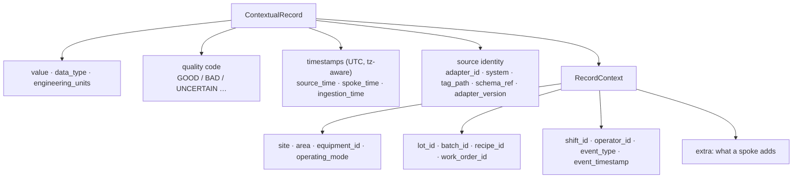

- `RecordContext` carries the context field registry slot for slot, on the proto and in Go, with every producer and the TimescaleDB table following (FB-013).
- A naive datetime or an offset-less string is rejected at the model (`forge_core.clock`, FB-014); ruff's `DTZ` rules block CI.
- The hub stamps `ingestion_time` with its own clock on receipt; the spoke states its own send time in `spoke_time`; nothing is invented (FB-087, FB-092).
- Register, Health and Ingest also carry the time exchange (FB-092): the spoke sends T1, the hub answers with T2 and T3, and the spoke measures its clock against the hub's. F9 has the whole picture.
- No record builder invents a source time either: a value without a source stamp is refused unless its connection declares `source_timestamp_origin: forge`; then Forge's read time stands in and the record says so (`source_clock`, `source_uncertainty_seconds`), and the refusal is on health, status, API and CLI (FB-088, 2026-11-13).
- Every schema reference uses one grammar, `forge://schemas/<spoke>[/<Entity>][/v<version>]`, held at every boundary (FB-008).

note:
- The context field registry (`forge-core/src/python/forge_core/registry`) and the manufacturing entity catalog (`forge-core/docs/manufacturing-entity-catalog.md`) define what each slot means, so "area" is the same thing in every spoke.
- `spoke_time` is on the wire (proto field 10) since the hub-to-spoke time exchange landed (FB-092, 2026-11-15); until then it was the hub-local `sent_time`.

---

## Transport · gRPC, TLS/mTLS, Tokens

| Property | State | Where |
|---|---|---|
| TLS / mTLS hub → spoke and spoke → hub | ✅ | FB-063, FB-072 |
| Per-spoke callback token, scoped hub endpoints | ✅ | FB-063 |
| Hub → spoke write-back over a session-bound callback | ✅ | FB-054 |
| Durable adapter registry and ingest log | ✅ | FB-060, migration 007 |
| FTTS transport spec and runner | ✅ | `forge-hub/fxts/ftts/grpc-hardened-transport.ftts.json`, hashed and approved by the owner on 2026-11-18; page `forge-core/docs/fxts/FTTS.md`. The transport contract it should become is decided and signed (D-15, `docs/decisions/transport-contract.md`): versioning, delivery, store and forward, command expiry, time-outs, security. None of that is built (FB-164) |
| Transport parity tests for the Go module | ⬜ | FB-055 |
| Hub time in the contract: the four-timestamp exchange on Register, Health and Ingest; a reporting spoke measured two-way | ✅ | FB-092 (2026-11-15) |
| A spoke outside its tolerance, or one that reports no measurement, refused at Register and Ingest | ✅ | FB-093's hub half (2026-11-17; the plant-floor links fail closed since 2026-11-15) |

Code: `forge-hub/src/python/forge_hub/link/grpc_server.py` (hub), `spoke_client.py` (spoke side), `grpc_channel.py` (retry), `proto_bridge.py` (proto ↔ model), `transport_adapter.py` (adapter base).

note:
- FTTS governs the transport; the schema and runner exist and one approved spec is in force (`forge-core/docs/fxts/FTTS.md`). That spec describes the Python implementation; the next slide but two is what the transport is to guarantee for every language.

---

## Ingest · What Happens at Register and at Ingest

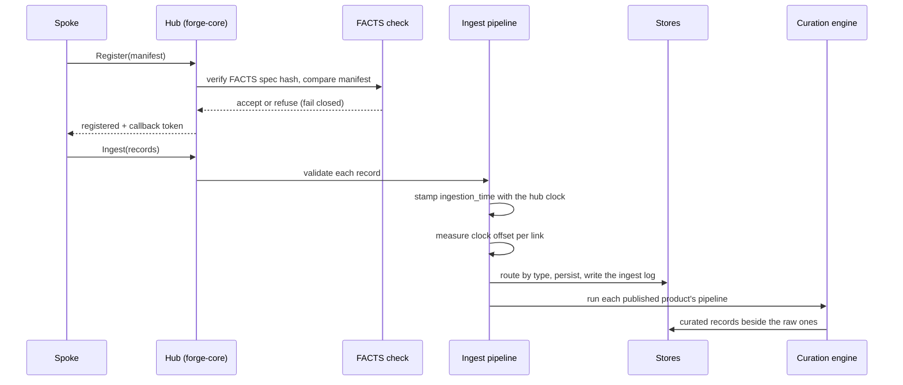

- `forge_hub.ingest.facts_check` verifies the spec's hash before trusting it; a spoke whose manifest or hash does not match is refused.
- One hub-clock reading per batch (`IngestPipeline.ingest` → `stamp_receipt`).
- Every link's clock offset is measured and exposed on `AdapterHealth.clock`, `GET /v1/ingest/stats`, the OT connection status and OpenTelemetry (`forge.clock.offset`, `forge.clock.out_of_tolerance`); a spoke that reports the time exchange is held to the class it declared (FB-089, FB-092). Enforcement is FB-093 (D-9 signed 2026-11-03: per-link tolerance classes, never silent): on the plant floor since 2026-11-15, and at the hub since 2026-11-17, where every Register, Health and Ingest request is a probe of the spoke's clock and three probes outside the class, or three with no measurement, refuse the spoke's Register and Ingest.
- Curated records are persisted with the raw ones (FB-009).

note:
- `HubIngestServicer` replaced the original in-memory servicer (FB-053); before that, records were queued and never routed.
- Push persisted and FACTS-checked at Register since FB-053; pull since FB-061 and FB-071.

---

## Pull, Backfill and Write-back

- **Collect**: the hub asks a spoke for records on demand (bounded by the spoke's declared capabilities).
- **Backfill**: historical ranges, used by historian spokes and the forge-mes `AuditLog` backfill (FB-071).
- **Subscribe / Unsubscribe**: live change streams.
- **Write**: the hub writes back into a source system through a session-bound callback; the source's own rules still apply, and in the OT module the write first passes the defense chain (F5).

Everything a spoke can do is declared in its FACTS spec (`capabilities`, `data_sources`, `error_handling`); the runner checks the declaration, and Register checks the manifest against it.

note:
- Capability declarations are the contract's vocabulary: a spoke that is `INGESTION` only cannot be written to; one that is `BIDIRECTIONAL` must handle write errors as its spec says.

---

## The Transport Contract · Signed, Not Built (D-15)

The transport above works, but it was silent on what happens when things go wrong. On 2026-11-18 the owner settled that in sixteen answers (`docs/decisions/transport-contract.md`). It is to be read before any change to `forge-core/contract/proto` or `forge-hub/src/python/forge_hub/link`.

| Records going up (the IT half) | Commands going down (the OT half) |
|---|---|
| delivered **at least once** | delivered **at most once** |
| a module resends what it is not sure arrived; the hub keeps each record id once | never resent, never queued |
| **store and forward**: buffered while the hub is unreachable, with a capacity the installation controls | **never stored**: a command carries a short expiry; a late command is refused by the module and reported as not delivered |
| replayed with original source times; everything is ordered by source time, not by arrival | whoever issued it decides again |

**What a command is** (owner, 2026-11-19): only a write to a tag in a process controller (PLC or HMI) that directly affects a process. A message down to a business system is not one. A **business write-back** (a transaction posted to an ERP, an order updated in the MES) follows the IT rule in the other direction: it carries an id, the hub keeps it while the link is down, and it is delivered and confirmed **once and only once**; a minor delay is acceptable and it does not expire as a command does. Lifecycle calls (Configure, Start, Stop, a request to collect) are neither: they are answered or failed within a deadline.

| Rule | What it means for the code |
|---|---|
| Change | Within `forge.v1` only **add** (optional fields, RPCs, enum values). Never remove, rename or reuse a field number. A breaking change is `forge.v2`, served beside v1; a hub serves two majors. |
| Agreement | At Register both sides state their contract version, optional features and the limits in force. Use only what both named. |
| Session | The session is the unit of everything, one per module id. A start of an already active module is refused and recorded as a restart event. One connection may carry several sessions (the integration host). |
| Pace | The hub sets it: a module sends the next batch after the last was acknowledged. |
| Connection | The hub manages it and sets the keepalive. A module says goodbye on a proper shutdown and has a last will for an unannounced loss. Every call has a deadline. |
| Numbers | Keepalive, deadlines, batch and buffer sizes follow the **class of data** a link carries, not the network it runs on. The classes are a governed list of parents and sub-classes (F4, "Governed Lists"); a module declares the ones it carries. |
| A full buffer | A module declares its buffer as a size range and an age range; the hub admin sets the values and picks a pruning strategy the module supports (drop-oldest by default, or by class priority). Every loss is counted; audit is never pruned. |
| A lost module | Its last will, declared in its spec, is a message and an alarm priority; the hub records it as lost with the time last heard. |
| Security | Mutual TLS in production, certificates from the credential module. |
| Errors | One catalogue: cause, meaning, and what the module must do (retry, fix, stop, wait). |
| Hubs | A hub is a module to its parent on the same contract; hub-to-hub carries reporting and history and tolerates delay. |

note:
- The owner on why commands differ: "Messaging related to OT functionality specifically command type messages require a very different set of constraints from a normal IT-type data transfer."
- None of this is in the code yet beyond what the earlier slides list as working (FB-164). It also adds to what every module must do (a stable record id, store and forward, the goodbye and last will, refusing a late command), which the owner added to the module requirements on 2026-11-19 as M-12 to M-16 (F4); every module waives the ones that bind it until this is built.

---

## F2 · Honest State

| Gap | Backlog |
|---|---|
| The signed transport contract (D-15) is not built: no versions or limits at Register, no de-duplication, no store and forward outside forge-ot, no deadlines or keepalive, no command expiry, no once-and-only-once write-back, TLS optional | FB-164 |
| Go transport parity tests | FB-055 |
| The hub's REST ingest (`POST /v1/records`) carries no time exchange and is to be retired: every module speaks to the hub over gRPC | FB-123 |
| Every module has an FMTS spec; the owner has approved eight of the nine. A conformance kit runs four of the sixteen requirements against a running module; the interim MES bridge cannot be driven by it yet, so its spec is not approved; no module ships a roles file; the bridge's time-source requirement is waived | FB-155, FB-141, FB-145 |
| The time fields stored at rest (only `source_time` is; the rest travel on the record) | FB-108 |
| Four generic adapter packages (csv_file, mqtt_sparkplug, opcua, rest_generic) are empty | FB-148 |
| The FATS specs of the hub's REST routes declare no request or response shapes | FB-162 |

**Next**: where the records land.

---

<!-- SECTION F3, STORAGE -->
<!-- .slide: id="f3--storage-and-the-hubs-databases" -->

# F3 · Storage and the Hub-Owned Databases

**Nav**: [← F2](#f2--the-hub-spoke-contract) · [⇤ TOC](#table-of-contents) · [⇅ Landing fork](#landing-fork) · [F4 →](#f4--governance-fxts)

The hub owns the databases (decision A-6). This section covers the engines, routing, the twelve migrations, Forge-issued credentials, the "observe → shadow → own" path for module data, and the two schema registries.

note:
- Source: `docs/PRINCIPLES.md` §2 and §6, `docs/WHERE-WE-ARE.md` §3.3, `forge-hub/docs/database-orchestration-framework.md`, `forge-hub/src/python/forge_hub/storage`.

---

## The Hub Owns the Databases (A-6)

| Store | Role | State |
|---|---|---|
| PostgreSQL 16 | relational: `forge_core` (adapters, ingest log, permissions, audit, registries), `forge_canonical` (data products), one `mod_<name>` schema per module | in force |
| TimescaleDB | time series: `forge_ts.contextual_records`, one column per `RecordContext` slot | in force |
| Neo4j 5 | lineage and topology | in force |
| Redis | cache and sessions | in force |
| RabbitMQ · MQTT | module events on a unified namespace of exchanges per site and area; the embedded MQTT 3.1.1 broker | in force |
| MinIO · Kafka | object store; the enterprise bus when volume requires it | in the compose stack; Kafka planned |

- Modules hold only Forge-issued credentials and never connect on their own. It is module requirement M-8, checked from each module's FMTS spec (F4).
- **Time in a database follows the time contract.** A time a module writes comes from its own governed clock or the hub's, never from the database's `now()`; the hub is to check the clocks of the databases it owns (FB-138, not built).
- A module keeps one local store of its own, and only one: the **store-and-forward buffer** the transport contract requires. It is not a database of the module's under M-8.
- Storage is polyglot by invariant: record types route to the engine that fits them; no single database serves every access pattern.
- Serving is API-first: consumers go through versioned APIs defined by FATS specs, never to a database directly.

note:
- The hub's health orchestrator probes all seven compose-stack components (`/v1/health`, `/readyz`, FB-006).

---

## Routing

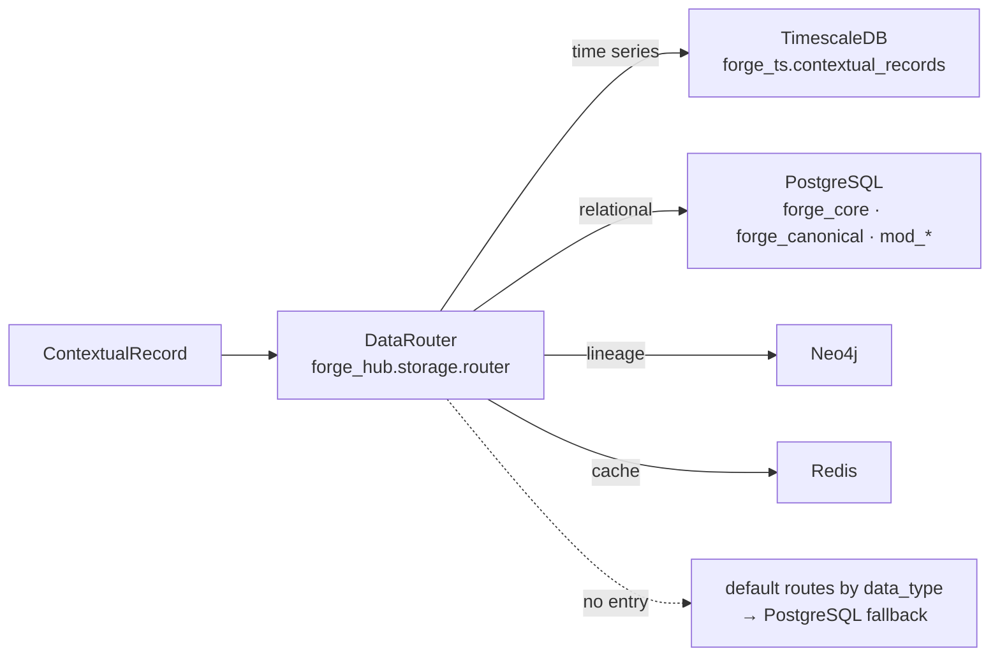

- `forge_hub.storage.factory` builds the engines from configuration; the router picks the engine per record.
- Today the routing registry is in memory and empty on every start, so routing falls through the default routes by `data_type`. That is the subject of the one-schema-registry design record (D-10, below).

note:
- `forge_hub.storage.engines.timescale` writes every `RecordContext` slot (FB-013); the migration test holds the writer's column list equal to the table's.

---

## Migrations · Twelve, and the Runner

| # | Creates |
|---|---|
| 001 | `forge_core` schema: adapters, records log, governance reports, schema entries |
| 002 | the six module schemas (`mod_wms`, `mod_mes`, `mod_erpi`, `mod_cmms`, `mod_nms`, `mod_ims`) and their roles, created `NOLOGIN` without a password (FB-099) |
| 003 | `forge_canonical` (data products) |
| 004 | TimescaleDB initialisation |
| 005 | lineage tables |
| 006 | `forge_ts.contextual_records` (the table the engine writes); its downgrade removes the schema (FB-101) |
| 007 | durable adapter registry and ingest log |
| 008 | `module_permissions` and `access_audit` (replaces two 001 tables, FB-003) |
| 009 | Schema Registry and equipment tables |
| 010 | the data product curation spec column |
| 011 | one column per `RecordContext` slot on contextual records |
| 012 | closes the placeholder login on spoke roles that 002's earlier text created, unless Forge issued the role |

```bash
forge migrate up | status | down
python -m forge_hub.storage.migrations.run up --target postgres     # the runner behind the CLI
```

- Online runs go through asyncpg on SQLAlchemy's async engine (FB-003).
- The whole downgrade runs in one transaction; head → base → head is verified clean on a throwaway TimescaleDB container (FB-098, FB-101).
- `forge-hub/tests/storage/test_migrations.py` reads the migration source and holds it to the models and the writers.

note:
- A migration is never edited after it has been applied somewhere; a repair is a new revision (012 is the pattern).
- Postgres and the time-series target share the chain; the hypertable step runs only when the timescaledb extension is present.

---

## Forge-Issued Credentials · `forge db access`

```bash
forge db access grant forge-mes mod_mes --level write
forge db access grant forge-mes forge_canonical --level read
forge db access issue forge-mes --host localhost      # prints DATABASE_URL=... once
forge db access list | revoke ...
```

- A module's schema is `mod_<service>`, derived from its id (`forge-wms` → `mod_wms`); an integration module named for its product keeps the schema of the function it serves through an explicit mapping (`forge-integ-erp-netsuite` → `mod_erpi`).
- A module role (`forge_mod_<x>`) has no way in until `issue` runs `ALTER ROLE … WITH LOGIN PASSWORD` with a password Forge generated; re-issuing rotates it.
- The password is shown once and never stored; the grant, the issue and every refusal are written to `forge_core.access_audit` (FB-003, FB-057 step 1).
- READ: usage and select, now and by default on future tables. WRITE: also insert, update, delete and sequences. ADMIN: also create on the schema (the interim MES bridge runs its own DDL through Prisma until the hub owns that DDL).
- Protected schemas (`forge_core`, `forge_canonical`, `curated`, `lineage`) cannot be granted for writing.

note:
- `PersistentAccessController` is the in-memory controller with every change written to the store the moment it is made; the storage factory and the CLI share it.
- Open: the bootstrap read grant on `forge_core` covers only the four tables that existed at 002 (FB-100, decided with FB-057 step 2).

---

## Observe → Shadow → Own

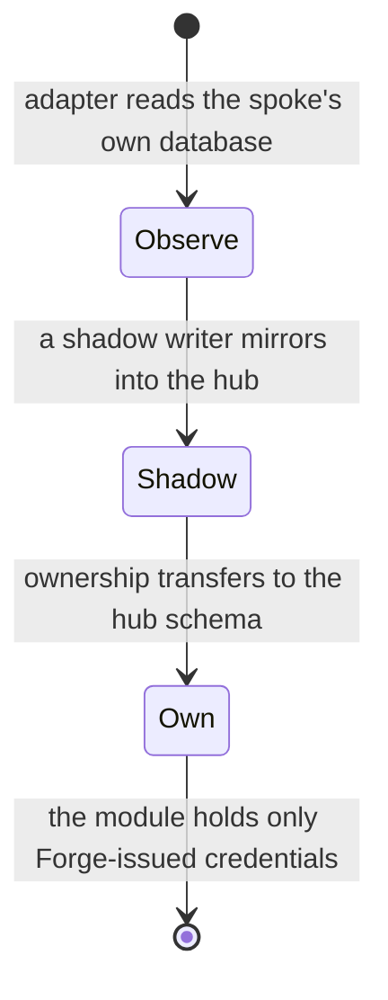

- The hybrid path from `forge-hub/docs/database-orchestration-framework.md`: adapters read spoke databases, a shadow writer mirrors into the hub, ownership transfers per module.
- Step 1 (grants and issued credentials) is delivered; steps 2–5 (the MES data into `mod_mes`) follow the forge-mes Go design, signed 2026-11-03 (FB-057, D-3).
- `forge_hub.storage.shadow` and `forge_hub.storage.backfill` are the shadow writer and the historical backfill.

note:
- "Own" is the end state for every management module: the module's schema lives in the hub's PostgreSQL and the module never carries a password it created itself.

---

## Two Schema Registries · D-10

| | F20 Schema Registry (`forge_hub.registry`) | Routing registry (`forge_hub.storage.registry`) |
|---|---|---|
| Served at | `/v1/schemas` (9 routes), Postgres tables from migration 009 | in-memory only; the `schema_entries` table from 001 is never written |
| Models | `SchemaMetadata`, `SchemaVersion`, integer versions, compatibility mode | `SchemaEntry` with engine, namespace, retention, authoritative spoke, status |
| Effect | the registry the hub exposes | empty on every start, so routing uses the default routes |

The design record `docs/decisions/one-schema-registry.md` (round 1 2026-10-26, signed 2026-11-03) folds routing into the F20 registry as a placement facet: ten proposals, eight questions answered by the owner one at a time, eight implementation steps, one PR each (FB-097, D-10).

note:
- This is the pattern for every design the owner must sign: a record with a status line, statements tagged [OWNER] / [FACT] / [PROPOSED] / [OPEN], numbered proposals and questions with proposed answers. Nobody signs on the owner's behalf.

---

## F3 · Honest State

| Gap | Backlog |
|---|---|
| `mod_mes` in the hub (MES data moves in) | FB-057 steps 2–5, in the signed forge-mes Go design's step order (D-3) |
| Backups and a restore procedure | no backlog id yet |
| The two registries converge | FB-097 (D-10) |
| Bootstrap read grant on `forge_core` partial | FB-100 |
| The hub does not check the clocks of its own databases | FB-138 |
| Credentials for third-party systems: a central credential module, forge-creds, is the owner's direction; it has no design record | FB-142 |

**Next**: the headline section, governance.

---
<!-- SECTION F4, GOVERNANCE -->
<!-- .slide: id="f4--governance-fxts" -->

# F4 · Spec-First Governance

**Nav**: [← F3](#f3--storage-and-the-hubs-databases) · [⇤ TOC](#table-of-contents) · [⇅ Landing fork](#landing-fork) · [F5 →](#f5--the-forge-ot)

The spec is the contract. This section is the headline for contributors: spec-first governance, the four layers every framework shares, the family of frameworks and their state, what every framework must provide, hashing and the owner's approval, the anatomy of a FACTS spec, what every module must do (FMTS), and how to run the gates.

note:
- Source: `docs/PRINCIPLES.md` §3, `forge-core/docs/fxts/README.md`, `forge-core/docs/facts-developer-guide.md`, `docs/WHERE-WE-ARE.md` §3.9, `forge-core/src/python/forge_core/fxts`.

---

## Spec-First, Not Test-First

- **The spec defines what must exist and how it must behave**; the implementation serves the spec; the runner enforces conformance; the CI gate blocks deviation.
- A FATS spec that says `GET /v1/data-products/{id}` returns 200 with a given shape is a **prior commitment**, not a test of an existing endpoint.
- Drift is caught by the runner; a spec change is a visible diff in review.
- A behavioural change is a spec change, and a spec change is reviewed. No specification field is silently ignored.

Rules carried over from MDEMG's UxTS and confirmed in practice:

- A spec with zero assertions **fails**; it does not pass (the "0/0 problem").
- **Parity**: schema fields the runner does not enforce are reported, never ignored; a single unimplemented field is a hard fail.
- Runners produce structured verdicts with check IDs, spec references, violation details and timing, not bare pass/fail.

note:
- Lineage: FxTS is adapted from MDEMG's UxTS framework family. The same governed-memory tooling (MDEMG/Jiminy) watches over the agents working on this repository (F10).

---

## The Four Layers

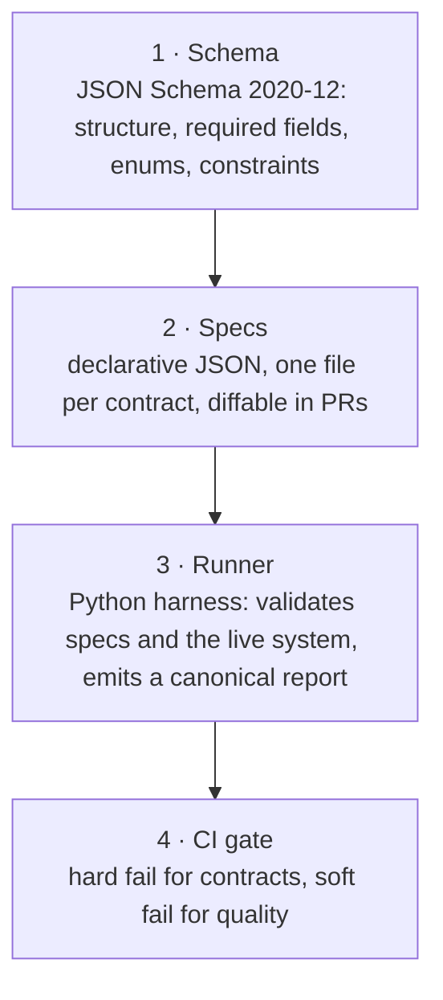

| Layer | Where |
|---|---|
| Schemas | `forge-core/src/python/forge_core/fxts/<framework>/schema/*.schema.json` |
| Specs | `forge-core/src/python/forge_core/fxts/<framework>/specs/*.json` (FACTS: nine, one per spoke) |
| Runners | `forge-core/src/python/forge_core/fxts/<framework>/runners/`, over the shared runner in `forge_core.fxts.shared.runner` (hashing, verification, approval) |
| Gate | the `hub-python` CI job runs the governance tests; `forge governance run` is the operator's path |

note:
- Hard fail blocks merges; soft fail warns. No framework is advisory-only.

---

## The Family

| Framework | Governs | State (2026-11-19) |
|---|---|---|
| **FACTS** · Forge Adapter Conformance Test Specification | a module's data contract: identity, capabilities, lifecycle, connection, data sources, context mapping, error handling, time governance | schema + runner + 9 specs, all approved |
| **FATS** · Forge API Test Specification | the hub's REST routes: route, method, authentication, status, errors, rate limit | schema + runner + 28 specs, one per served route, all approved; thin (FB-162) |
| **FTTS** · Forge Transport Test Specification | the hub-to-module transport | schema + runner + 1 spec, approved; the signed transport contract is not built (FB-164) |
| **FVTS** · Forge View Test Specification | module ↔ forge-display: points, objects (collections with a schema), alarms, actions, surfaces, profiles | schema 0.2.0 + runner + reference renderer + golden messages + 2 specs: the hub's own (approved) and the plant-floor reference (awaiting approval, FB-078) |
| **FMTS** · Forge Module Test Specification | what every module must do: sixteen requirements, the time contract, waivers | schema + runner + conformance kit + 9 specs, 8 approved |
| **FUTS** · Forge UI Test Specification | what a screen is made of: widget specs and view documents (laid-out screens) | schema 0.2.0 + runner + 17 specs (twelve widgets, the hub's four standard screens, one reference view), all approved; nothing renders them yet (FB-181) |
| **FHTS** · Forge Hash Test Specification | the hash and owner approval of every spec above | hashing, verification, approval, revert, registry |
| FQTS · FSTS · FDTS · FLTS · FNTS · FOTS · FPTS | data quality · security · schema evolution · lineage · normalization · observability · performance | planned: a documentation page each, nothing in the code |

Governance is declarative by invariant: quality, lineage, normalization and security rules are specifications, not code paths.

**Every highly repeatable process has an FxTS spec and is built to it** (A-13). When something that will be done more than once is about to be built and no framework fits, that is a finding for `BACKLOG.md`, not a reason to invent an informal format.

note:
- `forge-core/docs/fxts/README.md` is the summary of this table with a page per framework; a test keeps it true to the code.
- Every FACTS spec validates. forge-ot's is written against schema 0.2.0, which added the words an OT adapter needs (FB-079, D-8).

---

## What Every Framework Provides (D-14)

A framework is either **planned** (a page that says so; no code, no specs) or it meets all ten. Nothing in between. `docs/decisions/fxts-framework-baseline.md`, signed 2026-11-18.

| # | Requirement | Today |
|---|---|---|
| F-1 | A stated purpose: which repeatable work it standardizes | ✅ |
| F-2 | A versioned schema, every released version kept, each with a hash the owner approves | ✅ |
| F-3 | A runner that enforces every schema field | ✅ |
| F-4 | Every spec carries a hash; a run fails when it does not verify or is not approved | ✅ |
| F-5 | Every spec lives in the framework's `specs/` directory and is listed | ✅ |
| F-6 | A blocking CI gate that names each failure it allows, with its backlog item | ✅ |
| F-7 | A check that was not run is reported as not run, never as passed | ✅ |
| F-8 | A documentation page and a summary row stating the real state | ✅ |
| F-9 | `forge governance run`, `stamp`, `approve`, `validate-spec` work for it | ✅ |
| F-10 | Each spec records the schema version and hash it was approved against | ✅ |

`tests/governance/test_framework_baseline.py` walks every framework against these on every run. Its list of allowed gaps is empty since 2026-11-19.

**Changing a schema** is a release, never an edit in place: edit `<framework>.schema.json`, raise the version in its `$id`, run `forge governance schema-release <framework> --summary "..."`, and the owner approves the new version's hash. `forge governance schemas` lists every version; `schema-diff` shows what changed and the step each change needs; `migrate-spec` moves a spec forward. A schema edited without a release fails the suite.

note:
- Why it exists: so that building FxTS specs does not generate excessive technical debt, by ensuring these core purposes are met with each new instantiation of an FxTS spec.
- Schema rules decided with it: within a major version a schema only gains; patch is wording, minor adds something optional, major adds a required field or removes or narrows anything and marks every spec for review. The owner approves each schema hash. The code is `forge-core/contract/fxts/shared/schemas.py`; the page is `forge-core/docs/fxts/FHTS.md`, "Schema Versions".
- Every run now gives three verdicts for a spec's standing: `hash-verified`, `hash-approved` and `schema-current`.

---

## FHTS · Hashing and the Owner Approval

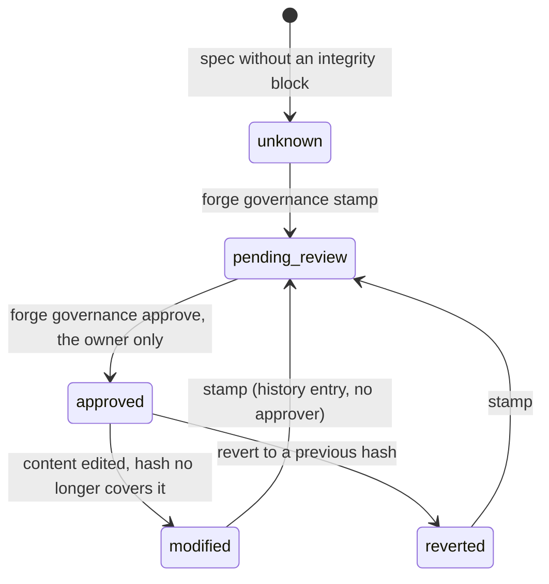

- Every governed spec carries an `integrity` block: `spec_hash`, `hash_state`, `previous_hash`, `approved_by`, `approved_at`, `change_history` naming who or what changed it.
- The content hash **excludes the whole `integrity` block** (a history entry refers to the hash itself); canonical JSON uses sorted keys, compact separators and ASCII escaping, so the digest is portable.
- **A spec is also tied to its schema.** Its integrity block records the schema version and hash it was approved against, and `<framework>:schema-current` fails when that schema version is not approved, has changed, or is a major step behind.
- **A bad hash fails the run, in every framework.** The shared runner gives two verdicts for every spec: `<framework>:hash-verified` fails when the content no longer matches the recorded hash, and `<framework>:hash-approved` when the owner has not approved it. A spec with no hash fails both.
- **Only the owner approves** a spec hash. Agents re-stamp to `pending_review` and never approve on the owner's behalf. `approve` is refused when the hash no longer covers the content.
- The hub's Register check verifies a spoke's FACTS hash before accepting the spoke.

note:
- Problem P-7: the more AI assistance a team uses, the larger the risk of a silently relaxed timeout or dropped required field. Hashing makes the change visible in the spec's own history and fails CI until the owner approves it.

---

## A FACTS Spec, Anatomically

| Block | Declares |
|---|---|
| `adapter_identity` | id, name, version, tier (`OT`, `MES_MOM`, `ERP_BUSINESS`, `HISTORIAN`, `DOCUMENT`), type (`INGESTION`, `BIDIRECTIONAL`, `WRITE_ONLY`, `DISCOVERY_ONLY`) |
| `capabilities` | what the spoke can do: ingest, collect, backfill, subscribe, write, discover |
| `connection` | parameters, protocols, timeouts, retry policy |
| `data_sources` | each source the spoke reads or writes (GraphQL, REST, RabbitMQ, MQTT, gRPC, database, WebSocket …), with its schema reference |
| `context_mapping` | source field → Forge context field, and the enrichment rules the hub applies |
| `error_handling` | dead-letter policy, retry classes, what is fatal |
| `time_governance` | how the spoke is time-governed (one clock, FB-090): time source, sync protocol, clock-read method, probe cadence, which clock stamps its values, tolerance class, `fail_closed: true`, per-connection entries; required, checked by the blocking `facts:time-governed` |
| `sample_records` | records the runner validates against the data contract |
| `integrity` | the FHTS block |

- Nine specs today, one per module: forge-wms (the reference), forge-mes, forge-ims, forge-cmms, forge-nms, forge-historian, forge-scanner, forge-integ-erp-netsuite, forge-ot.
- The runner validates every spec against the JSON schema first (`facts:schema-valid`) and reads its enums from the schema (FB-080).
- The developer guide, `forge-core/docs/facts-developer-guide.md`, walks the schema, how to write a spec, running the runner, common failures and cross-spoke consistency.

note:
- Adapter tiers and what they mean: `docs/PRINCIPLES.md` §5. The OT tier's words entered FACTS with schema 0.2.0 (D-8, FB-079): a word only for a new meaning.

---

## FMTS · What Every Module Must Do (D-12)

FACTS says what a module's data looks like. FMTS says what a module must do before a hub admits it. `docs/decisions/forge-module-requirements.md`, signed 2026-11-17 and amended 2026-11-19; one spec per module, `<module>.fmts.json`.

| # | Requirement | Checked |
|---|---|---|
| M-1 | Speaks `forge.v1.AdapterService` to the hub over gRPC and nothing else | from the repository |
| M-2 | Has an approved FACTS spec, and its manifest matches it | from the repository |
| M-3 | Declares a **time contract** for every counterpart: its hub, each database, each plant-floor device, each third-party system | from the repository |
| M-4 | Implements the time exchange and reports its measurement | by the conformance kit |
| M-5 | Fails closed on a bad clock or a hub refusal, with the cause on its health | by the conformance kit |
| M-6 | Stamps UTC and never invents a source time | by the conformance kit |
| M-7 | Reports health, with refusals by cause | by the conformance kit |
| M-8 | Holds only Forge-issued credentials and owns no database connection | from the repository |
| M-9 | Ships no user interface code; describes its screens in FVTS specs | from the repository |
| M-10 | Declares its roles and scopes | from the repository |
| M-11 | Is built from the module SDK template for its language | from the repository |
| M-12 | Gives every record a stable record id | not yet: needs the transport contract (FB-164) |
| M-13 | Stores and forwards what it cannot deliver, with a declared capacity | not yet (FB-164) |
| M-14 | Says goodbye on a proper shutdown and declares a last will | not yet (FB-164) |
| M-15 | Refuses a command that arrives after its expiry; only for a module that declares process-control writes | not yet (FB-164); the declaration is checked now |
| M-16 | Applies each business write-back once by its id and confirms it; only for a module that declares it takes them | not yet (FB-164); the declaration is checked now |

- **The conformance kit** (`forge-hub/src/python/forge_hub/conformance.py`) runs the real hub on clocks it controls, puts the module's clock 5 s out, and checks that the hub refuses the module, that nothing is delivered, that the module's own health says why, and that it is readmitted when the clock is put right. The kit belongs to the hub and is handed to the runner; a runner handed none reports these checks as not run.
- **A waiver** is a requirement a module cannot meet yet, written in its spec with the reason and the backlog item that removes it. The owner approves it through the spec's hash; every run names it; it expires when its backlog item is closed. Three requirements are waived only with admin privileges: the two for time keeping (M-3, M-4) and refusing a late command (M-15).
- **A check that could not run is reported as `NOT CHECKED`**, never as passed.

| Module | Kind | Approved | Waived |
|---|---|---|---|
| forge-wms, forge-cmms, forge-nms, forge-ims, forge-historian | management | yes | M-10 (no roles file exists yet); M-12 to M-14 |
| forge-scanner | management | yes | M-3 (no clock reader for handheld devices), M-10; M-12 to M-14 |
| forge-integ-erp-netsuite | integration | yes | M-10; M-12 to M-14 |
| forge-ot | ot | yes | M-10, M-11; M-12 to M-15 (it writes to process controllers) |
| forge-mes (the interim bridge) | management | no: the kit cannot drive a TypeScript process yet | M-3, M-8, M-9, M-10, M-11; M-12 to M-14 and M-16 (it takes business write-backs) |

note:
- Driving forge-ot with the kit found four defects that its own tests, which use stand-ins for the tag registry, had hidden: a collect that could not run on the real registry, subscriptions that never fired, and a schema reference that would have made the hub refuse its registration and every record. That is what the kit is for.
- The hub does not yet demand an approved FMTS spec at Register (FB-140). M-12 to M-16 were added on 2026-11-19 from the transport contract; nothing can check them against a running module until that contract is built (FB-164).

---

## Governed Lists · Values That Can Grow

Some fields take a value from a list that must be able to grow: a new module function, a new protocol, a new data class. If the list lived in the schema, every new entry would be a new schema version. So five lists live outside it (owner, 2026-11-19 and 20).

| List | A spec uses it for | Entries today |
|---|---|---|
| Module functions | what service a module performs | mes, wms, cmms, erp, nms, ims, historian, scanner, ot, display, creds, mpc, qms, lims |
| Application-side protocols | how an integration module reaches its application | rest, graphql, mqtt, opc-ua, sql, amqp, file |
| Data classes | what a module carries on its link | thirteen parents (next table) |
| Pruning strategies | what a module does when its buffer is full | drop-oldest (the default), by-class-priority |
| Container kinds | how a container of a screen arranges its children | fixed, reflow, switch |

- Each list is a file in `forge-core/contract/lists/`, **hashed and approved by the owner like a spec**. `forge governance specs` shows it; `stamp` and `approve` work on it.
- The schema says only "an entry of the list"; the runner checks it. A list that does not verify, or that the owner has not approved, fails every module spec.
- **To add an entry**: edit the list, stamp it, and the owner approves it. No schema version, no spec touched.

**Data classes are parents and sub-classes.** A class is named `parent` or `parent.child`. A parent has exactly one rule; a sub-class inherits it and may only tighten its numbers, so a hub that knows only the parents still handles a new sub-class safely.

| Going up | Rule | Going down | Rule |
|---|---|---|---|
| raw | at least once, stored and forwarded | control | a command: at most once, never stored, expires |
| curated | at least once, relaxed | write-back | once and only once, kept while a link is down |
| historical | at least once, slow, may be scheduled | config | the newest wins, kept until delivered |
| alarm | at least once, tighter than raw | security | highest priority, never stored in clear, never replayed |
| audit | at least once, never pruned | **Both ways** | |
| status | health, goodbye, last will; not buffered | request | answered within a deadline, never stored |
| live | the latest wins, never stored | artifact | in pieces, resumable, verified by hash |

note:
- Whether a class travels module to hub, hub to module or hub to hub is an attribute of the class, not a class of its own. `control` travels hub to module only.
- The numbers of each class (keepalive, deadlines, batch, buffer, expiry) are settled when the transport contract is built (FB-164). The code is `forge-core/src/python/forge_core/fxts/shared/lists.py`.

---

## Running the Gates

```bash
forge governance specs                       # every spec's hash state, approver, hash still verifies?
forge governance specs --pending             # what awaits the owner
forge archive list                           # what was retired from the tree, and where its last version is
forge archive show <id>                      # read a retired file from the history
scripts/tla/tlc.sh <Model.tla>               # the TLA+ model checker, pinned by checksum, fetched on first use
uv run pytest tests/modules/ot/control/test_review_gate_exhaustive.py -q    # the write review gate: every sequence and interleaving in a bound
uv run pytest tests/modules/ot/alarming/test_state_machine_exhaustive.py -q # the alarm state machine: every configuration, no bound
forge governance validate-spec <spec.json>   # against the schema version it declares
forge governance schemas                     # every schema version, its step, hash and approval
forge governance index                       # rewrite the generated indexes (forge-core/fxts, forge-hub/fxts); --check fails when one is stale
forge governance run facts forge-wms           # one framework, one spec; exit 1 on any failure
forge governance stamp <spec.json>           # after an edit: history entry, pending_review, no approver
forge governance approve <spec.json> --by reh3376   # the owner, on their own word, never on their behalf
```

- `run` covers FATS, FACTS, FVTS, FTTS and FMTS (FB-021, FB-083, FB-135), and lists every check it skipped: a waived or unverified requirement is never shown as passed.
- Every gate names the failures it allows, each with its backlog item (`ALLOWED_FAILURES` in the gate tests). A spec the owner has approved is allowed none.
- The hub test suite holds FATS in both directions: every served route has a spec, every spec names a served route.
- The FVTS runner has a render-profile baseline and golden messages; a module can only tighten the baseline, never loosen it.

note:
- A new hub route comes with a FATS spec; a new module comes with its FACTS and FMTS specs; when a module exposes a screen it adds an FVTS spec; a new widget gets a FUTS widget spec and a standard screen is a FUTS view document. The gate is where a forgotten one is found.
- After any edit a spec is stamped (`stamp`). It then awaits the owner. Nobody else writes an approval.

---

## F4 · Honest State

| Gap | Backlog / decision |
|---|---|
| The time contract is declared by every module and checked for form; nothing reads the clocks of databases or third-party systems yet | FB-138, FB-139 (with FB-117 and FB-120) |
| The JSON documents outside FxTS (adapter manifests, the OT control configuration, the golden-message sets) carry no schema version | FB-171 |
| The FATS specs declare no request or response shapes | FB-162 |
| The hub does not demand an approved FMTS spec at Register; the scaffold does not generate one | FB-140 |
| No module ships a roles file, and the roles file has no FxTS spec of its own | FB-141 |
| The conformance kit cannot drive a module in another process or language | FB-155 |
| Two specs await the owner's approval: `forge-mes.fmts.json`, `forge-ot.fvts.json` | FB-155, FB-078 |
| The OT reference FVTS spec uses invented points and is `pending_review` | FB-078 |

**Next**: the module that reaches the plant floor.

---

<!-- SECTION F5, OT MODULE -->
<!-- .slide: id="f5--the-forge-ot" -->

# F5 · The Plant-Floor Module (forge-ot)

**Nav**: [← F4](#f4--governance-fxts) · [⇤ TOC](#table-of-contents) · [⇅ Landing fork](#landing-fork) · [F6 →](#f6--modules-the-sdk-and-forge-display)

forge-ot is the most mature module: the one that talks to PLCs and OPC UA servers. Its module id is `forge-ot` everywhere since 2026-11-18 (it had carried three different ids). This section covers the tag engine, ISA-18.2 alarming, the control-write defense chain, the MES changeover, the scripting SDK, the Ignition bridge, the one-clock principle, and the three-layer process control framework the owner decided on 2026-11-13 (D-11).

note:
- Source: `docs/VISION.md` P-4 and P-6, `docs/WHERE-WE-ARE.md` §3.5, `README.md` "OT Module", `src/forge/modules/ot`, `docs/PRINCIPLES.md` §2 (one clock), `docs/decisions/process-control-framework.md` (D-11).

---

## What It Is

- A **thin, open wrapper over OPC-UA**: asyncua owns the wire protocol (pinned `==2.1.0`, FB-085); Forge owns tags, alarms, writes, scripting and history.
- Hosted **inside the hub** with PLC connections, supervision and liveness (`forge.modules.ot.host`, FB-069, FB-070).
- It is held to the module requirements like any module: its FMTS spec is approved, and the conformance kit drives it on a real tag registry through `src/forge/modules/ot/conformance.py`.
- Replaces the vendor SCADA/HMI layer (Ignition) problem by problem: tag engine, alarming, scripting SDK, i3X-shaped REST, MQTT; where a site keeps its vendor product, the **Ignition bridge** runs a read-only parallel validation.
- HMI/SCADA itself is an optional module activated per site (decision A-4); forge-display renders the surfaces (A-3).

| Subsystem | Package |
|---|---|
| OPC-UA client, path normalisation (OPC-UA ↔ Ignition ↔ Forge) | `opcua_client` |
| Tag engine: definitions, registry, UDT templates, persistence, eight provider types | `tag_engine` |
| ISA-18.2 alarming: state machine, detector, engine, integrations, API | `alarming` |
| Control writes: validation, review, interlocks, authorization, write engine, audit, recipe integration | `control` |
| MQTT: publisher, subscriber, tag publisher, topic router, Sparkplug B, rate limiter | `mqtt` |
| Ignition bridge: adapter, REST client, tag mapper, dual-write validator, health dashboard | `bridge` |
| i3X (CESMII) models and router; context resolvers; the store-and-forward buffer (SQLite); acquisition | `i3x`, `context`, `acquisition` |

note:
- Phases 1–6 of the OT plan are complete (`README.md` "Phase Summary"); phase numbering history is in `docs/ROADMAP.md` §7.
- forge-ot is the only module with a store-and-forward buffer today. The transport contract makes one part of every module (F2), provided by the SDK.

---

## Tags and Providers

| Provider | Serves |
|---|---|
| `opcua_provider` | direct OPC-UA reads |
| `acquisition` | scheduled polling |
| `memory_provider` | in-memory tags |
| `expression_provider` | calculated tags |
| `query_provider` | SQL-driven tags |
| `virtual_provider` | virtual and derived tags |
| `event_provider` | event-driven tags |
| `base` | the provider protocol |

- `TagDefinition`, `TagValue`, `QualityCode`, `DataType` are the models; every value carries quality.
- Context resolvers attach site, area, equipment, lot, shift and mode to OT records; the batch context resolver wired to MES is open (FB-020).

note:
- The OT module's `DataValue` and `TagValue` still coerce a naive datetime to UTC because OPC UA `DateTime` is UTC by definition; the source-time correction landed with FB-088 and FB-094 on 2026-11-13 (below).

---

## Alarms · ISA-18.2

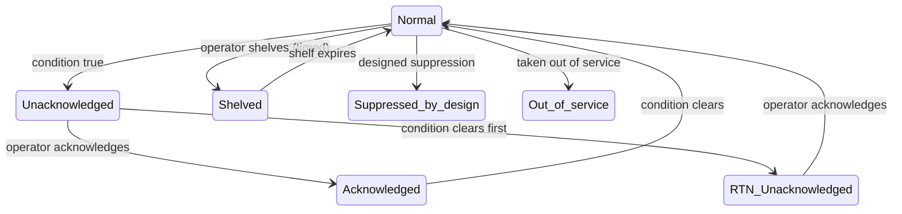

- Seven-state ISA-18.2 machine, nine alarm types (HI, HIHI, LO, LOLO, digital, rate-of-change, quality, communication, custom).
- Event-sourced journal; REST under `/alarms` (active, history, config, ack, shelve).
- Integrations: MQTT publish, RabbitMQ fan-out, CMMS auto work orders.

note:
- Alarm presentation (annunciation, priority colours, staleness) is forge-display's job from the FVTS spec, not the module's.

---

## Control Writes · The Defense Chain (A-7)

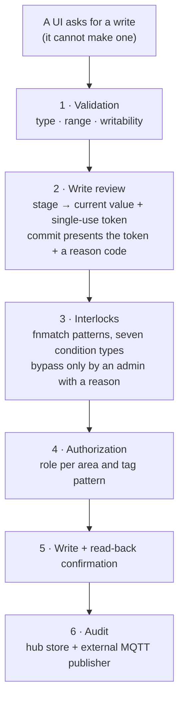

- Safety stays in the core: roles, interlocks, confirmation, read-back and audit are enforced in forge-core/OT, never only in a UI.
- A write to a controller tag is a **command**, the only thing the transport contract calls one, and commands follow its OT half (F2): delivered at most once, never stored or queued, with an expiry. forge-ot declares process-control writes in its module spec, so requirement M-15 (refuse a command past its expiry) binds it. A write that could not be delivered at once is reported, and the person or logic that issued it decides again. Expiry is decided (D-15) and not built.
- Server-side two-step review with reason codes and `REJECTED_REVIEW` since FB-074; multi-party approval follows the role model (D-1, signed 2026-11-03; FB-075).
- The audit record goes to the hub store and to an external publisher (FB-066, FB-067).
- The FVTS contract binds every UI action to a required role, a confirmation mode and the statuses it must handle; the user's role decides whether a write is allowed, on any render profile (owner, 2026-11-19; a site may switch writes off for a profile).

note:
- "Solved when": no path exists from any interface to a PLC that does not pass the chain, and every write is reconstructible from the audit log (`docs/VISION.md` P-6).

---

## The MES Changeover

- The orchestrator runs the changeover sequence against the PLC through the **CIP runner**, with recipe integration turning an MES recipe into batched PLC writes through the defense chain (FB-062, FB-065).
- REST endpoints for confirm-start, retry-recipe, resume and connection restart sit behind the hub's `adapters:write` scope; the hub user is the actor on the MES write, the audit record and the events (FB-082).

| Capability | State |
|---|---|
| Orchestrator, CIP runner, recipe integration, REST | ✅ |
| Endpoints behind a hub scope | ✅ FB-082 |
| Batch context resolver wired to MES | ⬜ FB-020 |

note:
- The interim MES bridge is the counterpart today; the Go forge-mes module takes over the changeover and MQTT in M3 (phases 2–3 of FB-076).

---

## The Scripting SDK · `forge.*` Replaces `system.*`

| Module | Replaces | Key functions |
|---|---|---|
| `forge.tag` | `system.tag.*` | `read`, `write`, `browse`, `get_config`, `exists` |
| `forge.db` | `system.db.*` | `query`, `named_query`, `transaction`, `scalar` |
| `forge.net` | `system.net.*` | `http_get`, `http_post`, `http_put`, `http_delete` |
| `forge.alarm` | `system.alarm.*` | `get_active`, `ack`, `trigger`, `shelve`, `get_history` |
| `forge.log` · `forge.date` · `forge.dataset` | `system.util.getLogger`, `system.date.*`, `system.dataset.*` | logging, date handling with Java → Python pattern conversion, tabular data |
| `forge.perspective` · `forge.file` · `forge.util` · `forge.security` | `system.perspective.*`, `system.file.*`, `system.util.*`, `system.security.*` | UI interaction, sandboxed files, JSON and messaging, user and role queries |

- Python 3.12+ engine replacing Jython 2.7: discovery, loading, hot reload; a PEP 302 import allow-list sandbox; `@timer`, `@on_tag_change`, `@api.route` triggers; area and tag-pattern RBAC; an append-only audit ring buffer.
- The migration map covers all 52 `system.*` calls; 42 Tier 1 scripts are identified for conversion (`docs/p7-forge-ot/`).

note:
- The SDK lives in `forge-core/src/python/forge_core/sdk/scripting`; the OT module's user scripts in `src/forge/modules/ot/scripts`.

---

## One Clock, Governed by the Hub

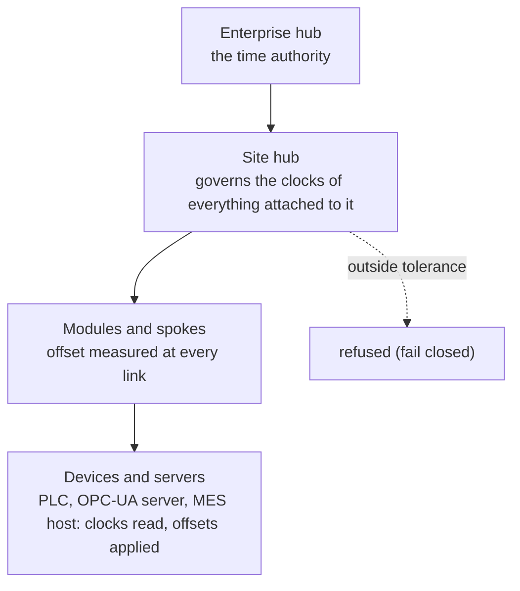

The owner's principle (2026-10-18): records from different sources only reconcile if their timestamps come from the same master time. This slide is the plant-floor view; F9 covers one clock across the whole platform.

| Rule | State |
|---|---|
| Every stored timestamp is UTC and timezone-aware; naive rejected at the model | ✅ FB-014 |
| The hub stamps receipt with its own clock | ✅ FB-087 |
| The offset of every connected clock is measured, recorded and surfaced | ✅ FB-089 (provisional 1 s tolerance, warning only) |
| A tag's `source_time` is device time corrected to master by the device's measured offset, original stamp and offset recorded | 🟡 FB-088 done 2026-11-13 (no invented stamp; the stamping clock named once declared); FB-094 steps 2 and 3 done 2026-11-13 (the server's clock is read on every OPC-UA response and on a runtime probe cadence, and the source and server stamps are corrected by its filtered offset at the spoke, the stamp as sent, the offset and the time quality kept); step 6 done too (every tag declares `max_sampling_uncertainty_ms`, refused at load when the acquisition cannot meet it; the bound is on every value), so FB-094 is complete for what the tree has; FB-090 done 2026-11-13 (the FACTS declaration); design record `docs/decisions/one-clock-ot-source-time.md` signed 2026-11-03 |
| A PLC connection whose clock cannot be read, or is outside its tolerance class, for three consecutive probes stops delivering (`CLOCK_UNREADABLE`, `CLOCK_OUT_OF_TOLERANCE`); three good probes resume it; never silent | ✅ FB-093, the OT links (2026-11-15) |
| Hub time in the contract: every spoke takes time from its hub and is measured two-way | ✅ FB-092 (2026-11-15) |
| A spoke outside tolerance, or one that reports no measurement, is refused by its hub | ✅ FB-093's hub half (2026-11-17); hub to hub is FB-118 |
| Per-spoke declaration of time governance; a quality dimension for time | 🟡 FB-090 done 2026-11-13 (FACTS `time_governance`: clock origin, probe cadence, tolerance class, fail closed); FB-091 (the quality dimension and the offset assumed on an offset-less stamp) |

note:
- The OPC-UA converter stores `SourceTimestamp` as the server sends it and, since FB-088 (2026-11-13), invents nothing when it is absent: the value is refused unless the connection declares origin `forge`. Since FB-094 steps 2 and 3 (2026-11-13) the server's clock is read on every response and on the probe cadence, keyed by the clock measured, and each stamp is corrected by that clock's filtered offset where it enters, the stamp as sent and the offset kept on the record. That row is marked 🟡 deliberately: the principle says a device whose clock cannot be read is not a valid source.
- D-9 chooses among established standards: NTP/chrony strata mirroring the hub hierarchy, PTP/IEEE 1588 on the plant network, NTP four-timestamp measurement in-band, IEC 61850-5 tolerance classes, IEC 61850 `TimeQuality` and OPC UA `DataValue` fields on the record.
- The deployment requirement (the NTP/PTP chain from the top hub, the tolerance classes, what fails closed, a new-site checklist) is `forge-hub/docs/clock-discipline.md` (FB-090).

---

## Three Layers of Control · PC-L1 / PC-L2 / PC-L3 (D-11)

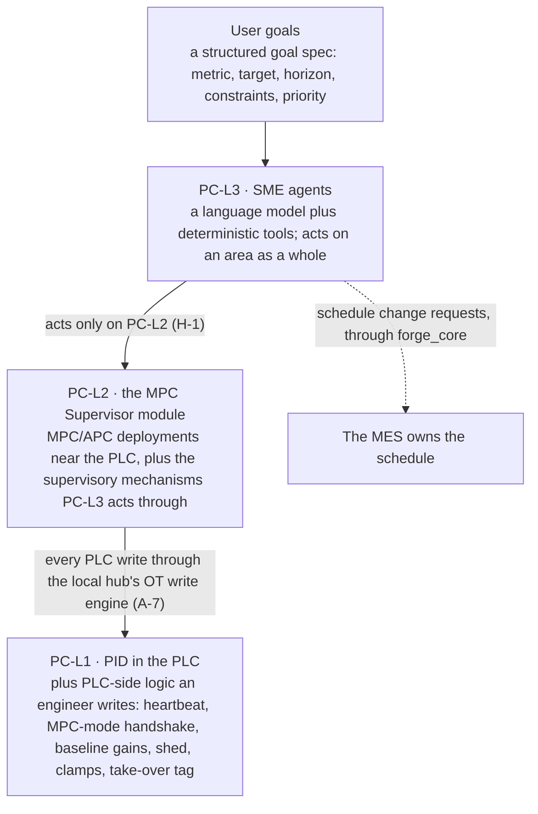

- **New, not the classic control hierarchy** (owner, F-2): portions of layers 1 and 2 have run in industry for years; the whole, with PC-L3 and the autonomy model, has not. The distillery's seven batch processes are an example only; the framework is for every industry Forge serves (F-6).
- **One vocabulary for PID and MPC**: PV (the variable controlled), SP (its target), MV (what the controller moves), DV (a disturbance); "CV" is retired because it means two different things (V-1 to V-4). Logix `PIDE.CV` maps to MV at the PLC boundary.
- **PC-L2's two goals**: consistent control of a complex loop, and predicting disturbances to act before they manifest (F-3); it improves its own model and tuning (F-4) under the autonomy model on the next slide.
- **Strict adjacency** (H-1): PC-L3 reaches PC-L1 only through PC-L2; if PC-L2 is offline, PC-L3 writes recommendation logs only (H-8).

note:
- Source: `docs/decisions/process-control-framework.md` §1, §2.1 and §2.2, with the companion context in `docs/decisions/process-control-framework-context.md`. The layers are named PC-L1/2/3 so they cannot be confused with the reference architecture's L1–L5 or with ISA-95 levels (V-5).

---

## What Never Changes, and How Autonomy Is Earned

| # | Hard invariant (no setting, rollout profile or earned autonomy relaxes it) |
|---|---|
| H-1 | each layer affects only the layer directly below it |
| H-2 | no PLC code is generated or edited on a PLC; recommendations only, an engineer writes the logic |
| H-3 · H-4 | no layer writes to safety systems; none forces, bypasses or overrides an interlock or permissive |
| H-5 | PLC-side clamps range- and rate-check every value PC-L2 writes |
| H-6 | the operator can always take a loop out of MPC mode, immediately, from the plant's own HMI (UI-1) |
| H-8 | PC-L2 offline: PC-L3 knows it, cannot effect change, writes recommendation logs only |

- Every PC-L2 self-improvement category (model parameters, tuning, model structure, operating limits) and every PC-L3 action type (targets; limits and priorities; controller configuration; schedule requests) is **Off**, **Propose** or **Autonomous**; everything ships **Off** (AU-1, L2-10, L3-4).
- Autonomy is **earned per category**: four confidence signals (prediction accuracy, the outcome of promoted changes, the human agreement rate, shadow-run performance), each over its own threshold, for a duration and a minimum number of evaluated events; the framework ships no values, a user enters them; a person grants the switch by default; revocation is automatic (AU-3 to AU-9).
- Changes are versioned and validated by a backtest plus a shadow run; rollback is a default an administrator may adjust, and without it a category is Propose at most (AU-10 to AU-16). Shed: heartbeat bad, and the PID resumes in auto at the last SP with the baseline gains stored in the PLC (L2-5).
- Permissions reuse Forge's model: a service identity per controller with `ot:tag:write` on its own tags, never `ot:interlock:bypass` (L2-13).

note:
- Record §2.2, §2.3 and §2.5; the autonomy model is one mechanism for both layers (L3-5), built and audited once.

---

## Process Control · Where It Stands

| Item | State |
|---|---|
| Decision record signed by the owner (rounds 1 to 3, Q-1 to Q-50) | ✅ 2026-11-13 (D-11, the owner's PR 93) |
| Forge review of the tree for O-2 to O-4 (write path, scopes, loop model, schemas, FVTS, one clock) | ✅ 2026-11-13, record §4a; FB-112 recorded |
| Framework FSD, then PC-L1, PC-L2 and PC-L3 FSDs; an FxTS spec per contract before code | ⬜ FB-110, after the owner's round-4 answers (nine questions: the FSDs' home and format, the module's language O-2, the mapping O-3, a `CONTROLLER` write origin, the PLC contract's home, batch phase as a context field, a one-clock refusal as a shed event, publication before the prior-art search, a provenance line) |
| The MPC Supervisor module (all of PC-L2; a new build to the SDK) | ⬜ language decided after the review (O-2) |
| Controller write path: a `CONTROLLER` origin, a cycle write, a heartbeat class, write timing on the status | ⬜ FB-112, designed in the PC-L2 FSD |
| PC-L3 agent topology | [OPEN] O-1; the FSD notes it undecided |
| Prior-art search on the framework's novelty | ⬜ FB-111, before any IP filing or public positioning |

- What the tree gives it today: the OT write engine's defense chain (one tag per write, pre-read, write, read-back, audit), OPC UA to Logix, the decision models for proposals and approvals, and the one-clock rules every spoke follows: an MPC deployment is a spoke, so its FACTS `time_governance` declaration applies and a refused connection sheds its loops.
- Nothing of the framework is implemented, and nothing is before its FSD (WS-12, roadmap sequence item 12).

note:
- `docs/ROADMAP.md` WS-12 and D-11; `docs/WHERE-WE-ARE.md` §3.13. The record's §4a holds the review's facts and its [PROPOSED] answers; the owner's signature does not cover those.

---

## F5 · Honest State

| Gap | Backlog / decision |
|---|---|
| Source time is corrected to master on OPC UA only; the Logix, S7 and Modbus readers follow their drivers; the FACTS declaration is in place | FB-094 and FB-090 done 2026-11-13; FB-093 enforces on OPC UA since 2026-11-15 |
| The manifest's data contract still differs from the approved FACTS spec in tier vocabulary, output format and context fields; the hub warns | FB-158 |
| The ISA-18.2 alarm package exists but the host does not compose it | FB-115 |
| Not built from an SDK template (waived in its module spec) | FB-146 |
| Batch context resolver wired to MES | FB-020 |
| OT FACTS vocabulary | D-8 |
| OT reference FVTS spec with real tags, owner-approved | FB-078 |
| The three-layer process control framework: decided (D-11), not built; FSDs after the owner's round-4 answers | FB-110, FB-111, FB-112 |

**Next**: how modules are built and shown.

---

<!-- SECTION F6, MODULES -->
<!-- .slide: id="f6--modules-the-sdk-and-forge-display" -->

# F6 · Modules, the Module Builder and forge-display

**Nav**: [← F5](#f5--the-forge-ot) · [⇤ TOC](#table-of-contents) · [⇅ Landing fork](#landing-fork) · [F7 →](#f7--context-curation-and-decisions)

How capability enters Forge: the kinds of module and their names, what a module is made of, the order in which they are built, the Python adapter template that exists today, what exists in Go, the interim MES bridge, forge-display and its designer, and the integration modules an installation builds for itself.

note:
- Source: `docs/ROADMAP.md` §1 (A-2, A-3, A-5, A-14, A-17, A-18, A-19), `docs/decisions/forge-module-requirements.md` (D-12), `docs/decisions/integration-module-builder.md` (D-13), `forge-core/docs/module-builder.md`, `forge-core/docs/fxts/FVTS.md`, `forge-core/docs/fxts/FMTS.md`.

---

## The Kinds of Module and Their Names

Everything that registers with a hub is a module, and every module meets the same requirements (F4).

| Kind | What it is | Named | Today |
|---|---|---|---|
| **Management** | a module Forge builds for a business function | `forge-<service>` | forge-mes, forge-wms, forge-cmms, forge-nms, forge-ims, forge-historian, forge-scanner |
| **Integration** | connects Forge to one third-party product; the only place that product's API is called | `forge-integ-<function>-<product>` | forge-integ-erp-netsuite |
| **OT** | talks to plant-floor devices | `forge-ot` | forge-ot |
| **Display** | produces every user interface | `forge-display` | not built |

- Every module also has an **alias**, its shortcut name: `wms`, `cmms`, `netsuite`, `ot`. It is in the module's FMTS spec and is unique among the modules.
- Every module has a **function**, the service it performs, from a governed list: `forge-wms` has function `wms`, and `forge-integ-erp-netsuite` has function `erp`. Kind says how the module comes to exist; function says what it is for.
- An integration module's spec has an **integration section**: the product, the versions supported, the protocols used, whether Forge reads, writes or both, who owns the application at the site, and the name of the credential it needs.
- **The management modules are Forge's own.** Existing applications were the examples they are built from; they are not connectors to those applications. Read their code with that in mind: a module's Python adapter today holds the data contract taken from its example (sources, context mapping, record shapes), and the module's own logic, storage and screens are still to be built.
- **An integration module has two sides.** Its hub side is gRPC only. Its application side reaches the product through one or more protocols from a list that can grow: REST, GraphQL, MQTT, OPC UA, SQL, and others when needed.
- **No existing company is named in this repository** (A-16). A third-party product that an integration module integrates may be named, because the module has to name it.

note:
- The names changed on 2026-11-18 and 19 during the owner's review of the module specs. An older name met in history or in a document's record of a past decision is the same module.

---

## What a Module Is Made Of

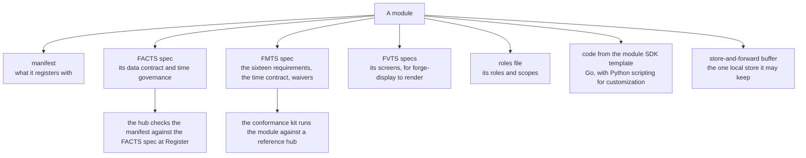

| A module has | A module does not have |
|---|---|
| specs that the owner (or an installation's approver) has approved | a database connection of its own: the hub owns the databases (A-6) |
| a time contract with every counterpart | user interface code: it describes its screens and forge-display renders them (A-3) |
| a session with its hub, over gRPC | any other way to reach the hub, or any direct link to another module |
| Forge-issued credentials | a credential it created or stores itself |

note:
- Today no module ships a roles file (the requirement is waived everywhere, FB-141), only forge-ot has screens described, and no module is on the Go template because it does not exist yet. The table is the target; F4's module table says where each module stands.

---

## The Order of Building

Set by the owner on 2026-11-20 (the forge-display design record, D-16). The specifications of the first stage are written; this is what follows.

| # | Step |
|---|---|
| 1 | **The FUTS schemas** for view documents and widgets (done 2026-11-20), with the hub's own view spec and object schemas |
| 2 | ~~**A spike**~~ done 2026-11-20: three provisional choices measured and made final |
| 3 | **The role model in force** on the hub: a write is only as accountable as the sign-in behind it |
| 4 | **The Go module SDK**, with the parts of the transport contract forge-display needs |
| 5 | **forge-display**: the server and runtime renderer; the hub's four screens, then forge-ot's HMI screens on live data |
| 6 | **Python scripting** for every Go module: the worker pool in the SDK |
| 7 | **The designer** |
| 8 | **The management modules in Go**, forge-mes first; then the integration builder |

The first fully functioning Forge module that must be built is forge-display. It is used to build the frontend of the entire Forge platform, the hub UI included, so it must exist before any other module can be completed.

note:
- This replaces the older sequence that put the Go SDK and forge-mes before forge-display. `docs/ROADMAP.md` §4 has the backlog item of every step.

---

## The Language Policy

| Component | Language | Status |
|---|---|---|
| Hub (forge-core) | Python ≥ 3.12, FastAPI, Typer, Pydantic v2, uv, ruff | in force |
| Modules | **Go**, generated from the module SDK, with **Python scripting** for customization (A-2, A-5) | decided; no module is in Go yet and the Go SDK template does not exist (FB-017) |
| Today's modules | Python adapters hosted in the hub, and forge-ot, a Python module hosted in the hub | in force, interim for the management modules |
| forge-mes today | the imported NestJS/Next.js application, the **interim MES bridge**, until the Go module replaces it | bridge in place; the Go design is signed (D-3) |
| User interfaces | none in modules: forge-display renders every screen (A-3). Its server is Go; its client is TypeScript with React, the one exception to "modules are Go" (A-21) | designed and signed (D-16); the contract, a runner and a reference renderer exist; forge-display does not |

note:
- The hub stays Python. The decision that modules are Go is about what is built from the SDK and deployed beside a hub.

---

## Today's Template · The Six-File Python Adapter

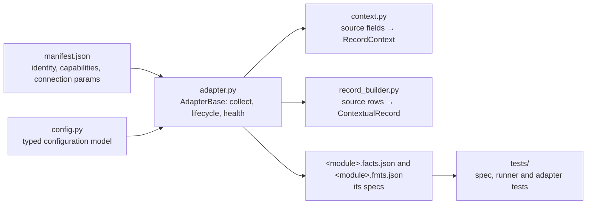

- `forge module init` generates this layout (`forge-core/src/python/forge_core/sdk/module_builder`); `forge-core/docs/module-builder.md` is the from-first-principles guide.
- FMTS requirement M-11 checks the layout. The conformance kit finds the one `AdapterBase` subclass in `adapter.py` and drives it; a Python module off the template (forge-ot) supplies a small `conformance.py` hook beside its adapter.
- Read `src/forge/adapters/forge_wms` as the reference: adapter, config, context, record builder, entity mappers.

note:
- Honest: the template is Python and backend-only (FB-017), duplicate SDK copies drift (FB-019), and the scaffold does not yet generate a module's FMTS spec (FB-140). The Go template is the real target.

---

## Go Today

| Piece | State |
|---|---|
| `forge-core/src/go/internal/models` | ✅ the core models mirrored, 2,078 lines with 1,665 of tests; every manufacturing entity has a `New*` constructor with the Python defaults and a `Validate()`, held equal to the Python models by one fixture both suites read (FB-016) |
| `forge-core/src/go/gen/forge` | ✅ generated bindings from the one proto set (Buf) |
| `forge-core/src/go/internal/scaffold` | 🟡 112 lines; not a module template yet |
| `forged` daemon, `forgectl` | ⬜ placeholders |
| CI | `go build`, `gofmt -l`, `go vet`, `go test` in the `hub-go` job, which runs them only when a push touches `forge-core/src/go/` or the proto files |

What the Go SDK has to give every module, so that no module writes it itself: the session with the hub, the time exchange, store and forward with its buffer, the goodbye and last will, the health report with refusals by cause, and authorization. A Go module is written to the **transport contract spec** (F2), not to the Python code.

note:
- The Go layout is in `docs/decisions/forge-mes-go.md` §4 (signed, D-3). Its first consumer was to be forge-mes; by A-14 it is forge-display.

---

## forge-mes · The Interim Bridge

| Capability | State |
|---|---|
| NestJS backend + Next.js frontend as the bridge (`modules/Forge MES`); it speaks the contract (push, pull, Collect, token, TLS) and exchanges time with the hub | ✅ |
| FACTS spec `forge-mes`, approved | ✅ |
| FMTS spec | 🟡 not approved: the kit cannot drive a TypeScript process (FB-155); five requirements are waived, among them its own database, its own UI and its time sources (FB-145) |
| Go rewrite from the module SDK | ⬜ FB-076: decided (A-2) and designed (D-3) |
| Its data into the hub's `mod_mes` | ⬜ FB-057 steps 2–5 |
| Frontend retired in favour of forge-display | ⬜ after forge-display exists |

- The bridge's frontend type check is clean and blocks in CI (FB-028). Its backend test step is advisory: five suites need a database and test settings the job does not have (FB-036).
- Do not build new product surface on the bridge's frontend. It is the MES user interface only until forge-display exists.
- The bridge has its own instruction file, `modules/Forge MES/CLAUDE.md`.

note:
- Wording rule: "the interim MES bridge", never "TypeScript forge-mes".
- The bridge was imported in October 2026; a credential leak in that import is why the repository's history was purged and the hardening of F8 exists.

---

## forge-display · Modules Describe, forge-display Renders (A-3)

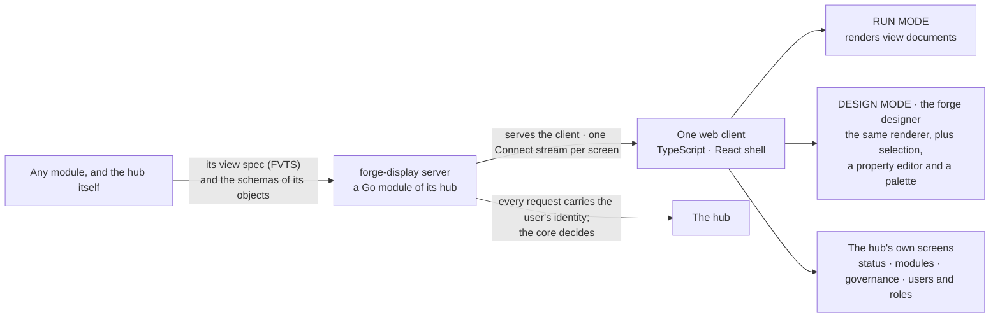

Signed by the owner on 2026-11-20: `docs/decisions/forge-display.md` (D-16). Nothing of it is built.

- **A Go module plus one web client.** The server is a module like any other. The client is the one place in the platform that is neither Go nor Python: TypeScript, with React for the shell and the designer. One client does run mode, design mode and the hub's configuration and administration screens.
- **Schema-first.** Each module carries its view spec and versioned schemas of its own objects; forge-display generates forms, tables and detail pages from them and holds nothing specific to any module. The Go and TypeScript types are generated from the schemas, never written by hand.
- **A view spec declares points and objects.** A point is one live value (a temperature). An object is a collection with a schema (the modules of a hub, the lots of a warehouse), fetched on request or pushed as it changes. The object's schema is covered by the spec's approval: change the schema and the spec must be approved again.
- **The hub has its own view spec** (2026-11-21), approved by the owner: four screens (status and health, modules, governance, users and roles), seven objects, no points. It is read-only apart from running a spec's checks; approving and assigning roles stay on the command line until roles are enforced.
- **Those four screens are laid out** (2026-11-22) as FUTS view documents, Forge's first standard screens: one reflowing column each, a title, a line of guidance, and a table per object whose columns are fields of that object's schema. A binding names a point or an object; a table takes an object.
- **What an installation builds is data.** A screen is a view document (a tree of containers and widget instances with their properties, bindings, actions and event handlers) in a new framework, **FUTS**, which also holds the widget specs. Forge's standard screens are files in the repository; an installation's are in its hub's database, versioned, hashed and approved on that hub.
- **A screen adapts to its device through its containers.** Each container has a kind, mixed freely on one screen: `fixed` (exact positions, for a process graphic), `reflow` (rows and columns that wrap and stack, for forms and tables) and `switch` (one of several arrangements, chosen by the width of the display).
- **FUTS exists** (2026-11-20): the schema, a runner, the first twelve widget specs and one reference view document, all approved. A view document may use only the points and actions of the surface it lays out, and only widgets whose spec the owner approved. `forge-core/docs/fxts/FUTS.md`.
- **The core decides.** A browser reaches only forge-display; forge-display reaches data only through its hub session and never decides a permission itself.
- **Any number of clients, and any of them may act.** Whoever has the role may write, from a control room, a laptop or a tablet; there is no station-in-control. The activity chain records who did what, and from which profile. This replaces the earlier rule that only the control-room profile writes.
- **Design mode is the forge designer** (D-13): the same renderer plus selection, a property editor and a palette. An installation builds its screens there with widgets that are each governed by a spec; a user builds only within what the specs allow, and Forge alone writes the widgets.
- **Bindings stay fast.** A value is bound directly or through a small expression (CEL) evaluated in the browser. Python handles event handlers and explicit transforms, in worker processes on the server, never on the path of a live value.

| Profile | Rate | What it is |
|---|---|---|
| `desktop_hmi` | 20 Hz | the control room, kiosk |
| `desktop_app` | 10 Hz | an installed application |
| `web` | 4 Hz | a browser |
| `mobile` | 1 Hz | the web client wrapped for a phone or tablet |

note:
- Two models: Ignition for scope (a gateway for configuration and administration, a designer, strong Python scripting) and Grafana for structure (a Go backend, a TypeScript and React client, types generated from schemas). Structure and ideas are taken from them, not code.
- Why React and not something that would outlast it: Forge alone writes the widgets, and what installations build is view documents in Forge's own schema, so a later change of framework rewrites the shell and a bounded set of widgets and nothing an installation built.
- Measured in a throwaway spike on 2026-11-20 and then made final by the owner: 500 widgets all changing 20 times a second held 60 frames a second over one Connect stream; CEL gave the same results in the browser and in Go. Two requirements came out of it. **forge-display is always served over TLS with HTTP/2**: over plain HTTP/1.1 a browser gives only six screens their values, and with six open a write can hang. **The client keeps only the newest value of each point per frame**, so a struggling device falls behind by a bounded amount, not without limit.
- Forge writes the live-value store and the designer's drawing area itself; the flow editor uses a library. Any further library is confirmed with the owner first.
- A module can only **tighten** the profile baseline, never loosen it. forge-display ships staleness marking, bad-quality handling, ISA-101 presentation, alarm annunciation and action feedback; it enforces nothing safety-critical itself.
- Today: the FVTS schema, a runner, the render-profile baseline, a reference renderer, golden messages and a CI gate. Since 2026-11-21 the profile baseline opens tag writes and every alarm operation on all four profiles, and a site policy can switch either off for a profile (FB-178).

---

## Integration Modules Are Built On Site (D-13)

Every third-party product is different, so Forge defines the general framework of an integration module and an installation's developer users build the module itself, in the designer: drag and drop, function blocks chained into flows as in Node-RED, and scripting.

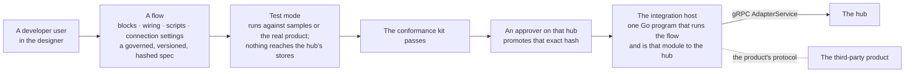

| Decided | What it means |
|---|---|
| A generic integration host first; generated Go later | nothing is compiled on site; a proven flow can later be exported as Go code that behaves identically |
| A flow is a governed spec | every saved change is a new version with a hash |
| Blocks | a Forge library of compiled blocks (sources, transforms, timing, sinks) plus script blocks; no code from outside Forge is loaded |
| Scripts | Python, sandboxed with time and memory limits, reaching only the Forge scripting API; the same sandbox as forge-ot's scripts |
| The module requirements | apply in full; the designer generates the module's FACTS and FMTS specs and the host supplies what every module needs |
| Approval | per hub: roles are scoped by hub and each hub is independent; one enterprise super admin holds every scope |
| Credentials | from forge-creds: entered once, referenced by name, handed over at Configure, never readable by a script |
| Lifecycle | test mode, promotion of an approved hash, rollback by promoting the previous one, all audited |

note:
- Signed on 2026-11-18; nothing of it is built (FB-154). It comes after forge-display and the management modules.
- `forge-integ-erp-netsuite` in this repository is hand-written and is the forerunner of what the designer will produce.

---

## F6 · Honest State

| Gap | Backlog / decision |
|---|---|
| forge-display: designed and signed (D-16), no code. Its framework for view documents and widgets exists (FUTS) and so does the hub's own view spec; the view service and the designer do not, and nothing renders a view document | FB-180, FB-181, FB-184 |
| The hub's four screens are laid out as view documents and approved; nothing draws them | FB-181 |
| What the hub serves for its objects: components and modules exist; governed files have no served route; users, roles and assignments have nothing until the role model is built | FB-075, FB-180 |
| A view document's expressions are not compiled or type-checked (the Go server does that), and no Go or TypeScript types are generated from the schemas yet | FB-181, FB-186 |
| Python scripting for Go modules: worker processes and an approved-package list per hub are decided, not built; today's engine runs inside the hub's process | FB-182, FB-183 |
| The Go module SDK template; any module in Go | FB-017, FB-076 (D-3) |
| The management modules are data contracts in Python adapters; their logic, storage and screens are not built | each module's FMTS spec says so |
| The designer, the flow format, the integration host | FB-154 (D-13) |
| The credential module, forge-creds | FB-142 |
| The Python template is backend-only; duplicate SDK copies; the scaffold generates no FMTS spec | FB-017, FB-019, FB-140 |
| Old module names remain in some values other code depends on (a site id, the bridge's imported files) | FB-150 |
| The MPC Supervisor module (all of PC-L2) is a new build to the SDK; its language is open (O-2, with D-7) | FB-110 (D-11) |

**Next**: how a value becomes decision-quality.

---

<!-- SECTION F7, CONTEXT AND CURATION -->
<!-- .slide: id="f7--context-curation-and-decisions" -->

# F7 · Context, Curation and Decisions

**Nav**: [← F6](#f6--modules-the-sdk-and-forge-display) · [⇤ TOC](#table-of-contents) · [⇅ Landing fork](#landing-fork) · [F8 →](#f8--security-identity-and-federation)

From a raw value to a decision-quality figure and a recorded decision: the Context Engine, the manufacturing entities, the curation pipeline, data products with lineage, and the decision frame.

note:
- Source: `docs/VISION.md` P-2, P-3, P-9; `docs/PRINCIPLES.md` §4; `docs/WHERE-WE-ARE.md` §3.2–§3.3; `forge-hub/src/python/forge_hub/context`, `forge-hub/src/python/forge_hub/curation`, `forge-core/src/python/forge_core/models`.

---

## Context Is a First-Class Citizen

- A module's FACTS spec maps source fields to Forge context fields and declares enrichment rules; the hub fills what the source cannot: **shift from timestamp, area from location, lot from the active batch**.
- Context is what makes two records joinable; **time** is what makes them comparable. A record is ordered by its source time, never by when it arrived, which is why a replay after an outage does not corrupt a data product (F2, F9).
- The **Context Engine** (F21) is served by the hub under `/v1/context` (12 routes; state changes behind `context:write`) with Postgres stores through the factory (FB-001, FB-005).
- The **context field registry** (`forge-core/src/python/forge_core/registry`) is the vocabulary; `RecordContext` carries it slot for slot (FB-013).
- The **manufacturing entity catalog** (`forge-core/docs/manufacturing-entity-catalog.md`) and the ISA-95 / ISA-88 hierarchy in `forge_core.models.manufacturing` define what context *means*: `MaterialItem`, `Lot` (with `item_id`, FB-010), `ProductionOrder`, equipment and areas.
- Context is never silently dropped (invariant).

| Open | Backlog |
|---|---|
| Step and phase execution, electronic batch record entities | FB-011 |
| Typed ISA-88 hierarchy | FB-012 |
| Equipment registry served from Postgres | ✅ migration 009 |

note:
- "Solved when": no record is persisted without its required context fields, and the required set is declared per spoke and checked by the FACTS gate.

---

## Curation · From Raw Records to Data Products

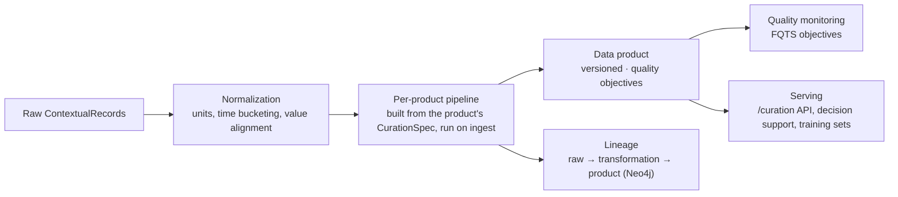

- One curation engine builds each data product's pipeline from its `CurationSpec` (migration 010) and runs it on ingest for the published products the adapter feeds; curated records are persisted with the raw ones (FB-009).
- `forge_hub.curation`: `pipeline.py` (multi-stage normalization and enrichment), `normalization.py` (field normalization, unit conversion), `aggregation.py` (time windows), `quality.py` (scoring and validation), `lineage.py` (provenance).
- The curation service is mounted at `/curation`; data products live in `forge_canonical.data_products`.

note:
- The governance frameworks that make this declarative (FQTS quality, FNTS normalization, FLTS lineage) are planned; the engine runs on the product's spec today.
- When FQTS is built it starts from rules of four kinds already sketched for three data products: completeness, freshness, range and consistency (`forge-core/docs/fxts/FQTS.md`).

---

## Data Products

| Property | Meaning |
|---|---|
| Versioned | a product's definition changes by version; consumers pin one |
| Quality objectives | what "good" means for this product, visible beside every figure derived from it |
| Lineage | the chain from raw record through each transformation to the product, recorded and queryable |
| Curation spec | the pipeline the engine builds and runs for the product |
| Owner, status | who answers for it; draft, published, deprecated |

- "Solved when": every figure on a surface can be traced to its sources and transformations, and its quality objective is visible beside it (P-3).
- The same curated products are the training and evaluation sets for site-specific models, so expertise is captured where it is exercised.

note:
- `DataProduct` is a Pydantic model in `forge_core.models.data_product`; migration 003 mirrors it and the test suite holds the key fields.

---

## Decisions Are Records

The research basis (`docs/PRINCIPLES.md` §4): decision quality degrades from incomplete information and from undisciplined judgment. Collection, governance, storage, curation and serving address the first; the decision-support layer addresses the second.

| Requirement | Why |
|---|---|
| Preserve and surface **base rates** beside alerts | base-rate neglect |
| Normalise and segment **before** comparing; declare the basis or say "unnormalised" | Simpson's paradox |
| Link multi-departmental context; show several departmental views of the same data | spurious correlation, framing |
| Require **disconfirming evidence** before action hardens; distinguish confidence from evidence | structured challenge, procedural not optional |

For significant decisions the 13-point minimum frame is recorded: scope, current hypothesis, supporting evidence, **challenging evidence (required)**, alternative hypotheses, key assumptions with confidence, missing information, risk if wrong, opportunity if right, existing controls, **evidence of effectiveness (required)**, reassessment trigger, a named owner.

- `forge_core.models.decision` holds the decision with the products and lineage it relied on; outcomes are observed against it (`forge_hub.observer`).
- Every assumption is a tracked entity (active / validated / invalidated / superseded); new data that contradicts an active assumption alerts its owner.

note:
- "Solved when": a decision can be replayed: what was known, what was decided, what happened (P-9).

---

## F7 · Honest State

| Gap | Backlog / decision |
|---|---|
| FQTS, FNTS, FLTS as gates | planned (M5) |
| Clock agreement as a quality dimension of a data product | FB-091 |
| Step/phase execution, electronic batch records; typed ISA-88 hierarchy | FB-011, FB-012 |
| Decision-support module with the 13-point frame as a workflow | the models exist; the module does not |
| Routing registry convergence (which store a schema lives in) | FB-097 (D-10) |

**Next**: who may do what, and how sites keep working offline.

---

<!-- SECTION F8, SECURITY -->
<!-- .slide: id="f8--security-identity-and-federation" -->

# F8 · Security, Identity and Federation

**Nav**: [← F7](#f7--context-curation-and-decisions) · [⇤ TOC](#table-of-contents) · [⇅ Landing fork](#landing-fork) · [F9 →](#f9--one-clock)

The gateway as it is, the role model as it is designed, roles per hub, the hub of hubs, credentials and the credential module, the security of the transport, and the repository's own security posture.

note:
- Source: `docs/VISION.md` P-10, P-11, §3.6; `docs/decisions/roles.md`; `docs/WHERE-WE-ARE.md` §3.10; `docs/ROADMAP.md` §1 (A-9).

---

## The Gateway Today

| Capability | State |
|---|---|
| Auth, RBAC and rate-limiting middleware (`forge_hub.gateway`) | 🟡 exists; **auth off by default** |
| Scopes on state-changing routes: `adapters:write`, `context:write`, `schemas:write` | ✅ |
| Reads are open | 🟡 FB-007 |
| Scoped roles enforced on every route and RPC | ⬜ FB-075 (two role enums today: gateway `Role`, OT `WriteRole`) |
| OT control POST endpoints behind `adapters:write` | ✅ FB-082 |

- "Solved when": the gateway enforces scoped roles on every route and RPC, modules hold only Forge-issued credentials, and a visibility rule such as "ERP hidden from distillery operators" is a configuration, not code (P-11).

note:
- Do not mistake the development default for the design: auth is off so the stack runs on a laptop; the role model below is what the gateway will enforce.

---

## The Role Model · R-1 … R-19 (D-1 signed 2026-11-03)

Designed in dialogue in `docs/decisions/roles.md`; enterprise-class:

- **Identity is established by the installation's chosen method** (OIDC, local accounts and service identities first; then LDAP/AD; then SAML, R-10), but **Forge decides what an identity may do** (R-2).
- Roles are **scoped** (R-7), shipped **per module as data** (R-12), chosen in shape by the installing administrator (R-3, R-4), and **constrain reads as well as actions** (R-11).
- Roles are assigned at the **managing hub** and inherited downward (R-16); tokens verify **offline** against the issuing hub's public key with a one-hour default lifetime (R-8, R-15).
- **Separation of duties** (two-step review, interlock bypass with reason, approvals) is evaluated by the hub (R-6).
- Resolved 2026-11-03: Q21, a derived copy of assignments at the site hub, refreshed from the managing hub and never edited locally (R-18); Q22, the four-role ladder as an optional preset, off by default (R-19). FB-075, FB-078 and the multi-party approval step above FB-074 can start.

**Stated by the owner on 2026-11-18, to be carried into the role model's build (FB-075):**

- **Each hub is independent in its role permissions.** The approver on one hub may or may not be the approver on a second area hub at the same site. Roles are scoped by hub.
- **One super admin** has full access to all hubs in an enterprise.
- **Who may change a specification's schema**: a hub admin, a dev, or the super admin. A user who builds in the designer builds within the specs and cannot change them; a change beyond them is requested and reviewed through the Forge support pipeline.
- **Approval at an installation** is a scope held on a hub: that is who approves a module built on site, and who can grant a time-keeping waiver.

note:
- The record's format is the one every design record follows: status line for the owner's signature, participants, tagged statements, numbered proposals and questions.

---

## Hub of Hubs (P-10, R-9)

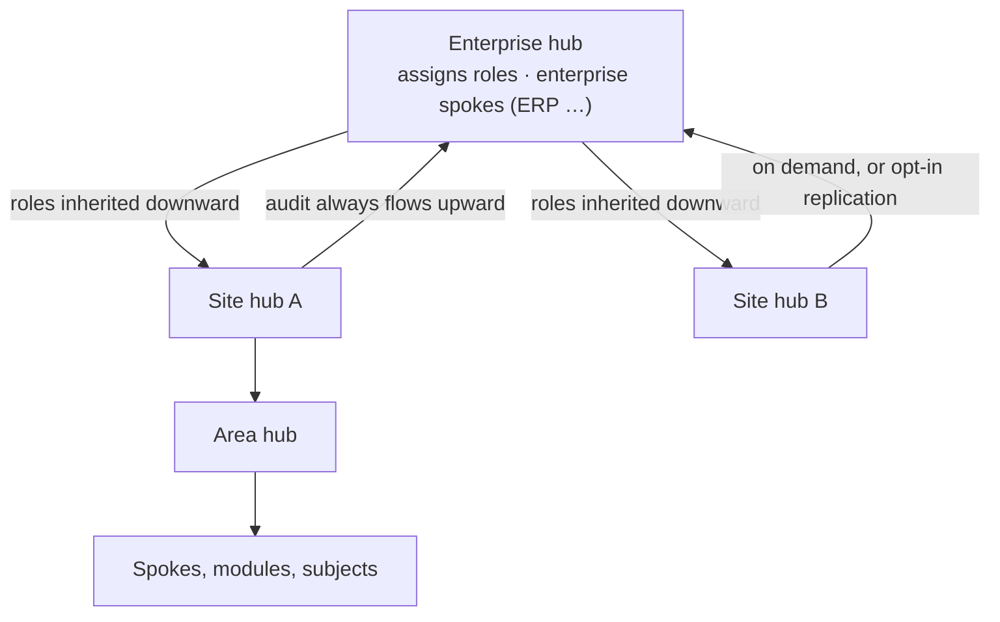

- Every hub **owns what is attached to it directly** (spokes, child hubs, subjects) and collects, governs, stores, curates and serves that data (R-13, R-14).
- Nothing communicates *through* a hub; a transfer *occurs at* it.
- Audit records always flow upward; other data is requested on demand unless a site opts into replication (R-17).
- A site keeps working when the WAN does not: full operation for the token lifetime, audit complete on reconnection.
- The time-authority chain follows the hub hierarchy (one clock, F9).
- **A hub is a module to its parent**, on the same transport contract, with hub-only calls added (D-15). Hub-to-hub links carry reporting and history, tolerate a short loss because store and forward holds the data, and are lower priority than hub-to-module links: the modules of a hub control actual processes, and nothing between hubs may be needed for them to keep doing so.
- State: no code; milestone M6.

note:
- "Solved when": a site hub runs for the full token lifetime with the enterprise unreachable, and the enterprise's audit view is complete when the link returns.

---

## Credentials and Secrets

- The hub owns the databases and issues credentials (`forge db access`, F3): a module never carries a database password it created itself; the password is printed once and never stored.
- Hub ↔ module traffic is TLS or mTLS in both directions with a per-module callback token. Both are optional today. The signed transport contract makes mutual TLS **required in production**, with a development mode that is deliberate and visible on status, a short-lived token renewed on the open stream, and revocation that takes effect at once (D-15, not built).
- **forge-creds**, a central credential module, is the owner's direction for everything a module needs a secret for, third-party systems included: entered once, held behind an existing secret store, referenced by name, handed to a module at Configure and never readable by a script. It has no design record yet (FB-142), and mutual TLS in production depends on it.
- The interim MES bridge still reads a cloud vault directly when one is configured; that is interim.
- Configuration comes from `.env` files and environment variables; no credential, IP or key is hard-coded.
- gitleaks runs on every pushed commit in CI (`secrets-scan`) and before every push locally; nothing is imported into the repository without a history scan and a purge plan.

note:
- The compose stack's `changeme` defaults are development placeholders for the infrastructure containers, overridden by the environment; they are not Forge-issued credentials.

---

## The Repository Security Posture (A-9)

| Measure | State |
|---|---|
| Repository public again since 2026-10-17 (owner's decision) | ✅ |
| Secret scanning, push protection, CodeQL default setup, Dependabot (Python on the `uv` ecosystem), private vulnerability reporting, fork-PR approval | ✅ |
| gitleaks in CI on the pushed commits | ✅ |
| The 2026-10-15 import leak: credentials rotated, history purged, the purged refs with GitHub Support until GC | 🟡 ticket open |
| Non-provider patterns and validity checks (owner toggles the API refuses) | FB-044 |

- Lesson that binds: every import is scanned before it lands, and secrets never enter a commit; the PR workflow and the backlog rule exist in part because of this incident.

note:
- `docs/WHERE-WE-ARE.md` §3.10 carries the current state of the alerts and the support ticket.

---

## F8 · Honest State

| Gap | Backlog / decision |
|---|---|
| Scoped roles enforced in the gateway; reads open | FB-075, FB-007 (D-1) |
| Identity methods | R-10, not started |
| Hub of hubs, offline tokens | M6, no code |
| Roles per hub, the super admin, the hub admin and dev roles | FB-075, with the owner's statements of 2026-11-18 |
| forge-creds; mutual TLS required in production | FB-142, FB-164 |
| No module ships a roles file, and the roles file has no specification of its own | FB-141 |
| Security test specification (FSTS) | planned |

**Next**: one clock, across everything the earlier sections touched.

---

<!-- SECTION F9, ONE CLOCK -->
<!-- .slide: id="f9--one-clock" -->

# F9 · One Clock: Time Across the Platform

**Nav**: [← F8](#f8--security-identity-and-federation) · [⇤ TOC](#table-of-contents) · [⇅ Landing fork](#landing-fork) · [F10 →](#f10--contributing)

Why every clock in the system has to agree, and how Forge makes it so: stamps, measurement, correction, declaration and refusal, from the top hub down to a PLC. Earlier sections each showed a piece (the record in F2, the FACTS section in F4, the plant-floor probe in F5, the hub hierarchy in F8); this one puts them together.

note:
- Source: `docs/decisions/one-clock-ot-source-time.md` (D-9, signed 2026-11-03); `docs/PRINCIPLES.md` §2; `forge-hub/docs/clock-discipline.md`; `docs/WHERE-WE-ARE.md` §3.1 and §3.5; the code is `forge-core/src/python/forge_core/clock.py`.

---

## Why Time Has to Agree

Forge joins records from systems that were never built to agree with each other: a PLC, an OPC UA server, an MES, a warehouse system, a lab system. The timestamp is the one field every join uses.

| The question | What clock skew does to the answer |
|---|---|
| Which came first: the alarm, the operator's action, or the valve moving? | Two clocks two seconds apart reverse cause and effect in the sequence of events |
| What was the temperature when this lot was transferred? | The MES event and the tag value fall into different windows; the join returns the wrong reading, or none |
| Is this data product fresh? | Age is "now minus source time" across two clocks: a source running behind looks stale, one running ahead looks fresh for ever |
| Did the controller act inside its cycle? | A model-predictive controller reads, computes and writes on a cycle and proves it is alive with a heartbeat (F5); neither can be judged across clocks that disagree |
| What happened, for the audit? | A trail whose order depends on which machine stamped each line is not evidence |

- The owner's principle (2026-10-18): **records from different sources only reconcile if their timestamps come from the same master time.** Warnings are not a substitute for correction.
- Skew fails silently: nothing errors, the numbers are just wrong. So the rule has a second half: a clock that is not on master time is **never silent** (owner, 2026-11-03).

note:
- "Solved when": every record at rest can be ordered against every other one, and any clock that cannot be trusted has said so and stopped delivering.
- `docs/PRINCIPLES.md` §2 states the invariant; D-9 chooses the standards that implement it.

---

## A Time Authority at Every Level

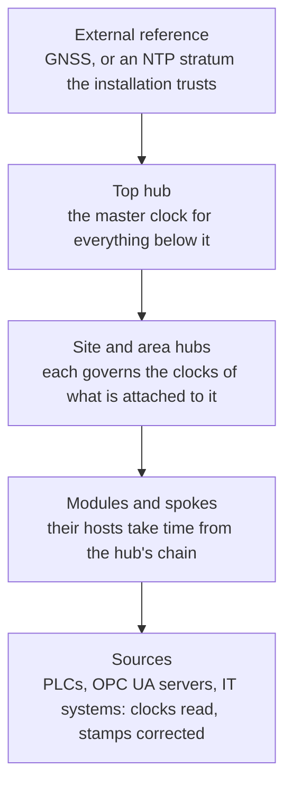

- The highest hub provides time for every hub and spoke below it; each hub governs the modules and spokes attached directly to it; each spoke governs or measures the clocks of the systems behind it.
- **The installation distributes time; Forge does not set clocks.** NTP strata mirror the hub hierarchy, and PTP runs on the plant network where the devices support it (D-9, P-1). The requirement and a new-site checklist are `forge-hub/docs/clock-discipline.md`.
- Forge does four things with the time it is given: it **stamps** (its own receipt), **measures** (every clock it can reach), **corrects** (a source stamp, once, where it enters) and **refuses** (a clock it cannot trust).

| Class | Links | Tolerance |
|---|---|---|
| `T1` | PLC event and alarm stamps, sequence of events; devices that report PTP synchronisation | 1 ms |
| `T0` | polled process values from NTP-synced devices and servers | 10 ms |
| `it-lan` | MES, WMS, ERP and other spoke hosts on the site LAN; the OT module's host | 10 ms |
| `it-wan` | hub to hub, remote spokes | 100 ms |
| `edge-mqtt` | Sparkplug edge nodes, measured one way | 500 ms |

note:
- The classes and values are D-9's P-8, approved by the owner as proposed (Q-1); in code they are `TOLERANCE_CLASS_SECONDS` in `forge_core.clock`. The class is data on each link's declaration: a new class is a row, not a code change.
- `T2` to `T5` exist for devices that report PTP synchronisation; a round-trip probe cannot resolve them (FB-116).

---

## What a Record Carries

Every `ContextualRecord` has a `RecordTimestamp` (F2). These are its fields:

| Field | What it is | Who sets it |
|---|---|---|
| `source_time` | when the value occurred at the source, corrected to master time where the clock is measured | the spoke's record builder |
| `source_time_as_sent` | the stamp exactly as the source sent it | the builder, when it corrects |
| `source_offset_seconds` | the offset that was applied | the builder |
| `source_uncertainty_seconds` | the error bound: half the probe's round trip plus the sampling bound of the tag | the builder |
| `source_clock` | which clock stamped it: `device:<name>`, `server:<name>`, `edge:<name>` or `forge` | the builder, from the declaration |
| `time_quality` | synchronised, clock failure, leap seconds known, accuracy class (IEC 61850 `TimeQuality`) | the builder |
| `server_time` | when the source's server processed it | the source |
| `spoke_time` | the spoke's own clock when it sent the record | the spoke |
| `ingestion_time` | when the hub received it, by the hub's clock | the hub |

- **UTC, with its zone, everywhere.** A naive datetime or an offset-less string is rejected at the model (`OneClockModel`); ruff's `DTZ` rules block one in code.
- **The hub stamps receipt** with one reading of its own clock per batch (`stamp_receipt`); a spoke's claim about arrival is never used.
- **No source time is ever invented.** A value that arrives without one is refused, unless its connection declares `source_timestamp_origin: forge`: then Forge's read time stands in, the record says so (`source_clock: forge`) and the poll interval is its uncertainty.
- **Correction happens once, where the stamp enters** (the spoke's builder, P-10). The hub never corrects a second time.

note:
- Honest: at rest the hypertable keeps only `source_time`; the other fields travel on the record, the API and into curation (FB-108). `spoke_time` was the hub-local `sent_time` until the time exchange landed (FB-092).

---

## Measuring a Clock

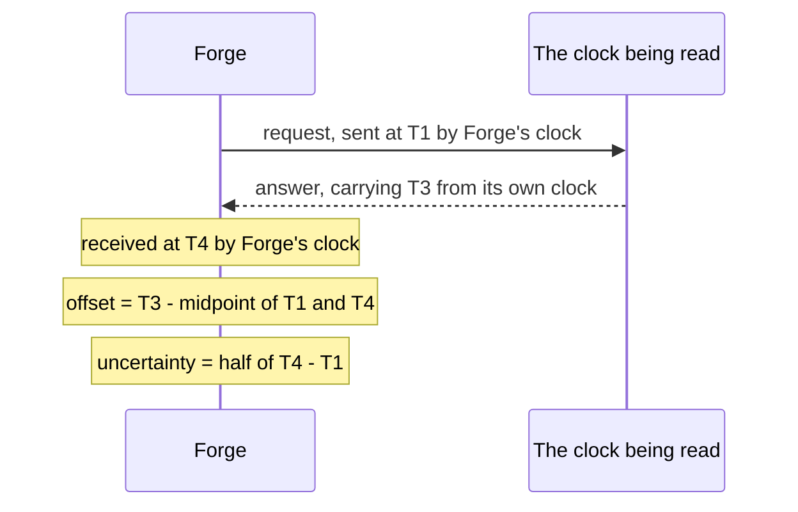

- The measurement is NTP's: taking the offset at the midpoint of the round trip cancels the transit delay, and half the round trip bounds the error from an asymmetric path. In code it is `ClockSample`.
- **On the plant floor** every OPC UA connection reads `ServerStatus.CurrentTime` on a cadence (30 s by default, 1 s at the least, changed per connection while it runs: `POST /control/connections/{name}/clock-probe-interval`) and also reads the timestamp in every response header. Both feed one series, named for the clock that was read (`server:PLC01`, or `device:PLC01` for a PLC-embedded server).
- **Between hub and spoke** the same four timestamps travel in the contract (FB-092): the spoke sends T1 with Register, Health and Ingest, the hub answers with T2 and T3, the spoke takes T4, computes the offset and the round trip (`TimeExchange`) and reports them with its next Health. The hub then keeps that spoke's clock two-way and holds it to its declared class.
- A spoke that does not report is measured one way from its records (`spoke_time` against receipt), which includes the delay in transit. The source's server and the source are measured from the records as well: `server_time` against receipt, `source_time` against `server_time`.
- `ClockOffsetTracker` keeps a rolling window per adapter, link and clock, filters the estimate the correction uses with NTP's one-eighth weight, and puts every sample on `forge.clock.offset`. The statistics are on `AdapterHealth.clock`, `GET /v1/ingest/stats` and the OT connection status.

note:
- The probe is also the liveness check (FB-070): a dead session cannot answer it. A probe that fails restarts the connection; a probe that answers without a clock value counts toward `CLOCK_UNREADABLE`.

---

## Declaring It · FACTS `time_governance`

Every spoke states how it is time-governed, in its FACTS spec and on the manifest it registers with:

```json
"time_governance": {
  "time_source": "hub-ntp",
  "sync_protocol": "ntp",
  "clock_read_method": "opcua-current-time",
  "clock_probe_interval_seconds": 30,
  "source_timestamp_origin": "server",
  "tolerance_class": "T0",
  "fail_closed": true,
  "connections": [
    { "name": "PLC02", "source_timestamp_origin": "device", "tolerance_class": "T1" }
  ]
}
```

- The section is **required**, and `facts:time-governed` is a blocking check: it refuses a spec without the section, `sync_protocol: none`, a spec that does not fail closed, a cadence under 1 s, and a clock-read method the protocol cannot perform.
- All nine specs carry it, approved by the owner: the eight business modules declare `hub-ntp`, `ntp`, origin `server` and class `it-lan`; forge-ot declares class `T0` and reads its servers with `opcua-current-time`.
- The declaration is what the runtime obeys: the origin decides what happens to a value without a stamp, the class is the tolerance the link is held to, and a connection parameter that contradicts it is refused when the adapter is configured (`time_governance_conflict`).

note:
- `AdapterManifest.time_governance` is proto field 13; the Python, Go and interim-bridge models all carry it (FB-090).

---

## The Time Contract · Every Counterpart (D-12)

FACTS `time_governance` covers a module's own clock and the devices it pulls from. The module requirements go further: a module declares a **time contract** for every counterpart it exchanges data with, in its FMTS spec (requirement M-3).

| Counterpart | What the module declares | Who checks the clock |
|---|---|---|
| Its hub | the four-timestamp exchange, fail closed; the tolerance class is the one in its FACTS spec | the hub, on every Register, Health and Ingest |
| A plant-floor device or server | how its clock is read, the cadence, which clock stamps the values, the class | the module (forge-ot does, for OPC UA) |
| A database the hub owns | that every time the module writes there comes from its own governed clock or the hub's, never from the database's `now()` | the hub checks its own databases' clocks (FB-138, not built) |
| A third-party database or system | how its clock is read, the class, the cadence, and that the offset is reported on the record | the integration module (FB-139, not built) |
| A clock that cannot be read | exactly that: then the module's own read time is the stamp and the polling interval is recorded as the uncertainty on every record | nobody; the uncertainty travels with the data |

- An unreadable clock is a declaration, not an escape: a module that neither reads a clock nor declares it unreadable is refused.
- The owner on why this reaches so far: when a module replays buffered records after an outage, fresh data arrives before older data, and only the source time puts them back in order. "This is why the time sync and time reporting is so important in forge."
- A time-keeping requirement can be waived only with admin privileges, and the waiver is named on every run of the module's spec.

note:
- `docs/decisions/forge-module-requirements.md` §5 and the answers Q-5 and Q-6; `forge-core/docs/fxts/FMTS.md` "The time contract".
- Two modules carry such a waiver today: forge-scanner (no clock reader exists for handheld devices) and the interim MES bridge (its database stamps rows with its own clock).

---

## Failing Closed

```mermaid
flowchart LR
  OK["OK<br/>delivering"] -- "3 probes in a row:<br/>no clock value" --> U["CLOCK_UNREADABLE<br/>nothing delivered"]
  OK -- "3 probes in a row:<br/>offset beyond the class" --> T["CLOCK_OUT_OF_TOLERANCE<br/>nothing delivered"]
  U -- "3 good probes in a row" --> OK
  T -- "3 good probes in a row" --> OK
```

Every PLC connection has a `ClockGate` (D-9's P-5; three in and three out is the owner's answer Q-4). While a connection is refused:

- its provider is stopped: nothing is subscribed and nothing is pulled;
- reads and writes through it are refused with `ClockRefusedError`, and `collect` skips its tags, its last values included;
- the supervisor's restart loop does not apply, and an operator restart is answered 409 with the cause: this is a refusal, not a recovery;
- only the probe goes on, over a session it opens and closes itself.

The hub holds every spoke to the same rule (`SpokeClockGates`). It cannot open a call to a spoke, so the spoke's own requests are the probes: each Register, Health and Ingest carries the spoke's last two-way measurement, or none. After three measurements outside the declared class, or three requests with no measurement, the hub refuses the spoke's Register (`accepted=false`) and its Ingest (`FAILED_PRECONDITION`), each with the cause in the message and in the `x-forge-refusal-cause` trailer. Health is still answered, so the spoke goes on measuring, and three good probes readmit it. At most one probe a second is counted.

**Never silent.** The refusal is an error line in the log, on the connection status (`clock_state`, and `clock_gate` with the cause, since when, the class and the counters), on `AdapterHealth` (DEGRADED, `refusals.clock_unreadable` or `clock_out_of_tolerance`, `last_refusal`), on the `forge.ingest.refused` metric, and a HIGH alarm where the host runs an alarm engine. The adapter is HEALTHY again when its last refused connection clears. A refused spoke shows the same on the hub's health of it, on `GET /v1/adapters/{id}/health` and on `forge adapter health`.

note:
- In force on the OT links since 2026-11-15 and on the hub-to-module link since 2026-11-17 (FB-093). A module that does not implement the time exchange is refused too (owner, 2026-11-17). The module requirements exist so that this never happens in production: the conformance kit proves a module exchanges time and fails closed before a hub ever sees it (F4).
- A manifest without `time_governance` is refused at Register: with no declared class there is nothing to hold the clock to.
- The probe cannot be switched off: a cadence under 1 s, 0 included, is refused when the configuration is loaded. A clock that is not read cannot be trusted.

---

## Holding Code to It

| When a developer … | What is done |
|---|---|
| stamp anything with Forge's own time | `forge_core.clock.utc_now()`; never a naive `datetime.now()` or `utcnow()` |
| define a model with a datetime field | derive from `OneClockModel` (manufacturing entities already do, through their base) |
| build a record from a source value | `resolve_source_stamp(...)`, then `SourceStamp.timestamp_fields()`; never fall back to "now"; refuse with `adapter.refuse(exc)` |
| add a spoke | declare `time_governance` in the FACTS spec and on the manifest; `forge governance run` checks it |
| write a spoke's client | use `SpokeClient`: it runs the time exchange on Register, Health and Ingest and stamps `spoke_time`; a client in another language sends T1, takes T4 and reports with Health, as the MES bridge's `ForgeHubClient` does |
| add a protocol that can read a device's clock | implement `ClockReader.read_clock()` returning a `ClockSample`; feed `ClockOffsetTracker.observe(...)` with a `clock_id` and the class's tolerance; gate the link with `ClockGate` |
| change a time field on the wire | proto fields are added, never renumbered; the FATS and FACTS specs are re-stamped for the owner (F4) |

- The tests that hold this are `tests/core/test_clock_gate.py`, `test_clock_offsets.py`, `test_clock_sample.py` and `test_time_governance.py`, and `tests/modules/ot/control/test_connections.py` for the plant floor.

note:
- A refusal is a first-class outcome, not an exception to swallow: count it, name its cause, show it. That is what `refuse` and the gate do.

---

## F9 · Honest State

| In force | Since |
|---|---|
| Every stored timestamp UTC and timezone-aware; naive rejected at the model | FB-014 (2026-10-20) |
| The hub stamps receipt with its own clock | FB-087 (2026-10-20) |
| The offset of every link measured, exposed and alerted | FB-089 (2026-10-20) |
| No source time invented | FB-088 (2026-11-13) |
| OPC UA: the clock read by probe and tap, the stamp corrected on entry, the time-quality fields, the per-tag sampling bound | FB-094 (2026-11-13) |
| Every spoke declares how it is time-governed | FB-090 (2026-11-13) |
| A PLC connection fails closed on its clock | FB-093, the OT links (2026-11-15) |
| The hub fails closed on a spoke's clock: outside its class, or no measurement reported, and its Register and Ingest are refused | FB-093, the hub half (2026-11-17) |
| Hub time in the contract: the four-timestamp exchange; a reporting spoke measured both ways and held to its class | FB-092 (2026-11-15) |

| Missing | Backlog |
|---|---|
| The hub's REST ingest retired: it carries no time exchange, and every module speaks to the hub over gRPC | FB-123 |
| Nothing reads the clock of a hub-owned database or of a third-party system; the hub does not demand an approved module spec at Register | FB-138, FB-139, FB-140 |
| A module in another process or language is not driven by the conformance kit | FB-155 |
| Forge checking its own host's clock before it judges others | FB-119 |
| Clock agreement as a quality dimension; the offset assumed for an offset-less source stamp | FB-091 |
| The time fields stored at rest | FB-108 |
| A remote spoke's refusals visible at the hub | FB-109 |
| IT spokes reading the clock of the system they pull from | FB-120 |
| Clock readers for Logix, S7 and Modbus; Sparkplug's one-way measurement | FB-117 |
| PTP-aware judgement for `T1` and finer | FB-116 |
| The time chain between hubs | FB-118, with the hub of hubs (M6) |
| The alarm engine running in the hub; clock state on forge-display | FB-115; M4 |

**Next**: landing a change.

---

<!-- SECTION F10, CONTRIBUTING -->
<!-- .slide: id="f10--contributing" -->

# F10 · Contributing

**Nav**: [← F9](#f9--one-clock) · [⇤ TOC](#table-of-contents) · [⇅ Landing fork](#landing-fork) · [F11 →](#f11--conclusion)

Setting up, the workflow, the rules that bind, where each kind of change goes, how to add a module, how a decision is made with the owner, and the governed memory that watches over the agents working here.

note:
- Source: `README.md` "Development", `docs/ROADMAP.md` §1 (A-8, A-10), `docs/PRINCIPLES.md` §9, `.github/workflows/ci.yml`, `BACKLOG.md` header.

---

## Set Up

```bash
git clone https://github.com/reh3376/forge.git && cd forge
uv sync --locked --extra dev --extra ot        # the same command CI and the hub image run
uv run pytest -q -rsx                          # 5,159 tests in tests/, forge-core/tests and forge-hub/tests, ~1 minute; lists each skip with its reason
uv run ruff check . && uv run ruff format --check .   # both block CI; ruff is pinned exactly
(cd go && go build ./... && go vet ./... && go test ./...)
docker compose -f deploy/docker/docker-compose.yml up -d   # postgres, timescaledb, neo4j, redis, kafka, rabbitmq, minio
```

- Python 3.12+, uv, ruff, Docker for the services; Go 1.26 for `forge-core/src/go/`; Node 20 for the interim MES bridge's CI job and Node 22 for the tutorial build.
- Every Python dependency is locked in `uv.lock`; `--locked` fails on a stale lock, so a dependency moves only through a committed re-lock (FB-096):

```bash
uv lock --upgrade-package fastapi    # one package, within its pyproject range
uv lock --upgrade                    # everything the ranges allow; then commit uv.lock
```

note:
- `tests/test_dependency_lock.py` holds the lock to the manifest and every installer (CI, the Dockerfile, the README quick start) to the lock.
- The hub image builds from the lock with the dependency layer before the source and the dev tooling out (`deploy/docker/Dockerfile.forge`).

---

## The Workflow (A-8)

```mermaid
flowchart LR
  B["Branch reh3376_dev01<br/>level with main"] --> I["One backlog item"]
  I --> D["Docs and tutorial current<br/>WHERE-WE-ARE status date + last merged PR, counts"]
  D --> G["gitleaks on the commits"]
  G --> P["git push origin HEAD:reh3376_dev01"]
  P --> PR["auto-pr.yml opens the PR<br/>(bot author)"]
  PR --> CI["CI: hub-python · hub-go · mes-module · secrets-scan"]
  CI --> M["Owner merges on green"]
  M --> S["git fetch && git merge --ff-only origin/main"]
  S --> I
```

- **One backlog item per PR.** Never push the next item onto a branch with an open PR: commit locally, push after the merge.
- The PR is opened by the workflow with the bot as author, so the owner can approve it; nobody opens PRs as the owner.
- Docs-only commits may ride along with an item; everything else is its own PR.
- **This tutorial is part of every item.** Both tracks are reviewed against the change and updated before the push, because the push is what opens the PR: the tutorial has to describe the code as it is (owner, 2026-11-17). Its opening "Last verified" line carries the date and the last merged PR of every push; a test fails when it and `docs/WHERE-WE-ARE.md` disagree.
- **Run what CI runs, over the whole repository**: `ruff check .` and `ruff format --check .`, not only `src` and `tests`.
- Conventional Commits (`feat:`, `fix:`, `docs:`, `build:`).

note:
- CI runs on every push to every branch so checks attach to the commits behind auto-opened PRs; same-repo PRs do not run twice.
- All four jobs are required checks on `main`, so all four always report. Two of them do their work only when it is relevant: `hub-go` when the branch touches `forge-core/src/go/` or `forge-core/contract/proto/`, `mes-module` when it touches `modules/Forge MES/`, the proto files or the forge-mes manifest. Otherwise the job passes in seconds and says "nothing to check" in its log and summary. The whole branch is compared with `main`, not only the last push, and when the comparison cannot be made the job runs in full (`.github/scripts/changed-paths.sh`).

---

## The Rules That Bind

| Rule | Since |
|---|---|
| **Every finding is fixed or recorded** in `BACKLOG.md`; nothing is skipped | 2026-10-15 |
| **Documentation is current before every push**: `docs/WHERE-WE-ARE.md` rows, numbers and status date, `README.md` counts, the roadmap and backlog | 2026-10-16 |
| **The developer and user tutorial is current before every push**: `docs/tutorial.md` reviewed against the change, updated, rebuilt (`make sync-tutorial-embed`) and checked | 2026-11-17 (owner) |
| **The repository's documents are the authority**: where Jiminy guidance disagrees, the documents win and the disagreement is reported to the mdemg agent as a defect | A-12, 2026-11-17 |
| **Every module speaks to the hub over gRPC**; third-party software is reached by an integration module, never by the hub; every module meets the forge module requirements (`docs/decisions/forge-module-requirements.md`, signed 2026-11-17; their framework is FMTS) | A-11, D-12 |
| **Only the owner approves** a spec hash (`forge governance approve --by reh3376`) and signs a design record, on their explicit word | A-9, FHTS |
| **Forge-issued passwords are printed once and never stored** | FB-057 |
| **Local models only** for the project's tooling (MDEMG/Jiminy on `mdemg-llm-v1`); never a cloud model | A-10 |
| **Nothing imported without a gitleaks history scan**; gitleaks before every push | A-9 |
| **Never `git push --force`, never `rm -rf`, never a bare `DROP` of a table, schema, index or database, never the SQL verb that empties a table** in a command (the hook matches the bare word in any case, inside identifiers too: reword, never work around); the governance hook denies them | Jiminy PreToolUse |
| **A migration already applied is never edited**; a repair is a new revision | F3 |
| **Wording**: the NestJS/Next.js code is "the interim MES bridge"; forge-mes is Go | owner |
| **Every highly repeatable process has an FxTS spec** and is built to it; no fitting framework is a finding | A-13 |
| **forge-display is the first module built**; do not start another module ahead of it | A-14 |
| **Every FxTS framework meets the baseline**: planned or complete, every spec hashed and approved | A-15, D-14 |
| **No existing company is named** in the repository; a third-party product that an integration module integrates may be | A-16 |
| **Module names**: `forge-<service>` for a build, `forge-integ-<function>-<product>` for an integration; every module has an alias | A-17 |
| **Within `forge.v1` the proto only gains**; records go up at least once; a command (a write to a process controller) goes down at most once and expires; a business write-back is delivered once and only once | D-15 |
| **Every skipped test states its reason**; a check that was not run is reported as not run | A-20 |
| **No silent failure**: a refusal or a fail-closed state is visible on status, health, API and CLI with its cause | owner, 2026-11-03 |
| **Confirm with the owner before installing packages** or changing a manifest or lock file | owner, 2026-11-17 |

note:
- The hook is deterministic enforcement at the point of action: when a command is blocked, comply, reword minimally, surface it, never engineer a workaround.

---

## Where Each Kind of Change Goes

| The aim | What is done |
|---|---|
| fix something found while doing something else | finish the item; add a `BACKLOG.md` row (ID, severity, problem, where, suggested fix) if it was not fixed |
| add or change a hub route | add or update the FATS spec; the hub test holds both directions |
| add a module | scaffold with the module builder; write its FACTS spec and its FMTS spec; run `forge governance run facts <module>` and `forge governance run fmts <module>`; the module registers only when its manifest matches the approved FACTS spec |
| change what crosses the wire | read `docs/decisions/transport-contract.md` first; within `forge.v1` only add; a wire change re-stamps the specs it touches. A proto file lives in three places (`forge-core/contract/proto`, `forge-core/src/go/proto/forge/v1`, the interim MES bridge's `backend/forge-core/contract/proto`): change all three in the same change, keep the Go copy's own `go_package` line, and regenerate. `tests/test_proto_copies.py` fails otherwise. |
| build something that will be done more than once | find its FxTS framework and build to the spec; if none fits, record that in `BACKLOG.md` |
| add a module function, a protocol, a data class or a pruning strategy | edit the governed list in `forge-core/contract/lists/`, `forge governance stamp` it; the owner approves it. Not a schema change. |
| skip a test | give the reason (`reason=`, a `// skip reason:` comment, a message to `t.Skip`); if the reason is "needs work", add a backlog item |
| change a stored shape | a new migration (never edit an applied one); a test in `forge-hub/tests/storage/test_migrations.py` that reads the migration source |
| expose a surface from a module | an FVTS spec; the runner checks it against the render-profile baseline |
| propose a design the owner must decide | a record in `docs/decisions/` (status line, [OWNER]/[FACT]/[PROPOSED]/[OPEN], P-n proposals, Q-n questions); list it as D-n in `ROADMAP.md` §5 and the gates table; wait for the signature before implementing |
| change a governed spec | edit, `forge governance stamp`, leave it `pending_review`; the owner approves |
| bump a dependency | `uv lock --upgrade-package <name>`, commit `uv.lock` with the change |

note:
- The repository's own FACTS reference spec is `forge-wms`; the OT module is the most complete in-repo module to read for patterns.

---

## Adding a Module (P-5)

1. **Name it**: `forge-<service>` if Forge builds the function, `forge-integ-<function>-<product>` if it connects a third-party product; give it an alias.
2. **Scaffold**: the module builder generates manifest, config, adapter, context mapper, record builder and a FACTS spec skeleton (`forge-core/docs/module-builder.md` §3–§4).
3. **Declare its data** in the FACTS spec: identity and tier, capabilities, connection, data sources with schema references, context mapping and enrichment, error handling, `time_governance`, sample records.
4. **Declare what it must do** in the FMTS spec: its kind and function, the data classes it carries, whether it takes process-control writes or business write-backs, the sixteen claims, its time contract with every counterpart, and a waiver, with a reason and an open backlog item, for anything it cannot meet yet.
5. **Validate**: `forge governance run facts <module>` and `run fmts <module>`; fix every violation; `stamp` both specs.
6. **Implement**: `collect`, lifecycle and health in `adapter.py`; mappers turn source rows into `ContextualRecord`s with the context the spec declares. Never invent a source time; refuse with `adapter.refuse(exc)`.
7. **Prove it runs right**: give the conformance kit sample events (`tests/governance/fmts/conformance/<module>.json`); it drives the module against a reference hub and checks the time exchange, failing closed, UTC stamps and health with refusal causes.
8. **Test**: spec tests, runner tests and adapter tests under `tests/`; the gate names any failure it allows.
9. **The owner approves** both hashes. The hub checks the manifest against the FACTS spec at Register.

"Solved when": onboarding a new system is a day's work from the SDK, and a conformance failure anywhere blocks the merge, not the plant.

note:
- This is today's path, in Python. The target is a Go module from the SDK, and for an integration module the designer generates the specs and the host supplies the behaviour (F6).

---

## How a Decision Is Made With the Owner

Some things are not a contributor's to decide: a design that pins the platform in, a name, an approval, a waiver. The pattern, used for every signed record:

1. **Survey first.** Write what the code does today as facts, with paths. Most open questions shrink once the facts are on the page.
2. **Draft a record** in `docs/decisions/`: a status line that says "draft, not approved", statements tagged **[OWNER]**, **[FACT]** or **[PROPOSED]**, and a numbered list of questions.
3. **Ask one question at a time**, each with a recommended answer and what follows from it. Record the answer in the owner's own words, with the date and a debt check: what the answer costs later.
4. **The owner signs** by declaring the answers the signature. Only then does the status line change, and only then is anything built.
5. **The record becomes backlog items**, one per step, one pull request each.

A signed record is changed only by the owner. When the owner says something after the signature, it is added to the record in their words, dated.

note:
- Five records were made this way between 2026-11-17 and 19: the module requirements, the integration builder, the framework baseline and the transport contract, and the amendments to them.
- A contributor who is assuming what the owner would want, on something that is the owner's, stops and asks.

---

## Testing Conventions

- `tests/`, `forge-core/tests` and `forge-hub/tests`: 280 files, 5,159 collected; the full suite runs in about a minute on the locked dependency set. A skipped test states its reason, in every language; a test enforces that and CI lists the reasons on every run (owner, 2026-11-18).
- Migration tests read the migration source and hold it to the models and writers; they do not need a database. Behavioural verification of a migration runs on a throwaway container and is recorded in the backlog row.
- Governance tests assert schema–runner parity and run every spec through its runner; FVTS has golden messages.
- The Go suite holds the Go models equal to the Python models through one shared fixture.
- Counts in `README.md` and `docs/WHERE-WE-ARE.md` are updated with every push that changes them (`pytest --collect-only -q` for the collected count).

note:
- `-p no:cacheprovider` keeps the repository clean of `.pytest_cache`; the CI job runs the same flags.

---

## MDEMG and Jiminy · Governed Memory for the Agents

- The repository runs its own MDEMG instance (a local, graph-backed project memory) with Jiminy as the governance layer; it recalls constraints, corrections and outcomes from a graph built by ingesting the codebase, documentation included.
- **The repository's documents are the authority (A-12, owner 2026-11-17).** Where Jiminy guidance disagrees with them, follow the documents; the disagreement is a defect in MDEMG and is reported to the mdemg agent, not worked around here (FB-126).
- The J17 handshake: identify by session, request the constraints for the task at hand, acknowledge them, act under enforcement, report the outcome.
- The repository's own `CLAUDE.md` is what every coding agent reads first: what Forge is, why it is built, its goal, the documents to read, the architecture rules and the workflow. The interim MES bridge has one of its own under `modules/Forge MES/`.
- The **PreToolUse hook** enforces constraints deterministically at each tool call, whether or not the agent has read anything; a blocked action is the protocol working.
- Models: the local llama-server model `mdemg-llm-v1`; no cloud model, ever (A-10).
- This is problem P-7 applied to the engineering platform itself: the more AI assistance, the more the contracts and the workflow must be machine-enforced.

note:
- The vision counts the engineering platform as part of the product (`docs/VISION.md` §3.7): one item per PR, owner merges on green, findings fixed or recorded, docs current, owner-only approvals, local models, governed memory.

---

## F10 · Recap

- `uv sync --locked`, pytest, ruff, go test; the compose stack for services.
- One item, docs current, gitleaks, push, auto-PR, CI green, the owner merges, fast-forward sync.
- Findings fixed or recorded; only the owner approves and signs; passwords never stored; local models only; the hook's denials are final.
- Routes get FATS specs, modules get FACTS and FMTS specs, screens get FVTS specs, stored shapes get migrations, owner decisions get design records.

**Next**: the current state and where to go.

---

<!-- SECTION F11, CONCLUSION -->
<!-- .slide: id="f11--conclusion" -->

# F11 · Conclusion

**Nav**: [← F10](#f10--contributing) · [⇤ TOC](#table-of-contents) · [⇅ Landing fork](#landing-fork)

The honest state against the vision, the milestones, the decision queue, what is next, and where to go from here.

note:
- Source: `docs/WHERE-WE-ARE.md` §4–§5, `docs/WHERE-WE-ARE-GOING.md` §3–§5, `docs/ROADMAP.md` §4–§5.

---

## The Largest Gaps Against the Vision

1. **No forge-display**: its design is signed (D-16) and the view contract and a runner exist; the module that renders every screen, its framework for view documents and widgets, and the designer in it do not. It is the first module to be built.
2. **No module is the module it will be**: the management modules are data contracts in Python adapters; the interim MES bridge stands in for forge-mes; the Go SDK template does not exist.
3. **The transport contract is signed and not built**: no store and forward outside forge-ot, no de-duplication, no command expiry, no deadlines, TLS optional.
4. **No scoped roles in force**: the gateway's auth is off by default; the role model is signed and not enforced; roles per hub and the super admin are stated and not designed in.
5. **No credential module**: forge-creds is the owner's direction and has no record; production mutual TLS depends on it.
6. **No hub hierarchy**: a single hub only.
7. **The JSON documents outside FxTS carry no schema version**: manifests, the OT control configuration, the golden-message sets (FB-171).
8. **Seven governance frameworks are planned**, none half-built.
9. **No production deployment**: compose only.
10. **One clock is enforced on the links that exist, not everywhere**: not on Forge's own hosts, not on databases or third-party systems, not between hubs.
11. **Process control is decided, not built**: the three-layer framework waits for its FSDs.

note:
- `docs/WHERE-WE-ARE.md` §5 in substance. Each gap has backlog ids and, where one is needed, a decision it waits on.

---

## Milestones

| Milestone | Outcome | State |
|---|---|---|
| **M1 · Contract and governance floor** | hub ↔ spoke end to end; OT module in the hub; FATS, FACTS, FTTS, FVTS with runners and gates; FHTS hashing | **Done** (PRs through 36) |
| **M2 · Decisions and designs** | role model (D-1), forge-mes Go design (D-3), FVTS open items (D-4), OT FACTS vocabulary (D-8), one clock (D-9), one schema registry (D-10), process control (D-11); OT reference FVTS spec approved | **Mostly done**: six decisions signed 2026-11-03, D-11 on 2026-11-13; the OT FVTS spec (FB-078) open |
| **M3 · forge-display** | the FUTS schemas and the hub's view spec; the role model in force; the Go SDK; the server and runtime renderer; the hub screens, then the OT HMI; Python workers; the designer | design signed 2026-11-20 (D-16); not started |
| **M4 · The management modules in Go** | forge-mes first, with `mod_mes`, changeover and MQTT in Go, cut-over; then the others and the integration builder | after M3 |
| **M5 · Hub platform hardening** | Context Engine and Schema Registry (done), scoped roles, persistent access control (done), FDTS/FQTS/FSTS from planned to gate | started |
| **M6 · Enterprise** | hub of hubs, identity methods, offline tokens, Kubernetes, backups and SLOs; forge-cmms and forge-wms in Go; forge-ignition | not started |

note:
- **The order was set by the owner on 2026-11-20** (D-16): forge-display before every other module. M3 and M4 were the other way round before.

---

## The Decision Queue (owner input)

| # | Decision | State |
|---|---|---|
| D-1 | Platform role model (Q21, Q22) | signed 2026-11-03; FB-075, FB-078 and the multi-party approval above FB-074 can start |
| D-3 | forge-mes Go design (`docs/decisions/forge-mes-go.md`) | signed 2026-11-03; ten steps, the Go SDK scaffold first |
| D-4 | FVTS open items (name, write authority per profile, mobile acknowledge, transport, layout) | decided 2026-11-03; forge-display design next |
| D-7 | Scope of the Go standard (OT module, Python adapters) | open |
| D-8 | FACTS vocabulary for OT adapters | decided 2026-11-03, narrowed 2026-11-23 (a word only for a new meaning); done with FACTS 0.2.0 (FB-079) |
| D-9 | One clock: which established standards to adopt (`docs/decisions/one-clock-ot-source-time.md`) | signed 2026-11-03; FB-088, FB-094 (steps 2, 3, 6) and FB-090 done 2026-11-13; FB-093's OT half and FB-092 done 2026-11-15; FB-093's hub half done 2026-11-17; FB-091 follows |
| D-10 | One schema registry (`docs/decisions/one-schema-registry.md`) | signed 2026-11-03; FB-097's eight steps |
| D-11 | Three-layer process control framework, PC-L1/PC-L2/PC-L3 (`docs/decisions/process-control-framework.md`) | signed 2026-11-13 by the owner; Forge review done; the FSDs follow the owner's round-4 answers (FB-110) |
| D-12 | The forge module requirements (`forge-module-requirements.md`) | signed 2026-11-17; the checker and the conformance kit are built; the check at Register is not |
| D-13 | The integration module builder (`integration-module-builder.md`) | signed 2026-11-18; nothing built |
| D-14 | What every FxTS framework provides (`fxts-framework-baseline.md`) | signed 2026-11-18; built (all five steps) |
| D-15 | The hub-to-module transport contract (`transport-contract.md`) | signed 2026-11-18, amended 2026-11-19; nothing built |
| D-16 | The forge-display design (`forge-display.md`) | signed 2026-11-20; its three provisional points measured and made final the same day; nothing built |
| D-17 | The structure of the repository (`repository-structure.md`) | signed 2026-11-22: forge-core (shared foundation), forge-hub (the hub), forge-modules, each a self-contained folder with the same standard entries (`README.md`, `docs/`, `fxts/`, `src/`, `tests/`; amended the same day); nothing moved yet (FB-199 to FB-209) |

**Waiting for the owner**: the generator for Go and TypeScript types (FB-186, an install); the numbers of each data class, when the transport contract is built (FB-164); forge-creds (FB-142); a new site id and the last old names (FB-150).

On 2026-11-03 the owner answered the open questions **one at a time** (34 answers) and declared the answers the signature; every gated item can start. Two standing rules came with the answers: no silent failure, and no decision that pins the platform in.

note:
- A design record is signed by the owner editing its status line; implementation does not start before that.

---

## What Is Next

The owner's order of 2026-11-20:

1. **The FUTS schemas** for view documents and widgets (done 2026-11-20, FB-176), the view contract's profile table for role-based writes and alarm operations (done 2026-11-21, FB-178), the hub's own view spec and object schemas (done 2026-11-21, FB-177), and the hub's four screens as view documents (done 2026-11-22, FB-187). Step 1 is complete apart from generated types (FB-186).
2. ~~**The spike**~~ done 2026-11-20 (FB-179).
3. **The role model in force** on the hub (FB-075), in seven steps of its own: scopes and roles as data, subjects and assignments, the decision point, tokens, sign-in, enforcement on every route, the copy at a site hub (FB-189 to FB-195).
4. **The Go module SDK** with the parts of the transport contract forge-display needs, and the view service messages (FB-017, FB-164, FB-180).
5. **forge-display**: the server and runtime renderer, the four hub screens, then forge-ot's HMI screens on live data (FB-181).
6. **Python scripting**: the worker pool in the SDK and the approved-package list per hub (FB-182, FB-183).
7. **The designer** (FB-184).
8. **The management modules in Go**, forge-mes first, then the integration builder (FB-076, FB-154).

Beside it: process control (D-11), the last old names (FB-150), the JSON documents outside the frameworks (FB-171).

note:
- The current next step is always the "Pick-up point" at the top of `docs/WHERE-WE-ARE.md`. This list is the shape of the road; that paragraph is where the work stands today.

---

## Where to Go Next

| To find… | Document |
|---|---|
| see the destination in full | `docs/VISION.md` |
| see what gates the route | `docs/WHERE-WE-ARE-GOING.md` §5 |
| see what exists today, component by component | `docs/WHERE-WE-ARE.md` §3 |
| pick up an item | `BACKLOG.md` and `docs/ROADMAP.md` §6 (open backlog by workstream) |
| write a module | `forge-core/docs/module-builder.md`, `forge-core/docs/facts-developer-guide.md`, `forge-core/docs/fxts/FMTS.md` |
| see every specification framework and its state | `forge-core/docs/fxts/README.md`, then `forge-core/docs/fxts/<FRAMEWORK>.md` |
| change the transport or the proto | `docs/decisions/transport-contract.md` |
| read a signed decision | `docs/decisions/` |
| understand why things are the way they are | `docs/PRINCIPLES.md` |

End of the path. **[Return to the landing fork ↑](#landing-fork)** · **[Continue to the End User path ↓](#end-user-path)**

note:
- Natural final Q&A anchor. The end-user path follows for anyone who wants the operator's view of the same system.

---
<!-- END USER PATH -->
<!-- .slide: id="end-user-path" -->

# U1 · Start Here · The End User Overview

**Nav**: [⇤ TOC](#table-of-contents) · [⇅ Landing fork](#landing-fork) · [U2 →](#u2--how-data-flows)

This track is for the people who will run a Forge site or decide from it: operators, supervisors, planners, maintenance and quality staff, and the managers above them. No code. Plain language. It is complete on its own.

| Section | What it gives |
|---|---|
| [U1 Start Here](#end-user-path) | what Forge is for, the problems it solves for a plant, what it is not |
| [U2 How Data Flows](#u2--how-data-flows) | from a plant system to a screen, in six steps; what happens when a link goes down |
| [U3 The Hub in Operation](#u3--the-hub-you-run) | what is running, how to tell it is healthy, the command line |
| [U4 A Site's Systems as Modules](#u4--your-systems-as-spokes) | the kinds of module, the ones that exist, and what their contracts mean to a site |
| [U5 The Plant Floor](#u5--the-plant-floor) | tags, alarms, writes, changeover, the three layers of control above the PLC |
| [U6 Context, Products, Decisions](#u6--context-products-and-decisions) | why "area" means one thing, where figures come from, recording a decision |
| [U7 Governance for Users](#u7--governance-for-users) | what "approved" means and why nothing changes silently |
| [U8 Screens](#u8--screens) | what operators will look at, how a site builds its own screens and integrations, and what exists today |
| [U9 Identity, Roles, Credentials](#u9--identity-roles-and-credentials) | who may do what |
| [U10 One Clock](#u10--one-clock) | why every timestamp must agree, how Forge keeps it so, what an operator sees and does when a clock is wrong |
| [U11 Operations](#u11--operations) | how a site is run, backed up and upgraded |
| [U12 Where to Go Next](#u12--where-to-go-next) | documents, asking for a change, returning to the fork |

note:
- The dev path (F1–F11) covers the same system for engineers. Nothing here depends on it.

---

## What Forge Is, in One Paragraph

Forge sits between everything a plant runs on and the people who need to decide from its data. Every part of it is a **module** attached to one **hub**. Some modules are Forge's own software for a business function: manufacturing execution, the warehouse, maintenance, the network, the historian. Some are **integration modules**, each connecting one outside product the site keeps, such as its ERP. One talks to the plant floor. Every value that crosses into the hub is checked, stamped with the hub's clock, and tagged with the **context** it belongs to: which site, area and equipment, which lot and work order, which shift and operator, which operating mode. From those records the hub builds **data products** whose figures carry their sources and a stated quality, renders the screens people use from declared contracts, and records the decisions taken on them. A site can keep its existing software and connect it through an integration module, or replace it with a Forge module, one at a time.

The goal: Forge is first and foremost a manufacturing sector solution for properly deployed digital infrastructure. The ultimate goal is to facilitate an enterprise's ability to make better decisions at all levels of the business based on the data generated within the business.

note:
- `docs/VISION.md` §1 in plain words. "Hub" is the Forge server for a site or an area; a "module" is anything attached to it. Older pages say "spoke" or "adapter" for the same thing.

---

## The Problems It Solves

| What a plant lives with today | What Forge does about it |
|---|---|
| A dozen systems, each with its own identifiers, units and clocks; four screens open to answer one question | every system speaks one contract to the hub; every record is one shape with context attached, so the answer is one query |
| A number on a dashboard that nobody can trace or trust | every figure carries where it came from, what was done to it and the quality it is held to |
| Setpoints written from a screen with no role check, no confirmation, no record | every write passes a defense chain in the core: validation, review, interlocks, authorization, read-back, audit |
| Each application with its own screens, its own alarm banner, its own mobile story | one rendering layer draws every screen from a declared contract, on desktop HMI, desktop, web and mobile |
| Passwords in config files; "admin or not" | the hub issues credentials and roles are scoped to what a person does, where |
| A site that stops when the link to headquarters drops | each site hub keeps working on its own; audit flows up when the link returns |
| A contract between two systems changed quietly in a commit nobody read | every contract is hashed; only the owner approves a change; an unapproved change fails before it ships |
| Data lost whenever a network link drops | every module keeps what it could not send and delivers it, in order, when the link returns |
| Software that fits the vendor's idea of a plant, not the plant's own | each installation is built out for its own plant in the Forge designer, inside rules that keep it safe and consistent |

note:
- `docs/VISION.md` §2 (P-1 to P-12) in the end-user's terms.

---

## What Forge Is Not

- **Not a PLC programming environment.** It reads and writes PLCs through OPC-UA; ladder logic and function blocks stay in the vendor tools.
- **Not an ERP, accounting or HR system.** It integrates them as spokes and may host a management module beside them; it does not replace the ledger.
- **Not a cloud service.** It is enterprise software installed per site and per enterprise, with local models for its own tooling.
- **Not a general dashboarding product.** forge-display renders Forge modules; it is not a UI framework for third parties.
- **Not a fixed product.** Manufacturing differs from plant to plant, so Forge is a framework: every installation is a build-out for one facility, site or enterprise (U8).

note:
- `docs/VISION.md` §5.

---

<!-- .slide: id="u2--how-data-flows" -->

# U2 · How Data Flows

**Nav**: [← U1](#end-user-path) · [⇤ TOC](#table-of-contents) · [⇅ Landing fork](#landing-fork) · [U3 →](#u3--the-hub-you-run)

```mermaid
flowchart LR
  P["The plant<br/>PLCs and devices · outside products the site keeps (ERP …)"] --> S["Modules<br/>Forge's own (MES, warehouse, maintenance …) · integration · plant floor"]
  S -- "one contract<br/>kept and re-sent if the link drops" --> H["Hub"]
  H --> C["Context attached<br/>site · area · equipment · lot · shift · operator · mode"]
  C --> ST["Stored<br/>time series · records · lineage"]
  ST --> DP["Data products<br/>figures with sources and quality"]
  DP --> SC["Screens and decisions<br/>rendered from contracts"]
```

1. A **module** produces records, from its own work or from the device or product it connects, and sends them to the hub; the hub can also ask a module for data on demand, backfill history, or send a command down.
2. The hub **checks** the module against its contract before it is allowed in, and checks every record.
3. The hub **stamps** when the record arrived with its own clock and measures how far the module's clock is from its own.
4. The record gets its **context**; what the source could not say (the shift from the time, the area from the location, the lot from the active batch), the hub fills in.
5. Records are **stored** in the store that fits them; the hub owns every database.
6. **Data products** are built from the records and feed screens, decisions and, where a site chooses, training data for its own models.

note:
- Honest: today the hub measures clock offsets and warns, and every connected system declares how it keeps time in its contract (2026-11-13); a plant-floor connection whose clock cannot be read or is out of tolerance is refused since 2026-11-15; since 2026-11-15 the hub also gives its time to every connected system and checks each one both ways; since 2026-11-17 the hub also refuses a whole connected system whose clock is wrong, or that does not report its clock, until the clock is right.

---

## When a Link Goes Down

Plant networks drop. Forge is designed so that a dropped link loses nothing and, just as important, does nothing unsafe when it comes back.

| What travels | Rule | Why |
|---|---|---|
| **Records** going up (readings, events, transactions) | never lost: the module keeps what it could not send and delivers it in order when the link returns; the hub ignores anything it already has | history must be complete |
| **Commands** going down: writes to a PLC or HMI tag that act on a running process (a setpoint, a start, a recipe write) | never kept: a command that cannot be delivered now is dropped and the sender is told; it also carries a time limit | a setpoint from two minutes ago must not arrive on a process that has moved on |
| **Business write-backs** going down (a transaction posted to the ERP, an order updated) | delivered and confirmed once and only once: kept while the link is down, never applied twice, no short time limit | a posting must not be lost or doubled, and a minor delay does no harm |

- After an outage, live data flows first and the backlog follows. Every record is placed by the time it happened, so late arrival does not scramble the picture. That is one reason Forge is strict about clocks (U10).
- A module that shuts down properly says goodbye; one that vanishes is noticed by the hub and reported as lost, with the message and alarm priority that module declared in advance. A module that restarts is recorded as a restart.
- If an outage lasts longer than a module can hold data for, the hub administrator has chosen beforehand what goes first: the oldest data, or the least important kind of data. Either way the loss is counted and shown, and audit records are never dropped.
- Links between hubs (area to site, site to headquarters) carry reports and history. They may be down for a while without affecting control: each hub and its modules keep running by themselves.

Where it stands: these rules were decided and signed by the owner on 2026-11-18. Today only the plant-floor module keeps unsent data; the rest is to be built.

note:
- `docs/decisions/transport-contract.md` in plain words.

---

## One Record Type

Every value that enters the hub is a **contextual record**:

| Part | Holds |
|---|---|
| the value | the number, text or state, its data type and units |
| the quality | good, bad or uncertain, carried with the value, never hidden |
| the times | when it happened at the source, when the spoke sent it, when the hub received it; always UTC with its zone |
| the source | which spoke, which system, which tag or table, which version of the contract |
| the context | site, area, equipment, operating mode, lot, batch, recipe, work order, shift, operator, event |

Because every record has the same shape, "fermentation temperature of Cooker 01 during lot L-2026-0412 on the night shift" is a question the hub can answer without anyone mapping systems by hand.

note:
- Two values can be joined only if the words mean the same thing everywhere; U6 explains how "area" is kept the same.

---

## One Clock

Forge exists so that people at every level decide from the same picture, and records from different sources only line up if their timestamps come from the same master time.

- The **highest hub is the time authority**; every hub governs the clocks of the modules and spokes attached to it; every spoke governs or measures the clocks of the systems behind it.
- Every stored timestamp is **UTC with its zone**; the hub stamps receipt with its own clock; the offset of every connected clock is measured and shown.
- A hub, module or spoke **outside tolerance is refused**: warnings are not a substitute for correction.
- For a plant-floor tag, the time that counts is **when the value occurred at the device**, corrected to master time, never the poll time passed off as device time.

Where it stands: timestamps are UTC and receipt is stamped; offsets are measured and warned on; on the plant floor a tag's time is corrected to the master clock by the server's measured offset (OPC UA, since 2026-11-13), no time is ever invented, and every connected system declares how it keeps time in its contract. A plant-floor connection with a bad clock is refused since 2026-11-15 (three checks in, three out, and it says so); the hub gives its time to every connected system and checks each one both ways (2026-11-15); a whole connected system is refused on the same rule since 2026-11-17.

note:
- The owner's principle of 2026-10-18; `docs/PRINCIPLES.md` §2. U10 explains why this matters to a plant and what an operator sees and does when a clock is wrong.

---

<!-- .slide: id="u3--the-hub-you-run" -->

# U3 · The Hub in Operation

**Nav**: [← U2](#u2--how-data-flows) · [⇤ TOC](#table-of-contents) · [⇅ Landing fork](#landing-fork) · [U4 →](#u4--your-systems-as-spokes)

What is running on a site hub, how to tell it is healthy, and the command line.

---

## What Is Running

| Component | Purpose |
|---|---|
| **forge-hub** | the hub itself: the REST API, the gRPC endpoint modules connect to, the plant-floor module, governance, the CLI |
| **PostgreSQL** | the hub's own tables, the data product catalogue, one schema per module |
| **TimescaleDB** | time series: every contextual record |
| **Neo4j** | lineage and topology |
| **Redis** | cache and sessions |
| **RabbitMQ** and the embedded **MQTT** broker | module events and plant-floor messaging |
| **MinIO**, **Kafka** | object store; the enterprise bus for later |

Today this runs from **Docker Compose for development**; production is a Kubernetes deployment per hub, which is not built yet (U11).

note:
- `deploy/docker/docker-compose.yml`; the hub image is built from the locked dependency set.

---

## Is It Healthy?

```bash
forge health                 # the platform's own view
curl http://<hub>/v1/health  # every component: postgres, timescaledb, neo4j, redis, kafka, rabbitmq, minio
curl http://<hub>/readyz     # ready to serve?
forge adapter list            # which modules are registered
forge adapter status <module> # one module's state, including its clock offset
```

- A module's health report includes how far its clock is from the hub's, and every refusal with its cause; the hub's ingest statistics show offsets per link.
- Nothing fails quietly: a module that has been refused shows as degraded with the reason, on the status, the health and the command line.
- The observer (health, liveness, service-level objectives, backup status) exists as a package; its objectives and alerts are a planned framework (FOTS).

note:
- `GET /v1/ingest/stats` and OpenTelemetry metrics `forge.clock.offset` and `forge.clock.out_of_tolerance` carry the clock picture.

---

## The Command Line

| Command | Does |
|---|---|
| `forge version`, `forge health`, `forge init` | version, health, a new instance |
| `forge adapter list`, `forge adapter status <id>` | registered modules and their state |
| `forge governance specs [--pending]` | every contract's approval state; what awaits the owner |
| `forge archive list`, `forge archive show <id>` | documents retired from the repository: what each was for, what replaced it, and its last version read from the history (the old text is not kept in the tree, so it cannot be mistaken for current) |
| `forge governance run <framework> <spec>` | run one contract's checks |
| `forge migrate up`, `status`, `down` | apply, show or roll back database migrations |
| `forge db access grant / revoke / list / issue` | give a module access to a schema and hand it a credential, printed once |

note:
- Approving a contract (`forge governance approve`) is the owner's command alone (U7).

---

<!-- .slide: id="u4--your-systems-as-spokes" -->

# U4 · A Site's Systems as Modules

**Nav**: [← U3](#u3--the-hub-you-run) · [⇤ TOC](#table-of-contents) · [⇅ Landing fork](#landing-fork) · [U5 →](#u5--the-plant-floor)

The kinds of module, which ones exist, and what the contracts behind each one mean to the people who depend on it.

---

## The Modules

| Kind | What it is | Named |
|---|---|---|
| **Management** | Forge's own software for a business function | `forge-<service>` |
| **Integration** | connects one outside product the site keeps; the only place that product is talked to | `forge-integ-<function>-<product>` |
| **Plant floor** | talks to PLCs and devices | `forge-ot` |
| **Display** | draws every screen | `forge-display` |

| Module | Kind | What it covers |
|---|---|---|
| forge-mes | management | manufacturing execution: orders, batches, recipes, changeover, audit (the interim bridge today) |
| forge-wms | management | the warehouse: inventory, movements, receipts |
| forge-cmms | management | maintenance: equipment, work orders, maintenance events |
| forge-nms | management | the plant network's topology and health |
| forge-ims | management | inventory management |
| forge-historian | management | process history: one time-series store, trends users build and save, export |
| forge-scanner | management | barcode scans as events |
| forge-integ-erp-netsuite | integration | an ERP product: master data, orders, finance |
| forge-ot | plant floor | tags, alarms, control writes, scripting |

- **Honest:** the management modules are at an early stage. Today each one is the agreed shape of its data, held in the hub; the working software and its screens are to be built, after forge-display (U8).
- Every module also has a short name, its **alias** (`wms`, `cmms`, `ot`), and a **function**, the service it performs, chosen from one approved list so that two modules never name the same service differently.
- A site that keeps a vendor's control-room software can run it in parallel behind a bridge while the plant-floor module proves it gives the same answers.

note:
- `forge-core/docs/fxts/FMTS.md` lists every module with its state. Integration modules for other products are built at the site, in the designer (U8).

---

## What a Contract Means to a Site

Each module has two contracts. Its **data contract** (FACTS) says what it is, what it is allowed to do (read, be written to, backfill, subscribe), what data it provides, how each field maps to Forge context, how it keeps time, and what happens on errors. Its **module contract** (FMTS) says what every module must do before a hub lets it in: speak to the hub in the one agreed way, keep time with the hub and stop when its clock is wrong, hold no passwords or databases of its own, ship no screens of its own, declare its roles.

- **The spec is the contract.** If the module does not match its data contract, it cannot connect.
- **A module is tested before it reaches a site**: it is run against a test hub with its clock set wrong, to prove that it stops and says why.
- **An exception is written down.** Where a module cannot yet meet a requirement, the gap is named in its contract with the reason, approved by the owner, and reported on every check.
- **Approval state** is visible: `forge governance specs` shows whether each contract is approved by the owner, pending review after a change, or modified without review.
- **A change on either side fails the gate before it fails production.** If a vendor upgrade changes the data a system sends, the contract check catches it in the hub, not on the floor.

| Contract | State today |
|---|---|
| the nine data contracts | all approved by the owner |
| the nine module contracts | eight approved; forge-mes waits until the test hub can drive the interim bridge (FB-155) |
| forge-ot's data contract | approved by the owner on 2026-11-23; it passes every check |

note:
- "Approved" means the owner approved this exact content. A contract goes back to pending whenever its content changes (a person or an AI agent re-stamps it) and the owner re-approves; "pending" does not mean broken.

---

<!-- .slide: id="u5--the-plant-floor" -->

# U5 · The Plant Floor

**Nav**: [← U4](#u4--your-systems-as-spokes) · [⇤ TOC](#table-of-contents) · [⇅ Landing fork](#landing-fork) · [U6 →](#u6--context-products-and-decisions)

Tags, alarms, writes and changeover: how Forge reaches equipment, and why a screen can ask for a write but never make one.

---

## Tags

- A **tag** is a named value from the floor: a temperature, a valve state, a counter. Forge reads tags through OPC-UA and keeps them in a tag engine with eight kinds of source: direct reads, scheduled polls, in-memory values, calculated expressions, SQL queries, virtual and derived values, and events.
- Every tag value carries a **quality**: good, bad or uncertain; a bad value is shown as bad, never as a plausible number.
- Tags carry **context**: the equipment and area they belong to, the lot and operating mode at the time.
- Tag paths are normalised across OPC-UA, Ignition and Forge, so a tag keeps its identity through a migration.

note:
- Honest: since 2026-11-13 a tag's source time on OPC UA is corrected to the master clock by the server's measured offset, with the stamp as sent and the offset kept on the record, and a value without a time is refused rather than given the poll time. Since 2026-11-15 a device whose clock cannot be read, or is outside its tolerance, for three checks in a row stops delivering until three good checks, and says so (FB-093).

---

## Alarms

```mermaid
stateDiagram-v2
  Normal --> Active_unacknowledged: condition becomes true
  Active_unacknowledged --> Active_acknowledged: an operator acknowledges
  Active_acknowledged --> Normal: condition clears
  Active_unacknowledged --> Cleared_unacknowledged: condition clears first
  Cleared_unacknowledged --> Normal: an operator acknowledges
  Normal --> Shelved: an operator shelves it for a time
  Shelved --> Normal: the shelf expires
```

- Alarms follow the **ISA-18.2** standard: the states above plus "suppressed by design" and "out of service"; nine alarm types (high, high-high, low, low-low, digital, rate of change, quality, communication, custom).
- Every alarm event is journaled; active alarms and history are available to screens and to other systems: an alarm can publish to the plant message bus, and a maintenance alarm can **open a CMMS work order automatically**.
- How alarms look (colours, sounds, priority) is the screen layer's job from a declared contract, the same on every screen.

note:
- `src/forge/modules/ot/alarming`; presentation follows ISA-101 in forge-display when it exists.

---

## Writing to Equipment · From the Operator Seat

```mermaid
sequenceDiagram
  participant O as Operator (screen)
  participant H as Forge core (OT module)
  participant P as PLC
  O->>H: request a write (tag, value)
  H->>H: validate type, range, writability
  H-->>O: for a reviewed tag: current value + a single-use token
  O->>H: commit with the token and a reason code
  H->>H: interlocks · role for this area and tag
  H->>P: write
  P-->>H: read back the value
  H->>H: audit record (who, what, interlock result, read-back)
  H-->>O: confirmed, or rejected with the reason
```

- **A screen asks; the core decides.** No path exists from any interface to a PLC that does not pass validation, review, interlocks, authorization, write with read-back, and audit.
- Some tags require **two-step review**: the core shows the operator the current value and issues a one-time token; the commit must present the token and a reason from the site's own list.
- **Interlocks** block writes when a condition is unsafe; only an administrator can bypass one, with a reason that is recorded.
- Every write is **reconstructible from the audit log**: who, what, when, which interlocks were evaluated, what the equipment read back.
- **Whether a person may write depends on their role, not on the device.** An operator with the right role can act from the control room, a laptop or a tablet carried onto the floor. Every write, from anywhere, goes through the same checks and is recorded with who made it and from what kind of screen. A site can switch writes off for a kind of screen if it chooses to.

note:
- Multi-party approval (two people) for certain writes is designed; the role model it needs is signed (D-1, 2026-11-03) and FB-075 builds it.

---

## Changeover

- The OT module runs the **MES changeover** sequence: the recipe from the manufacturing system becomes a batch of PLC writes, each through the defense chain, driven by the CIP runner against the PLC.
- Operators confirm start, retry a recipe, resume or restart a connection through hub endpoints that require the right scope; the hub user is recorded as the actor on the MES write, the audit record and the events.
- Vendor SCADA can run in **parallel** during a migration: the bridge polls the vendor system and the dual-write validator proves the two agree before a cut-over.

note:
- Today the manufacturing system on the other side is the interim MES bridge; the Go forge-mes module takes over the changeover later.

---

## Three Layers of Control Above the PLC

| Layer | What it does | Who or what acts |
|---|---|---|
| **PC-L1** | the PID control the PLC runs today; it stays in the PLC | the controls engineer; the PLC |
| **PC-L2** | model-predictive control for the complex loops: holds them steady and acts on a disturbance before it shows in the process; improves its own model and tuning under rules the site sets | the MPC Supervisor, a Forge module, writing through the same defense chain as every other write |
| **PC-L3** | expert agents that learn all the processes of an area and work on the whole toward stated goals (for example, 130,000 barrels a year into the warehouses); every number they use comes from a deterministic tool, so it can be checked | the agents, acting only through PC-L2 |

What never changes, whatever is switched on:

- **An operator can always take over.** A loop leaves MPC mode from the plant's own HMI, immediately, with Forge up or down.
- **Nothing writes to a safety system, and nothing bypasses an interlock.** The PLC clamps every value the upper layers write.
- **No layer writes PLC code.** It can recommend; an engineer decides.
- **Everything starts Off.** Each kind of automatic change begins as a proposal a person approves; it earns autonomy only after it has proved itself for a period the site defines, against figures the site enters, and it loses that autonomy by itself if its record slips. If PC-L2 goes offline, PC-L3 can only write recommendations.

Where it stands: the owner decided the framework on 2026-11-13; nothing of it is built yet, and nothing will be before its specifications are written.

note:
- `docs/decisions/process-control-framework.md` in plain words: the layers (F-1), the invariants (H-1 to H-8), the autonomy model (AU-1 to AU-16). One vocabulary serves PID and MPC: PV, SP, MV and DV; "CV" is not used.

---

<!-- .slide: id="u6--context-products-and-decisions" -->

# U6 · Context, Products and Decisions

**Nav**: [← U5](#u5--the-plant-floor) · [⇤ TOC](#table-of-contents) · [⇅ Landing fork](#landing-fork) · [U7 →](#u7--governance-for-users)

Why "area" means one thing everywhere, where a figure comes from, and how a decision is recorded so its cost can be learned.

---

## Context · Why Area Means One Thing

- A value like `TIT_2010 = 61.2` is useless until it is known to be Cooker 01's temperature, in the Granary area, during lot L-2026-0412, on the night shift, in Cooking mode. Historians store values; context used to live in people's heads.
- In Forge, context is **declared per spoke** (which source field is the equipment, which is the lot) and **defined once** for the whole platform in a manufacturing entity catalogue following the ISA-95 hierarchy: enterprise, site, area, line, cell, equipment; material items, lots, production orders.
- The hub **enriches** what the source cannot say: the shift from the timestamp, the area from the location, the lot from the active batch.
- A record missing required context is not stored silently; what is required is declared per spoke and checked by its contract.

note:
- `forge-core/docs/manufacturing-entity-catalog.md`; the Context Engine serves the vocabulary under `/v1/context`.

---

## Data Products · Where a Figure Comes From

| A data product has | So that |
|---|---|
| a **version** | consumers know which definition they are reading |
| a **quality objective** | "good" is stated, and shown beside every figure |
| **lineage** | each figure traces back through each transformation to the raw records |
| a **curation recipe** | the hub builds and runs the same pipeline on every new record |
| an **owner** and a status | somebody answers for it; draft, published, deprecated |

Normalisation happens before comparison: units are converted, time is aligned, and a comparison declares its basis or says "unnormalised". Aggregate views link to the segmented views beneath them, so a trend cannot hide the operating condition that explains it.

note:
- `docs/VISION.md` P-3; the research basis on decision error is `docs/PRINCIPLES.md` §4.

---

## Recording a Decision

A confidently wrong decision costs more than the data problem that caused it, and its cost is spread across many shifts and units. Forge treats the decision as a record.

For significant decisions (capital allocation, process changes, root-cause conclusions, vendor selection, quality dispositions) the system records a minimum frame: what is being decided and why now; the current hypothesis with evidence links; **challenging evidence, required**; alternative hypotheses; key assumptions with a confidence; missing information; risk if wrong; opportunity if right; existing controls and **evidence they work, required**; a reassessment trigger; and a named owner.

- Every assumption is tracked; new data that contradicts one alerts its owner and the owners of every decision that relied on it.
- Outcomes are observed against the decision, so what was known, what was decided and what happened can be replayed.

Where it stands: the decision and assumption models exist in the hub; the decision-support workflow around them is not built yet.

note:
- `docs/PRINCIPLES.md` §4; `docs/VISION.md` P-9.

---

<!-- .slide: id="u7--governance-for-users" -->

# U7 · Governance for Users

**Nav**: [← U6](#u6--context-products-and-decisions) · [⇤ TOC](#table-of-contents) · [⇅ Landing fork](#landing-fork) · [U8 →](#u8--screens)

What "approved" means, why nothing changes silently, and the owner's role.

---

## Contracts, Not Promises

- Every interface in Forge is a **specification**: what a module may do and must do, what a hub route returns, what a screen shows and which action needs which role, how transport is secured.
- The same goes for **anything done more than once**: if it is repeatable, it has a specification and is built to it.
- The specification is checked by a **runner** and enforced as a **gate**: a change that breaks a contract is stopped before it is merged, not discovered on the floor.
- Specifications are **hashed**. Each carries its hash, its state and a history of who or what changed it.
- The **form** a specification must take (its schema) is versioned and hashed too. A released version is never changed; a change is a new version that the owner approves, and every specification records the version it was approved against.

| State | Meaning |
|---|---|
| `approved` | the owner approved this exact content |
| `pending_review` | the content was changed (by a person or an AI agent) and re-stamped; it awaits the owner |
| `modified` | the content no longer matches its hash; nothing trusts it until it is stamped and approved |
| `reverted` | rolled back to a previous approved hash |

- **Only the owner approves** the platform's own contracts. AI coding agents working on the platform can propose and stamp; they can never approve, and a contract whose hash does not match, or that is not approved, fails its check.
- **At a site, approval belongs to a role on its hub.** What the site's people build in the designer is approved by whoever holds that role on that hub; a second hub may have a different approver.

note:
- `forge-core/docs/fxts/README.md` and `docs/PRINCIPLES.md` §3; the command is `forge governance specs --pending`.

---

## Why This Matters to a Site

- A module whose contract was relaxed without approval **cannot register**.
- **What a site builds is safe by construction.** A person building a screen or an integration in the designer can only use what the specifications allow. Changing a specification itself takes a hub admin, a developer or the super admin; anything beyond is a request that Forge support reviews.
- A route that stopped returning what its contract says **fails the build**.
- A screen that tries to write from a profile that may not **fails the view contract**.
- The platform's own engineering is governed the same way: one item per change, every finding recorded, documents current before every change ships, owner-only approvals, and a governed memory for the AI agents that work on the code.

note:
- Problem P-7 in `docs/VISION.md`: the more AI assistance a team uses, the more the contracts must be machine-enforced.

---

<!-- .slide: id="u8--screens" -->

# U8 · Screens

**Nav**: [← U7](#u7--governance-for-users) · [⇤ TOC](#table-of-contents) · [⇅ Landing fork](#landing-fork) · [U9 →](#u9--identity-roles-and-credentials)

What operators will look at, and what exists today.

---

## One Renderer, Four Kinds of Screen

In the finished system no module ships its own screens. A module **describes** what it has (points with units and ranges, alarms, actions with the role and confirmation each needs, surfaces) and **forge-display** renders it on four profiles:

| Profile | Rate | For |
|---|---|---|
| desktop HMI | 20 Hz | the control room, a kiosk |
| desktop app | 10 Hz | an installed application |
| web | 4 Hz | a browser |
| mobile | 1 Hz | a phone or tablet |

What a person may do on any of them, writing a value or shelving an alarm included, follows their role. A site can switch writes or alarm operations off for one kind of screen, for example no writes from phones.

- **Any number of people can watch and operate the same process at once**: three control rooms, a lab technician and a supervisor are five clients of the same screens. What each may do follows their own sign-in and role.
- A module may make a screen stricter than the baseline, never looser.
- Stale values are marked, bad quality is shown, alarms are annunciated and styled by one standard (ISA-101), and every action shows its result with the audit confirmation.

note:
- `docs/VISION.md` P-8 and §3.4; the contract is FVTS.

---

## Built for Each Plant · The Designer

No two plants are alike, so Forge does not ship one fixed set of screens and connections. forge-display has a **design mode**, the Forge designer, where a site's own people build what the site needs.

| What is built | How |
|---|---|
| **Screens** | drag and drop components and bind them to the site's data; each component is governed by a specification, so a screen cannot do what its kind of screen may not |
| **An integration module** for a product the site runs | wire ready-made blocks into a flow (read from the product, transform, map to Forge context, send to the hub), with small scripts where the blocks do not reach |

- A build is **tested** against sample data or the real product; nothing it produces reaches the hub's stores while it is a test.
- It goes live only when it passes the same checks as every module and **an approver on the site's hub** promotes that exact version. Going back is promoting the previous version. All of it is recorded.
- Passwords for the outside product are entered once in a central place and never appear in a flow or a script.

Where it stands: decided and signed by the owner on 2026-11-18; not built. It follows forge-display itself.

note:
- `docs/decisions/integration-module-builder.md` in plain words.

---

## What Exists Today · Honest

- **forge-display does not exist yet, and it is the first module that will be built.** Its design was signed by the owner on 2026-11-20: one web client for the screens operators use, the designer a site builds with, and the hub's own configuration and administration screens (status, modules, governance, users and roles). What exists today is its contract with the modules and the checker for it.
- The manufacturing system's screens today are the **interim MES bridge's** own web frontend, imported with it; they will be retired when forge-display renders the MES surfaces.
- Plant-floor screens today are the vendor's where a site keeps them; the plant-floor module serves the data behind them and its REST interfaces.

note:
- forge-display comes first in the order of building; the hub's own screens are among its first.

---

<!-- .slide: id="u9--identity-roles-and-credentials" -->

# U9 · Identity, Roles and Credentials

**Nav**: [← U8](#u8--screens) · [⇤ TOC](#table-of-contents) · [⇅ Landing fork](#landing-fork) · [U10 →](#u10--one-clock)

Who may do what, where, and how systems get their credentials.

---

## Identity and Roles

- **Each installation chooses how people sign in** (single sign-on with OpenID Connect, local accounts, LDAP or Active Directory, SAML), and **Forge decides what a signed-in identity may do**.
- **Roles are scoped**: a role says what a person may do in which area, on which equipment, in which module. "Operators in the distillery may acknowledge alarms there and see nothing from the ERP" is a configuration, not a program.
- Roles **constrain what a person can read** as well as what they can do.
- **Separation of duties** is evaluated by the hub: two-step review on a write, an interlock bypass with a recorded reason, approvals.
- In a multi-site enterprise, roles are assigned at the managing hub and inherited by sites; a site keeps verifying sign-ins while the link to headquarters is down.
- **Each hub is independent in who may do what on it.** The approver on one area hub may not be the approver on the next. One **super admin** has full access to every hub in the enterprise.

Where it stands: the role model is decided and signed (2026-11-03); the hub's authentication is off by default in development, and scoped roles on every route are not yet enforced (FB-075).

note:
- `docs/decisions/roles.md` (R-1 … R-19, signed 2026-11-03); `docs/WHERE-WE-ARE.md` §3.10.

---

## Credentials

- **The hub owns the databases.** A module never carries a database password it created itself: the hub grants a module access to its own schema and hands it a credential that is **printed once and never stored**; re-issuing rotates it.
- Hub ↔ module traffic can be encrypted both ways with certificates, and each module has its own token. In production this will be required, not optional (decided 2026-11-18, not built).
- Passwords for outside products will live in one central credential module, **forge-creds**: entered once, used by name, never shown again. It is the owner's direction and is not designed yet (FB-142).
- Every grant, every issued credential and every refusal is in the hub's access audit.

note:
- `forge db access` in U3; the design is `forge-hub/docs/database-orchestration-framework.md`.

---

<!-- .slide: id="u10--one-clock" -->

# U10 · One Clock: Why Every Timestamp Must Agree

**Nav**: [← U9](#u9--identity-roles-and-credentials) · [⇤ TOC](#table-of-contents) · [⇅ Landing fork](#landing-fork) · [U11 →](#u11--operations)

Why Forge insists that every clock in a plant agrees, what it does about it, and what an operator sees and does when one does not.

---

## Why It Matters

Every question asked of plant data has a "when" in it.

- **What happened first?** If the PLC's clock and the MES server's clock are two seconds apart, the record can show a valve opening before anyone commanded it.
- **What was the reading at that moment?** A lab sample, a lot transfer and a temperature only line up if all three were stamped by clocks that agree.
- **Is this figure current?** A system whose clock runs behind makes fresh data look old; one that runs ahead makes old data look fresh.
- **Does the record hold up?** A batch record or an audit trail is evidence only if its order does not depend on which machine wrote each line.

Nothing breaks loudly when clocks drift apart. The screens keep working and the numbers are quietly wrong. That is why Forge treats time as a rule, not a setting.

note:
- The owner's principle of 2026-10-18: records from different sources only reconcile if their timestamps come from the same master time, and a warning is not a substitute for correction.

---

## How Forge Keeps One Clock

```mermaid
flowchart TD
  R["One time reference<br/>for the whole enterprise"] --> H["The hub<br/>the master clock for everything attached to it"]
  H --> S["Connected systems<br/>MES, warehouse, maintenance, the plant-floor module"]
  S --> D["Servers and PLCs<br/>clocks checked, times corrected"]
  D -. "a clock that cannot be trusted" .-> X["cut off until it is right"]
```

| Who | Does what |
|---|---|
| The site's network (IT and controls) | keeps every server and PLC in step with one reference, using the standard time services (NTP, or PTP where the devices support it). Forge does not set clocks. |
| The top hub | is the master clock for everything below it; each hub looks after the clocks of what is attached to it |
| Every connected system | states in its contract how it keeps time and how close it must be: within 10 ms on the site network, 100 ms between sites |
| The hub, with every connected system | exchanges time on every contact, so each system knows how far its clock is from the hub's, and the hub knows too |
| Forge, on every record | stamps arrival with the hub's own clock, in UTC, and never makes up a time for a value that arrived without one |
| Forge, on the plant floor | checks each server's clock every 30 seconds, corrects each tag's time to master time, and keeps the original time and the correction on the record |
| Forge, when a clock is wrong | cuts that plant-floor connection, or that whole connected system, off after three checks in a row, says why, and reconnects it after three good checks |

- "Cut off" means nothing is collected from that connection, or accepted from that system, and nothing is written to it until its clock is right. A value with a time that cannot be trusted is worse than no value.

note:
- `docs/decisions/one-clock-ot-source-time.md` (signed 2026-11-03) in plain words; the site requirement and a checklist for a new site are `forge-hub/docs/clock-discipline.md`.

---

## What Is Seen and What Is Done

When a plant-floor connection is cut off for its clock:

- **The operator is told at once.** The connection shows `CLOCK_UNREADABLE` (its clock could not be read) or `CLOCK_OUT_OF_TOLERANCE` (it is too far off), with the measured difference, the limit and since when. The plant-floor module's health turns degraded and names the connection.
- **Its values stop arriving and writes to it are refused.** Every other connection carries on.
- **Fix the clock, not Forge.** Ask whoever looks after that server or PLC to restore its time service. Restarting the connection does not help and is refused, with the reason.
- **It comes back by itself.** After three good checks in a row (90 seconds at the usual pace) the connection resumes and the health returns to normal.
- An engineer can change how often a connection's clock is checked while it runs, from once a second upward. The check cannot be switched off.

When a whole connected system (the MES, for example) is cut off for its clock, the same holds. The hub shows the system as degraded with `CLOCK_OUT_OF_TOLERANCE`, or `CLOCK_UNREADABLE` when the system stopped reporting its clock, and it accepts nothing from it. Restarting the system does not bring it back. Its server's clock has to be put right, and after three good checks the hub takes its data again.

Where it is seen today: the hub's status pages and command line (U3). On the site's screens when forge-display exists (U8).

note:
- Honest: an alarm in the alarm list is raised only where the alarm service is running, which the hub does not yet do by itself (FB-115); the status, the health and the log always carry the refusal.

---

## One Clock · Where It Stands

| In place | Since |
|---|---|
| Every stored time is UTC; the hub stamps arrival with its own clock | 2026-10-20 |
| Every connected clock is measured and shown; a drift raises a warning | 2026-10-20 |
| No time is ever made up for a value | 2026-11-13 |
| Plant-floor times corrected to master time (OPC UA) | 2026-11-13 |
| Every connected system declares how it keeps time | 2026-11-13 |
| A plant-floor connection with a bad clock is cut off until it is right | 2026-11-15 |
| The hub gives its time to each connected system and checks it both ways | 2026-11-15 |
| A whole connected system with a bad clock, or one that does not report its clock, is cut off until it is right | 2026-11-17 |

| Not yet | When |
|---|---|
| A module also declares how time is kept with every database and outside product it touches; nothing reads those clocks yet | recorded (FB-138, FB-139) |
| Forge checking its own server's clock before it judges the others | recorded (FB-119) |
| Clock agreement counted in a data product's quality score | planned (FB-091) |
| Business systems having the clock of their own server checked | recorded (FB-120) |
| PLCs reached without OPC UA (Logix, S7, Modbus) having their clocks read | with their drivers (FB-117) |
| The chain of clocks between sites and headquarters | with multi-site hubs (FB-118) |
| Clock state on the site's screens | with forge-display |

note:
- `docs/WHERE-WE-ARE.md` §3.1 and §5 carry the current state.

---

<!-- .slide: id="u11--operations" -->

# U11 · Operations

**Nav**: [← U10](#u10--one-clock) · [⇤ TOC](#table-of-contents) · [⇅ Landing fork](#landing-fork) · [U12 →](#u12--where-to-go-next)

How a site is run, upgraded and, in time, backed up.

---

## Running a Site · Honest

| Concern | Today | Planned |
|---|---|---|
| Deployment | Docker Compose, development only | Kubernetes per hub (P-12) |
| Health | `/v1/health` probes every component; `/readyz` | service-level objectives and alerts (FOTS) |
| Upgrades | `forge migrate up` applies versioned database migrations; a migration is never edited after it is applied | an upgrade procedure per hub |
| Backups | none | scheduled backups of every store and a restore procedure |
| Clock | offsets measured and warned; device time corrected on OPC UA; every connected system declares how it keeps time (2026-11-13); a plant-floor connection with an unreadable or out-of-tolerance clock is refused, the hub gives time to and checks every connected system both ways (2026-11-15) and refuses one whose clock is wrong (2026-11-17) | Forge checks its own server's clock (FB-119); the chain of clocks between sites (FB-118) |
| Multi-site | one hub | hub of hubs with upward audit and offline operation (M6) |
| A dropped link | the plant-floor module keeps unsent data; the others do not | every module keeps and re-sends its records; commands are never kept (U2) |
| Skipped checks | every skipped test and every check that was not run is listed with its reason | the same, as the checks grow |

- "Solved when": a site hub can be stood up, upgraded and restored from backup by procedure, and its objectives are visible.

note:
- `docs/WHERE-WE-ARE.md` §3.11; the K8s decision is recorded as owner's note.

---

<!-- .slide: id="u12--where-to-go-next" -->

# U12 · Where to Go Next

**Nav**: [← U11](#u11--operations) · [⇤ TOC](#table-of-contents) · [⇅ Landing fork](#landing-fork)

| To find… | Document |
|---|---|
| read the full definition and the problems it solves | `docs/VISION.md` |
| see what exists today, component by component | `docs/WHERE-WE-ARE.md` |
| see the route and what gates it | `docs/WHERE-WE-ARE-GOING.md` |
| see every contract family and its state | `forge-core/docs/fxts/README.md`, then `forge-core/docs/fxts/<FRAMEWORK>.md` |
| see which contracts await approval | `forge governance specs --pending` |
| ask for a change or report a problem | a row in `BACKLOG.md`: every finding is recorded, never skipped |
| see the decisions the owner is weighing | `docs/ROADMAP.md` §5 and `docs/decisions/` |

End of the path. **[Return to the landing fork ↑](#landing-fork)** · **[Start the Software Dev path ↑](#f1--opening)**

note:
- The end-user path is complete for operators by design: nothing above sends the reader into the dev path for a topic.
