# Forge Platform

## Industrial data operations for a manufacturing enterprise

Onboarding tutorial · two tracks from one landing fork · software-dev / contributor onboarding and an end-user overview of the framework.

`Last verified: 2026-10-27` against the repository `reh3376/forge` at the merge of PR 76 (branch `main`).

**Companions**: [`README.md`](https://github.com/reh3376/forge/blob/main/README.md) · [`docs/VISION.md`](https://github.com/reh3376/forge/blob/main/docs/VISION.md) · [`docs/WHERE-WE-ARE-GOING.md`](https://github.com/reh3376/forge/blob/main/docs/WHERE-WE-ARE-GOING.md) · [`docs/WHERE-WE-ARE.md`](https://github.com/reh3376/forge/blob/main/docs/WHERE-WE-ARE.md) · [`docs/ROADMAP.md`](https://github.com/reh3376/forge/blob/main/docs/ROADMAP.md) · [`docs/PRINCIPLES.md`](https://github.com/reh3376/forge/blob/main/docs/PRINCIPLES.md) · [`BACKLOG.md`](https://github.com/reh3376/forge/blob/main/BACKLOG.md)

note:
- Every substantive claim in this deck traces to one of the companion documents or to shipped code. The key docs are the source of truth; this deck is the guided path through them.
- Where something is not built yet, the deck says so. "Honest" sub-sections exist for that reason: the gap between the vision and the snapshot is the work.
- The deck is regenerated from `docs/tutorial.md` by tutorial-forge (`scripts/tutorial-forge/`); edit the source, not the HTML.

---

<!-- .slide: id="landing-fork" -->

## Choose Your Path

Two walkthroughs branch from here.

| | **Software Dev / Contributor Onboarding** | **End User Overview** |
|---|---|---|
| **For** | Engineers and technical PMs who will build on or inside Forge | Operators, supervisors and managers who will run a Forge site or decide from it |
| **Depth** | ~90 min, engineering-dense, code pointers throughout | ~45 min, plain language, no code required |
| **Covers** | contract, storage, governance, OT module, modules and SDK, context and curation, security, the contributor workflow, where we are | what Forge is for, how data flows, the hub you run, your systems as spokes, the plant floor, context and decisions, governance, screens, roles, operations |
| **Next** | Continue below ↓ (Contents → F1 Opening) | [Jump to the End User path →](#end-user-path) |

note:
- The dev path is the default: keep scrolling. The end-user path is complete on its own and never sends an operator into the dev path for a topic.
- The left-margin sidebar lists every section and every diagram; clicking an acronym jumps to the glossary at the end, and a "Return to Previous" button brings you back.

---

<!-- .slide: id="table-of-contents" -->

## Table of Contents

**Software Dev Path**: **[F1 Opening](#f1--opening)** → **[F2 The Hub ↔ Spoke Contract](#f2--the-hub-spoke-contract)** → **[F3 Storage](#f3--storage-and-the-hubs-databases)** → **[F4 Spec-First Governance](#f4--governance-fxts)** → **[F5 The Plant-Floor Module](#f5--the-ot-module)** → **[F6 Modules, Module Builder, forge-display](#f6--modules-the-sdk-and-forge-display)** → **[F7 Context, Curation, Decisions](#f7--context-curation-and-decisions)** → **[F8 Security, Identity, Federation](#f8--security-identity-and-federation)** → **[F9 Contributing](#f9--contributing)** → **[F10 Conclusion](#f10--conclusion)**

**End User Path**: **[U1 Start Here](#end-user-path)** → **[U2 How Data Flows](#u2--how-data-flows)** → **[U3 The Hub You Run](#u3--the-hub-you-run)** → **[U4 Your Systems as Spokes](#u4--your-systems-as-spokes)** → **[U5 The Plant Floor](#u5--the-plant-floor)** → **[U6 Context, Products, Decisions](#u6--context-products-and-decisions)** → **[U7 Governance for Users](#u7--governance-for-users)** → **[U8 Screens](#u8--screens)** → **[U9 Identity, Roles, Credentials](#u9--identity-roles-and-credentials)** → **[U10 Operations](#u10--operations)** → **[U11 Where to Go Next](#u11--where-to-go-next)**

| § | Section | Target | What you leave with |
|---|---|---:|---|
| [F1](#f1--opening) | Opening: definition, thesis, the twelve problems, the finished system, honest state, the key docs | ~12 min | the shape of the platform and how to read its documents |
| [F2](#f2--the-hub-spoke-contract) | The hub ↔ spoke contract: `AdapterService`, `ContextualRecord`, transport, ingest | ~12 min | what crosses the hub boundary and how |
| [F3](#f3--storage-and-the-hubs-databases) | Storage: hub-owned databases, routing, migrations, Forge-issued credentials | ~8 min | where data lands and who may touch it |
| [F4](#f4--governance-fxts) | **Spec-first governance** (headline): the four layers, the FxTS family, hashing and the owner's approval | ~14 min | why nothing changes silently |
| [F5](#f5--the-ot-module) | The plant-floor module (forge-ot): tags, alarms, the write defense chain, changeover, one clock | ~12 min | how the plant floor is reached safely |
| [F6](#f6--modules-the-sdk-and-forge-display) | Modules, the module builder and forge-display | ~8 min | how new capability is built and shown |
| [F7](#f7--context-curation-and-decisions) | Context, curation and decisions | ~8 min | how a value becomes decision-quality |
| [F8](#f8--security-identity-and-federation) | Security, identity and federation | ~6 min | roles, credentials, hub of hubs, repo posture |
| [F9](#f9--contributing) | Contributing: setup, the workflow, the rules that bind, where things go | ~10 min | how to land a change |
| [F10](#f10--conclusion) | Conclusion: honest state, milestones, the decision queue, next | ~6 min | where to go from here |

Use the left-margin sidebar for section and diagram navigation.

note:
- F4 is the headline section for contributors: everything else either feeds a spec or is gated by one.
- Natural pauses: after F1's honest state, after F4's hashing rules, after F9's rules that bind.

---

<!-- SECTION F1, OPENING -->
<!-- .slide: id="f1--opening" -->

# F1 · Opening

**Nav**: [⇤ TOC](#table-of-contents) · [⇅ Landing fork](#landing-fork) · [F2 →](#f2--the-hub-spoke-contract)

What Forge is, the thesis behind it, the twelve problems it is built to solve, what the finished system looks like, where it honestly stands today, and how to read its documents.

note:
- Source: `docs/VISION.md` §1–§3, `docs/WHERE-WE-ARE.md` §1, `docs/WHERE-WE-ARE-GOING.md` §6.

---

## What Forge Is

**Forge is the industrial data operations platform for a manufacturing enterprise.**

- It connects every operational system a plant runs on: SCADA/PLC, MES, WMS, CMMS, ERP, QMS, historians, network management, lab and scanner devices.
- It turns their output into **one governed record type with manufacturing context attached**.
- It curates that into **decision-quality data products** with lineage and quality objectives.
- It renders every operator and management interface **from declarative specifications**.
- Its own management modules (forge-mes, forge-whs, forge-cmms, forge-ot, …) are **optional**: a site can run Forge purely as the integration and governance layer over the software it already has, or replace that software module by module.

Forge is also a **governed engineering platform**: contracts between components are machine-checked specifications with hash integrity and owner approval, so that neither people nor AI coding agents can change an interface silently.

note:
- `docs/VISION.md` §1 verbatim in substance. The vision is written in the present tense about a system that does not fully exist yet; the gap is the work.
- Hub and spoke is the topology: the hub is `forge-core` (`src/forge`), a spoke is any external system behind an adapter.

---

## The Thesis

**Bad manufacturing decisions come from missing quality, context and correlation, not from missing data.**

| Forge is built so that… | which means |
|---|---|
| every datum is **validated** | quality codes travel with the value; a bad value is marked, not hidden |
| every datum carries **where / when / what / who** it belongs to | site, area, equipment, lot, shift, operator, work order, operating mode |
| any two data can be **joined** by that context | correlation is a query, not a project |
| the **decision** taken on it is itself recorded and measured | what was known, what was decided, what happened |

Poor decisions are far more costly than generally realised: the cost is spread across many units and shifts, and the root cause of a confidently wrong decision is rarely captured.

note:
- `README.md` "What Forge Does" and `docs/VISION.md` §1. The research basis (two BBD papers on information architecture and human judgment) is summarised in `docs/PRINCIPLES.md` §4.

---

## The Twelve Problems

Each is stated as it is experienced in a plant; each has a component that carries it and a definition of solved (`docs/VISION.md` §2).

| # | Problem | What Forge does about it |
|---|---|---|
| P-1 | Every system is an island with its own data shape | hub and spoke: one contract, one record type |
| P-2 | Values arrive without context | context is declared per spoke and enforced at ingest |
| P-3 | Nothing can be trusted enough to decide on | curation with lineage and quality objectives |
| P-4 | SCADA and HMI lock the plant to one vendor | an open OT module over OPC-UA; vendor software behind an integration module |
| P-5 | Integrations are one-off projects that rot | a module SDK and machine-checked contracts as CI gates |
| P-6 | Writing to the plant floor is unsafe | a defense chain in the core for every write |
| P-7 | Contracts change silently, now also by AI agents | hash governance: every spec hashed, only the owner approves |
| P-8 | Every module ships its own UI | modules describe (FVTS), forge-display renders |
| P-9 | Decisions are not recorded, so their cost is never learned | the decision is a record with its products and lineage |
| P-10 | Multi-site enterprises break on the WAN | a hub of hubs along ISA-95; sites keep working offline |
| P-11 | Credentials sprawl and nobody has a role model | the hub owns the databases and issues credentials; scoped roles |
| P-12 | There is no production deployment story | Kubernetes per hub; compose is development only |

note:
- Keep this table in mind through the deck: F2 carries P-1 and P-2, F3 P-11, F4 P-5 and P-7, F5 P-4 and P-6, F6 P-5 and P-8, F7 P-2, P-3 and P-9, F8 P-10 and P-11, F10 P-12.

---

## The Finished System

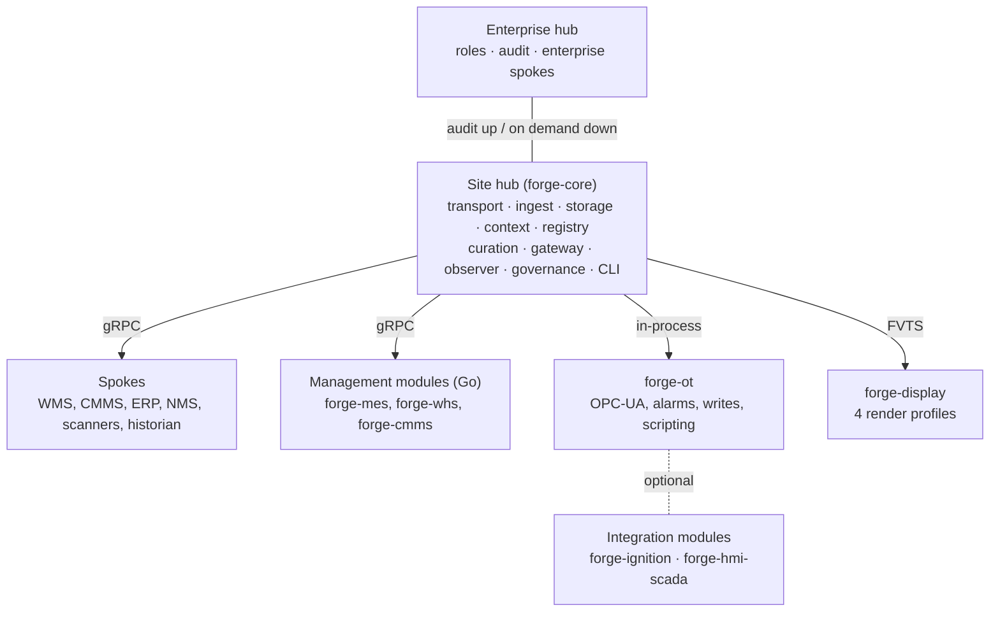

| Layer of the hub | What it is when complete |
|---|---|
| Transport | `forge.v1.AdapterService` over gRPC with TLS/mTLS both ways; push, pull, write-back, discovery |
| Ingest | validates manifest against the spoke's FACTS spec (hash verified), validates each record, routes, logs, feeds curation |
| Storage | hub-owned PostgreSQL, TimescaleDB, Neo4j, Redis; versioned migrations; modules never connect on their own credentials |
| Context Engine · Schema Registry | enrichment and the context field registry; versioned schemas and compatibility rules |
| Curation | normalization, data products, per-product pipelines, lineage, quality monitoring |
| Gateway · Hub API · Observer · CLI | auth and scoped RBAC; REST for operators and modules; health and SLOs; `forge` |
| Governance · Federation | the FxTS suite as CI gates with FHTS hashing; hub of hubs |

note:
- `docs/VISION.md` §3. The diagram is the finished system; F1's next sub-section says which boxes exist today.

---

## Where We Are Today · Honest

From `docs/WHERE-WE-ARE.md` §1, the snapshot at PR 76:

1. The **hub ↔ spoke contract works end to end**: a spoke registers, is checked against its FACTS spec, pushes records that are persisted, is pulled (Collect, Backfill, Subscribe) and receives write-backs, over TLS/mTLS both ways with per-spoke tokens.
2. The **OT module runs inside the hub** with OPC-UA connections, a tag engine, ISA-18.2 alarms, the full control-write defense chain, and drives the MES changeover sequence including the PLC CIP runner.
3. **forge-mes is Go and not yet built**: the imported NestJS backend and Next.js frontend stand in as the interim bridge and speak the spoke contract; the Go rewrite (FB-076) is decided but not designed.
4. **Governance is real for four frameworks** (FATS, FACTS, FTTS, FVTS) plus FHTS hashing; the other seven are stubs or planned. forge-display does not exist yet; its contract (FVTS) does, with a runner and golden messages.
5. **Not yet**: scoped roles in the gateway, `mod_mes` in the hub, the Go module SDK, the hub-of-hubs federation, Kubernetes, and any management module in Go.

| Measure | Value (2026-10-27) |
|---|---|
| Python hub (`src/forge`) | 354 files, ~68,500 lines |
| Python tests | 259 files, 4,448 collected, full suite green on the locked dependency set |
| Go (`go/`) | 32 files, ~9,500 lines; `gofmt`, `go vet`, `go test` gate CI |
| Interim MES bridge (`modules/Forge MES`) | ~248,000 lines of TypeScript, kept until the Go forge-mes lands |
| Hub REST routes | 41 on the hub app, plus OT i3X (8) and OT control (15), plus the curation app |
| Storage migrations | 12 |
| FACTS specs · FATS specs · FVTS specs | 9 · 28 · 1 |
| Backlog | 103 items recorded; every finding fixed or recorded |

note:
- Wording rule from the owner: the NestJS/Next.js code under `modules/Forge MES` is "the interim MES bridge"; forge-mes is the Go module that FB-076 builds. Never "TypeScript forge-mes".
- The numbers move with every push; `docs/WHERE-WE-ARE.md` §2 is current before each one.

---

## The Key Documents and How to Read Them

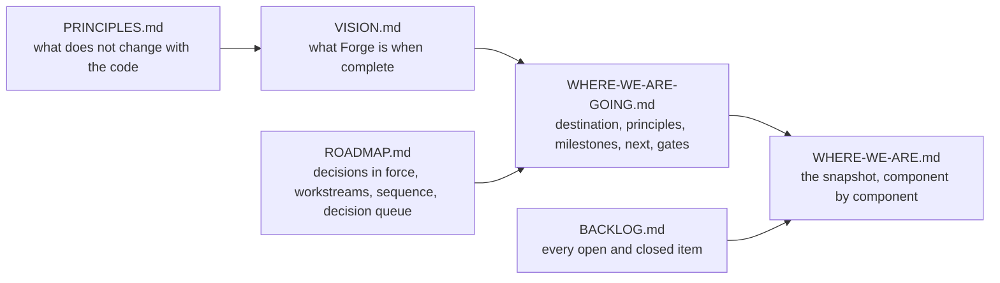

- **`VISION.md`** changes only when a decision in `ROADMAP.md` §1 changes.
- **`WHERE-WE-ARE-GOING.md`** changes when a milestone or the sequence changes.
- **`WHERE-WE-ARE.md`** changes **before any push** that changes the state it describes (rule since 2026-10-16).
- **`ROADMAP.md`** holds decisions in force (A-1 … A-10, R-1 … R-17), the workstreams, the proposed sequence and the owner's decision queue (D-1 …).
- **`BACKLOG.md`** is the unit of work: one item per PR; a finding is fixed or recorded, never skipped.
- **`PRINCIPLES.md`** holds the design principles, technical invariants, the governance pattern, the decision frame, adapter tiers, technology choices and lessons that still bind.

Design records for decisions the owner must sign live in `docs/decisions/` (`roles.md`, `one-clock-ot-source-time.md`, `one-schema-registry.md`).

note:
- `docs/WHERE-WE-ARE-GOING.md` §6 is the reading guide. A newcomer reads VISION once, GOING once, and WHERE-WE-ARE every time.

---

## Repository Tour

| Path | What lives there |
|---|---|
| `src/forge/core` | `ContextualRecord`, decisions, adapters, manufacturing entities (ISA-95 hierarchy), the embedded MQTT broker, the context field registry, the schema-reference grammar, the clock helpers |
| `src/forge/transport` · `proto` · `proto_gen` | the gRPC hub and spoke sides, the proto set and the generated Python bindings |
| `src/forge/ingest` | the ingest pipeline, the FACTS check at Register, receipt stamping |
| `src/forge/storage` | router, factory, engines (PostgreSQL, TimescaleDB, Neo4j, Redis), access control, migrations |
| `src/forge/context` · `registry` · `curation` | Context Engine, Schema Registry, curation (normalization, data products, pipeline, lineage, quality) |
| `src/forge/governance` | FxTS: schemas, runners, specs, the shared hashing runner |
| `src/forge/gateway` · `api` · `observer` · `cli` | auth and RBAC middleware, the hub FastAPI app, health, the `forge` CLI |
| `src/forge/modules/ot` | the OT module: OPC-UA client, tag engine, alarming, control, MQTT, bridge, i3X, changeover |
| `src/forge/sdk` | the module builder and the scripting SDK (`forge.*` namespace) |
| `src/forge/adapters` | in-repo spoke adapters (whk-cmms reference, the forge-mes hub-side adapter) |
| `go/` | Go models mirroring the core models, the scaffold, generated bindings, daemon and CLI stubs |
| `modules/Forge MES` | the interim MES bridge (NestJS + Next.js) that FB-076 retires |
| `tests/` | 259 files mirroring `src/`; migration tests read the migration source |
| `docs/` | the key docs, `FxTS/` framework pages, `decisions/`, `governance/`, `core/`, `spokes/`, `p7-ot-module/` |
| `deploy/docker` | the development compose stack and the hub image |

note:
- `README.md` "Project Structure" has the file-level tree. Note that two README tree comments still carry old names for FATS and FHTS; the framework pages under `docs/FxTS/` are the authority.

---

## F1 Recap → F2

- Forge: one governed record type, context attached, curated into data products, interfaces rendered from specs, contracts hashed and owner-approved.
- Twelve problems, each carried by a named component with a definition of solved.
- Today: the contract works end to end, the OT module runs in the hub, governance is real for four frameworks; forge-mes in Go, forge-display, scoped roles, federation and Kubernetes are not built.
- Read VISION once, GOING once, WHERE-WE-ARE every time.

**Next**: what actually crosses the hub boundary.

---

<!-- SECTION F2, THE CONTRACT -->
<!-- .slide: id="f2--the-hub-spoke-contract" -->

# F2 · The Hub ↔ Spoke Contract

**Nav**: [← F1](#f1--opening) · [⇤ TOC](#table-of-contents) · [⇅ Landing fork](#landing-fork) · [F3 →](#f3--storage-and-the-hubs-databases)

One contract, `forge.v1.AdapterService`, carries everything between a spoke and its hub. This section covers the twelve RPCs, the one record type, the transport, and what happens at Register and at Ingest.

note:
- Source: `docs/VISION.md` P-1, `docs/WHERE-WE-ARE.md` §3.1, `src/forge/proto`, `src/forge/transport`, `src/forge/ingest`.

---

## AdapterService · Twelve RPCs

| Group | RPC | Direction | Purpose |
|---|---|---|---|
| Lifecycle | `Register` | spoke → hub | present the manifest; the hub checks it against the spoke's FACTS spec (hash verified) before accepting |
| Lifecycle | `Configure`, `Start`, `Stop`, `Health` | hub → spoke | configure and run the adapter; report health, including clock offset |
| Push | `Ingest` | spoke → hub | stream `ContextualRecord`s; persisted and FACTS-checked |
| Pull | `Collect`, `Backfill` | hub → spoke | on-demand reads and historical ranges |
| Pull | `Subscribe`, `Unsubscribe` | hub → spoke | live streams of changes |
| Write-back | `Write` | hub → spoke | a session-bound callback into the source system |
| Discovery | `Discover` | hub → spoke | enumerate what the source exposes |

- Compiled protobuf over gRPC; JSON over gRPC is forbidden (decision A-1).
- Go and Python bindings generated from one proto set (`src/forge/proto`, `src/forge/proto_gen`, `go/gen/forge`).
- Spokes are Python inside the hub or external processes in any language that speaks the proto.

note:
- The rule "spokes never talk directly to each other" holds: every exchange goes through the hub. Spokes may publish to the Forge broker for real-time data, but the contract is the hub's.

---

## ContextualRecord · The One Record Type

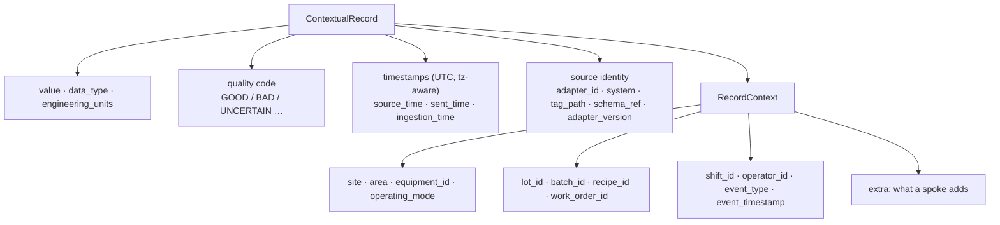

- `RecordContext` carries the context field registry slot for slot, on the proto and in Go, with every producer and the TimescaleDB table following (FB-013).
- A naive datetime or an offset-less string is rejected at the model (`forge.core.clock`, FB-014); ruff's `DTZ` rules block CI.
- The hub stamps `ingestion_time` with its own clock on receipt; the spoke's stamp is kept as `sent_time`; nothing is invented (FB-087).
- Every schema reference uses one grammar, `forge://schemas/<spoke>[/<Entity>][/v<version>]`, held at every boundary (FB-008).

note:
- The context field registry (`src/forge/core/registry`) and the manufacturing entity catalog (`docs/core/manufacturing-entity-catalog.md`) define what each slot means, so "area" is the same thing in every spoke.
- `sent_time` is provisional until the one-clock decision (D-9) names the time fields.

---

## Transport · gRPC, TLS/mTLS, Tokens

| Property | State | Where |
|---|---|---|
| TLS / mTLS hub → spoke and spoke → hub | ✅ | FB-063, FB-072 |
| Per-spoke callback token, scoped hub endpoints | ✅ | FB-063 |
| Hub → spoke write-back over a session-bound callback | ✅ | FB-054 |
| Durable adapter registry and ingest log | ✅ | FB-060, migration 007 |
| FTTS transport spec and runner | 🟡 | `specs/grpc-hardened-transport.ftts.json`; no `docs/FxTS/FTTS.md` page yet |
| Transport parity tests for the Go module | ⬜ | FB-055 |
| Hub time in the contract; fail-closed clock enforcement | ⬜ | FB-092, FB-093 wait on D-9 |

Code: `src/forge/transport/grpc_server.py` (hub), `spoke_client.py` (spoke side), `grpc_channel.py` (retry), `proto_bridge.py` (proto ↔ model), `transport_adapter.py` (adapter base).

note:
- FTTS governs TLS, tokens and streaming behaviour; the schema and runner exist and one spec is in force. The missing doc page is a known gap.

---

## Ingest · What Happens at Register and at Ingest

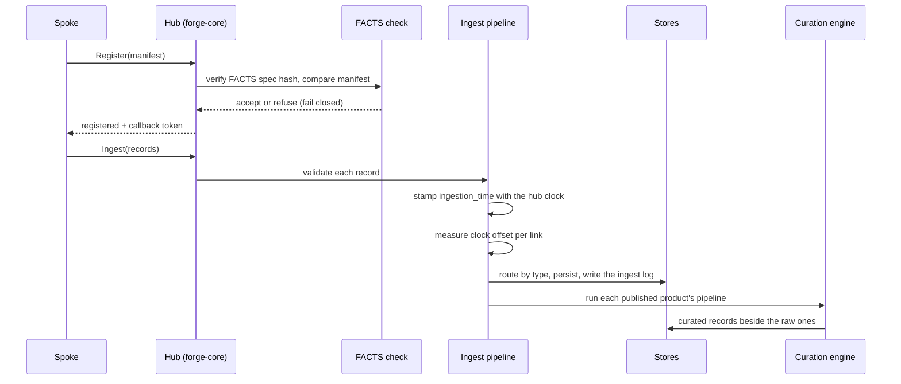

- `forge.ingest.facts_check` verifies the spec's hash before trusting it; a spoke whose manifest or hash does not match is refused.
- One hub-clock reading per batch (`IngestPipeline.ingest` → `stamp_receipt`).
- Every link's clock offset is measured and exposed on `AdapterHealth.clock`, `GET /v1/ingest/stats`, the OT connection status and OpenTelemetry (`forge.clock.offset`, `forge.clock.out_of_tolerance`); the provisional tolerance is 1 s (FB-089). Enforcement waits on D-9 (FB-093).
- Curated records are persisted with the raw ones (FB-009).

note:
- `HubIngestServicer` replaced the original in-memory servicer (FB-053); before that, records were queued and never routed.
- Push persisted and FACTS-checked at Register since FB-053; pull since FB-061 and FB-071.

---

## Pull, Backfill and Write-back

- **Collect**: the hub asks a spoke for records on demand (bounded by the spoke's declared capabilities).
- **Backfill**: historical ranges, used by historian spokes and the forge-mes `AuditLog` backfill (FB-071).
- **Subscribe / Unsubscribe**: live change streams.
- **Write**: the hub writes back into a source system through a session-bound callback; the source's own rules still apply, and in the OT module the write first passes the defense chain (F5).

Everything a spoke can do is declared in its FACTS spec (`capabilities`, `data_sources`, `error_handling`); the runner checks the declaration, and Register checks the manifest against it.

note:
- Capability declarations are the contract's vocabulary: a spoke that is `INGESTION` only cannot be written to; one that is `BIDIRECTIONAL` must handle write errors as its spec says.

---

## F2 · Honest State

| Gap | Backlog |
|---|---|
| FTTS has no documentation page | noted in `docs/WHERE-WE-ARE.md` §3.1 |
| Go transport parity tests | FB-055 |
| Hub time in the contract; refusing an out-of-tolerance clock | FB-092, FB-093 (D-9) |
| The spoke's time fields (`sent_time`, source time per spoke) | FB-088, FB-090 (D-9) |
| Generic adapters (csv_file, mqtt_sparkplug, opcua, rest_generic) | package stubs only |

**Next**: where the records land.

---

<!-- SECTION F3, STORAGE -->
<!-- .slide: id="f3--storage-and-the-hubs-databases" -->

# F3 · Storage and the Hub-Owned Databases

**Nav**: [← F2](#f2--the-hub-spoke-contract) · [⇤ TOC](#table-of-contents) · [⇅ Landing fork](#landing-fork) · [F4 →](#f4--governance-fxts)

The hub owns the databases (decision A-6). This section covers the engines, routing, the twelve migrations, Forge-issued credentials, the "observe → shadow → own" path for module data, and the two schema registries.

note:
- Source: `docs/PRINCIPLES.md` §2 and §6, `docs/WHERE-WE-ARE.md` §3.3, `docs/DB_ORCHESTRATION_FRAMEWORK.md`, `src/forge/storage`.

---

## The Hub Owns the Databases (A-6)

| Store | Role | State |
|---|---|---|
| PostgreSQL 16 | relational: `forge_core` (adapters, ingest log, permissions, audit, registries), `forge_canonical` (data products), one `mod_<name>` schema per module | in force |
| TimescaleDB | time series: `forge_ts.contextual_records`, one column per `RecordContext` slot | in force |
| Neo4j 5 | lineage and topology | in force |
| Redis | cache and sessions | in force |
| RabbitMQ · MQTT | module events (the `wh.whk01.distillery01.*` proto-UNS); the embedded MQTT 3.1.1 broker | in force |
| MinIO · Kafka | object store; the enterprise bus when volume requires it | in the compose stack; Kafka planned |

- Modules hold only Forge-issued credentials and never connect on their own.
- Storage is polyglot by invariant: record types route to the engine that fits them; no single database serves every access pattern.
- Serving is API-first: consumers go through versioned APIs defined by FATS specs, never to a database directly.

note:
- The hub's health orchestrator probes all seven compose-stack components (`/v1/health`, `/readyz`, FB-006).

---

## Routing

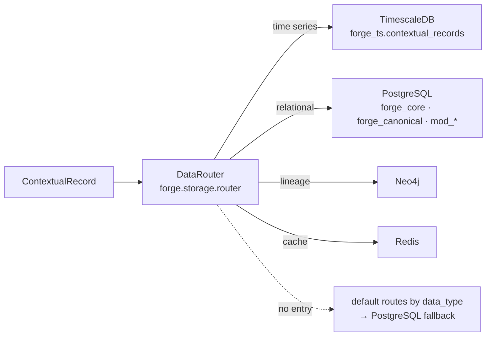

- `forge.storage.factory` builds the engines from configuration; the router picks the engine per record.
- Today the routing registry is in memory and empty on every start, so routing falls through the default routes by `data_type`. That is the subject of the one-schema-registry design record (D-10, below).

note:
- `forge.storage.engines.timescale` writes every `RecordContext` slot (FB-013); the migration test holds the writer's column list equal to the table's.

---

## Migrations · Twelve, and the Runner

| # | Creates |
|---|---|
| 001 | `forge_core` schema: adapters, records log, governance reports, schema entries |
| 002 | the six spoke schemas `mod_wms … mod_ims` and their roles, created `NOLOGIN` without a password (FB-099) |
| 003 | `forge_canonical` (data products) |
| 004 | TimescaleDB initialisation |
| 005 | lineage tables |
| 006 | `forge_ts.contextual_records` (the table the engine writes); its downgrade removes the schema (FB-101) |
| 007 | durable adapter registry and ingest log |
| 008 | `module_permissions` and `access_audit` (replaces two 001 tables, FB-003) |
| 009 | Schema Registry and equipment tables |
| 010 | the data product curation spec column |
| 011 | one column per `RecordContext` slot on contextual records |
| 012 | closes the placeholder login on spoke roles that 002's earlier text created, unless Forge issued the role |

```bash
forge migrate up | status | down
python -m forge.storage.migrations.run up --target postgres     # the runner behind the CLI
```

- Online runs go through asyncpg on SQLAlchemy's async engine (FB-003).
- The whole downgrade runs in one transaction; head → base → head is verified clean on a throwaway TimescaleDB container (FB-098, FB-101).
- `tests/storage/test_migrations.py` reads the migration source and holds it to the models and the writers.

note:
- A migration is never edited after it has been applied somewhere; a repair is a new revision (012 is the pattern).
- Postgres and the time-series target share the chain; the hypertable step runs only when the timescaledb extension is present.

---

## Forge-Issued Credentials · `forge db access`

```bash
forge db access grant forge-mes mod_mes --level write
forge db access grant forge-mes forge_canonical --level read
forge db access issue forge-mes --host localhost      # prints DATABASE_URL=... once
forge db access list | revoke ...
```

- A spoke role (`forge_mod_<x>`) has no way in until `issue` runs `ALTER ROLE … WITH LOGIN PASSWORD` with a password Forge generated; re-issuing rotates it.
- The password is shown once and never stored; the grant, the issue and every refusal are written to `forge_core.access_audit` (FB-003, FB-057 step 1).
- READ: usage and select, now and by default on future tables. WRITE: also insert, update, delete and sequences. ADMIN: also create on the schema (the interim MES bridge runs its own DDL through Prisma until the hub owns that DDL).
- Protected schemas (`forge_core`, `forge_canonical`, `curated`, `lineage`) cannot be granted for writing.

note:
- `PersistentAccessController` is the in-memory controller with every change written to the store the moment it is made; the storage factory and the CLI share it.
- Open: the bootstrap read grant on `forge_core` covers only the four tables that existed at 002 (FB-100, decided with FB-057 step 2).

---

## Observe → Shadow → Own

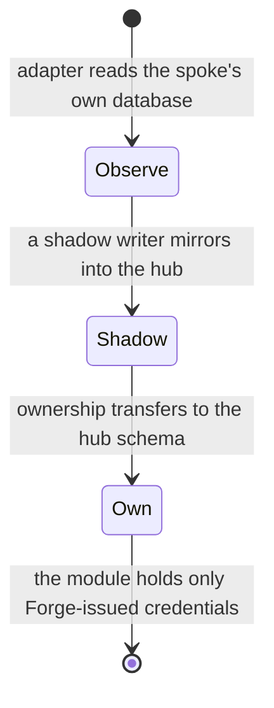

- The hybrid path from `docs/DB_ORCHESTRATION_FRAMEWORK.md`: adapters read spoke databases, a shadow writer mirrors into the hub, ownership transfers per module.
- Step 1 (grants and issued credentials) is delivered; steps 2–5 (the MES data into `mod_mes`) follow the forge-mes Go design (FB-057, D-3).
- `forge.storage.shadow` and `forge.storage.backfill` are the shadow writer and the historical backfill.

note:
- "Own" is the end state for every management module: the module's schema lives in the hub's PostgreSQL and the module never carries a password it created itself.

---

## Two Schema Registries · D-10

| | F20 Schema Registry (`forge.registry`) | Routing registry (`forge.storage.registry`) |
|---|---|---|
| Served at | `/v1/schemas` (9 routes), Postgres tables from migration 009 | in-memory only; the `schema_entries` table from 001 is never written |
| Models | `SchemaMetadata`, `SchemaVersion`, integer versions, compatibility mode | `SchemaEntry` with engine, namespace, retention, authoritative spoke, status |
| Effect | the registry the hub exposes | empty on every start, so routing uses the default routes |

The design record `docs/decisions/one-schema-registry.md` (round 1, 2026-10-26) recommends folding routing into the F20 registry as a placement facet, with ten proposals and eight questions. Its first three implementation steps need only the owner's signature (FB-097, D-10).

note:
- This is the pattern for every design the owner must sign: a record with a status line, statements tagged [OWNER] / [FACT] / [PROPOSED] / [OPEN], numbered proposals and questions with proposed answers. Nobody signs on the owner's behalf.

---

## F3 · Honest State

| Gap | Backlog |
|---|---|
| `mod_mes` in the hub (MES data moves in) | FB-057 steps 2–5, after the FB-076 design |
| Backups and a restore procedure | no backlog id yet |
| The two registries converge | FB-097 (D-10) |
| Bootstrap read grant on `forge_core` partial | FB-100 |

**Next**: the headline section, governance.

---
<!-- SECTION F4, GOVERNANCE -->
<!-- .slide: id="f4--governance-fxts" -->

# F4 · Spec-First Governance

**Nav**: [← F3](#f3--storage-and-the-hubs-databases) · [⇤ TOC](#table-of-contents) · [⇅ Landing fork](#landing-fork) · [F5 →](#f5--the-ot-module)

The spec is the contract. This section is the headline for contributors: spec-first governance, the four layers every framework shares, the family of frameworks and their state, hashing and the owner's approval, the anatomy of a FACTS spec, and how to run the gates.

note:
- Source: `docs/PRINCIPLES.md` §3, `docs/FxTS/README.md`, `docs/governance/facts-developer-guide.md`, `docs/WHERE-WE-ARE.md` §3.9, `src/forge/governance`.

---

## Spec-First, Not Test-First

- **The spec defines what must exist and how it must behave**; the implementation serves the spec; the runner enforces conformance; the CI gate blocks deviation.
- A FATS spec that says `GET /v1/data-products/{id}` returns 200 with a given shape is a **prior commitment**, not a test of an existing endpoint.
- Drift is caught by the runner; a spec change is a visible diff in review.
- A behavioural change is a spec change, and a spec change is reviewed. No specification field is silently ignored.

Rules carried over from MDEMG's UxTS and confirmed in practice:

- A spec with zero assertions **fails**; it does not pass (the "0/0 problem").
- **Parity**: schema fields the runner does not enforce are reported, never ignored; a single unimplemented field is a hard fail.
- Runners produce structured verdicts with check IDs, spec references, violation details and timing, not bare pass/fail.

note:
- Lineage: FxTS is adapted from MDEMG's UxTS framework family. The same governed-memory tooling (MDEMG/Jiminy) watches over the agents working on this repository (F9).

---

## The Four Layers

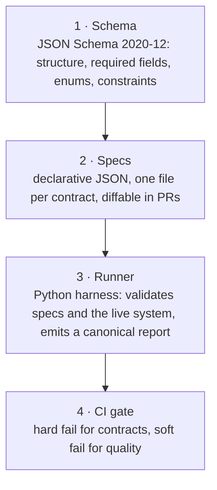

| Layer | Where |
|---|---|
| Schemas | `src/forge/governance/<framework>/schema/*.schema.json` |
| Specs | `src/forge/governance/<framework>/specs/*.json` (FACTS: nine, one per spoke) |
| Runners | `src/forge/governance/<framework>/runners/`, over the shared runner in `forge.governance.shared.runner` (hashing, verification, approval) |
| Gate | the `hub-python` CI job runs the governance tests; `forge governance run` is the operator's path |

note:
- Hard fail blocks merges; soft fail warns. No framework is advisory-only.

---

## The Family

| Framework | Governs | State (2026-10-27) |
|---|---|---|
| **FATS** · Forge API Test Specification | API contracts: routes, shapes, status codes | schema + runner + 28 specs, one per hub-served route |
| **FACTS** · Forge Adapter Conformance Test Specification | identity, capabilities, lifecycle, connection, data contract, context mapping, error handling | schema + runner (`facts:schema-valid` + 35 rule checks) + 9 specs; 8 validate |
| **FTTS** · Forge Transport Test Specification | TLS, tokens, streaming behaviour | schema + runner + 1 spec; no doc page |
| **FVTS** · Forge View Test Specification | module ↔ display: points, alarms, actions, surfaces, profiles | schema + 19-check runner + reference renderer + golden messages + 1 spec |
| **FHTS** · Forge Hash Test Specification | hash integrity and owner approval of every spec above | hashing, verification, approval, revert, registry |
| FQTS · FSTS | data quality · security controls | stubs |
| FDTS · FLTS · FNTS · FOTS · FPTS | schema evolution · lineage · normalization · observability · performance | planned (doc pages only) |

Governance is declarative by invariant: quality, lineage, normalization and security rules are specifications, not code paths.

note:
- Six FACTS specs await the owner's approval after re-stamps (`forge governance specs --pending`); the OT spec fails schema validation until the OT vocabulary decision (D-8, FB-079).

---

## FHTS · Hashing and the Owner Approval

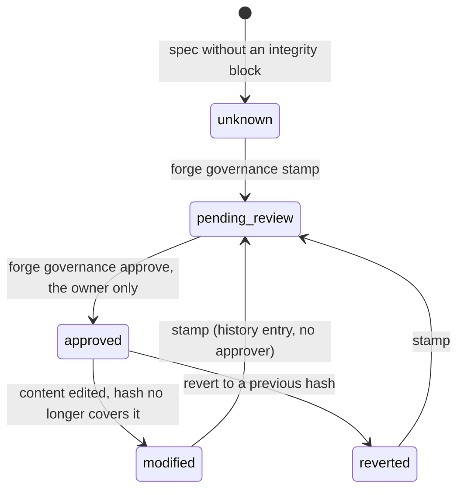

- Every governed spec carries an `integrity` block: `spec_hash`, `hash_state`, `previous_hash`, `approved_by`, `approved_at`, `change_history` naming who or what changed it.
- The content hash **excludes the whole `integrity` block** (a history entry refers to the hash itself); canonical JSON uses sorted keys, compact separators and ASCII escaping, so the digest is portable.
- Hash verification is **independent of assertion execution**: a spec can pass every assertion and still have `hash_verified=false` if it was modified. Two orthogonal signals.
- **Only the owner approves** a spec hash. Agents re-stamp to `pending_review` and never approve on the owner's behalf. `approve` is refused when the hash no longer covers the content.
- The hub's Register check verifies a spoke's FACTS hash before accepting the spoke.

note:
- Problem P-7: the more AI assistance a team uses, the larger the risk of a silently relaxed timeout or dropped required field. Hashing makes the change visible in the spec's own history and fails CI until the owner approves it.

---

## A FACTS Spec, Anatomically

| Block | Declares |
|---|---|
| `adapter_identity` | id, name, version, tier (`OT`, `MES_MOM`, `ERP_BUSINESS`, `HISTORIAN`, `DOCUMENT`), type (`INGESTION`, `BIDIRECTIONAL`, `WRITE_ONLY`, `DISCOVERY_ONLY`) |
| `capabilities` | what the spoke can do: ingest, collect, backfill, subscribe, write, discover |
| `connection` | parameters, protocols, timeouts, retry policy |
| `data_sources` | each source the spoke reads or writes (GraphQL, REST, RabbitMQ, MQTT, gRPC, database, WebSocket …), with its schema reference |
| `context_mapping` | source field → Forge context field, and the enrichment rules the hub applies |
| `error_handling` | dead-letter policy, retry classes, what is fatal |
| `sample_records` | records the runner validates against the data contract |
| `integrity` | the FHTS block |

- Nine specs today: whk-wms (the reference), forge-mes, bosc-ims, whk-cmms, whk-erpi, whk-nms, next-trend, scanner-gateway, ot-module.
- The runner validates every spec against the JSON schema first (`facts:schema-valid`) and reads its enums from the schema (FB-080).
- The developer guide, `docs/governance/facts-developer-guide.md`, walks the schema, how to write a spec, running the runner, common failures and cross-spoke consistency.

note:
- Adapter tiers and what they mean: `docs/PRINCIPLES.md` §5. The OT tier's vocabulary gap in FACTS v0.1.0 is decision D-8.

---

## Running the Gates

```bash
forge governance specs                       # every spec's hash state, approver, hash still verifies?
forge governance specs --pending             # what awaits the owner
forge governance validate-spec <spec.json>   # against its framework schema
forge governance run facts whk-wms           # one framework, one spec; exit 1 on any failure
forge governance stamp <spec.json>           # after an edit: history entry, pending_review, no approver
forge governance approve <spec.json> --by reh3376   # the owner, on their own word, never on their behalf
```

- `run` covers FATS, FACTS, FVTS and FTTS (FB-021, FB-083).
- The hub test suite holds FATS in both directions: every served route has a spec, every spec names a served route.
- The FVTS runner has a render-profile baseline and golden messages; a module can only tighten the baseline, never loosen it.

note:
- When you add a hub route you add a FATS spec; when you add a spoke you add a FACTS spec; when a module exposes a surface it adds an FVTS spec. The gate is where you find out you forgot.

---

## F4 · Honest State

| Gap | Backlog / decision |
|---|---|
| Six FACTS specs await the owner's approval after re-stamps | `forge governance specs --pending` |
| The OT FACTS spec fails `facts:schema-valid` and eight vocabulary checks | FB-079, D-8 |
| FQTS and FSTS are stubs; FDTS, FLTS, FNTS, FOTS, FPTS are planned | M5 |
| FTTS has no documentation page | noted in `docs/WHERE-WE-ARE.md` §3.9 |
| The OT reference FVTS spec uses invented points and is `pending_review` | FB-078 |

**Next**: the module that reaches the plant floor.

---

<!-- SECTION F5, OT MODULE -->
<!-- .slide: id="f5--the-ot-module" -->

# F5 · The Plant-Floor Module (forge-ot)

**Nav**: [← F4](#f4--governance-fxts) · [⇤ TOC](#table-of-contents) · [⇅ Landing fork](#landing-fork) · [F6 →](#f6--modules-the-sdk-and-forge-display)

forge-ot is the most mature module and lives in this repository. This section covers the tag engine, ISA-18.2 alarming, the control-write defense chain, the MES changeover, the scripting SDK, the Ignition bridge, and the one-clock principle.

note:
- Source: `docs/VISION.md` P-4 and P-6, `docs/WHERE-WE-ARE.md` §3.5, `README.md` "OT Module", `src/forge/modules/ot`, `docs/PRINCIPLES.md` §2 (one clock).

---

## What It Is

- A **thin, open wrapper over OPC-UA**: asyncua owns the wire protocol (pinned `==2.1.0`, FB-085); Forge owns tags, alarms, writes, scripting and history.
- Hosted **inside the hub** with PLC connections, supervision and liveness (`forge.modules.ot.host`, FB-069, FB-070).
- Replaces the vendor SCADA/HMI layer (Ignition) problem by problem: tag engine, alarming, scripting SDK, i3X-shaped REST, MQTT; where a site keeps its vendor product, the **Ignition bridge** runs a read-only parallel validation.
- HMI/SCADA itself is an optional module activated per site (decision A-4); forge-display renders the surfaces (A-3).

| Subsystem | Package |
|---|---|
| OPC-UA client, path normalisation (OPC-UA ↔ Ignition ↔ Forge) | `opcua_client` |
| Tag engine: definitions, registry, UDT templates, persistence, eight provider types | `tag_engine` |
| ISA-18.2 alarming: state machine, detector, engine, integrations, API | `alarming` |
| Control writes: validation, review, interlocks, authorization, write engine, audit, recipe integration | `control` |
| MQTT: publisher, subscriber, tag publisher, topic router, Sparkplug B, rate limiter | `mqtt` |
| Ignition bridge: adapter, REST client, tag mapper, dual-write validator, health dashboard | `bridge` |
| i3X (CESMII) models and router; context resolvers; store-and-forward; acquisition | `i3x`, `context`, `acquisition` |

note:
- Phases 1–6 of the OT plan are complete (`README.md` "Phase Summary"); phase numbering history is in `docs/ROADMAP.md` §7.

---

## Tags and Providers

| Provider | Serves |
|---|---|
| `opcua_provider` | direct OPC-UA reads |
| `acquisition` | scheduled polling |
| `memory_provider` | in-memory tags |
| `expression_provider` | calculated tags |
| `query_provider` | SQL-driven tags |
| `virtual_provider` | virtual and derived tags |
| `event_provider` | event-driven tags |
| `base` | the provider protocol |

- `TagDefinition`, `TagValue`, `QualityCode`, `DataType` are the models; every value carries quality.
- Context resolvers attach site, area, equipment, lot, shift and mode to OT records; the batch context resolver wired to MES is open (FB-020).

note:
- The OT module's `DataValue` and `TagValue` still coerce a naive datetime to UTC because OPC UA `DateTime` is UTC by definition; the source-time correction is the subject of FB-088 and FB-094 (below).

---

## Alarms · ISA-18.2

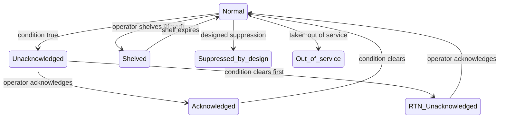

- Seven-state ISA-18.2 machine, nine alarm types (HI, HIHI, LO, LOLO, digital, rate-of-change, quality, communication, custom).
- Event-sourced journal; REST under `/alarms` (active, history, config, ack, shelve).
- Integrations: MQTT publish, RabbitMQ fan-out, CMMS auto work orders.

note:
- Alarm presentation (annunciation, priority colours, staleness) is forge-display's job from the FVTS spec, not the module's.

---

## Control Writes · The Defense Chain (A-7)

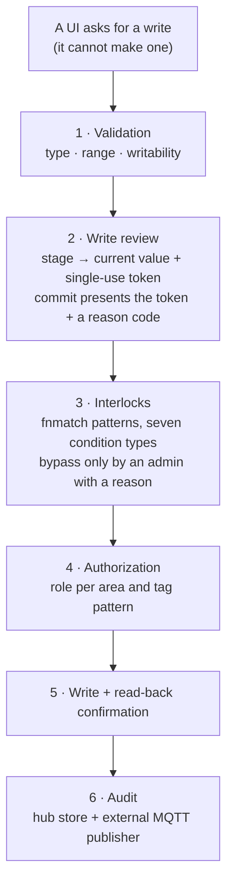

- Safety stays in the core: roles, interlocks, confirmation, read-back and audit are enforced in forge-core/OT, never only in a UI.
- Server-side two-step review with reason codes and `REJECTED_REVIEW` since FB-074; multi-party approval waits on the role model (D-1).
- The audit record goes to the hub store and to an external publisher (FB-066, FB-067).
- The FVTS contract binds every UI action to a required role, a confirmation mode and the statuses it must handle; the render profile decides whether a surface may write at all.

note:
- "Solved when": no path exists from any interface to a PLC that does not pass the chain, and every write is reconstructible from the audit log (`docs/VISION.md` P-6).

---

## The MES Changeover

- The orchestrator runs the changeover sequence against the PLC through the **CIP runner**, with recipe integration turning an MES recipe into batched PLC writes through the defense chain (FB-062, FB-065).
- REST endpoints for confirm-start, retry-recipe, resume and connection restart sit behind the hub's `adapters:write` scope; the hub user is the actor on the MES write, the audit record and the events (FB-082).

| Capability | State |
|---|---|
| Orchestrator, CIP runner, recipe integration, REST | ✅ |
| Endpoints behind a hub scope | ✅ FB-082 |
| Batch context resolver wired to MES | ⬜ FB-020 |

note:
- The interim MES bridge is the counterpart today; the Go forge-mes module takes over the changeover and MQTT in M3 (phases 2–3 of FB-076).

---

## The Scripting SDK · `forge.*` Replaces `system.*`

| Module | Replaces | Key functions |
|---|---|---|
| `forge.tag` | `system.tag.*` | `read`, `write`, `browse`, `get_config`, `exists` |
| `forge.db` | `system.db.*` | `query`, `named_query`, `transaction`, `scalar` |
| `forge.net` | `system.net.*` | `http_get`, `http_post`, `http_put`, `http_delete` |
| `forge.alarm` | `system.alarm.*` | `get_active`, `ack`, `trigger`, `shelve`, `get_history` |
| `forge.log` · `forge.date` · `forge.dataset` | `system.util.getLogger`, `system.date.*`, `system.dataset.*` | logging, date handling with Java → Python pattern conversion, tabular data |
| `forge.perspective` · `forge.file` · `forge.util` · `forge.security` | `system.perspective.*`, `system.file.*`, `system.util.*`, `system.security.*` | UI interaction, sandboxed files, JSON and messaging, user and role queries |

- Python 3.12+ engine replacing Jython 2.7: discovery, loading, hot reload; a PEP 302 import allow-list sandbox; `@timer`, `@on_tag_change`, `@api.route` triggers; area and tag-pattern RBAC; an append-only audit ring buffer.
- The migration map covers all 52 `system.*` calls; 42 Tier 1 scripts are identified for conversion (`docs/p7-ot-module/`).

note:
- The SDK lives in `src/forge/sdk/scripting`; the OT module's user scripts in `src/forge/modules/ot/scripts`.

---

## One Clock, Governed by the Hub

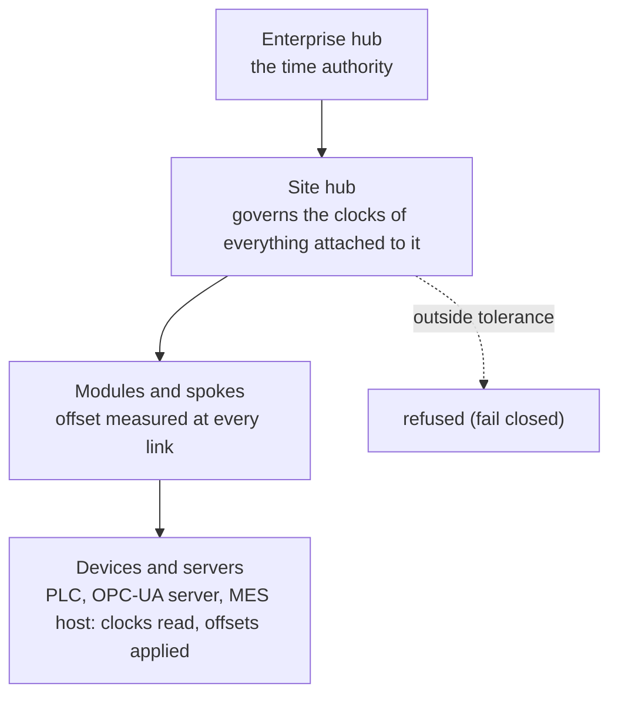

The owner's principle (2026-10-18): records from different sources only reconcile if their timestamps come from the same master time.

| Rule | State |
|---|---|
| Every stored timestamp is UTC and timezone-aware; naive rejected at the model | ✅ FB-014 |
| The hub stamps receipt with its own clock | ✅ FB-087 |
| The offset of every connected clock is measured, recorded and surfaced | ✅ FB-089 (provisional 1 s tolerance, warning only) |
| A tag's `source_time` is device time corrected to master by the device's measured offset, original stamp and offset recorded | ❌ FB-088, FB-094; design record `docs/decisions/one-clock-ot-source-time.md` awaits the owner's signature |
| Hub time in the contract; a hub, module or spoke outside tolerance is refused | ⬜ FB-092, FB-093 (D-9) |
| Per-spoke declaration of source time zones; a quality dimension for time | ⬜ FB-090, FB-091 (D-9) |

note:
- Today the OPC-UA converter stores `SourceTimestamp` as the server sends it and invents one when absent; no device clock is read. That row is marked ❌ deliberately: the principle says a device whose clock cannot be read is not a valid source.
- D-9 chooses among established standards: NTP/chrony strata mirroring the hub hierarchy, PTP/IEEE 1588 on the plant network, NTP four-timestamp measurement in-band, IEC 61850-5 tolerance classes, IEC 61850 `TimeQuality` and OPC UA `DataValue` fields on the record.

---

## F5 · Honest State

| Gap | Backlog / decision |
|---|---|
| Source time is not device time corrected to master | FB-088, FB-094 (D-9 signature) |
| One adapter identity (code `forge-ot-module`, manifest and spec `ot-module`) | FB-079 (includes FB-018) |
| Batch context resolver wired to MES | FB-020 |
| OT FACTS vocabulary | D-8 |
| OT reference FVTS spec with real tags, owner-approved | FB-078 |

**Next**: how modules are built and shown.

---

<!-- SECTION F6, MODULES -->
<!-- .slide: id="f6--modules-the-sdk-and-forge-display" -->

# F6 · Modules, the Module Builder and forge-display

**Nav**: [← F5](#f5--the-ot-module) · [⇤ TOC](#table-of-contents) · [⇅ Landing fork](#landing-fork) · [F7 →](#f7--context-curation-and-decisions)

How new capability enters Forge: the language policy, the module builder's pattern, what exists in Go, the interim MES bridge and its Go rewrite, and the one UI runtime.

note:
- Source: `docs/ROADMAP.md` §1 (A-2, A-3, A-5), `docs/MODULE_BUILDER.md`, `docs/WHERE-WE-ARE.md` §3.6–§3.8, `docs/FxTS/FVTS.md`.

---

## The Language Policy

| Component | Language | Status |
|---|---|---|
| Hub (forge-core) | Python ≥ 3.12, FastAPI, Typer, Pydantic v2, uv, ruff | in force |
| Management and integration modules (`forge-<service>`) | **Go**, generated from the module SDK (A-2, A-5) | in force; the Go forge-mes is FB-076 |
| Spokes | Python inside the hub, or any language that speaks the proto as an external process | in force |
| forge-mes today | the migrated NestJS/Next.js application runs as the **interim MES bridge** until the Go module replaces it | bridge in place; design (D-3) not written |
| User interfaces | none in modules: forge-display renders every surface from FVTS specs (A-3) | runner and reference renderer exist; the renderer does not |

note:
- Decision D-7 (scope of the Go standard for the OT module and the Python adapters) is parked; nothing in the current sequence depends on it.

---

## The Module Builder Six-File Pattern

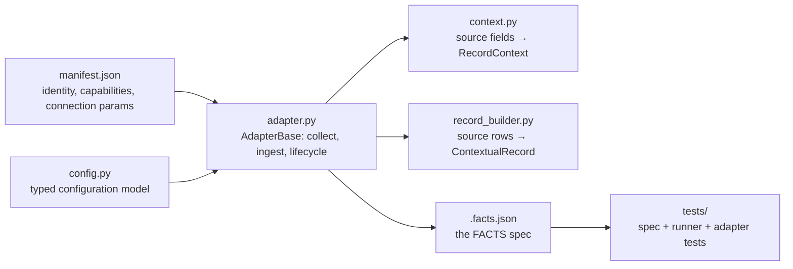

- `docs/MODULE_BUILDER.md` is the from-first-principles guide (~20 minutes, no prior Forge knowledge assumed): manifest, config, adapter class, context mapper, record builder, the FACTS spec, testing, CLI and API reference, common patterns, troubleshooting.
- `src/forge/sdk/module_builder`: manifest builder, scaffolder, generators and its CLI.
- The reference spoke is `src/forge/adapters/whk_cmms` (adapter, config, context, record builder, topics, entity mappers).

note:
- Honest: the templates are adapter-style and backend-only (FB-017), and duplicate SDK copies drift (FB-019). The Go module template does not exist yet (M3).

---

## Go Today

| Piece | State |
|---|---|
| `go/internal/models` | ✅ the core models mirrored, 1,800 lines with 1,488 of tests; `Lot.item_id` (FB-010) and the `RecordContext` slots (FB-013); every manufacturing entity has a `New*` constructor with the Python defaults and a `Validate()`, held equal to the Python models by one fixture both suites read (FB-016) |
| `go/gen/forge` | ✅ generated bindings from the one proto set (Buf) |
| `go/internal/scaffold` | 🟡 112 lines; not a module template yet |
| `forged` daemon, `forgectl` | ⬜ placeholders |
| CI | `go build`, `gofmt -l`, `go vet`, `go test` in the `hub-go` job |

The route (M3): the module SDK template in Go; forge-mes phase 1 registers, ingests and takes write-backs against the hub with the transport parity tests (FB-055) as the acceptance test; `mod_mes` in the hub (FB-057); changeover and MQTT in Go; parity; cut-over; the NestJS backend retired.

note:
- The Go models become the MES module's types, so the data-model items (FB-010, FB-011, FB-012, FB-016) were settled first.

---

## forge-mes · The Interim Bridge and the Go Rewrite

| Capability | State |
|---|---|
| NestJS backend + Next.js frontend imported as the bridge (`modules/Forge MES`); the spoke speaks the contract (push, pull, Collect, token, TLS) | ✅ |
| FACTS spec `forge-mes` (18 data sources incl. the AuditLog backfill), approved | ✅ |
| Go rewrite from the module SDK | ⬜ FB-076: decided (A-2), design document not written (D-3) |
| Prisma data into the hub's `mod_mes` | ⬜ FB-057 steps 2–5 |
| Frontend retired in favour of forge-display | ⬜ after forge-display exists |

- The bridge's jest and tsc gates are advisory in CI (FB-048) and go away when FB-076 retires that code.
- The bridge was imported from `WhiskeyHouse/whk-mes` on 2026-10-15; the import's credential leak is why the repository's history was purged and the hardening of F8 exists.

note:
- Wording rule again: "the interim MES bridge", never "TypeScript forge-mes".

---

## forge-display · Modules Describe, the Renderer Renders (A-3)

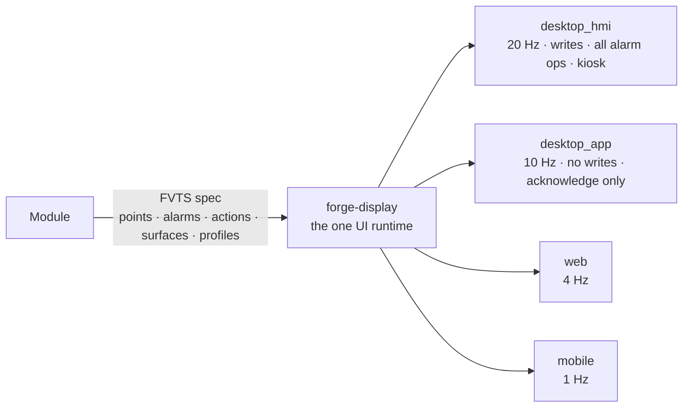

- A module publishes points (units, precision, ranges, staleness), alarms, actions, surfaces and the render profiles it supports; a module can only **tighten** the baseline, never loosen it.
- forge-display enforces nothing safety-critical itself (the core does); it ships staleness marking, bad-quality handling, ISA-101 presentation, alarm annunciation and action feedback with audit confirmation.
- Today: FVTS v0.1.0 schema, the 19-check runner, the render-profile baseline, a reference renderer, golden messages and a CI gate (FB-077). The renderer itself has no code and no backlog id until the design lands; the FVTS open items are decision D-4.

note:
- "Solved when": no module in the repository contains UI code, and the same FVTS spec renders on all four profiles (`docs/VISION.md` P-8).

---

## F6 · Honest State

| Gap | Backlog / decision |
|---|---|
| Go module SDK template; forge-mes in Go | FB-017, FB-076 (D-3) |
| Module builder templates adapter-style; duplicate SDK copies | FB-017, FB-019 |
| forge-display runtime | needs D-4; no code yet |
| Template module copies (`modules/Forge CMMS`, `Forge ERPI`, `Forge DB Orchestration`) are adapter templates, not Go modules | `docs/WHERE-WE-ARE.md` §3.7 |

**Next**: how a value becomes decision-quality.

---
<!-- SECTION F7, CONTEXT AND CURATION -->
<!-- .slide: id="f7--context-curation-and-decisions" -->

# F7 · Context, Curation and Decisions

**Nav**: [← F6](#f6--modules-the-sdk-and-forge-display) · [⇤ TOC](#table-of-contents) · [⇅ Landing fork](#landing-fork) · [F8 →](#f8--security-identity-and-federation)

From a raw value to a decision-quality figure and a recorded decision: the Context Engine, the manufacturing entities, the curation pipeline, data products with lineage, and the decision frame.

note:
- Source: `docs/VISION.md` P-2, P-3, P-9; `docs/PRINCIPLES.md` §4; `docs/WHERE-WE-ARE.md` §3.2–§3.3; `src/forge/context`, `src/forge/curation`, `src/forge/core/models`.

---

## Context Is a First-Class Citizen

- A spoke's FACTS spec maps source fields to Forge context fields and declares enrichment rules; the hub fills what the source cannot: **shift from timestamp, area from location, lot from the active batch**.
- The **Context Engine** (F21) is served by the hub under `/v1/context` (12 routes; state changes behind `context:write`) with Postgres stores through the factory (FB-001, FB-005).
- The **context field registry** (`src/forge/core/registry`) is the vocabulary; `RecordContext` carries it slot for slot (FB-013).
- The **manufacturing entity catalog** (`docs/core/manufacturing-entity-catalog.md`) and the ISA-95 / ISA-88 hierarchy in `forge.core.models.manufacturing` define what context *means*: `MaterialItem`, `Lot` (with `item_id`, FB-010), `ProductionOrder`, equipment and areas.
- Context is never silently dropped (invariant).

| Open | Backlog |
|---|---|
| Step and phase execution, electronic batch record entities | FB-011 |
| Typed ISA-88 hierarchy | FB-012 |
| Equipment registry served from Postgres | ✅ migration 009 |

note:
- "Solved when": no record is persisted without its required context fields, and the required set is declared per spoke and checked by the FACTS gate.

---

## Curation · From Raw Records to Data Products

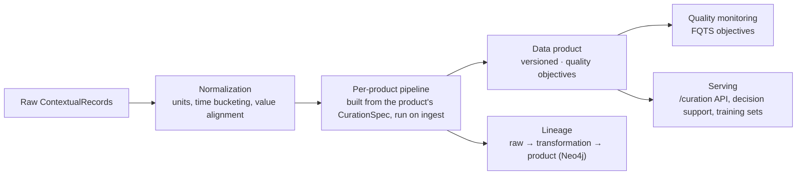

- One curation engine builds each data product's pipeline from its `CurationSpec` (migration 010) and runs it on ingest for the published products the adapter feeds; curated records are persisted with the raw ones (FB-009).
- `forge.curation`: `pipeline.py` (multi-stage normalization and enrichment), `normalization.py` (field normalization, unit conversion), `aggregation.py` (time windows), `quality.py` (scoring and validation), `lineage.py` (provenance).
- The curation service is mounted at `/curation`; data products live in `forge_canonical.data_products`.

note:
- The governance frameworks that make this declarative (FQTS quality, FNTS normalization, FLTS lineage) are stubs or planned; the engine runs on the product's spec today.

---

## Data Products

| Property | Meaning |
|---|---|
| Versioned | a product's definition changes by version; consumers pin one |
| Quality objectives | what "good" means for this product, visible beside every figure derived from it |
| Lineage | the chain from raw record through each transformation to the product, recorded and queryable |
| Curation spec | the pipeline the engine builds and runs for the product |
| Owner, status | who answers for it; draft, published, deprecated |

- "Solved when": every figure on a surface can be traced to its sources and transformations, and its quality objective is visible beside it (P-3).
- The same curated products are the training and evaluation sets for site-specific models, so expertise is captured where it is exercised.

note:
- `DataProduct` is a Pydantic model in `forge.core.models.data_product`; migration 003 mirrors it and the test suite holds the key fields.

---

## Decisions Are Records

The research basis (`docs/PRINCIPLES.md` §4): decision quality degrades from incomplete information and from undisciplined judgment. Collection, governance, storage, curation and serving address the first; the decision-support layer addresses the second.

| Requirement | Why |
|---|---|
| Preserve and surface **base rates** beside alerts | base-rate neglect |
| Normalise and segment **before** comparing; declare the basis or say "unnormalised" | Simpson's paradox |
| Link multi-departmental context; show several departmental views of the same data | spurious correlation, framing |
| Require **disconfirming evidence** before action hardens; distinguish confidence from evidence | structured challenge, procedural not optional |

For significant decisions the 13-point minimum frame is recorded: scope, current hypothesis, supporting evidence, **challenging evidence (required)**, alternative hypotheses, key assumptions with confidence, missing information, risk if wrong, opportunity if right, existing controls, **evidence of effectiveness (required)**, reassessment trigger, a named owner.

- `forge.core.models.decision` holds the decision with the products and lineage it relied on; outcomes are observed against it (`forge.observer`).
- Every assumption is a tracked entity (active / validated / invalidated / superseded); new data that contradicts an active assumption alerts its owner.

note:
- "Solved when": a decision can be replayed: what was known, what was decided, what happened (P-9).

---

## F7 · Honest State

| Gap | Backlog / decision |
|---|---|
| FQTS, FNTS, FLTS as gates | stubs or planned (M5) |
| Step/phase execution, electronic batch records; typed ISA-88 hierarchy | FB-011, FB-012 |
| Decision-support module with the 13-point frame as a workflow | the models exist; the module does not |
| Routing registry convergence (which store a schema lives in) | FB-097 (D-10) |

**Next**: who may do what, and how sites keep working offline.

---

<!-- SECTION F8, SECURITY -->
<!-- .slide: id="f8--security-identity-and-federation" -->

# F8 · Security, Identity and Federation

**Nav**: [← F7](#f7--context-curation-and-decisions) · [⇤ TOC](#table-of-contents) · [⇅ Landing fork](#landing-fork) · [F9 →](#f9--contributing)

The gateway as it is, the role model as it is designed, the hub of hubs, Forge-issued credentials, and the repository's own security posture.

note:
- Source: `docs/VISION.md` P-10, P-11, §3.6; `docs/decisions/roles.md`; `docs/WHERE-WE-ARE.md` §3.10; `docs/ROADMAP.md` §1 (A-9).

---

## The Gateway Today

| Capability | State |
|---|---|
| Auth, RBAC and rate-limiting middleware (`forge.gateway`) | 🟡 exists; **auth off by default** |
| Scopes on state-changing routes: `adapters:write`, `context:write`, `schemas:write` | ✅ |
| Reads are open | 🟡 FB-007 |
| Scoped roles enforced on every route and RPC | ⬜ FB-075 (two role enums today: gateway `Role`, OT `WriteRole`) |
| OT control POST endpoints behind `adapters:write` | ✅ FB-082 |

- "Solved when": the gateway enforces scoped roles on every route and RPC, modules hold only Forge-issued credentials, and a visibility rule such as "ERP hidden from distillery operators" is a configuration, not code (P-11).

note:
- Do not mistake the development default for the design: auth is off so the stack runs on a laptop; the role model below is what the gateway will enforce.

---

## The Role Model · R-1 … R-17 (D-1 in progress)

Designed in dialogue in `docs/decisions/roles.md`; enterprise-class:

- **Identity is established by the installation's chosen method** (OIDC, local accounts and service identities first; then LDAP/AD; then SAML, R-10), but **Forge decides what an identity may do** (R-2).
- Roles are **scoped** (R-7), shipped **per module as data** (R-12), chosen in shape by the installing administrator (R-3, R-4), and **constrain reads as well as actions** (R-11).
- Roles are assigned at the **managing hub** and inherited downward (R-16); tokens verify **offline** against the issuing hub's public key with a one-hour default lifetime (R-8, R-15).
- **Separation of duties** (two-step review, interlock bypass with reason, approvals) is evaluated by the hub (R-6).
- Open: Q21 (a derived copy of assignments at the site hub) and Q22 (the ladder preset). They gate FB-075, FB-078 and the multi-party approval step above FB-074.

note:
- The record's format is the one every design record follows: status line for the owner's signature, participants, tagged statements, numbered proposals and questions.

---

## Hub of Hubs (P-10, R-9)

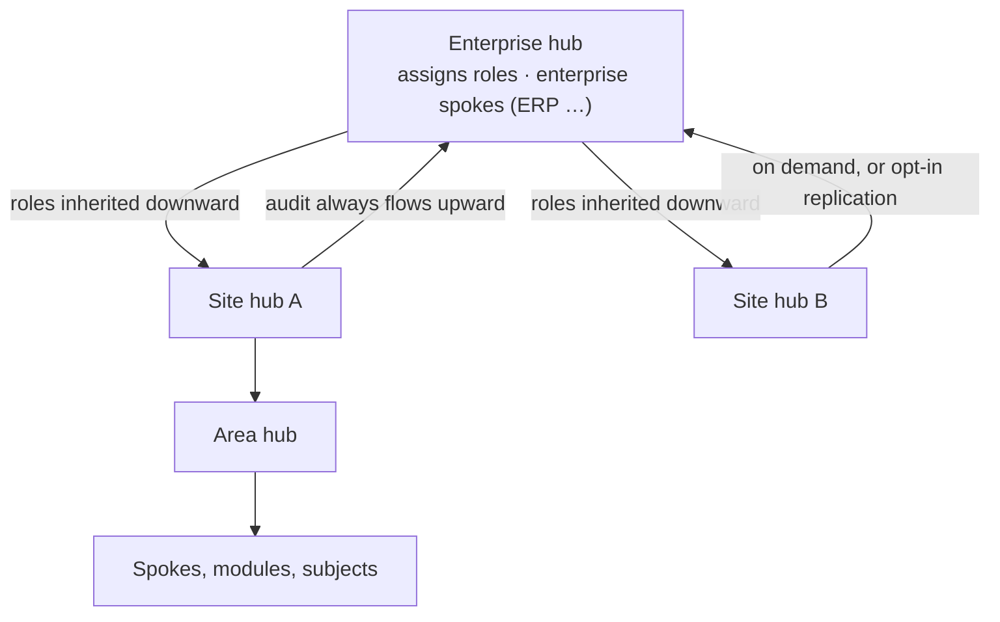

- Every hub **owns what is attached to it directly** (spokes, child hubs, subjects) and collects, governs, stores, curates and serves that data (R-13, R-14).
- Nothing communicates *through* a hub; a transfer *occurs at* it.
- Audit records always flow upward; other data is requested on demand unless a site opts into replication (R-17).
- A site keeps working when the WAN does not: full operation for the token lifetime, audit complete on reconnection.
- The time-authority chain follows the hub hierarchy (one clock, F5).
- State: no code; milestone M6.

note:
- "Solved when": a site hub runs for the full token lifetime with the enterprise unreachable, and the enterprise's audit view is complete when the link returns.

---

## Credentials and Secrets

- The hub owns the databases and issues credentials (`forge db access`, F3): a module never carries a database password it created itself; the password is printed once and never stored.
- Hub ↔ spoke traffic is TLS or mTLS in both directions with a per-spoke callback token.
- Configuration comes from `.env` files and environment variables; no credential, IP or key is hard-coded.
- gitleaks runs on every pushed commit in CI (`secrets-scan`) and before every push locally; nothing is imported into the repository without a history scan and a purge plan.

note:
- The compose stack's `changeme` defaults are development placeholders for the infrastructure containers, overridden by the environment; they are not Forge-issued credentials.

---

## The Repository Security Posture (A-9)

| Measure | State |
|---|---|
| Repository public again since 2026-10-17 (owner's decision) | ✅ |
| Secret scanning, push protection, CodeQL default setup, Dependabot (Python on the `uv` ecosystem), private vulnerability reporting, fork-PR approval | ✅ |
| gitleaks in CI on the pushed commits | ✅ |
| The 2026-10-15 import leak: credentials rotated, history purged, the purged refs with GitHub Support until GC | 🟡 ticket open |
| Non-provider patterns and validity checks (owner toggles the API refuses) | FB-044 |

- Lesson that binds: every import is scanned before it lands, and secrets never enter a commit; the PR workflow and the backlog rule exist in part because of this incident.

note:
- `docs/WHERE-WE-ARE.md` §3.10 carries the current state of the alerts and the support ticket.

---

## F8 · Honest State

| Gap | Backlog / decision |
|---|---|
| Scoped roles enforced in the gateway; reads open | FB-075, FB-007 (D-1) |
| Identity methods | R-10, not started |
| Hub of hubs, offline tokens | M6, no code |
| Security test specification (FSTS) | stub |

**Next**: landing a change.

---

<!-- SECTION F9, CONTRIBUTING -->
<!-- .slide: id="f9--contributing" -->

# F9 · Contributing

**Nav**: [← F8](#f8--security-identity-and-federation) · [⇤ TOC](#table-of-contents) · [⇅ Landing fork](#landing-fork) · [F10 →](#f10--conclusion)

Setting up, the workflow, the rules that bind, where each kind of change goes, how to add a spoke, and the governed memory that watches over the agents working here.

note:
- Source: `README.md` "Development", `docs/ROADMAP.md` §1 (A-8, A-10), `docs/PRINCIPLES.md` §9, `.github/workflows/ci.yml`, `BACKLOG.md` header.

---

## Set Up

```bash
git clone https://github.com/reh3376/forge.git && cd forge
uv sync --locked --extra dev --extra ot        # the same command CI and the hub image run
uv run pytest tests -q                         # 4,448 tests, ~1 minute
uv run ruff check . && uv run ruff format --check .   # both block CI; ruff is pinned exactly
(cd go && go build ./... && go vet ./... && go test ./...)
docker compose -f deploy/docker/docker-compose.yml up -d   # postgres, timescaledb, neo4j, redis, kafka, rabbitmq, minio
```

- Python 3.12+, uv, ruff, Docker for the services; Go 1.26 for `go/`; Node 20 only for the interim MES bridge.
- Every Python dependency is locked in `uv.lock`; `--locked` fails on a stale lock, so a dependency moves only through a committed re-lock (FB-096):

```bash
uv lock --upgrade-package fastapi    # one package, within its pyproject range
uv lock --upgrade                    # everything the ranges allow; then commit uv.lock
```

note:
- `tests/test_dependency_lock.py` holds the lock to the manifest and every installer (CI, the Dockerfile, the README quick start) to the lock.
- The hub image builds from the lock with the dependency layer before the source and the dev tooling out (`deploy/docker/Dockerfile.forge`).

---

## The Workflow (A-8)

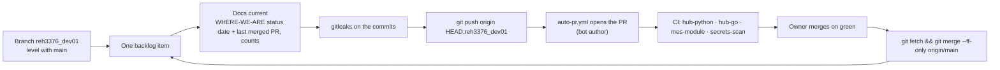

- **One backlog item per PR.** Never push the next item onto a branch with an open PR: commit locally, push after the merge.
- The PR is opened by the workflow with the bot as author, so the owner can approve it; nobody opens PRs as the owner.
- Docs-only commits may ride along with an item; everything else is its own PR.
- Conventional Commits (`feat:`, `fix:`, `docs:`, `build:`).

note:
- CI runs on every push to every branch so checks attach to the commits behind auto-opened PRs; same-repo PRs do not run twice.

---

## The Rules That Bind

| Rule | Since |
|---|---|
| **Every finding is fixed or recorded** in `BACKLOG.md`; nothing is skipped | 2026-10-15 |
| **Documentation is current before every push**: `docs/WHERE-WE-ARE.md` rows, numbers and status date, `README.md` counts, the roadmap and backlog | 2026-10-16 |
| **Only the owner approves** a spec hash (`forge governance approve --by reh3376`) and signs a design record, on their explicit word | A-9, FHTS |
| **Forge-issued passwords are printed once and never stored** | FB-057 |
| **Local models only** for the project's tooling (MDEMG/Jiminy on `mdemg-llm-v1`); never a cloud model | A-10 |
| **Nothing imported without a gitleaks history scan**; gitleaks before every push | A-9 |
| **Never `git push --force`, never `rm -rf`, never a bare `DROP` of a table, schema, index or database** in a command; the governance hook denies them | Jiminy PreToolUse |
| **A migration already applied is never edited**; a repair is a new revision | F3 |
| **Wording**: the NestJS/Next.js code is "the interim MES bridge"; forge-mes is Go | owner |

note:
- The hook is deterministic enforcement at the point of action: when a command is blocked, comply, reword minimally, surface it, never engineer a workaround.

---

## Where Each Kind of Change Goes

| You want to… | Do this |
|---|---|
| fix something you found while doing something else | finish the item; add a `BACKLOG.md` row (ID, severity, problem, where, suggested fix) if you did not fix it |
| add or change a hub route | add or update the FATS spec; the hub test holds both directions |
| add a spoke | scaffold with the module builder; write the FACTS spec; run `forge governance run facts <spoke>`; the spoke registers only when the manifest matches the approved spec |
| change a stored shape | a new migration (never edit an applied one); a test in `tests/storage/test_migrations.py` that reads the migration source |
| expose a surface from a module | an FVTS spec; the runner checks it against the render-profile baseline |
| propose a design the owner must decide | a record in `docs/decisions/` (status line, [OWNER]/[FACT]/[PROPOSED]/[OPEN], P-n proposals, Q-n questions); list it as D-n in `ROADMAP.md` §5 and the gates table; wait for the signature before implementing |
| change a governed spec | edit, `forge governance stamp`, leave it `pending_review`; the owner approves |
| bump a dependency | `uv lock --upgrade-package <name>`, commit `uv.lock` with the change |

note:
- The repository's own FACTS reference spec is `whk-wms`; the OT module is the most complete in-repo module to read for patterns.

---

## Adding a Spoke in a Day (P-5)

1. **Scaffold**: the module builder generates manifest, config, adapter, context mapper, record builder and a FACTS spec skeleton (`docs/MODULE_BUILDER.md` §3–§4).
2. **Declare**: fill the FACTS spec: identity and tier, capabilities, connection, data sources with schema references, context mapping and enrichment, error handling, sample records.
3. **Validate**: `forge governance validate-spec` then `forge governance run facts <spoke>`; fix every violation; stamp.
4. **Implement**: `collect`, `ingest`, lifecycle and health in `adapter.py`; mappers turn source rows into `ContextualRecord`s with the context the spec declares.
5. **Test**: spec tests, runner tests and adapter tests under `tests/`; the suite stays green.
6. **Register**: the hub checks the manifest against the spec at Register; with the owner's approval of the hash the spoke is live.

"Solved when": onboarding a new system is a day's work from the SDK, and a conformance failure anywhere blocks the merge, not the plant.

note:
- The spoke onboarding priority and checklist are in `docs/PRINCIPLES.md` §8; compliance plans for two external spokes are in `docs/spoke-onboarding/`.

---

## Testing Conventions

- `tests/` mirrors `src/`: 259 files, 4,448 collected; the full suite runs in about a minute on the locked dependency set.
- Migration tests read the migration source and hold it to the models and writers; they do not need a database. Behavioural verification of a migration runs on a throwaway container and is recorded in the backlog row.
- Governance tests assert schema–runner parity and run every spec through its runner; FVTS has golden messages.
- The Go suite holds the Go models equal to the Python models through one shared fixture.
- Counts in `README.md` and `docs/WHERE-WE-ARE.md` are updated with every push that changes them (`pytest --collect-only -q` for the collected count).

note:
- `-p no:cacheprovider` keeps the repository clean of `.pytest_cache`; the CI job runs the same flags.

---

## MDEMG and Jiminy · Governed Memory for the Agents

- The repository runs its own MDEMG instance (a local, graph-backed project memory) with Jiminy as the governance layer; constraints, corrections and outcomes live in the graph, not in markdown.
- The J17 handshake: identify by session, request the constraints for the task at hand, acknowledge them, act under enforcement, report the outcome.
- The **PreToolUse hook** enforces constraints deterministically at each tool call, whether or not the agent has read anything; a blocked action is the protocol working.
- Models: the local llama-server model `mdemg-llm-v1`; no cloud model, ever (A-10).
- This is problem P-7 applied to the engineering platform itself: the more AI assistance, the more the contracts and the workflow must be machine-enforced.

note:
- The vision counts the engineering platform as part of the product (`docs/VISION.md` §3.7): one item per PR, owner merges on green, findings fixed or recorded, docs current, owner-only approvals, local models, governed memory.

---

## F9 · Recap

- `uv sync --locked`, pytest, ruff, go test; the compose stack for services.
- One item, docs current, gitleaks, push, auto-PR, CI green, the owner merges, fast-forward sync.
- Findings fixed or recorded; only the owner approves and signs; passwords never stored; local models only; the hook's denials are final.
- Routes get FATS specs, spokes get FACTS specs, surfaces get FVTS specs, stored shapes get migrations, owner decisions get design records.

**Next**: where we are and where to go.

---

<!-- SECTION F10, CONCLUSION -->
<!-- .slide: id="f10--conclusion" -->

# F10 · Conclusion

**Nav**: [← F9](#f9--contributing) · [⇤ TOC](#table-of-contents) · [⇅ Landing fork](#landing-fork)

The honest state against the vision, the milestones, the decision queue, what is next, and where to go from here.

note:
- Source: `docs/WHERE-WE-ARE.md` §4–§5, `docs/WHERE-WE-ARE-GOING.md` §3–§5, `docs/ROADMAP.md` §4–§5.

---

## The Largest Gaps Against the Vision

1. **No forge-display**: the contract and runner exist; the renderer does not.
2. **No management module in Go**: the interim MES bridge stands in for forge-mes; the SDK template does not exist yet.
3. **No scoped roles in force**: the gateway's auth is off by default and the role model is still being designed.
4. **No federation**: a single hub only; no hub-of-hubs code.
5. **Seven governance frameworks are stubs or planned**; six FACTS specs await the owner's hash approval.
6. **No production deployment**: compose only.
7. **No clock discipline below the hub**: the hub is not yet a time authority for what is attached to it, the OPC-UA converter invents a source time when the server sends none, nothing refuses a wrong clock.

note:
- `docs/WHERE-WE-ARE.md` §5 verbatim in substance. Each gap has backlog ids and a decision it waits on.

---

## Milestones

| Milestone | Outcome | State |
|---|---|---|
| **M1 · Contract and governance floor** | hub ↔ spoke end to end; OT module in the hub; FATS, FACTS, FTTS, FVTS with runners and gates; FHTS hashing | **Done** (PRs through 36) |
| **M2 · Decisions and designs** | role model (D-1), forge-mes Go design (D-3), FVTS open items (D-4), OT FACTS vocabulary (D-8), one clock (D-9), OT reference FVTS spec approved | **Now** |
| **M3 · Go SDK and the first Go module** | Go module template; forge-mes phase 1 against the hub; `mod_mes`; changeover and MQTT in Go; cut-over | not started |
| **M4 · forge-display** | renderer scaffold and spike; MES surfaces first, then OT HMI | not started (needs D-4) |
| **M5 · Hub platform hardening** | Context Engine and Schema Registry (done), scoped roles, persistent access control (done), FDTS/FQTS/FSTS from stub to gate | started |
| **M6 · Enterprise** | hub of hubs, identity methods, offline tokens, Kubernetes, backups and SLOs; forge-cmms and forge-whs in Go; forge-ignition | not started |

note:
- Milestones overlap where the sequence allows: forge-display can start once D-4 is answered, in parallel with M3.

---

## The Decision Queue (owner input needed)

| # | Decision | Blocks |
|---|---|---|
| D-1 | Platform role model (Q21, Q22) | FB-075, FB-078, multi-party approval above FB-074 |
| D-3 | forge-mes Go design document | FB-076, FB-057 steps 2–5, the Go SDK scaffold |
| D-4 | FVTS open items (name, write authority per profile, mobile acknowledge, transport, layout, server-side enforcement) | forge-display |
| D-7 | Scope of the Go standard (OT module, Python adapters) | parked |
| D-8 | FACTS vocabulary for OT adapters | FB-079, approval of the OT FACTS spec |
| D-9 | One clock: which established standards to adopt; the FB-094 record recommends | FB-088, FB-090 to FB-094, the time fields and tolerances |
| D-10 | One schema registry; the FB-097 record recommends | FB-097's eight steps, the Go module's schema registration, the FDTS gate |

As of 2026-10-27 **no decision-free backlog item remains**: everything open waits on one of these or on FB-057 step 2.

note:
- A design record is signed by the owner editing its status line; implementation does not start before that.

---

## What Is Next

1. A decision session on D-1, D-3, D-4, D-8, D-9 and D-10 (owner).
2. The FB-076 design document, then owner sign-off.
3. The module SDK Go scaffold; its first consumer is the Go forge-mes.
4. FB-076 phase 1: the Go module registers, ingests and takes write-backs against the hub.
5. FB-057 `mod_mes`, with FB-004 and FB-059 as the Go module needs them.
6. FB-076 phases 2–3: changeover and MQTT, parity, cut-over.
7. forge-display scaffold and renderer spike; MES surfaces first.
8. Hub platform items (FB-007, FB-075) as the Go module and forge-display start needing them.

note:
- `docs/WHERE-WE-ARE-GOING.md` §4; the detailed sequence with dependencies is `docs/ROADMAP.md` §4.

---

## Where to Go Next

| If you want to… | Open |
|---|---|
| see the destination in full | `docs/VISION.md` |
| see what gates the route | `docs/WHERE-WE-ARE-GOING.md` §5 |
| see what exists today, component by component | `docs/WHERE-WE-ARE.md` §3 |
| pick up an item | `BACKLOG.md` and `docs/ROADMAP.md` §6 (open backlog by workstream) |
| write a spoke | `docs/MODULE_BUILDER.md`, `docs/governance/facts-developer-guide.md` |
| understand a framework | `docs/FxTS/<FRAMEWORK>.md` |
| read a decision in progress | `docs/decisions/` |
| understand why things are the way they are | `docs/PRINCIPLES.md` |

Thank you. **[Return to the landing fork ↑](#landing-fork)** · **[Continue to the End User path ↓](#end-user-path)**

note:
- Natural final Q&A anchor. The end-user path follows for anyone who wants the operator's view of the same system.

---
<!-- END USER PATH -->
<!-- .slide: id="end-user-path" -->

# U1 · Start Here · The End User Overview

**Nav**: [⇤ TOC](#table-of-contents) · [⇅ Landing fork](#landing-fork) · [U2 →](#u2--how-data-flows)

This track is for the people who will run a Forge site or decide from it: operators, supervisors, planners, maintenance and quality staff, and the managers above them. No code. Plain language. It is complete on its own.

| Section | What you get |
|---|---|
| [U1 Start Here](#end-user-path) | what Forge is for, the problems it solves for you, what it is not |
| [U2 How Data Flows](#u2--how-data-flows) | from a plant system to a screen, in six steps |
| [U3 The Hub You Run](#u3--the-hub-you-run) | what is running, how to tell it is healthy, the command line |
| [U4 Your Systems as Spokes](#u4--your-systems-as-spokes) | the connected systems and what their contracts mean to you |
| [U5 The Plant Floor](#u5--the-plant-floor) | tags, alarms, writes, changeover |
| [U6 Context, Products, Decisions](#u6--context-products-and-decisions) | why "area" means one thing, where figures come from, recording a decision |
| [U7 Governance for Users](#u7--governance-for-users) | what "approved" means and why nothing changes silently |
| [U8 Screens](#u8--screens) | what you will look at, and what you look at today |
| [U9 Identity, Roles, Credentials](#u9--identity-roles-and-credentials) | who may do what |
| [U10 Operations](#u10--operations) | how a site is run, backed up and upgraded |
| [U11 Where to Go Next](#u11--where-to-go-next) | documents, asking for a change, returning to the fork |

note:
- The dev path (F1–F10) covers the same system for engineers. Nothing here depends on it.

---

## What Forge Is, in One Paragraph

Forge sits between the systems a plant already runs on and the people who need to decide from their data. Every system (the control system on the floor, the manufacturing execution system, the warehouse, maintenance, the ERP, the historian, scanners) connects to one **hub** as a **spoke**. Every value that crosses into the hub is checked, stamped with the hub's clock, and tagged with the **context** it belongs to: which site, area and equipment, which lot and work order, which shift and operator, which operating mode. From those records the hub builds **data products** whose figures carry their sources and a stated quality, renders the screens people use from declared contracts, and records the decisions taken on them. Forge's own modules for MES, warehouse, maintenance and the plant floor are optional: a site can keep its existing software and use Forge as the layer that connects and governs it, or replace that software one module at a time.

note:
- `docs/VISION.md` §1 in plain words. "Hub" is the Forge server for a site; "spoke" is any connected system.

---

## The Problems It Solves for You

| What you live with today | What Forge does about it |
|---|---|
| A dozen systems, each with its own identifiers, units and clocks; four screens open to answer one question | every system speaks one contract to the hub; every record is one shape with context attached, so the answer is one query |
| A number on a dashboard that nobody can trace or trust | every figure carries where it came from, what was done to it and the quality it is held to |
| Setpoints written from a screen with no role check, no confirmation, no record | every write passes a defense chain in the core: validation, review, interlocks, authorization, read-back, audit |
| Each application with its own screens, its own alarm banner, its own mobile story | one rendering layer draws every screen from a declared contract, on desktop HMI, desktop, web and mobile |
| Passwords in config files; "admin or not" | the hub issues credentials and roles are scoped to what a person does, where |
| A site that stops when the link to headquarters drops | each site hub keeps working on its own; audit flows up when the link returns |
| A contract between two systems changed quietly in a commit nobody read | every contract is hashed; only the owner approves a change; an unapproved change fails before it ships |

note:
- `docs/VISION.md` §2 (P-1 to P-12) in the end-user's terms.

---

## What Forge Is Not

- **Not a PLC programming environment.** It reads and writes PLCs through OPC-UA; ladder logic and function blocks stay in the vendor tools.
- **Not an ERP, accounting or HR system.** It integrates them as spokes and may host a management module beside them; it does not replace the ledger.
- **Not a cloud service.** It is enterprise software installed per site and per enterprise, with local models for its own tooling.
- **Not a general dashboarding product.** forge-display renders Forge modules; it is not a UI framework for third parties.

note:
- `docs/VISION.md` §5.

---

<!-- .slide: id="u2--how-data-flows" -->

# U2 · How Data Flows

**Nav**: [← U1](#end-user-path) · [⇤ TOC](#table-of-contents) · [⇅ Landing fork](#landing-fork) · [U3 →](#u3--the-hub-you-run)

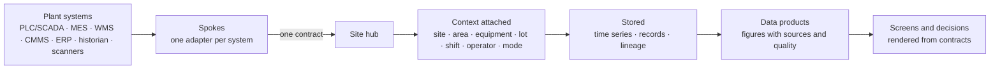

1. A **spoke** reads from or subscribes to a plant system and sends records to the hub; the hub can also ask the spoke for data on demand, backfill history, or write back into the system.
2. The hub **checks** the spoke against its contract before it is allowed in, and checks every record.
3. The hub **stamps** when the record arrived with its own clock and measures how far the spoke's clock is from its own.
4. The record gets its **context**; what the source could not say (the shift from the time, the area from the location, the lot from the active batch), the hub fills in.
5. Records are **stored** in the store that fits them; the hub owns every database.
6. **Data products** are built from the records and feed screens, decisions and, where a site chooses, training data for its own models.

note:
- Honest: today the hub measures clock offsets and warns; refusing a spoke whose clock is out of tolerance is designed but not yet enforced (decision D-9).

---

## One Record Type

Every value that enters the hub is a **contextual record**:

| Part | Holds |
|---|---|
| the value | the number, text or state, its data type and units |
| the quality | good, bad or uncertain, carried with the value, never hidden |
| the times | when it happened at the source, when the spoke sent it, when the hub received it; always UTC with its zone |
| the source | which spoke, which system, which tag or table, which version of the contract |
| the context | site, area, equipment, operating mode, lot, batch, recipe, work order, shift, operator, event |

Because every record has the same shape, "fermentation temperature of Cooker 01 during lot L-2026-0412 on the night shift" is a question the hub can answer without anyone mapping systems by hand.

note:
- Two values can be joined only if the words mean the same thing everywhere; U6 explains how "area" is kept the same.

---

## One Clock

Forge exists so that people at every level decide from the same picture, and records from different sources only line up if their timestamps come from the same master time.

- The **highest hub is the time authority**; every hub governs the clocks of the modules and spokes attached to it; every spoke governs or measures the clocks of the systems behind it.
- Every stored timestamp is **UTC with its zone**; the hub stamps receipt with its own clock; the offset of every connected clock is measured and shown.
- A hub, module or spoke **outside tolerance is refused**: warnings are not a substitute for correction.
- For a plant-floor tag, the time that counts is **when the value occurred at the device**, corrected to master time, never the poll time passed off as device time.

Where it stands: timestamps are UTC and receipt is stamped; offsets are measured and warned on. Correcting device time and refusing a bad clock are designed and wait for the owner's decision on which time standards to adopt (D-9).

note:
- The owner's principle of 2026-10-18; `docs/PRINCIPLES.md` §2.

---

<!-- .slide: id="u3--the-hub-you-run" -->

# U3 · The Hub You Run

**Nav**: [← U2](#u2--how-data-flows) · [⇤ TOC](#table-of-contents) · [⇅ Landing fork](#landing-fork) · [U4 →](#u4--your-systems-as-spokes)

What is running on a site hub, how to tell it is healthy, and the command line.

---

## What Is Running

| Component | Purpose |
|---|---|
| **forge-hub** | the hub itself: the REST API, the gRPC endpoint spokes connect to, the OT module, governance, the CLI |
| **PostgreSQL** | the hub's own tables, the data product catalogue, one schema per module |
| **TimescaleDB** | time series: every contextual record |
| **Neo4j** | lineage and topology |
| **Redis** | cache and sessions |
| **RabbitMQ** and the embedded **MQTT** broker | module events and plant-floor messaging |
| **MinIO**, **Kafka** | object store; the enterprise bus for later |

Today this runs from **Docker Compose for development**; production is a Kubernetes deployment per hub, which is not built yet (U10).

note:
- `deploy/docker/docker-compose.yml`; the hub image is built from the locked dependency set.

---

## Is It Healthy?

```bash
forge health                 # the platform's own view
curl http://<hub>/v1/health  # every component: postgres, timescaledb, neo4j, redis, kafka, rabbitmq, minio
curl http://<hub>/readyz     # ready to serve?
forge adapter list           # which spokes are registered
forge adapter status <spoke> # one spoke's state, including its clock offset
```

- A spoke's health report includes how far its clock is from the hub's; the hub's ingest statistics show offsets per link.
- The observer (health, liveness, service-level objectives, backup status) exists as a package; its objectives and alerts are a planned framework (FOTS).

note:
- `GET /v1/ingest/stats` and OpenTelemetry metrics `forge.clock.offset` and `forge.clock.out_of_tolerance` carry the clock picture.

---

## The Command Line

| Command | Does |
|---|---|
| `forge version`, `forge health`, `forge init` | version, health, a new instance |
| `forge adapter list`, `forge adapter status <id>` | registered spokes and their state |
| `forge governance specs [--pending]` | every contract's approval state; what awaits the owner |
| `forge governance run <framework> <spec>` | run one contract's checks |
| `forge migrate up`, `status`, `down` | apply, show or roll back database migrations |
| `forge db access grant / revoke / list / issue` | give a module access to a schema and hand it a credential, printed once |

note:
- Approving a contract (`forge governance approve`) is the owner's command alone (U7).

---

<!-- .slide: id="u4--your-systems-as-spokes" -->

# U4 · Your Systems as Spokes

**Nav**: [← U3](#u3--the-hub-you-run) · [⇤ TOC](#table-of-contents) · [⇅ Landing fork](#landing-fork) · [U5 →](#u5--the-plant-floor)

Which systems connect, and what the contract behind each one means to the people who depend on it.

---

## The Connected Systems

| Spoke | System | What it brings |
|---|---|---|
| whk-wms | warehouse management | inventory, movements, receipts; 14 data sources |
| forge-mes | manufacturing execution (the interim bridge today, the Go module to come) | orders, batches, recipes, changeover, audit; 18 sources |
| whk-cmms | maintenance management | equipment, work orders, maintenance events |
| whk-erpi | ERP integration (NetSuite) | master data, orders, finance |
| whk-nms | network management | the plant network's topology and health |
| bosc-ims | aerospace inventory | parts and stock over gRPC |
| next-trend | time-series historian | archived process history, bulk backfill |
| scanner-gateway | Android barcode scanners | scans as events |
| ot-module | the plant floor: OPC-UA, MQTT, alarms, control writes, scripting | tags, alarms, writes; 21 sources |

Vendor SCADA (Ignition) runs in parallel behind a bridge while the OT module proves parity; Jython middleware scripts are being migrated to the Forge scripting SDK.

note:
- `README.md` "Connected Spokes" and "FACTS Specs". Generic adapters for REST, CSV files, MQTT Sparkplug and OPC-UA are planned for systems without a dedicated spoke.

---

## What a Contract Means to You

Each spoke has a **FACTS specification**: what the system is, what it is allowed to do (read, be written to, backfill, subscribe), how it connects, what data it provides, how each field maps to Forge context, and what happens on errors.

- **The spec is the contract.** If the spoke does not match its spec, it cannot connect.
- **Approval state** is visible: `forge governance specs` shows whether each contract is approved by the owner, pending review after a change, or modified without review.
- **A change on either side fails the gate before it fails production.** If a vendor upgrade changes the data a system sends, the contract check catches it in the hub, not on the floor.

| Contract | State today |
|---|---|
| whk-wms, forge-mes, bosc-ims | approved |
| whk-cmms, whk-erpi, whk-nms, next-trend, scanner-gateway | pending the owner's review after a re-stamp |
| ot-module | pending; fails schema validation until the OT vocabulary decision |

note:
- "Pending" does not mean broken: the runner passes the checks; the owner has not yet re-approved the hash after the specs were corrected.

---

<!-- .slide: id="u5--the-plant-floor" -->

# U5 · The Plant Floor

**Nav**: [← U4](#u4--your-systems-as-spokes) · [⇤ TOC](#table-of-contents) · [⇅ Landing fork](#landing-fork) · [U6 →](#u6--context-products-and-decisions)

Tags, alarms, writes and changeover: how Forge reaches equipment, and why a screen can ask for a write but never make one.

---

## Tags

- A **tag** is a named value from the floor: a temperature, a valve state, a counter. Forge reads tags through OPC-UA and keeps them in a tag engine with eight kinds of source: direct reads, scheduled polls, in-memory values, calculated expressions, SQL queries, virtual and derived values, and events.
- Every tag value carries a **quality**: good, bad or uncertain; a bad value is shown as bad, never as a plausible number.
- Tags carry **context**: the equipment and area they belong to, the lot and operating mode at the time.
- Tag paths are normalised across OPC-UA, Ignition and Forge, so a tag keeps its identity through a migration.

note:
- Honest: today a tag's source time is what the OPC-UA server sends; correcting it to the master clock by the device's measured offset is designed (D-9) and not yet built.

---

## Alarms

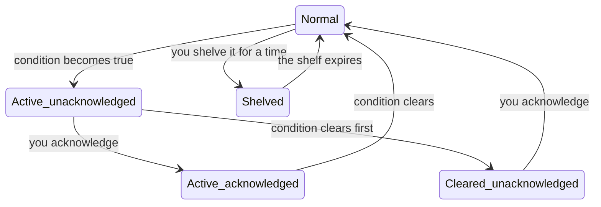

- Alarms follow the **ISA-18.2** standard: the states above plus "suppressed by design" and "out of service"; nine alarm types (high, high-high, low, low-low, digital, rate of change, quality, communication, custom).
- Every alarm event is journaled; active alarms and history are available to screens and to other systems: an alarm can publish to the plant message bus, and a maintenance alarm can **open a CMMS work order automatically**.
- How alarms look (colours, sounds, priority) is the screen layer's job from a declared contract, the same on every screen.

note:
- `src/forge/modules/ot/alarming`; presentation follows ISA-101 in forge-display when it exists.

---

## Writing to Equipment · From the Operator Seat

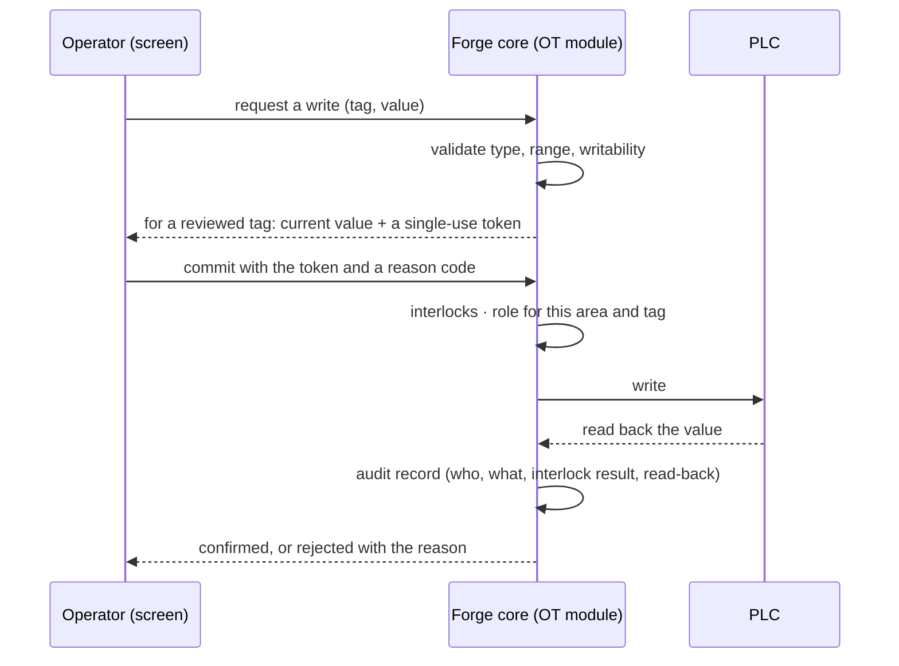

- **A screen asks; the core decides.** No path exists from any interface to a PLC that does not pass validation, review, interlocks, authorization, write with read-back, and audit.
- Some tags require **two-step review**: the core shows you the current value and gives you a one-time token; the commit must present the token and a reason from the site's own list.
- **Interlocks** block writes when a condition is unsafe; only an administrator can bypass one, with a reason that is recorded.
- Every write is **reconstructible from the audit log**: who, what, when, which interlocks were evaluated, what the equipment read back.
- Whether a screen may write at all depends on the kind of screen: a desktop HMI may; a web page or a phone may not.

note:
- Multi-party approval (two people) for certain writes is designed and waits on the role model (D-1).

---

## Changeover

- The OT module runs the **MES changeover** sequence: the recipe from the manufacturing system becomes a batch of PLC writes, each through the defense chain, driven by the CIP runner against the PLC.
- Operators confirm start, retry a recipe, resume or restart a connection through hub endpoints that require the right scope; the hub user is recorded as the actor on the MES write, the audit record and the events.
- Vendor SCADA can run in **parallel** during a migration: the bridge polls the vendor system and the dual-write validator proves the two agree before a cut-over.

note:
- Today the manufacturing system on the other side is the interim MES bridge; the Go forge-mes module takes over the changeover later.

---

<!-- .slide: id="u6--context-products-and-decisions" -->

# U6 · Context, Products and Decisions

**Nav**: [← U5](#u5--the-plant-floor) · [⇤ TOC](#table-of-contents) · [⇅ Landing fork](#landing-fork) · [U7 →](#u7--governance-for-users)

Why "area" means one thing everywhere, where a figure comes from, and how a decision is recorded so its cost can be learned.

---

## Context · Why Area Means One Thing

- A value like `TIT_2010 = 61.2` is useless until you know it is Cooker 01's temperature, in the Granary area, during lot L-2026-0412, on the night shift, in Cooking mode. Historians store values; context used to live in people's heads.
- In Forge, context is **declared per spoke** (which source field is the equipment, which is the lot) and **defined once** for the whole platform in a manufacturing entity catalogue following the ISA-95 hierarchy: enterprise, site, area, line, cell, equipment; material items, lots, production orders.
- The hub **enriches** what the source cannot say: the shift from the timestamp, the area from the location, the lot from the active batch.
- A record missing required context is not stored silently; what is required is declared per spoke and checked by its contract.

note:
- `docs/core/manufacturing-entity-catalog.md`; the Context Engine serves the vocabulary under `/v1/context`.

---

## Data Products · Where a Figure Comes From

| A data product has | So that |
|---|---|
| a **version** | consumers know which definition they are reading |
| a **quality objective** | "good" is stated, and shown beside every figure |
| **lineage** | each figure traces back through each transformation to the raw records |
| a **curation recipe** | the hub builds and runs the same pipeline on every new record |
| an **owner** and a status | somebody answers for it; draft, published, deprecated |

Normalisation happens before comparison: units are converted, time is aligned, and a comparison declares its basis or says "unnormalised". Aggregate views link to the segmented views beneath them, so a trend cannot hide the operating condition that explains it.

note:
- `docs/VISION.md` P-3; the research basis on decision error is `docs/PRINCIPLES.md` §4.

---

## Recording a Decision

A confidently wrong decision costs more than the data problem that caused it, and its cost is spread across many shifts and units. Forge treats the decision as a record.

For significant decisions (capital allocation, process changes, root-cause conclusions, vendor selection, quality dispositions) the system records a minimum frame: what is being decided and why now; the current hypothesis with evidence links; **challenging evidence, required**; alternative hypotheses; key assumptions with a confidence; missing information; risk if wrong; opportunity if right; existing controls and **evidence they work, required**; a reassessment trigger; and a named owner.

- Every assumption is tracked; new data that contradicts one alerts its owner and the owners of every decision that relied on it.
- Outcomes are observed against the decision, so what was known, what was decided and what happened can be replayed.

Where it stands: the decision and assumption models exist in the hub; the decision-support workflow around them is not built yet.

note:
- `docs/PRINCIPLES.md` §4; `docs/VISION.md` P-9.

---

<!-- .slide: id="u7--governance-for-users" -->

# U7 · Governance for Users

**Nav**: [← U6](#u6--context-products-and-decisions) · [⇤ TOC](#table-of-contents) · [⇅ Landing fork](#landing-fork) · [U8 →](#u8--screens)

What "approved" means, why nothing changes silently, and the owner's role.

---

## Contracts, Not Promises

- Every interface in Forge is a **specification**: what a spoke may do, what a hub route returns, what a screen shows and which action needs which role, how transport is secured.
- The specification is checked by a **runner** and enforced as a **gate**: a change that breaks a contract is stopped before it is merged, not discovered on the floor.
- Specifications are **hashed**. Each carries its hash, its state and a history of who or what changed it.

| State | Meaning |
|---|---|
| `approved` | the owner approved this exact content |
| `pending_review` | the content was changed (by a person or an AI agent) and re-stamped; it awaits the owner |
| `modified` | the content no longer matches its hash; nothing trusts it until it is stamped and approved |
| `reverted` | rolled back to a previous approved hash |

- **Only the owner approves.** AI coding agents working on the platform can propose and stamp; they can never approve, and the hub checks the hash before trusting a contract.

note:
- `docs/FxTS/README.md` and `docs/PRINCIPLES.md` §3; the command is `forge governance specs --pending`.

---

## Why This Matters to You

- A spoke whose contract was relaxed without approval **cannot register**.
- A route that stopped returning what its contract says **fails the build**.
- A screen that tries to write from a profile that may not **fails the view contract**.
- The platform's own engineering is governed the same way: one item per change, every finding recorded, documents current before every change ships, owner-only approvals, and a governed memory for the AI agents that work on the code.

note:
- Problem P-7 in `docs/VISION.md`: the more AI assistance a team uses, the more the contracts must be machine-enforced.

---

<!-- .slide: id="u8--screens" -->

# U8 · Screens

**Nav**: [← U7](#u7--governance-for-users) · [⇤ TOC](#table-of-contents) · [⇅ Landing fork](#landing-fork) · [U9 →](#u9--identity-roles-and-credentials)

What you will look at, and what you look at today.

---

## One Renderer, Four Kinds of Screen

In the finished system no module ships its own screens. A module **describes** what it has (points with units and ranges, alarms, actions with the role and confirmation each needs, surfaces) and **forge-display** renders it on four profiles:

| Profile | Rate | May write? | Alarms |
|---|---|---|---|
| desktop HMI (the control room, kiosk) | 20 Hz | yes | all operations |
| desktop app | 10 Hz | no | acknowledge only |
| web | 4 Hz | no | view |
| mobile | 1 Hz | no | view |

- A module may make a screen stricter than the baseline, never looser.
- Stale values are marked, bad quality is shown, alarms are annunciated and styled by one standard (ISA-101), and every action shows its result with the audit confirmation.

note:
- `docs/VISION.md` P-8 and §3.4; the contract is FVTS.

---

## What You Look at Today · Honest

- **forge-display does not exist yet.** Its contract (FVTS), the checker, a render-profile baseline, a reference renderer and example messages do; the renderer waits on the owner's answers to its open questions (D-4).
- The manufacturing system's screens today are the **interim MES bridge's** own web frontend, imported with it; they will be retired when forge-display renders the MES surfaces.
- Plant-floor screens today are the vendor's (Ignition) where a site keeps them; the OT module serves the data behind them and its REST interfaces.

note:
- Milestone M4 is the renderer; MES surfaces first, then the OT HMI surfaces.

---

<!-- .slide: id="u9--identity-roles-and-credentials" -->

# U9 · Identity, Roles and Credentials

**Nav**: [← U8](#u8--screens) · [⇤ TOC](#table-of-contents) · [⇅ Landing fork](#landing-fork) · [U10 →](#u10--operations)

Who may do what, where, and how systems get their credentials.

---

## Identity and Roles

- **Your installation chooses how people sign in** (single sign-on with OpenID Connect, local accounts, LDAP or Active Directory, SAML), and **Forge decides what a signed-in identity may do**.
- **Roles are scoped**: a role says what you may do in which area, on which equipment, in which module. "Operators in the distillery may acknowledge alarms there and see nothing from the ERP" is a configuration, not a program.
- Roles **constrain what you can read** as well as what you can do.
- **Separation of duties** is evaluated by the hub: two-step review on a write, an interlock bypass with a recorded reason, approvals.
- In a multi-site enterprise, roles are assigned at the managing hub and inherited by sites; a site keeps verifying sign-ins while the link to headquarters is down.

Where it stands: the role model is designed and awaits two owner decisions; the hub's authentication is off by default in development, and scoped roles on every route are not yet enforced.

note:
- `docs/decisions/roles.md` (R-1 … R-17); `docs/WHERE-WE-ARE.md` §3.10.

---

## Credentials

- **The hub owns the databases.** A module never carries a database password it created itself: the hub grants a module access to its own schema and hands it a credential that is **printed once and never stored**; re-issuing rotates it.
- Hub ↔ spoke traffic is encrypted both ways with certificates, and each spoke has its own token.
- Every grant, every issued credential and every refusal is in the hub's access audit.

note:
- `forge db access` in U3; the design is `docs/DB_ORCHESTRATION_FRAMEWORK.md`.

---

<!-- .slide: id="u10--operations" -->

# U10 · Operations

**Nav**: [← U9](#u9--identity-roles-and-credentials) · [⇤ TOC](#table-of-contents) · [⇅ Landing fork](#landing-fork) · [U11 →](#u11--where-to-go-next)

How a site is run, upgraded and, in time, backed up.

---

## Running a Site · Honest

| Concern | Today | Planned |
|---|---|---|
| Deployment | Docker Compose, development only | Kubernetes per hub (P-12) |
| Health | `/v1/health` probes every component; `/readyz` | service-level objectives and alerts (FOTS) |
| Upgrades | `forge migrate up` applies versioned database migrations; a migration is never edited after it is applied | an upgrade procedure per hub |
| Backups | none | scheduled backups of every store and a restore procedure |
| Clock | offsets measured and warned | enforcement, device-time correction (D-9) |
| Multi-site | one hub | hub of hubs with upward audit and offline operation (M6) |

- "Solved when": a site hub can be stood up, upgraded and restored from backup by procedure, and its objectives are visible.

note:
- `docs/WHERE-WE-ARE.md` §3.11; the K8s decision is recorded as owner's note.

---

<!-- .slide: id="u11--where-to-go-next" -->

# U11 · Where to Go Next

**Nav**: [← U10](#u10--operations) · [⇤ TOC](#table-of-contents) · [⇅ Landing fork](#landing-fork)

| If you want to… | Open |
|---|---|
| read the full definition and the problems it solves | `docs/VISION.md` |
| see what exists today, component by component | `docs/WHERE-WE-ARE.md` |
| see the route and what gates it | `docs/WHERE-WE-ARE-GOING.md` |
| understand a contract family | `docs/FxTS/<FRAMEWORK>.md` |
| see which contracts await approval | `forge governance specs --pending` |
| ask for a change or report a problem | a row in `BACKLOG.md`: every finding is recorded, never skipped |
| see the decisions the owner is weighing | `docs/ROADMAP.md` §5 and `docs/decisions/` |

Thank you. **[Return to the landing fork ↑](#landing-fork)** · **[Start the Software Dev path ↑](#f1--opening)**

note:
- The end-user path is complete for operators by design: nothing above sends you into the dev path for a topic.
